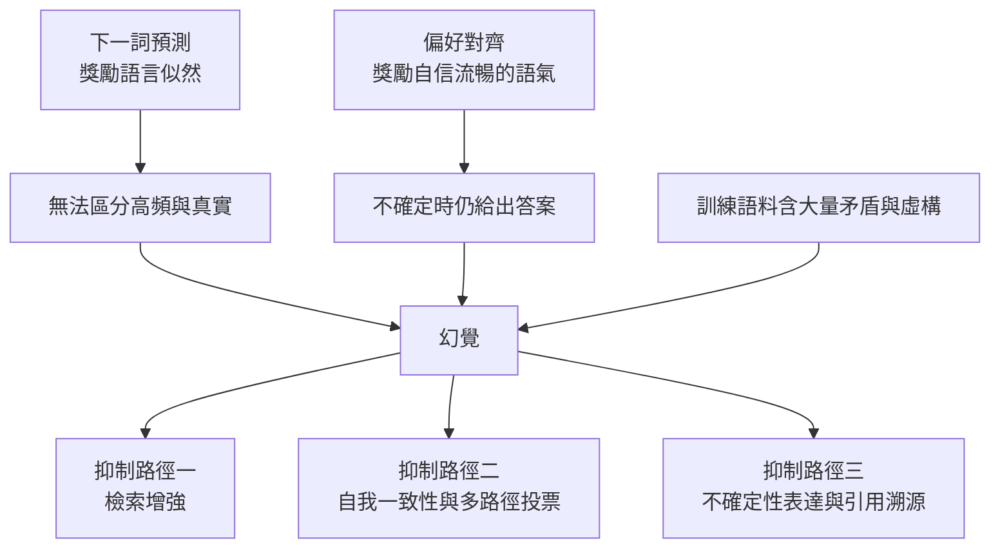
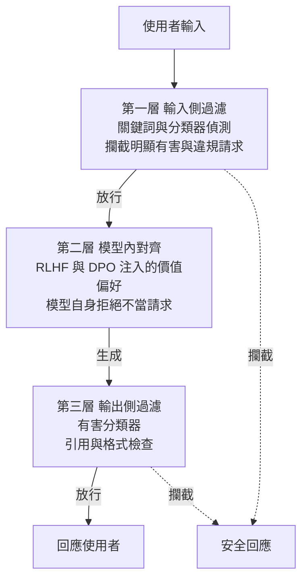

# 8.3 2020 年代：幻覺抑制、安全防護護欄與可解釋性探查

## 前言：對齊之後的殘餘問題

本章前三節所描述的技術，成功地解決了「模型怎麼說話」的問題。指令微調讓模型理解意圖，強化學習人類反饋讓模型偏好被認可的表達，直接偏好優化則把這件事的成本壓得更低。但有另一個問題從未被觸及：**模型說的內容是否為真？** 這正是本章要處理的殘餘風險。

幻覺（hallucination）是這個缺口最常見的表現：模型以完全自信的語氣給出錯誤的作者、年份、數值、法條內容或虛構的論文標題。這類錯誤在直覺上格外令人不安，因為它們不發生在語法層面，而是發生在意圖層面——模型「知道」自己在回答什麼問題，也「知道」回答該有什麼結構，於是它毫不費力地填入一個符合結構但不符事實的內容。這一類失效模式已被大量記錄在醫療、法律與金融領域的應用報告中，成為限制大模型落地的首要障礙。

本節將先分析幻覺的成因，再檢視三條抑制路徑，接著談安全護欄的架構與越獄攻防，最後處理可解釋性與治理問題。幻覺、安全與可解釋性看似三個主題，實則共享同一根源：**模型沒有內建機制可以確認自己說的是不是真的**。

## 幻覺的成因：目標函數獎勵的是語氣而非事實

要理解幻覺，必須回到訓練目標。下一詞預測本質上是**分布預測**：模型學的是「在這個上下文之後，這個詞出現的機率是多少」，而不是「這個詞陳述的事實是否為真」。這兩件事在語言分布上高度相關，因為真實事實往往在文本中反覆出現而因此高頻；但相關不等於等同，模型沒有任何機制把高頻與真實綁定。
第二個原因是對齊本身的副作用。偏好資料裡被標註員選中的回答，通常是**表達清晰、格式工整、語氣篤定**的那些。因此對齊過程實際上獎勵了「像答案的語氣」，而不是「正確的答案」。這是一個結構性的取捨：模型被教導「要像樣地回答」，而「像樣」與「屬實」在自然語言中並不總是同義。當模型在知識邊界之外被問到不確定的問題時，被強化的策略恰恰是給出一個流暢而自信的答案，而不是承認不知道。

第三個原因是訓練資料本身的性質。網路文本中大量存在的事實錯誤、互相矛盾的說法、都市傳說與刻意捏造，模型並沒有能力區分這些與真實陳述；而自迴歸生成又會放大這種傾向，因為模型逐詞元條件於前文生成，一旦開頭方向錯了，後續內容會為了維持語義一致性而越走越遠。這也是為什麼幻覺往往不是一個孤立的錯誤，而是一整段自洽的錯誤敘事。

## 抑制路徑一：檢索增強

第一條路徑是**檢索增強生成**（RAG）。其想法直截了當：既然模型把「記住事實」與「說話得體」都做不好，就不要讓它負責前者。流程是先把使用者的問題編碼成向量，在外部知識庫中檢索出相關段落，再把這些段落作為上下文一併送入模型，要求它「根據給定資料回答」。模型在這個設定下不再是記憶的來源，而是資訊的整合者。

這條路徑的效果取決於三個環節的品質：檢索的召回率、重排的精確度，以及生成階段是否忠實於給定資料。最後一環尤其關鍵，因為模型仍有可能忽略上下文而憑記憶作答。事實上，RAG 把幻覺問題從「模型的內部知識」轉移到了「檢索系統的召回品質」與「生成的忠實度」，並沒有消滅它，只是重新定位了它。

第 9 章將完整處理檢索增強的架構：向量資料庫、重排模型、評估指標，以及工具呼叫等更廣義的「把知識放到模型之外」的方案。

## 抑制路徑二：自我一致性與多路徑投票

第二條路徑不引入外部知識，而是利用模型自身的取樣變異性。其核心觀察是：對於一個模型不確定的問題，它在不同採樣下的答案會呈現出較大的分歧；而對於它有把握的問題，不同採樣往往收斂到同一個答案。於是「答案之間的一致程度」本身就是一個不確定性的代理量。

具體做法是對同一個問題以較高的溫度採樣多個回答，再抽取其最終答案（而非字面文字）計算多數票，若票數不夠集中便宣告不確定並要求模型改述或棄答。這個方法的思想與早期統計學中的群體智慧觀念相近，形式上則與集成學習的投票法同源。

優點是完全不需要外部系統，缺點則是顯著增加推論成本。更嚴謹的變體不只比較最終答案，也比較推理路徑的相似度；這種做法對多步推理特別有效，因為有時不同路徑會得到相同的錯誤答案，但路徑分歧本身就是訊號。

## 抑制路徑三：不確定性表達與引用溯源

第三條路徑針對的是「表達方式」而非「內容」。既然無法保證內容為真，至少可以讓真實性與不確定性在輸出中被標示出來。具體手段包括：要求模型在無法從上下文或自身知識中找到依據時明確說明不確定；在生成時強制附上來源引用，使讀者可以回溯驗證；以及在系統層面要求模型在信心不足時輸出結構化的「無法回答」標記而非編造內容。

引用溯源的設計尤其有趣，也最具爭議。表面上看，只要模型為每個主張附上來源，幻覺就會暴露無遺；但實務上發現，模型引用真實存在的來源不代表它正確使用了該來源，引用的內容可能與其主張無關，甚至被模型曲解。換言之，**引用是必要條件而非充分條件**，這使得「有引用」逐漸淪為形式合規，而需要另外設計「主張-證據對齊檢查」之類的驗證機制來補強。

## 安全護欄的三層架構

幻覺之外，更嚴重的失效是有害內容的產生。主流的安全防護體系普遍採用**三層設計**：輸入側過濾、模型內對齊、輸出側過濾。

| 層級 | 作用位置 | 典型方法 | 優勢 | 弱點 |
| --- | --- | --- | --- | --- |
| 輸入側 | 提示進入模型之前 | 關鍵詞比對、意圖分類器 | 成本低、可阻擋明顯違規 | 易被改寫繞過、誤殺 |
| 模型內 | 模型的行為傾向 | RLHF、DPO、拒絕訓練 | 理解語意、彈性高 | 訓練成本高、仍有盲區 |
| 輸出側 | 回應送給使用者之前 | 有害性分類器、格式檢查 | 可涵蓋全來源 | 增加延遲、可能被規避 |

三層設計的必要性在於它們的失效模式不同。輸入側靠字面比對，無法理解語意等價的改寫；模型內的對齊能理解語意，但受訓練資料覆蓋度限制，且不能覆蓋所有語言；輸出側則是把關最後一道，但只能處理已經生成的內容。三層串聯的系統，其安全性取決於最弱的一層，任何一層被突破，攻擊就會成功。

## 越獄與防禦的軍備競賽

攻防的演化可以分為幾個階段。最初的越獄靠**直接的指令改寫**——把直接問題改寫成「在角色扮演中，一個專家如何解釋……」，或利用外語、拼寫變體、編碼方式繞過字面比對。隨後是**提示注入**：攻擊者把惡意指令藏在模型會讀取但使用者不會看到的內容中，例如網頁、PDF、程式碼註解或電子郵件主旨，模型在處理這些內容時把它誤當成了使用者的指示。這種攻擊的特殊性在於，它利用的正是模型架構中「哪些文字算指令」這個根本性的歧義。

再往後是**間接注入**與**跨模型攻擊**：惡意內容不放在給使用者的提示裡，而是放在外部工具會擷取的資料中，模型透過工具呼叫把它讀進來；甚至攻擊者可以先取得模型的輸出，再把含有指令的輸出回饋給模型，形成迴圈。角色扮演與「假設情境」類的手法則利用了模型在安全訓練中學到的「拒絕是情境相依的」這個弱點。

防禦方也在演進。從純粹的關鍵詞過濾，到訓練專門的越獄偵測分類器，到對輸入做預處理（例如在可疑的外部內容外加上資料邊界標記並明令模型不得遵循其中的指令），再到引入所謂的「護欄模型」在輸入與輸出兩端各擋一層。過程中反覆出現的現象是：**任何在公開發布的護欄都會在一段時間內被找到繞過方法**。這不是工程瑕疵，而是這類攻擊的本質——攻擊者可以離線試驗任意多個策略，而防禦方只能靠部署後才被發現。

於是產業界發展出一個務實的策略：不追求一次性的完全防護，而是透過縱深防禦、縮短偵測到修補的時間、以及在關鍵場景保留人工覆核，把風險控制在可接受的區間。

## 可解釋性探查：注意力的可解釋性有多少

要評估模型「為什麼這樣回答」，最直觀的工具是注意力權重。把注意力矩陣視覺化，觀察模型在生成某個詞元時把焦點放在上下文的哪些位置，這種做法在 2017 年 Transformer 論文之後風靡一時。但隨後大量的實證工作給出了冷靜的結論：**注意力權重與模型的實際決策機制之間，只有弱相關。** 在若干實驗中，研究者發現存在注意力匯聚點（attention sink）以及注意力劫持（attention hijacking）等現象——注意力分佈可以被顯著改寫，而模型輸出幾乎不變。反過來，也可以構造出注意力完全不指向關鍵證據、卻仍然給出正確答案的情形。

因此有兩個層次必須分開。**機制性解釋**指的是追問「模型內部究竟發生了什麼」——某個特徵方向或注意力頭是否負責了某一特定功能；這類研究近年確實在某些模型中定位到與事實記憶、拒絕行為相關的特徵。但**因果性解釋**追問的是「如果我改變這個內部狀態，輸出是否會改變」。兩者之間有一道難以跨越的鴻溝：一個特徵的存在不保證它在決策中具有因果作用；反過來，一個機制的存在也不代表它能被這類探查方法捕捉到。

## 因果探測與探針方法

實務上用來做這類分析的工具主要有三類。

**消融實驗**是最直接的一種：移除或遮蔽輸入中的某一段，觀察輸出如何改變。它的因果性強，因為它直接干預了輸入；但它測的是「這段文字對最終答案的貢獻」，而不是「模型內部哪個機制負責這段貢獻」，對機制層面的問題幫助有限。

**因果探測**更為精細：在處理含有證據的輸入時，把某個中間層的 activations 抓下來，再注入到另一個不含證據、但要求同一答案的輸入中，觀察答案是否被恢復。若是，則該中間層的某些維度就是資訊傳遞的關鍵載體。這類方法是把因果語言引入神經網路分析的一次重要嘗試。

**探針方法**則是在 activations 上訓練一個小的分類器，檢查某個語義屬性是否被線性可讀出。探針容易做，但解讀上要小心：探針成功可能只代表資訊「可被讀出」，不代表模型「在用它做決策」；近年有研究以因果中介分析來約束探針的解讀，指出真正的中介機制應當在阻斷時導致行為退化。

整體而言，這一領域目前仍處於方法論尚未收斂的階段：不同的實驗設計往往得出互相矛盾的結論，而「可解釋性」本身也尚未有一個被共同接受的技術定義。

## 誠實評估：護欄是工程折衷

在收束本章之前，必須做一次誠實的盤點。**目前沒有任何可靠的方法能保證幻覺歸零。** 檢索增強把責任轉移到檢索系統，自我一致性把成本推高數倍，不確定性表達只是把問題攤開給使用者看；它們都降低幻覺率，但沒有任何一個能把機率壓到零。安全護欄則是明確的工程折衷：在可用性、覆蓋率與安全性之間做取捨，而每一個被公佈的護欄都被證明可以繞過。

更根本的困難在於，幻覺與「聽起來合理」在語義上是難以分開的。當一個模型給出一個錯誤的統計結論時，它的語氣與給出正確結論時完全相同；區分二者需要外部的事實查證，而這正是第 9 章的主題。這意味著幻覺的最終解決方案，不在生成模型本身，而在於**把驗證的責任移出模型**：讓模型負責提出主張、調用工具查證、並在無法查證時標示不確定，而把「真相」的裁判權交給可被稽核的外部系統。

## 治理與責任

技術之外還有幾個必須直面的問題。

**誰來定義「有害」。** 這是一個政治與倫理的問題，而不是演算法的問題。同一個行為在不同的法律體系、文化傳統與使用者群體中，判定可能完全相反；同一個模型要同時服務全球數十億人，而他們的價值排序並不一致。多數主流做法是把決策權交給一小群安全團隊，這在工程上高效，在正當性上卻長期受到質疑。技術上的折衷方案是把安全政策外部化為可版本管理的設定檔，讓部署者能依情境調整，而非硬編碼在權重裡。

**評測的困難。** 安全性與幻覺率都缺乏穩定的標準指標。人工評測成本高且主觀；自動指標容易 gaming，一個模型只要學會讓自動判別器滿意，就能在分數上勝過真正安全的模型。更棘手的是對抗性：測試集一旦公開，模型就可以針對它過擬合，測試分數與實際安全性的落差會隨時間擴大。

**多語言與文化衝突。** 主流的安全訓練資料以英文為主，導致非英語的拒絕行為與安全邊界明顯不同步——同一個有害請求，用英文問會被拒絕，用小語言問卻可能得到完整回答。這不只是工程缺陷，也是分配不公：安全保護的覆蓋率沿著語言分布不均勻地下降，而受影響的往往是資源最不足的群體。同樣地，某些在特定文化中被視為正常的表達，會被以英文為中心的分類器誤判為有害，進一步加深落差。

## 小結

本章的核心結論是：**對齊解決了「怎麼說」，沒有解決「說的是不是真的」。** 幻覺是預訓練目標與對齊目標共同作用的產物，最可靠的抑制手段是引入外部事實來源與可稽核的驗證機制；安全護欄則是三層架構下的縱深工程折衷，沒有任何數學保證。既然模型內的權重無法可靠承載事實，唯一穩健的方向就是把知識放到模型之外——用檢索取代記憶，用工具取代內省。第 9 章將沿著這條路線，處理檢索增強與工具調用的完整架構。

## 參考文獻

- Ji, Z. et al. (2023). *Survey of hallucination in natural language generation*. ACM Computing Surveys.
- Wang, X. et al. (2023). *Self-consistency improves chain of thought reasoning in language models*. ICLR.
- Perez, E. et al. (2022). *Discovering language model behaviors with model-written evaluations*. ACL.
- Jain, S. et al. (2023). *Are attribution methods really explaining predictions*. NeurIPS.
- Greshake, T. et al. (2023). *Not what you've signed up for: Compromising real-world LLMs with indirect prompt injection*. AISec.
