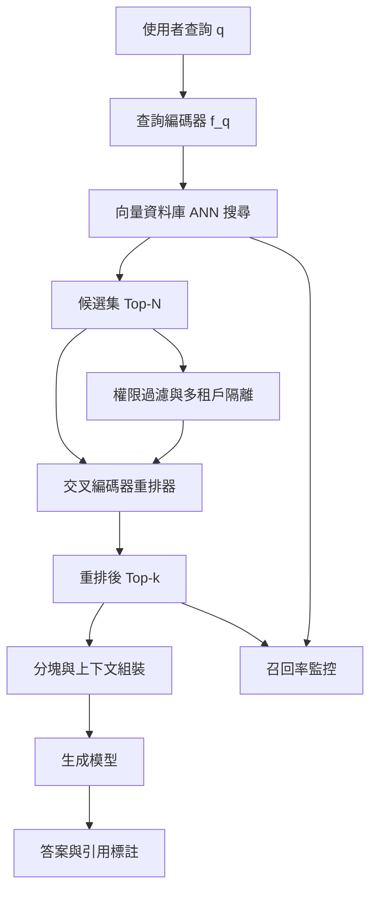

# 9.1 2020 年代：檢索增強生成（RAG）與向量資料庫重排架構

## 一、記憶的最後堡壘：參數化知識的四重侷限

在前八章的敘事裡，語言模型的記憶能力一直沿著「把記憶塞進權重」這條路徑推進：從 n-gram 的計數表，到詞向量矩陣，再到 Transformer 的權重與上下文視窗。容量越滾越大，成本也越滾越大。然而到了 2020 年代前後，這條路徑撞上了一堵牆。牆不是技術上的，而是結構性的，它由四個彼此糾纏的侷限所構成。第一個是**知識截止日期**：權重在預訓練結束那一刻便凝固，此後的新軟體版本、財報、法條修正都不在參數裡。第二個是**更新成本**：要把新知識寫進權重，就得上一次近完整的預訓練，代價以千萬美元計且動輒數月。第三個是**不可引用**：模型「知道」某個事實時，權重裡存的並非一篇可指名的文件，而是彌散在數十億參數中的統計痕跡，我們無法指出「出處在第 312 頁」。第四個是**私域不可達**：企業內部手冊、工單系統、客戶合約從未出現在公共語料裡，模型再大也無從得知。這四項限制合起來構成本章的起點：知識必須離開模型，放到模型之外。

一旦把知識外置，接下來的問題就變得尖銳而具體：**模型如何取得它不知道的東西，並且用得可信？** 這個問題的直覺答案在 2020 年之前就已經零星出現——最早的檢索式問答系統（IBM 的 Watson、搜尋引擎的片段摘要）都做過類似的事——但只有當生成式語言模型出現後，「以自然語言生成最終答案」這件事才讓外部檢索第一次成為語言模型系統的**核心組件**，而非前置的搜尋框。2020 年，Patrick Lewis 及其在 Facebook AI Research 的同事發表〈Retrieval-Augmented Generation for Knowledge-Intensive NLP Tasks〉，把這件事系統化地提出來：把「參數化的序列到序列生成器」與「非參數化的可微分密集索引」串接成一條可微的端到端訓練路徑，並在開放域問答、對話式問答、事實性知識補全等任務上取得當時的最好成績。這篇論文是檢索增強生成（RAG）這個術語的正式來源，也確定了此後整個領域的問題結構。

## 二、RAG 的三元結構：檢索、增強、生成

Lewis 等人的框架之所以重要，是因為它把「外部記憶」拆成了三個可以分別設計、分別量測、分別失敗的環節。第一環是**檢索（Retrieval）**：把使用者查詢 $`q`$ 轉成一個向量，丟進一個龐大的文件索引，找出最相近的 $`k`$ 份文件。第二環是**增強（Augmentation）**：把檢索到的文件片段與原本的查詢一起拼裝成擴充後的輸入，通常是「查詢 + 檢索文件的序號標記 + 文件內容」的串接。第三環是**生成（Generation）**：把這段擴充輸入餵給生成模型，讓它以自然語言作答。整體的機率形式可以寫成一個混合分布：

$$
p(y \mid x) = \sum_{z \in Z} p_\eta(z \mid x)\, p_\theta(y \mid x, z)
$$

其中 $`x`$ 是原始查詢， $`z`$ 索引了從檢索器取回的潛在文件片段， $`p_\eta`$ 是檢索器的分布， $`p_\theta`$ 是生成器的分布，而 $`Z`$ 是候選片段的集合。這個式子說明了一件關鍵的事：**生成器並非被迫只依賴自己的權重**。它被允許把機率質量分散到許多份外部證據上，並在訓練時學會「給定這些片段，該如何使用它們」。正確的片段以自然語言形式擺在輸入裡，模型更容易以「改寫」而非「編造」的方式作答。但實際系統的麻煩，幾乎全集中在第一環與第二環。

## 三、檢索的數學基礎：把符號映射到同一空間

檢索的第一個前提，是讓查詢與文件「可比」。在向量檢索中，這意味著存在兩個編碼器 $`f_\text{q}`$ 與 $`f_\text{d}`$ ，把兩者映射到同一個 $`d`$ 維的稠密向量空間：

$$
\mathbf{u} = f_\text{q}(q), \qquad \mathbf{v} = f_\text{d}(d)
$$

相似度最常用的兩種度量是內積與餘弦相似度。前者以向量長度隱含重要性權重，後者把長度正規化掉，只比較方向：

$$
s(q, d) = \mathbf{u}^{\top} \mathbf{v}, \qquad
\cos(q, d) = \frac{\mathbf{u} \cdot \mathbf{v}}{\lVert \mathbf{u} \rVert \lVert \mathbf{v} \rVert}
$$

兩者可以互相轉換：只要先做 $`\ell_2`$ 正規化，餘弦相似度就是正規化後的內積，因此實作上常見「先正規化，再取內積」。檢索時以查詢向量對全部文件向量算分數並排序，取前 $`k`$ 名：

$$
\mathcal{D}_k = \operatorname{TopK}_{d \in \mathcal{C}} \big( \cos(q, d) \big)
$$

在更進階的設定裡，分數還會被送入帶溫度的softmax，轉成一個檢索分布，而不是硬性排序，用以支援端到端訓練時梯度回傳：

$$
p_\eta(z \mid x) = \frac{\exp \big( s(q, z) / \tau \big)}{\sum_{z' \in \mathcal{Z}} \exp \big( s(q, z') / \tau \big)}
$$

這裡有個容易被忽略的設計張力：密集向量檢索擅長處理「說法不同但意思相近」的同義改寫，卻對精確的識別碼（錯誤訊息代碼、零件編號）不敏感，後者往往要靠稀疏關鍵字檢索才能補上。這也是為什麼成熟的 RAG 系統幾乎都是**混合檢索**而非純向量檢索。

## 四、嵌入模型與向量資料庫

嵌入模型是檢索的引擎，訓練目標大致是：讓「問題與正解文件」靠近，「問題與錯誤文件」遠離。最經典的對比學習損失如下，其中 $`q`$ 為查詢、 $`d^+`$ 為正樣本、 $`d^-`$ 為負樣本：

$$
\mathcal{L} = - \log \frac{\exp \big( \cos(q, d^+) / \tau \big)}{\exp \big( \cos(q, d^+) / \tau \big) + \sum_{j} \exp \big( \cos(q, d_j^-) / \tau \big)}
$$

一旦有了幾百萬到數十億條向量，問題就變成如何在百毫秒內完成近似最近鄰（ANN）搜尋。精確搜尋需對查詢向量與每個文件向量計算相似度，複雜度是 $`O(Nd)`$ ，在 $`N`$ 極大時不可行。近似搜尋的代價是「召回率低於 1」，偶爾漏掉真正最近的文件。

**HNSW**（分層導航小世界圖）是最常用的圖索引。它構造多層鄰接圖：最上層稀疏、節點少、邊長，負責粗略的長距離跳躍；下層稠密、節點多、邊短，負責精細的局部逼近。搜尋從頂層入口出發，先在粗層貪婪移動，再逐層下降並在精細層擴展搜尋佇列。它的直覺來自小世界現象：隨機圖的直徑是 $`O(\log N)`$ ，只要走對方向，少數幾跳即可抵達任何位置。HNSW 的可調參數中， $`M`$ 決定每個節點的最大連接數， $`efSearch`$ 決定查詢時的候選寬度；後者越大召回率越高、延遲也越高，因此常見的取捨是寧可在初始檢索階段「多給一些」。

**IVF-PQ** 走另一條路：先用分群把向量空間切成 $`n_\text{list}`$ 個倒排清單，搜尋時只掃描最接近的若干清單，複雜度從 $`O(Nd)`$ 降到約 $`O(n_\text{probe} \cdot \tfrac{N}{n_\text{list}} \cdot d)`$ ；再用乘積量化（Product Quantization）把向量切成子空間、各自用短碼本表示，以 8-bit 編碼取代浮點數，記憶體用量可壓到數十分之一，代價是距離估計近似且有量化誤差。語料以億計且記憶體吃緊時 IVF-PQ 合理；記憶體充裕且重視召回率時，HNSW 通常表現更好。

| 檢索策略 | 索引結構 | 優勢 | 主要取捨 | 適用場景 |
| --- | --- | --- | --- | --- |
| 暴力搜尋 | 全量掃描 | 精確、零召回損失 | 延遲隨 $`N`$ 線性成長 | 語料小於數萬、需要絕對正確 |
| HNSW | 分層圖 | 召回率高、延遲低、支援增量更新 | 建圖昂貴、參數需調校 | 中大型語料、線上服務 |
| IVF-PQ | 倒排清單 + 量化 | 記憶體極省、可離線批次 | 量化誤差、需重訓碼本 | 億級以上、記憶體受限 |
| 稀疏／BM25 | 倒排索引 | 精確識別碼、罕見詞強 | 對同義改寫弱 | 混合檢索的組成部分 |
| 混合檢索 | 稠密 + 稀疏融合 | 兼顧語意與字面 | 融合權重需學習或調校 | 企業知識問答的預設選擇 |

## 五、為什麼需要重排

初始檢索使用的是「雙塔」（bi-encoder）結構：查詢與文件**各自**編碼成向量後比對，好處是可以把文件的向量預先算好存進索引，查詢時只需編碼一次查詢，再做向量搜尋，代價是查詢與文件在編碼過程中從未互見，模型無法進行細粒度的互動式比對。這帶來一個結構性的偏誤：**雙塔只能學到粗略的相關性主題**。當「僱用條款」與「解約條件」共享大量詞彙卻語意關鍵處相反時，雙塔往往仍給出高分。

於是有了重排器（reranker）。重排採「交叉編碼器」（cross-encoder）架構，把查詢與候選文件**串接起來一起送進模型**：

$$
\text{score}(q, d) = g\big( [\texttt{[CLS]} \; q \; \texttt{[SEP]} \; d \; \texttt{[SEP]}] \big)
$$

因為每次打分成本是「跑一次完整的 Transformer 前向」，不可能套用到整個語料，只能用在候選集上。於是架構自然分成兩段：初始檢索以**召回率**為目標，重排以**精度**為目標。這個分工是所有工業級 RAG 系統的共同骨架：

## 六、分塊策略：檢索的最小單位

在多數系統中，檢索的對象不是「文件」而是「分塊」（chunk）。一份數十頁的技術手冊若整份塞進上下文，會浪費 token 並稀釋訊號；切成適當大小的片段，既能精準召回，也能乾淨地組裝上下文。常見策略可分為四類。

1. **固定長度切分**：以字元或 token 數硬切，最簡單、實作成本最低，但容易把句子、表格或條文從中間截斷，把完整語意切成兩半。
2. **重疊窗口切分**：在相鄰分塊之間保留一定比例的重疊（例如前一片的尾部 10% 併入後一片），緩衝截斷造成的資訊遺失，代價是索引膨脹與重複內容。
3. **語義分塊切分**：先用模型或嵌入的相似度變化偵測語意邊界（例如相鄰句子的向量餘弦相似度跌破門檻即切一刀），再合併成目標長度的區塊；優點是分塊本身語意完整，代價是多了一層模型呼叫的成本。
4. **結構感知切取**：直接沿著文件的原生結構切——Markdown 標題階層、HTML 區塊、PDF 的段落、程式碼的函式邊界、API 文件的端點。這類切法最貼近人類的閱讀單元，也最容易讓引用指回具體章節。

分塊大小與召回品質之間存在明顯權衡。分塊太小，單塊語意密度不足，模型難以僅憑片段給出正確答案；分塊太大，則引入無關內容稀釋訊號，並推高延遲與 token 成本。不存在普適最佳值，只有針對特定語料與問題型態的折衷。若語料以 FAQ 或條列式規範為主，幾百 token 的分塊通常合適；若語料是長篇論述或需要跨段推理的文件，較大的分塊加上「先摘要後檢索」的二階段設計會更穩健。

## 七、上下文組裝與「迷失在文件中」

檢索與重排完成後，系統要把 $`k`$ 份片段組裝成提示。組裝的方式本身會顯著影響答案品質，最關鍵的問題是**注意力被稀釋**：當上下文中有大量候選片段，其中只有少數真正相關，而模型在生成時必須在數千個 token 中「找到」那幾個相關片段，這就是著名的「迷失在文件中」（Lost in the Middle）現象——相關資訊位於上下文開頭或結尾時，模型的表現明顯優於位於中段時。此外模型還存在**位置偏置**：對上下文早期出現的內容賦予較高權重，這意味著「把最重要的片段排在最後」往往比「按相關性順序排列」更有效，這是一個反直覺但被反覆驗證的工程技巧。除了排序，常見的組裝策略還包括：為每個片段加上來源標記（使模型能生成引用）、在片段之間插入明確的分隔符、以及做一次「去重與壓縮」（丟棄重複片段或先摘要再拼接）。

這些技巧本質上是在對抗上下文視窗的限制。檢索的存在，部分正是因為注意力機制在長上下文上的稀釋問題。因此單純擴大視窗並不能取代 RAG——擴大視窗解決的是「能不能放進去」，RAG 解決的是「能不能找到並用對」。

## 八、評測：召回率、答案正確率、Faithfulness 與 Answer Relevance

評測是 RAG 領域最容易被糊弄過去的部分，必須把兩個層次分開：**檢索層**與**生成層**。

檢索層衡量的是「正確答案有沒有被找回來」。最常用的指標是召回率：

$$
\text{Recall@}k = \frac{\big| \text{Relevant} \cap \text{Top-}k \big|}{\big| \text{Relevant} \big|}
$$

若只關心第一個正確答案的位置，則用 $`\text{MRR}`$ 或 $`\text{Hit@}k`$ 。生成層則衡量「答案對不對、是否忠於來源」。這裡有兩個必須分開的概念：**Faithfulness（忠實度）**指的是答案的每一個主張是否都能由檢索到的上下文支持——這是在檢查有沒有幻覺；**Answer Relevance（答案相關性）**指的是答案是否真的回應了使用者的問題——這是在檢查有沒有離題。兩者可以完全分離：一個答案可以完全忠實於上下文，卻因上下文不相關而答非所問（忠實度高、相關性低）；也可以既相關又完全不忠實（自信地編造）。實務中忠實度常以人工標註或以另一個模型作裁判（LLM-as-a-judge）對每個主張標記「支持／不支持／矛盾」，再計算支持比例。

把答案正確率納入後，整體指標可寫成：

$$
\text{Accuracy} = \frac{\text{Answer Correct} \cap \text{Faithful} \cap \text{Relevant}}{\text{Total}}
$$

三個條件是交集關係，這正是評測報告必須分項呈現的原因：若只看端到端正確率，就無法判斷系統的弱點究竟出在檢索漏了、還是生成本身不忠實。缺乏這項分解，就無法做有方向的優化。

## 九、工程陷阱：一致性、權限與租戶隔離

文獻與教學材料常把 RAG 講成一個演算法，但真正把它放進生產環境時，攤開的多半是工程問題。

第一個是**更新一致性**。一份文件被刪除或修改之後，向量索引必須同步反映這個變更；若索引更新採批次處理，就會出現「使用者已刪除的機密文件仍可被檢索到」的窗口期，在合規情境下這是嚴重事故。向量資料庫為此通常提供 tombstone 機制與同步刪除，但代價是每次查詢都要在掃描時過濾失效向量。

第二個是**權限過濾**。多數企業系統中的文件帶有 ACL（存取控制清單）。若先做向量搜尋再過濾權限，被使用者無權閱讀的文件片段可能已經進入模型的上下文——即使最終答案不顯示，內容也已經「看見」了。正確的做法是**先過濾後檢索**（pre-filtering），把 ACL 下推到向量索引層，讓無權的向量根本進入不了候選集。

第三個是**多租戶隔離**。SaaS 形式的 RAG 服務中，不同客戶的向量混在同一個索引裡，若以 tenant_id 欄位做 partition 過濾，而實作上漏掉了某個查詢路徑，就會發生跨客戶資料外洩。這類漏洞通常在對抗性測試中才會浮現。

第四個是**引用與可追溯性**。既然 RAG 的賣點之一是可引用，就必須保證引用指向的文件真的包含該主張、且版本正確，否則「看起來有引用」反而比沒有引用更容易誤導使用者。

## 十、與第 7 章的對照：外部記憶 vs. 即時示範

現在可以把 RAG 放回本書的主線中。第 7 章描述的**上下文學習**（in-context learning）是另一種擴充模型能力的方式：把若干示範（示範輸入與示範輸出）放在提示的最前面，模型便能從中歸納出任務規則並依循之。兩者的差異值得逐項對照。

| 面向 | 上下文學習（第 7 章） | 檢索增強生成（本章） |
| --- | --- | --- |
| 用途 | 教模型「怎麼做」 | 告訴模型「事實是什麼」 |
| 內容來源 | 人工撰寫的示範 | 從外部語料庫檢索 |
| 更新速度 | 每次呼叫即時生效 | 需重新索引語料 |
| 主要失效模式 | 示範品質差、格式不一致 | 檢索召回不足、片段無關 |
| 成本 | 只佔提示 token | 額外延遲 + 向量搜尋 + 重排 |

兩者是**互補而非替代**的關係。實務上最常見的組合，是把示範放在提示前段、檢索片段放在後段，讓模型同時獲得「操作格式」與「事實內容」。語意上，上下文學習是**即時示範**——記憶存在於當次提示之中，隨視窗消失而消失；RAG 則是**外部記憶**——存在於模型之外，可持續更新、可被引用、可跨對話共享。

## 十一、尾聲：檢索只能讀

RAG 解決了「模型不知道」這一類的問題，它把語言模型從**記憶的容器**改造成**記憶的消費者**。但仔細檢視整條流水線會發現一件尷尬的事：從頭到尾，模型對外部世界只有一種操作——**讀取**。它可以讀文件、讀表格、讀日誌，卻不能查資料庫裡的即時庫存、不能執行程式算出結果、不能呼叫一個回傳即時天氣或股價的 API、不能把檔案從一個目錄搬到另一個。當使用者問「把這個月出貨量前五名的客戶列出來，並計算他們佔總營收的百分比」時，再完美的檢索器也無能為力，因為答案需要一次**計算**而不是一次**查找**。

更根本的是，檢索得到的知識是**靜態的**，反映的是索引建立時的語料狀態；真實世界是流動的，價格會變、庫存會變。任何依賴即時狀態的任務，都超出了 RAG 的能力邊界。這正是下一節的主題：把模型從「讀取外部記憶」推向「對外部世界採取行動」，也就是**工具呼叫**。當工具呼叫從單一函數擴展為可組合的工具生態、當模型開始在迴圈中持續行動時，推理便不再發生於單次前向傳遞之中——推理獲得了時間的維度，那將是第 10 章的課題。
