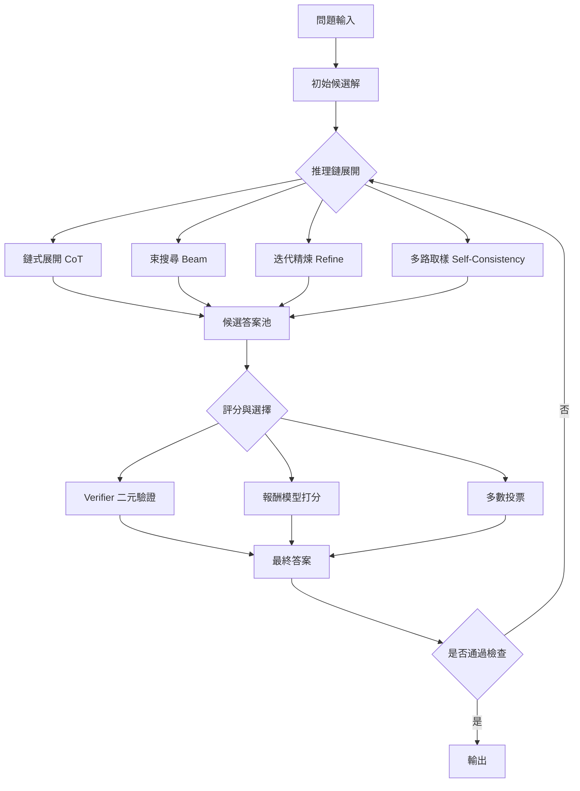

# 10.1 2024 至 2026 年：系統二推理：思維鏈與測試時計算架構

## 一、系統一與系統二：一個行為科學的框架

Daniel Kahneman 在《Thinking, Fast and Slow》（2011）中把人類思考分為兩套歷程。系統一快速、自動、無意識，靠的是長期練習內化的模式與直覺，它擅長辨認臉孔、估計機率、完成日常操作，卻不擅長統計風險，也無法向本人解釋自己的推論理由。系統二則緩慢、費力、刻意，需要主動投注注意力，它能進行演繹、維持長鏈條的因果推論、並自覺地檢查自己的答案。Kahneman 舉出的經典實驗是：直覺回答某題佔比為 $65\%$ 的圓形與 $35\%$ 的方形時，多數人答錯，因為系統一自動完成，系統二從未被喚醒。

把這個框架搬到大語言模型上不是比喻遊戲，而是有用的操作工具。生成式模型在預設解碼策略下幾乎完全是系統一：給定前文，它以機率最大的下一個 token 快速吐出後續內容，中間不建立任何可檢查的中間狀態。誠實評估時，人們常說模型「有時看起來像在推理」，那是因為某些任務的答案在訓練語料中反覆出現，模式匹配已經把中間步驟隱含在權重裡。當問題超出模式覆蓋範圍，系統一的輸出便迅速退化成流暢而錯誤的敘述。

系統二的對應物則是顯式的、中間可檢查的推理步驟。最早系統性地展示這件事的是 2022 年 Jason Wei 等人的〈Chain-of-Thought Prompting〉。他們發現，對於算術與符號推理這類多步驟題目，只要在提示中附上若干完整的推理範例，模型就能產出多步的中間計算，而把多個這類範例拼接成答案，其正確率隨著計算鏈長度的增加而顯著上升。這篇論文的意義不在於新架構，而在於指出：**額外的 token 數量可以被轉化為額外的計算深度**。

## 二、推論時計算是如何變得可行的

長期的技術障礙是「一次前向傳播即一次回答」的侷限。在訓練期，模型學到的是把輸入映射到答案的分佈；要在推論時做多步推理，傳統做法是把所有中間步驟塞進提示，但這使得上下文迅速膨脹，且每一步都要重新計算整段前文的注意力。

Transformer 的 KV cache 改變了這個算力結構。在自回歸解碼中，第 $t$ 步只新增一個 token，之前所有 token 的鍵值向量可以快取起來，於是每一步的計算從「重算整段序列」降為「只計算一個位置的注意力」。這意味著解碼的每個 token 的成本大致與上下文長度成正比，而與已生成的長度只透過快取佔用的記憶體間接相關。推論時計算因此有了工程基礎：只要時間與金錢允許，模型可以「想」任意長的一段，而不必為此重新訓練。

更根本的觀察是一種資源的置換。在訓練期，資本支出的重點是「把能力壓進權重」；在推論期，出現了另一種負擔——把能力**展開**到顯式的、可被檢查的 token 序列中。同一組權重在推論時被反覆使用 $k$ 次，得到的計算深度正比於 $k$ 。若把測試時展開的總 token 數記為 $N_{\text{test}}$ ，把訓練時用過的 token 數記為 $N_{\text{train}}$ ，兩者的邊際價值並不相同：前者換來的是可搜尋、可投票、可被外部工具驗證的軌跡，後者換來的是更廣的知識覆蓋與更好的先驗分佈。

## 三、思維鏈、自我一致性與多次取樣

思維鏈的推廣很快，但單一條推理鏈的可靠性顯然受限於它的偶然性。同一個問題，模型以不同採樣策略可能給出不同答案，而其中常常只有一條是對的。Wei 等人隨後提出的**自我一致性**（self-consistency）正是針對這一點：讓模型對同一問題獨立採樣多條推理路徑，再對最終答案取眾數。

自我一致性的統計直覺來自多數決策。若每條路徑獨立地以機率 $p$ 達到正確答案，且各路徑的錯誤近似互不相關，那麼 $n$ 條路徑中多數正確的機率隨 $n$ 增大而急升，即使單條路徑的正確率並不高。例如當 $p = 0.4$ 時， $n$ 從 1 增到 20 左右，多數決策的整體成功率就會明顯高於 $p$ 本身。這是一個純粹的測試時計算收益：完全不需要改動任何權重。

但自我一致性有明確的邊界。它只在「答案空間小且離散」時有效——多選題、短答案、最終數值；當輸出空間是連續的長文本時，多數決策無從定義，只能退化為「選一個看起來最像答案的」。而且它假定錯誤是獨立的，實際上模型的系統性誤解會讓多數條路徑一起錯，共識反而變成了集體錯誤的放大器。這正是後來引入驗證器（verifier）與獎勵模型的動因：讓外部訊號取代同伴投票，作為選擇依據。

## 四、測試時計算的架構家族

到 2024 至 2026 年，測試時計算發展出若干可辨識的架構家族。它們的共同骨架是一棵以 token 為節點的搜尋樹，但剪枝與選擇的策略各有不同。

四種主要策略各有適用場景。**搜尋**（如 best-of- $n$ 與樹搜尋）把生成視為在一個極寬的樹上找一個高分的葉子，其品質取決於評分函數的可靠性。**束搜尋**保留每步得分最高的若干條路徑，以固定寬度換取記憶體，是把推論延遲壓在可控範圍內的工程折衷。**迭代精煉**讓模型對自己的輸出提出批評並重寫，反覆數輪，它把「思考」變成一種自我對話。**驗證器打分與重排序**則引入獨立於生成器的模型：生成器負責提出，驗證器負責裁判，這在答案可自動檢查時特別有力。

| 策略 | 額外推論成本 | 是否需要外部訊號 | 適用條件 |
| --- | --- | --- | --- |
| 單次直接生成 | 低 | 否 | 知識問答、摘要 |
| 思維鏈 | 中 | 否 | 多步算術與符號推理 |
| 束搜尋 | 中 | 需內部機率分數 | 需要兼顧延遲與品質 |
| 自我一致性 | 高（倍數採樣） | 否 | 答案離散且錯誤獨立 |
| 驗證器重排序 | 高 | 是 | 答案可被自動檢查 |
| 迭代精煉 | 高 | 部分需要 | 開放式寫作與程式除錯 |

## 五、推理模型與思考 token 的出現

2025 年起，各家模型供應商陸續推出專門針對推理任務訓練的模型系列。據公開報導，這類模型的共同特徵是：先進行一段明顯的「思考」，輸出比一般對話模型更長的推理軌跡，再給出最終答案；其介面通常提供可調整的思考預算上限，讓使用者以額外延遲換取更準確的答案。相關的評測報告顯示，在數學競賽題目、程式競賽與多步推理基準上，這些模型相較同尺寸的一般模型有明顯提升，且在小模型上的提升幅度往往更大。

從機制上說，這類做法是把先前以提示工程外顯的推理行為，內化到訓練目標裡。模型學到的不是「怎麼寫出推理過程」，而是「先分配一段計算，再決定答案」。其代價是輸出的 token 數量暴增，進而推高延遲與成本；其好處是推理軌跡本身變得相對穩定，不容易在提示格式稍變時崩潰。

值得注意的是「思考 token」這個詞的雙關性：它既指模型在輸出中額外產生的推理 token，也讓人聯想到訓練時引入的特殊 token，用來標記推理段落的起訖。這類設計把「何處開始推理」從提示工程的責任轉為模型架構的一部分，減少了對使用者的格式依賴。

## 六、數學視角：生成即搜尋

從最佳化與決策的角度，測試時計算可以被形式化為一棵樹上的搜尋。令 $T$ 為推理步數， $B$ 為每步保留的分支數， $b$ 為 token 詞彙表大小，則未經剪枝的完整樹有 $B^{T}$ 個葉節點，每個葉節點的展開成本是 $b$ 。因此完整展開的總 token 消耗近似為

$$
C_{\text{full}} \approx b \cdot \frac{B^{T} - 1}{B - 1}
$$

這在 $T$ 稍大時便迅速爆炸，說明剪枝與選擇不是優化項而是可行性前提。若用一個獎勵模型 $R$ 為每個完整解答打分，並以束搜尋保留每步前 $B$ 條，則策略可寫成

$$
V(y) = \sum_{t=1}^{T} \gamma^{t} \max_{y' \in \mathcal{B}_t} R(y_{1:t}, y')
$$

其中 $\mathcal{B}_t$ 為第 $t$ 步保留的分支集合， $\gamma$ 為折扣因子，代表偏好較早的正確推導。這個形式把「讓模型多想一會」與「讓模型想得更聰明」統一起來：前者增加 $T$ ，後者改善 $R$ 或剪枝策略。

| 面向 | 訓練時擴展 | 測試時擴展 |
| --- | --- | --- |
| 擴展對象 | 參數量、訓練 token 數 | 推理鏈長度、取樣路徑數 |
| 收益來源 | 更廣的知識覆蓋與更好的先驗 | 更深的計算與更多元的候選 |
| 可解釋性 | 體現在權重中 | 體現在可讀的推理軌跡中 |
| 成本位置 | 一次性資本支出 | 每次呼叫的變動支出 |
| 失敗模式 | 資料瓶頸、能力上限 | 搜尋預算不足、延遲超標 |

兩者的關係並非替代而是互補。訓練時擴展決定了搜尋的上限：再怎麼搜尋，也不能搜出模型先驗中完全缺席的知識；測試時擴展則在既定上限內，把「可能算對」變成「實際算對」。

## 七、成本、延遲與並行度

測試時計算不是免費午餐。若思考鏈長度為 $T$ 個 token，則在批次大小固定時，解碼延遲大體隨 $T$ 線性成長；再考慮 verifier 與重排序所需的額外呼叫，總成本約與「路徑數 × 路徑長度」成正比。對互動式產品而言，這意味著秒級延遲與數千 token 輸出之間存在尖銳的取捨。

更麻煩的是並行度的限制。批次推論可以把獨立的取樣路徑同時送進 GPU，但單一條推理鏈內部的步驟是嚴格序列的，無法並行。於是長鏈推理的瓶頸不在算力總量，而在關鍵路徑長度；把批次開大可以降低單位成本，卻拉長排隊時間。推理模型的出現，把這種取捨從「使用者自己手動要求再試一次」變成了「模型端自動決定思考多久」，從而也把成本控制從產品介面轉移到了服務端的預算治理。

## 八、誠實評估

所有關於推理能力的宣稱，都需要分解為「在什麼任務上、以什麼代價」。目前的證據相當集中：增益最明顯的是那些**可驗證或有明確解法**的領域，包括數學運算、程式撰寫與除錯、邏輯推理、形式化證明，以及部分有標準答案的規劃題。在這些任務上，答案對錯可被機械檢查，搜尋與共識機制能發揮作用。

相對地，對知識性問題——某公司的成立年份、某條法條的內容、某位學者的生平——測試時計算的收益相對有限。這類問題的難點不在計算步驟，而在先驗覆蓋與事實取得；一個缺乏正確知識的模型再怎麼推理，也只能在錯誤的前提上演繹出更精緻的錯誤。這並不意味著推理無用：推理可以用來澄清問題、拆解結構、交叉查核，但它帶來的是流程上的嚴謹，而不是知識的注入。

另一個誠實的說法是並非所有領域都能受益。在創意寫作、開放式策略討論、價值判斷這類沒有唯一解的任務上，「驗證器」本身無從建立，強行套用搜尋與投票框架只會增加延遲而無法提高品質。此外，推理軌跡本身不等於正確性證明：一條讀起來合乎邏輯的思考鏈可能包含未被察覺的錯誤前提，並且在後續步驟中把這個錯誤放大。

## 九、推理能力的三個來源層次

把測試時計算的技術來源理清，有助於理解為何各家路線差異甚大。第一層是**提示層**：使用者以範例或格式規範，誘發模型產出顯式推理。這一層成本最低，但效果高度依賴任務是否在提示中被示範過，且對格式變動敏感。第二層是**訓練層**：以大量含推理軌跡的資料，或以過程獎勵進行訓練，讓「先想再答」成為模型的穩定行為。這一層把計算策略固化進權重，因此推理軌跡的可重現性遠高於提示法。第三層是**服務層**：在推論時以搜尋、投票、驗證與外部工具組成一個流程，並讓模型依難度自適應地分配思考預算。

三層並非互斥，實務上通常並存。真正值得注意的是它們對成本的控制點各不相同：提示層把成本轉嫁給使用者，訓練層把成本轉嫁給一次性的訓練預算，服務層則把成本轉嫁給每次呼叫的延遲與運算費用。這解釋了為何同一個「會推理」的模型，在不同產品中的體驗可以差異極大。

## 十、思考預算的分配

既然推理步數與品質相關，服務層就面臨一個資源分配問題：在固定延遲上限內，對每個查詢應該分配多少思考量。最簡單的做法是固定預算，把成本控制變得可預測，但會在簡單問題上浪費算力、在困難問題上不足。更細緻的做法是先做一次難度估測，再依估測結果動態調整鏈長或取樣路徑數。據公開報導，一些推理服務已提供可由使用者設定的思考預算上限，這本質上是把資源分配的決策權交給了使用者而非模型。

另一個方向是讓思考變得「省」。若推理鏈中有大量重複的子推理，可以把已完成且驗證通過的部分快取起來，避免重複展開；這在長鏈任務中特別有效，因為中間狀態往往可以作為快取鍵。這類最佳化不改變能力上限，但能在同樣的思考深度下顯著降低延遲，因而在實務中往往比單純擴大模型更划算。

## 十一、結語：把答案交給驗證器

系統二的到來，意味著語言模型的競爭焦點從「一次答對」轉向「答對的過程是否可檢查」。當推理鏈被攤開成顯式的 token 序列，過去只能靠人閱讀體驗的品質問題，開始可以用自動化工具處理——只要存在一個可信的判斷器。

這就把線索引向下一章的題目：在數學領域，有一個領域的每一步都已經被機器檢查了幾十年。任何一個生成的證明步驟，都會被一個小型但絕對可靠的核心檢查器接受或拒絕；答案不在訓練語料裡，因為宇宙中的定理數量遠大於人類已寫下的定理；而獎勵是二元的，卻完全沒有雜訊。這正是形式化數學在 2025 至 2026 年成為語言模型最佳測試場的原因，也是下一章的主題。
