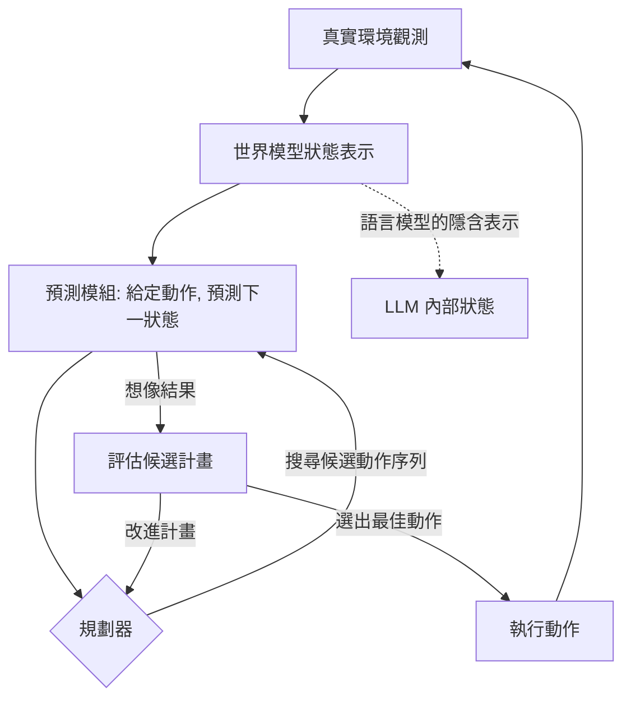

# 10.3 2025 至 2026 年：大型語言模型作為世界模型與物理規律模擬

## 一、世界模型的概念源流

「世界模型」一詞在 2018 年由 Jürgen Schmidhuber 與 David Ha 明確提出。他們定義：世界模型是一個能從感知輸入中學習、能模擬環境如何隨時間演化的內部模型，並可用它來預測未來、進行規劃。這個定義的重點不在「預測下一個 token」，而在於**預測必須在模型內部以某種結構化的狀態變數來承載**，以便於支援干預性的思考——也就是回答「如果我這樣做，會發生什麼」。

在機器學習的實作史上，世界模型的現代形態由 DeepMind 的 Dreamer 系列確立。Dreamer 把一個學習到的潛在狀態空間模型與一個想像的策略梯度結合：模型從觀測序列中學會編碼與解碼，並在潛在空間中進行長時段的「夢境」推演，用以訓練行為策略。這種「在模型的 imagination 中學習」的做法，把環境模擬從訓練迴圈中抽離出來，大幅降低了真實互動的成本，也讓基於模型的規劃在實踐中可行。

另一條獨立的源流是 Yann LeCun 於 2022 年提出的主張。他主張人類與動物並非靠無腦的試誤學習世界，而是內部維持一個抽象的世界狀態模型，用以預測尚未發生的感知，並據此規劃行動。他所描述的架構包含一個可訓練的感知模組、一個以世界狀態為基礎的短期記憶、以及一個負責預測與決策的模組，並強調其中最關鍵的是能夠對自己行為的後果做精確預測的代價模型。

這三條源流在本書的前作中都可找到對應：《強化學習》討論的是策略如何在沒有環境模型的情況下學習；《電腦下棋》討論的是在規則完全已知的世界中做搜尋。當規則已知時，模擬器可以精確建構；當規則未知但可學習時，模型化 RL 提供了折衷。而世界模型的主張，是把這套方法推向更一般的、規則只能部分觀察的現實環境。

## 二、語言模型作為世界模型的證據與反證

把語言模型視為世界模型，最直接的證據來自它的預測能力：給定「杯子從桌邊掉落的後果是什麼」這類問題，模型能給出在人類評估下合理的答案；給定一段程式碼的前半段，模型能預測其輸出；給定一個物理情境的敘述，模型能推論接下來會發生什麼。這些行為讓人感到模型內部存在某種狀態追蹤機制。

反證同樣有力。語言模型的原生表達是**離散的文字序列**，而物理世界是連續的、多時間尺度的、有量的。文字中承載物理量時，通常是模糊的：「大約三公斤」、「有點重」、「緩慢地落下」，這些描述不具備精確的狀態變數，也無法支撐數值預測。當被要求推算自由落體時間或浮力大小時，模型往往退回到記憶中的公式與公式套用，而不是從內部狀態逐步演化。

更根本的是**時間結構**。Transformer 的注意力在單次前向傳播中是對 token 的平行計算，它並不天然地維持一個隨時間更新的狀態變數；語言模型的「記憶」體現在權重與 KV cache 上，而非一個被持續更新的隱藏世界狀態。這與 Dreamer 的潛在狀態模型有本質差異：後者的狀態是為了預測演化而明確建構的，前者的隱藏表示則只是為了預測 token 而被訓練出來的副產品。

| 面向 | 典型世界模型 | 語言模型 |
| --- | --- | --- |
| 狀態表示 | 連續的潛在向量，具時序遞推 | 離散 token 與注意力向量 |
| 訓練目標 | 預測環境演化與觀測 | 預測下一個 token |
| 干預能力 | 可在模型內模擬動作後果 | 需以文字描述動作後果 |
| 數值精度 | 依表示而定，可高精度 | 弱，不擅長連續量運算 |
| 典型代表 | Dreamer 系列、狀態空間模型 | 各類預訓練 LLM |

## 三、三條可能路徑

面對上述落差，研究與實務上大致沿著三條路徑嘗試。

**第一條路徑是在純文字預測中湧現物理直覺。** 若預訓練語料中包含大量描述物理現象的文本——教科書、科普、工程文件、新聞報導——模型在預測後續詞語的過程中，必須在某種意義上掌握場景的因果結構，才能預測「接下來會發生什麼」或「這個問題的答案是什麼」。這種能力不是被顯式寫入的，而是預測壓力的副產品。已有研究顯示，模型在物理直覺測驗題上的表現，確實與預訓練規模及資料組成有關，某些任務上的分數高於非神經基線。

**第二條路徑是從影像或影片資料學習。** 把語言模型的多模態擴充視為一種「看見物理」的嘗試：影片提供了連續的時間序列，物體的移動與形變在其中被直接觀察。這條路徑的優勢在於資料本身承載了連續狀態的變化，不必依賴語言對物理量的模糊描述；其挑戰則是影片中的因果與三維結構需要從二維投影中推斷出來。

**第三條路徑是與模擬器結合的混合系統。** 讓語言模型負責高層的目標分解與策略選擇，把低層的物理預測交給既有的物理引擎或模擬器。這條路徑在工程上最為穩健，也最誠實：它承認語言模型並不是物理引擎，而是規劃層。真正的挑戰在於兩者的介面——如何用自然語言表達一個可由模擬器執行的動作，以及如何從模擬器的輸出中提煉出對決策有用的訊息。

如圖所示，世界模型與規劃構成一個閉環：模型提供狀態轉移的預測，規劃器在想像中評估候選計畫，最後只有一個動作真正作用於真實環境。整個架構的效率取決於「想像」相對於「實驗」的便宜程度。

## 四、物理直覺的評測

要判斷語言模型是否真的學會了物理，需要可量化的測驗。物理直覺測驗通常以選擇題形式呈現，要求模型依據日常經驗而非計算做出判斷，例如問道兩個物體同時落地時哪一個先著地、往杯子裡倒水的速度變快時水面是否上升。這類題目的分數能區分「模型真的內化了物理直覺」與「模型只是複述相關的知識文字」。

報告這類評測的文獻普遍發現幾個現象。其一，隨著預訓練規模擴大，物理直覺的分數有可測量的提升，顯示物理知識並非完全靠提示工程拼湊。其二，純文字模型在這類題目上確有非平凡的表現，儘管遠低於專門以物理資料訓練的模型。其三，當把同一題目的文字敘述替換為圖片或影片輸入時，人類的作答更接近直覺，而模型在兩種輸入之間的一致性不足——這提示模型的表現可能部分依賴語言中的表面線索（例如提到「真空」或「失重」的詞彙），而非內部的狀態推演。

另一組證據來自「反事實」式的提問：給定一個在物理上不可能的敘述，看模型是否會指出矛盾。模型在這類任務上的表現通常不穩定，且高度依賴提問方式，反映出其「世界模型」尚未形成穩固的內部結構。

## 五、世界模型與規劃

世界模型之所以重要，不在於它能預測，而在於它讓**反事實推理**成為可能。有了狀態轉移模型，就可以在不實際執行的情況下推演：若採取動作 $a$ ，狀態會從 $s$ 轉移到 $f(s, a)$ ；若接續動作 $b$ ，則到達 $f(f(s,a), b)$ 。整條動作序列的結果可以被評分，因而可以在多個候選計畫中挑選。相較之下，純粹的行為複製只能學到「在這種狀態下做這種事」，無法回答「若換一個做法」。

這正是 LeCun 主張的核心，也是模控與模型式規劃的落點。模型式規劃的成本正比於「想像的步數 × 每步狀態推演的成本」，因此它只在兩個條件下划算：模型足夠準確，且狀態表示足夠緊湊。當模型的誤差在數步之外累積到不可忽略時，規劃反而不如真實試錯——這是實踐中世界模型方案屢屢受挫的主要原因。

值得對照的是《電腦下棋》一書中的經驗：AlphaGo 之所以能超越人類，是因為規則完全已知，模擬器可以精確重建棋盤，而 MCTS 得以在數百萬次想像中搜尋。當環境的規則從「精確已知」退化成「只能從觀測中估計」，模擬器的不確定性就成為整體能力的上限。語言模型的世界模型問題，本質上就是把模擬器的不確定性從零推向未知。

## 六、與本系列其他各書的呼應

把世界模型放回本系列的主線，可以看清它的位置。《電腦下棋》處理的是完全資訊遊戲，記憶的位置在規則引擎與搜尋樹；《聲音模型》處理的是連續訊號，記憶的位置在梅爾頻譜與時序隱藏狀態；《強化學習》處理的是不確定環境中的策略，記憶的位置在價值函數與回饋訊號。三者合起來提供了三種類型的「環境表示」。

世界模型的主張是：這三者都是特例，統一的做法是讓模型學出一個可預測的環境表示。語言模型的加入提供了第四種材料——人類的語言知識中蘊含了關於世界的大量結構化描述，包括物理規律的通俗表述、工具的使用方法、社會互動的規則。問題在於這批材料的表示形式是離散且含混的，與物理引擎所要求的精確連續狀態距離甚遠。

同時，語言模型帶來了前幾本書沒有的能力：它能理解人類用自然語言提出的目標，並把模糊目標轉成可執行的子目標。這正是模擬器所缺的一層。

## 七、狀態表示的三種技術選項

要讓語言模型承載世界狀態，技術上有三種選擇。第一種是**隱含於注意力與隱藏向量之中**：不放棄現有的 token 介面，而是讓模型在序列內部隱式地維持與場景相關的資訊。這條路徑的優點是無需改變架構、代價極低；缺點是狀態的讀取與寫入都不可控，研究者難以確認它到底記住了什麼。

第二種是**以結構化文字作為顯式狀態**：讓模型把當前情境寫成一份簡潔的狀態描述（例如「車速 60 公里 / 檔位 3 / 剩餘距離 12 公里」），並在每一步更新這份描述。此時狀態變成了一段可以被檢查、被程式解析、被外部系統更新的字串。其代價是狀態受制於文字所能表達的精度，且每一步更新都要佔用額外的推論成本。

第三種是**外接結構化狀態**：由語言模型之外元件維護一個真正的狀態變數（例如一個物件與屬性的資料結構、一張關係表、一個場景圖），模型透過工具呼叫來讀寫它。這是《電腦下棋》與模擬器路線的直接延伸，也是目前工程實作中最常見的做法：語言模型負責高層決策，專門的元件負責狀態的權威表示與更新。

三者的取捨是一致的：狀態越結構化、越精確，規劃就越可靠；但模型與真實世界之間隔著的「轉譯層」也越厚，失真與資訊損失的機會隨之增加。

## 八、誠實評估

必須坦白的是，目前語言模型作為世界模型的證據**多半是間接的**。分數提升可以由更好的語言線索辨識、更強的常識檢索或對測題形式的熟悉所解釋，而不必假設模型內部存在狀態追蹤機制。要取得直接證據，需要能夠區分「內部有狀態」與「內部只有統計關聯」的實驗設計，例如要求模型執行無法靠語言線索完成的多步狀態推算。

真正的物理模擬需要三樣東西：結構化的狀態表示、精確的因果模型、以及能處理連續量的運算單元。語言模型在第一項上先天不足，在第三項上幾乎完全缺席。第二項則是有希望的：從文本中提煉出的因果規則，或許足以支撐定性推論（定性推論只需判斷方向，不需精確數值），這可能是近期最現實的落點。

世界模型還帶來**可控性與幻覺的雙面風險**。若模型內部真的有一個可被操控的狀態表示，那麼它也可能被用來生成看似合理但違反物理的內容，例如產生不成立的力學推理。反過來看，這個狀態表示若能被讀出、解釋與干預，就成為提高可解釋性的著力點。兩者源於同一個機制，因此無法單獨取得其中一面。

最後需要提醒的是「物理」一詞的歧義。語言模型展示的這類能力，涵蓋了從科學推理到日常常識的廣闊光譜，而日常常識的驗證標準遠比物理定律寬鬆。混用這兩個尺度，會嚴重誇大進展。

## 九、結語：從想像到行動

世界模型的完整價值鏈有三段：預測、規劃、行動。前兩段可以停留在內部；一旦要真的做什麼，問題就變成了一個迴圈——觀察、決定、執行、再觀察。這種持續的迴圈意味著語言模型不再只是回答一次問題，而是要在一段時間裡維持任務狀態、面對失敗、修正計畫。這對記憶的要求遠高於單次問答：模型需要記得自己已經做過什麼、哪些方法行不通、以及目標的當前進度。

於是下一章的主題是清楚的：語言模型何時、以及如何從一個靜態的函數，變成一個持續行動的主體。
