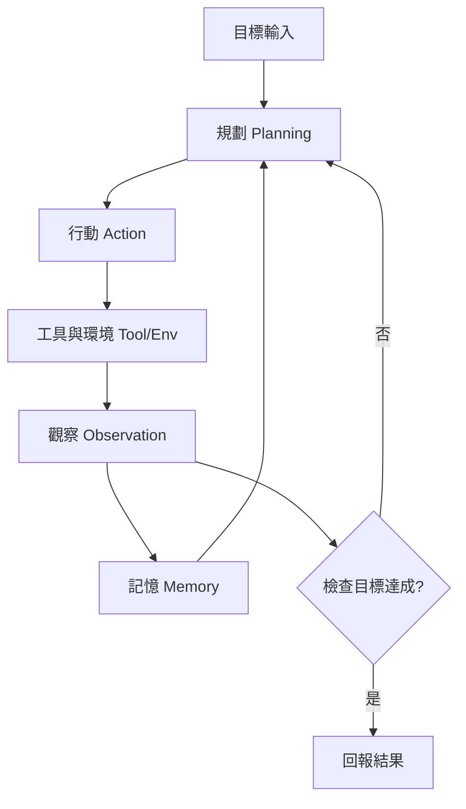
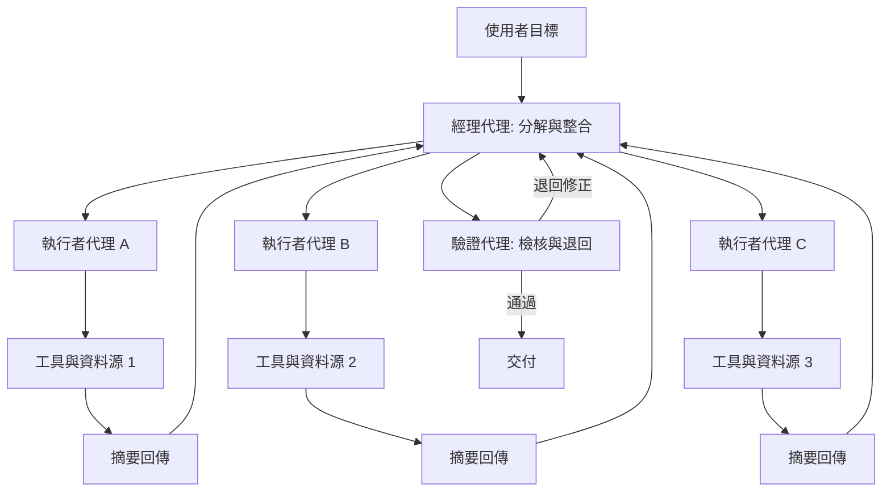

# 10.4 2025 至 2026 年：智慧體（AI Agents）迴圈、規劃與多智慧體協作

## 一、從單次問答到持續行動

截至本書寫作的時間點，語言模型的主流使用方式仍是一次提問、一次回答。使用者給出問題，模型給出文字，雙方互動結束。這個模式在資訊檢索與寫作輔助上很有效，但它無法承擔「把事情做完」這類需求：一項需要讀取多個檔案、比較資料、撰寫報告、寄送並追蹤回覆的任務，中間任何一步都需要依據前一步的結果決定下一步做什麼。

「智慧體」這個詞描寫的正是這種模式：把語言模型從一個被呼叫的函數，變成一個**持續行動的主體**。它有自己的目標、自己決定下一步、自己執行動作、自己觀察結果並修正計畫。這個轉變不是單純的工程包裝，它改變了模型的記憶結構（必須記得自己已經做過什麼）、改變了錯誤處理的方式（必須能從失敗中恢復），也改變了安全邊界的性質（動作可能有副作用）。

據公開報導，2025 年以來各家雲端服務商與模型供應商都密集推出了名稱各異的「代理」功能或框架，涵蓋程式開發、資料分析、文件處理、瀏覽器操作與研究助理等場景。名稱雖異，底層的設計模式卻高度收斂。

## 二、代理迴圈的結構

一個最小的代理迴圈包含五個環節：感知、規劃、行動、觀察、記憶。

**感知**把外部世界的狀態轉成模型可讀的形式，這部分由環境決定：瀏覽器回傳頁面文字，檔案系統回傳檔案內容，API 回傳結構化資料。**規劃**決定接下來要做什麼，可以是單步反應，也可以是展開成多步計畫。**行動**是唯一真正改變世界的環節，也就是第 9 章討論的工具呼叫。**觀察**是行動之後的回饋，可能成功也可能失敗。**記憶**則把跨步驟的資訊保留下來，使下一輪規劃不必從零開始。

這個迴圈的關閉性質值得特別強調。它不是流水線，而是帶有回饋的迴圈；每一圈的輸入都依賴上一圈的結果，因此任何一處錯誤都會沿迴圈累積。相較之下，單次問答的錯誤只影響那一次回答；代理的錯誤會改變世界的狀態，而改變後的世界又成為後續步驟的輸入。

## 三、記憶的三層結構

代理的記憶通常被劃分為三個層次，各自承擔不同功能。

**短期工作記憶**是當前任務的即時狀態：目標敘述、當前子目標、已收集的資訊、尚未解決的疑點。它的物理實現通常就是上下文視窗，因此容量有限，且每一輪都要重新「寫入」。

**長期儲存**是跨任務、跨時間的持久化資料：使用者偏好、專案背景文件、歷史任務的結果。它通常以向量資料庫或檔案系統的形式存在，透過檢索機制在使用時被取回——這正是第 9 章的檢索增強生成，只是主角從語言模型換成了代理。

**情節記憶**是具體的經歷記錄：某次任務的完整軌跡、發生過的錯誤、嘗試過但失敗的策略。它的價值不在於內容本身，而在於**避免重複犯錯**：代理在再次遇到相似情境時，可以調閱過去的經驗，把「上次那條路走不通」這個資訊帶回當前決策。

| 記憶層次 | 典型實作 | 容量特性 | 主要用途 |
| --- | --- | --- | --- |
| 工作記憶 | 上下文視窗 | 有限，隨輪次增長 | 維持當前任務狀態 |
| 長期儲存 | 向量資料庫、外部檔案 | 近乎無上限 | 跨任務的知識與偏好 |
| 情節記憶 | 軌跡日誌、案例庫 | 受檢索精度限制 | 借鑑過去成敗經驗 |

三層之間存在一個張力：工作記憶太小則規劃失去依據，太大則延遲與成本失控。而情節記憶的檢索本身也可能出錯——調回一段不相干的舊經歷，會把噪音注入當前決策。

## 四、規劃的三種粒度

規劃策略在實務上呈現三種粒度，彼此並非互斥，而是隨任務結構混合使用。

**即時反應**是最輕的一層：模型根據當前觀察直接決定下一個動作，不展開長期計畫。這適用於步驟明確、錯誤成本低、或者環境變化劇烈以致長期計畫立刻過期的情境。

**任務分解**把目標切成若干子目標序列，每個子目標由一串即時反應完成，之後檢查是否達成再進入下一個。這是目前最主流的架構，因為它與語言模型的能力邊界最為吻合：模型擅長把一個開放式的目標改寫成可操作的步驟清單。

**長程里程碑**則先設定幾個階段性的成果（例如「先蒐集資料、再交叉比對、再撰寫報告」），中間隔著長時間的自主運行。它要求模型能容忍長時間沒有新資訊、能在數百步之後仍然記得最初的目標，並且能意識到自己偏離了方向。這一層對記憶與自我監控的要求最高，目前的實作可靠性也最低。

一個值得注意的實務趨勢是**計畫的動態修訂**。與其一次訂出完整的步驟清單並盲目執行，較穩健的設計是在每個里程碑後重新檢視全局，允許插入新的子任務或刪除已證明無用的步驟。這種做法把長程規劃變成一串短程規劃的串接，大幅降低了偏離的累積成本。

## 五、工具與環境是代理的身體

語言模型本身只有文字介面，無法感知、無法行動、也無法改變任何事實。代理的「身體」是由工具與環境構成的：搜尋引擎提供世界知識的入口，程式執行器提供運算與精確數值，檔案系統提供持久狀態，瀏覽器自動化提供對網頁的操作，訊息介面提供與人類的往來通道。

這個身體的設計品質，直接決定代理的能力上限。上一章談到世界模型時曾指出，語言模型缺少連續量與精確狀態的表示能力；而在代理系統中，這個缺陷由工具補上：需要精確算術時呼叫計算器，需要精確狀態時查詢資料庫，需要現實資訊時執行檢索。這不是把語言模型的能力稀釋掉，而是把它放到合適的位置。

代價是耦合：工具的介面設計、錯誤訊息的品質、回應格式的一致性，都會直接影響代理的表現。一個回傳自由格式文字的工具，需要模型自行解析；一個回傳結構化錯誤碼的工具，則能被模型直接用於修正。這個差異往往比模型本身的強弱更能解釋任務成功率。

## 六、多代理協作與協作成本

當單個代理的上下文不足以容納整體任務，或任務可被自然地分割時，自然會出現多代理的設計：一個「經理」代理負責分解與整合，若干「執行者」代理各自負責子任務，彼此透過訊息傳遞結果。

多代理的想法聽起來優雅，但實務上的成敗差異極大。收益主要來自三處：**上下文隔離**，讓每個執行者只看到與自己子任務相關的資訊，避免互相干擾；**並行執行**，讓彼此獨立的子任務同時進行；**角色分化**，用不同的提示、不同的工具權限、不同的驗證標準處理不同性質的工作。

然而協作帶來的成本往往被低估。訊息傳遞本身需要序列化與解析，而語言模型之間的通訊本質上是**有損的**：一個代理無法直接讀取另一個代理的內部狀態或上下文，只能依賴被寫成文字的摘要。這意味著每經過一次轉述，資訊都可能被遺漏或誤解。當子任務數量增加，錯誤累積的機率也隨之上升。

| 面向 | 單代理加好工具 | 多代理協作 |
| --- | --- | --- |
| 上下文 | 單一視窗，需篩選 | 每個代理各自隔離 |
| 協調成本 | 無 | 訊息序列化與理解偏差 |
| 並行性 | 受限於單一流程 | 子任務可並行 |
| 除錯難度 | 單一路徑 | 跨代理歸因困難 |
| 適用情境 | 任務可線性拆解 | 子任務真正獨立 |

經濟學式的解釋是：多代理的收益必須超過協作成本。當子任務之間共享大量隱含脈絡、或者彼此高度依賴時，轉述的損失會超過隔離的好處，此時單代理配備良好工具往往是更優解。目前的共識傾向於把多代理保留給真正獨立的平行工作——例如同時蒐集多個獨立來源——而不是用代理之間的對話來取代一個能直接推理的模型。

圖中的關鍵節點是「摘要回傳」與「驗證」兩處。前者是有損通訊的發生地，後者則是把不可靠的下游輸出擋在交付之前的最後一道關卡。若沒有驗證代理，經理代理只能信任彼此的轉述，錯誤便會被當成事實向上累積。

## 七、代理的評測難度

評測代理比評測語言模型困難得多，因為任務成功率這個指標太過粗糙。同一個任務，一個代理花費十倍的成本與時間完成，與另一個代理在三次失敗後仍能穩定完成，在成功率上是無法區分的，但在實務價值上截然不同。

一個更完整的評測框架至少應包含四個維度。**任務成功率**衡量是否完成目標，但必須區分「一次成功」與「平均嘗試次數」。**可靠性**衡量結果的變異程度，同樣的輸入反覆執行是否得到一致的品質。**可恢復性**衡量失敗後的表現：代理在遇到工具錯誤、格式異常或環境改變時，是徹底崩潰還是可以察覺並修正。可恢復性往往比成功率更能預測代理在真實環境中的可用性。**成本**衡量完成任務所消耗的模型呼叫次數、token 數與時間。

| 評測維度 | 問題 | 為何重要 |
| --- | --- | --- |
| 成功率 | 是否達成目標 | 基本門檻 |
| 效率 | 耗用多少資源 | 決定經濟可行性 |
| 可靠性 | 結果是否穩定 | 決定能否上線 |
| 可恢復性 | 出錯後能否續行 | 決定長程任務可行性 |
| 安全合規 | 是否觸及禁止操作 | 決定部署邊界 |

此外，代理評測還面臨**環境漂移**的問題：網頁版面改了、API 回傳格式改了、檔案位置改了，代理的成功率便會下滑，而它本身並不知道規則已經改變。這使得代理的維護成本遠高於靜態的問答模型。

## 八、記憶與遺忘

代理系統裡，遺忘與記憶同樣重要。上下文視窗作為工作記憶，其容量與成本都是硬約束：把整段對話塞進去會推高延遲與費用，而把需要的資訊截掉又會讓模型失去依據。因此實務上需要摘要與蒸餾——把冗長的歷史軌跡壓縮成精簡的狀態摘要，把重複出現的觀察合併成一條結論。

「外部檢索作為長期記憶」則是另一種取捨。檢索讓記憶可以近乎無限，但引入了一個新的失敗模式：**錯誤召回**。當檢索到不相干的舊片段時，代理可能據此做出錯誤判斷，而且因為它在語境中確實讀到了這些內容，往往不會懷疑。因此，記憶系統需要的不只是召回，還要包括相關性評估、時序過濾與權重管理。

更深一層的問題是**遺忘的時機**。人類會在情境改變時丟棄舊資訊，例如新的工具介面推出後，不再依賴舊的呼叫格式。代理系統若把所有歷史永久保留，往往會被過時的假設束縛：它記得三個月前某個 API 是這樣呼叫的，於是在介面已改變後仍照舊嘗試並反覆失敗。適當的遺忘——讓過時的信念過期——是代理維持長期可用性的必要機制。

## 九、安全的現實問題

代理與一般聊天機器人的根本差別在於**副作用**。一段錯誤的輸出文字只是錯誤的資訊；一次錯誤的工具呼叫可能刪除檔案、發送郵件、修改資料庫、發布內容，甚至在具備權限的情境下造成金錢損失。

這使得幾個在純對話時代無關緊要的設計問題變得關鍵。**權限最小化**要求代理只被授予完成任務所必需的權限，且這些權限有時限、有範圍上限。**確認點**要求在不可逆或高風險操作前暫停，把決策交回給人。**dry run** 機制讓代理先產生將要執行的動作計畫供檢視，而不是直接執行。**審計軌跡**要求完整記錄每一次工具呼叫的輸入與輸出，使得事後能重建決策過程。

另一類風險來自**提示注入**：當代理讀取外部內容（網頁、郵件、檔案）時，那些內容可能夾帶著指示代理改變行為的文字。由於代理是為了執行任務而設計的，它對「指令」與「資料」的區分能力天生薄弱——同一段文字若以指令格式出現，就可能被服從。這是目前代理安全最難解決的問題之一，因為反注入與執行的衝突無法從根本上消除，只能透過權限限制與隔離來降低傷害。

## 十、開放問題

三個問題特別值得留意。

**可靠的自我評估**：代理需要判斷自己是否走在正確的路上、何時該改變策略、何時該承認失敗。當前的代理往往在誤以為成功時最危險——一個錯誤的結論若被自信地包裝成完成報告，會直接進入下游流程。因此「產出可被下游檢查的證據」比「產出結論」更為關鍵。

**何時該向人求助**：代理應當能辨識自己的不確定性超出可接受範圍，並主動將問題升級給人。但這需要一個明確的門檻定義，而門檻定義過低會使代理頻繁打斷流程而失去價值，過高則讓它在困境中反覆空轉。這個平衡點目前多靠產品層的人工設定，而非模型自行判斷。

**多代理的協調成本**：當代理數量從兩三個增加到數十個，通訊量隨之成長，系統行為會迅速變得難以預測與除錯。如何讓多代理系統的可理解性隨規模保持，是一個尚未成熟的工程與理論問題。

## 十一、結語：記憶的最後一次遷移

回顧全書的主線，語言模型這七十年演化的真正軸線是**記憶存放位置的持續遷移**。語法規則存在於人的心智裡；機率存在於計數表中；意義存在於分散式向量裡；上下文存在於注意力矩陣裡；能力存在於權重裡；意圖存在於人類偏好裡；知識被推到了模型之外；推理發生於測試時；世界存在於模型的內部狀態裡。而到了第十章的最後，記憶同時存在於**測試時的計算**與**行動的迴圈**之中——前者是一次詢問之內的臨時空間，後者是一段時間之內的持續狀態。

這個遷移帶來三個下一階段必須處理的問題。**可驗證性**：第十章第二節展示的夢想是讓產出經過機器檢查，但真實世界的行動往往沒有廉價的檢查器。**可控性**：當模型擁有能改變世界的權限，可控性的要求就從「回答得宜」升級為「行為得宜」。**效率**：迴圈的每一圈都要付出模型呼叫的成本，而任務的複雜度決定了圈的數量。

這三個問題都不是靠更大的模型能解決的，它們需要新的架構、新的評估方法，以及一個尚未成熟的學科——如何評價一個會行動的系統。本書到此結束，但這條遷移的路線，才剛剛開始。
