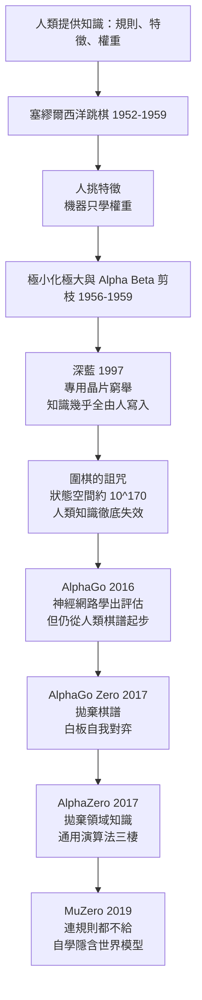
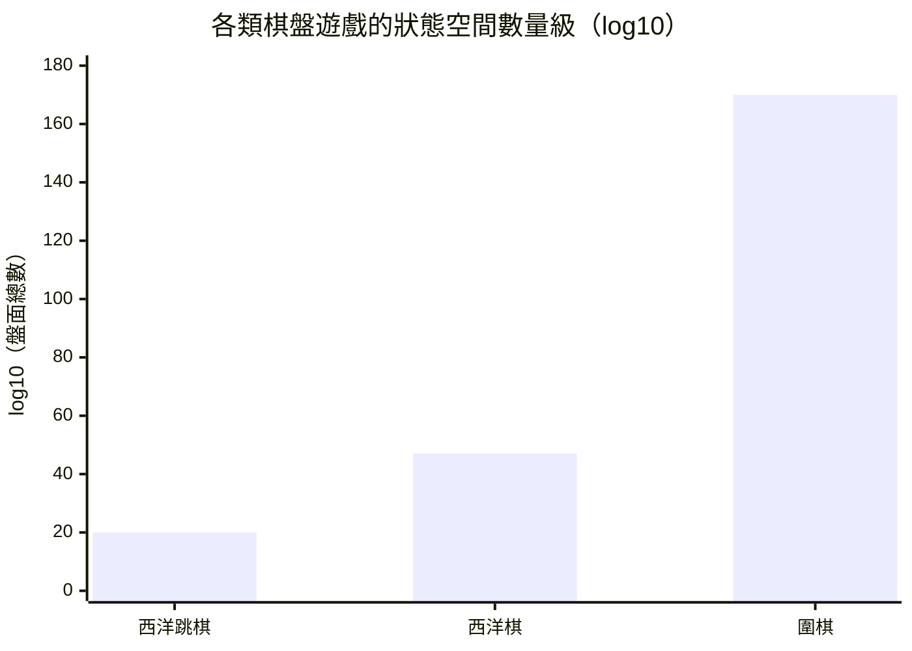
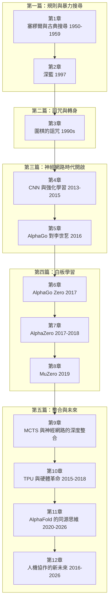

# 0.1 導言：機器如何學會超越人類的智慧

一九九七年五月，紐約。加里·卡斯帕羅夫向深藍投出最後的絕望一子，隨後起身離席。那例行的一鞠躬，被後世反覆放映，彷彿一場加冕典禮——加冕的表面是一台機器，實際上是一個延續了將近半世紀的猜想：智慧或許可以被工程化。早在一九五○年，圖靈就在《Computing Machinery and Intelligence》中直言，與其無休止地爭辯「機器能否思考」的定義，不如用一場對弈來做實驗；同年，克勞德·香農發表《Programming a Computer for Playing Chess》，第一次認真地替下棋程式畫出工程藍圖。這兩份文獻像兩枚種子：從此棋盤不再只是遊戲，而是人工智慧最早的實驗桌。

為什麼偏偏是棋？這個選擇看似偶然，其實內在邏輯相當嚴密。西洋跳棋、西洋棋、圍棋這一類遊戲，共享一套在現實問題中極其罕見的組合性質：**有限**——規則封閉，可出現的盤面總數有大小的上界；**確定**——落子之後的局面演化沒有任何歧義，不擲骰子、不翻牌；**回合制、零隨機**——雙方輪流行動，沒有隱藏的手牌與突發事件；**完美資訊**——整個局面攤在棋盤上，沒有暗處；最關鍵的一條是，**勝負可以用 $`0`$ 與 $`1`$ 嚴格驗證**。最後這一點常被低估。在真實世界裡，「這步棋好還是不好」往往要等數年才見分曉，回饋延遲長到人力難以承受；而在棋盤上，任何一條走法鏈的最終命運，原則上都可以推到底。換句話說，棋類是世上少數**因果可追溯**的智慧環境：每個錯誤都有明確的位置，每次勝利都有清晰的鏈條。

正因如此，棋盤成為第一個可以替「智慧」計分的場所。研究者不必再對「它聰明嗎」各說各話，只需問：它贏了誰？等級分多少？一九五○年，圖靈用紙筆手工模擬他的西洋棋演算法，並估計完整搜尋一棵中等深度的博弈樹約需 $`10^{9}`$ 量級的運算，他當時感嘆以這樣的速度，程式頂多達到業餘水準；到了一九五六年，塞繆爾的西洋跳棋程式已經透過電視節目公開示範，並在對弈中擊敗了康乃狄克州的冠軍選手。機器智慧第一次被放進公眾視野，而且是有明確勝負的視野——「智慧」從此從哲學名詞變成了工程量尺，而棋盤就是那把尺的第一道刻度。

## 一條看不見的依賴鏈

但早期的成功底下，藏著一個所有人都心照不宣的事實：程式會下棋，是因為**教它的是人**。塞繆爾的評估函數裡，棋子價值、棋子推進、控制中心這些特徵是人挑的，機器只是自動調整它們的權重；此後二十年的西洋棋程式，本質上是一大批程式員與特級大師把對局的知識一行一行寫成代碼。換言之，機器長出的每一段棋力，根都紮在人類的知識土壤裡。這條依賴鏈持續了四十多年，直到二○一○年代才開始被逐節剪斷，它的斷裂過程，正好就是本書的主體敘事。

這張圖的箭頭方向只有一個：**知識的供給者不斷從人往後退**。塞繆爾時代，人給特徵、機器學權重；深藍時代，人憑數十年西洋棋理論填滿評估函數，機器只負責算得足夠快，每秒推演兩億個局面；到了 AlphaGo，卷積神經網路開始自己長出評估能力，但訓練的第一步仍踩在十三萬份人類職業棋譜上；AlphaGo Zero 徹底拋棄棋譜，只給棋盤規則與勝負結果這一最小的介面，靠三天的自我對弈後以一百比零橫掃了李世乭版本；MuZero 更進一步，連環境規則都收回，只在網路內部學出一個**對決策有用**的隱含模型。用一句話濃縮這六十年：這是一部**把人從決策回路中一步步請出去**的歷史。

值得在這裡就停一下，看清楚第一節點的精妙。塞繆爾從 1952 年起在 IBM 開發西洋跳棋程式，他的做法在今天看來就是強化學習的原型：程式先自己跟自己下，事後回頭檢查哪幾步被證明是惡手，再把「惡手之前的盤面」標記為要避免的局面；評估函數的權重不靠人工填數字，而是讓機器從對局紀錄中自動刮平誤差。他用到的記憶體不過幾萬字元，卻已經把「機器可以自己修正判斷」這件事變成了事實。一九五九年他在論文中寫下的方法論，六十多年後就是 AlphaGo Zero 的自我對弈迴圈——只是權重從幾十個手工特徵，換成了數百萬個神經元。換言之，觀念很早就誕生了，遲到的從來是算力與可訓練的非線性函數。

這條依賴也解釋了一個耐人尋味的對比：同一時代的同類程式，在西洋跳棋上嶄露頭角，換到西洋棋就乏力，碰上圍棋更是屢屢敗給高中選手。差別不在硬體與程式人力的良窳，而在人類能替各棋類累積的知識厚薄。圍棋中「厚與薄」「棄與取」這類難以聚合的判斷，任何人工挑選的特徵函數都會碎裂；於是當人一出手，瓶頸就被踢回演算法自身。這也是本書貫穿的敘事手法：不崇拜幾個偶像是式的絕招，而是把每個里程碑裡「人做了什麼」與「機器學到什麼」拆開，看清依賴在哪一刀被切斷。

下表把這個單向趨勢整理得更清楚：

| 時代／系統 | 人類仍須提供的 | 機器自己學到的 | 保留了多少依賴 |
| --- | --- | --- | --- |
| 塞繆爾 1952-1959 | 特徵選取、規則框架 | 評估權重，可自我對弈修正 | 大部分 |
| 古典搜尋 1956-1959 | 搜尋策略、剪枝法則 | 幾乎沒有 | 幾乎全部 |
| 深藍 1997 | 領域知識、硬體設計 | 僅末段的參數微調 | 幾乎全部 |
| AlphaGo 2016 | 職業棋譜、規則 | 直覺與價值判斷 | 少一半 |
| AlphaGo Zero 2017 | 只剩規則與勝負介面 | 完整棋力 | 僅剩介面 |
| MuZero 2019 | 連規則都不給 | 隱含環境模型 | 幾乎為零 |
---

注意最後一列的變化方向，那才是問題的核心。MuZero 的意義不在於它又贏了誰，而在於它**拒絕了棋類遊戲的最後一項特權**。棋類的規則是封閉的，程式員可以把它精確編碼；但真實世界的規則從來無法被完美編碼，只能從與環境的交互中被間接逼近。MuZero 的隱含模型不需要在棋理上正確，只需要在規劃時有用，這個鬆動的介面恰好是現實問題唯一能給的介面。也因此，本書後段會看到同一套思想如何離開棋盤，走向 Atari 遊戲、乃至影片壓縮之類的非遊戲任務，最終指向 AlphaFold 一類的科學問題。

## 量的革命：狀態空間的詛咒

前面敘事的每一次斷裂，其實都被第三股力量推動著——**難題本身按指數速度膨脹**。為什麼塞繆爾在 1950 年代就能初嚐勝利？因為西洋跳棋的狀態空間約為 $`10^{20}`$ ，配上評估函數與剪枝，有限的計算力勉強夠用。為什麼深藍必須動用專用晶片才能壓制卡斯帕羅夫？因為西洋棋約為 $`10^{47}`$ ，通用機器的速度即使非常強大，窮舉仍然相當吃緊。為什麼圍棋讓全世界多等了將近二十年？因為其狀態空間約為 $`10^{170}`$ ，這個數字大到連「人的知識」本身都成了障礙——可觀測宇宙的原子總數也不過約 $`10^{80}`$ 。不過要小心區分兩個量：狀態空間只算「盤面最多能有幾種」，真正決定搜尋代價的是**博弈樹複雜度**——亦即「所有合法對局總數」，圍棋的這個數字高達約 $`10^{360}`$ ，意思是即使宇宙裡所有的原子都拿來做運算，窮舉也永遠不會是圍棋的選項。換句話說，難題的三級跳不是單純的量變，而是把「人的直覺」與「機器的算力」同時逼上絕境，逼出了一場結構性的重寫。下圖以對數尺度並列三種棋類的狀態空間，視覺上可一目了然各量級之間的斷崖：

圖中最醒目的正是最右邊那根柱子：當問題跳到 $`10^{170}`$ 量級，任何「再多搜尋一層」的戰術都無濟於事，因為每往下深探一層，代價就乘上一個巨大的分支因子。換言之，**數量級的差距不是量變，而是質變**；當窮舉戰略徹底破產，AI 家族被迫走向範式轉移——從「用人的知識加速搜尋」轉向「用學習直接逼近價值」。這場轉移的細節散布在各章，但其動機只有一個，就是這根柱子。

## 「超越」還是「理解」？

二○一六年三月，首爾四季酒店的對局室裡，李世乭按下認輸，AlphaGo 以 $`4`$ 比 $`1`$ 結束了五番棋。全球市場的反應近乎宗教性：人們看見的不只是棋，而是「人類在智力領域最後一道堡壘」失守。但本書的讀者將會發現，一個更幽微的問題在暗處同時長大：**機器超越了人，但它真的「理解」了嗎？**AlphaGo 對那一手棋的選擇，是來自千萬次自我對弈後的勝率統計，還是任何意義上的「看出」對局的意涵？答案不是簡單的是或否；它是本書末章真正想切下的核心。

有兩個經典案例可以幫我們把問題磨利。其一，AlphaGo 在 2016 年對李世乭的第二局第 $`37`$ 手，落點在人類職業棋手幾乎不會考慮的五路肩沖；周俊勳等職業棋手當場一度判定是失誤，數十手之後它的價值才逐漸顯現。其二，AlphaGo Zero 在完全沒有棋譜的條件下，於幾十天內自行走遍了人類花上千年才累積出來的布局理論：早期的訓練版本先本能地搶邊角，中期的版本重演了人類的定式與三三、星位布局，最終版本則倒過來拋棄了許多人類定式，以自己的方式重新走一遍圍棋。研究者觀察到的不是神祕的天啟，而是可追蹤的現象：價值網路的勝率輸出與人類的「外勢、實利」等概念之間能建立對映，只是從頭到尾沒有人把這些詞教給它。

於是，回答這問題最好的辦法，就是本書安排的這一條路：從塞繆爾到深藍，機器靠人的知識贏棋；從 AlphaGo 到 AlphaZero 與 MuZero，人被移出知識供應鏈，但勝負這把尺始終不變。本書花這些篇幅，不是只為了講一個轉折的精彩故事，而是為了讓讀者在結尾自己給出評判：一台只看勝負、不看意義的機器，真的佔有了它所展現的那種智慧嗎？

還有一個常被一筆帶過的角色，必須在此正名：硬體。AlphaGo Zero 能在三天之內下完數十萬場自我對弈、AlphaZero 能在一天之內從零學會西洋棋，靠的不是演算法比 1997 年更聰明，而是算力比 1997 年大幾千倍——Google 的 TPU 把神經網路的矩陣運算搬到專用晶片上，再把數百個 GPU 級的單元串成分散式訓練叢集。本書第 10 章會專門處理這一段；在緒論裡只需記住一條鐵律：**每一次範式轉移，背後都有一塊新的矽在托底**。演算法決定方向，硬體決定能不能走到下一個方向。

## 全書的路線圖

本書分成五篇、十二章、三十七節，五篇的安排正好對應上面那條依賴鏈被切斷的順序：

第一篇（第 1、2 章）講的是知識驅動路線的建立與極致：塞繆爾如何在西洋跳棋上做出第一個能自我修正權重的程式，並在 1959 年的論文《Some Studies in Machine Learning Using the Game of Checkers》裡首次系統性地寫出「機器從自身經驗中學習」的方法論；極小化極大與阿爾法貝塔剪枝如何建立搜尋效率的典範；深藍又如何把這條路線推到硬體的極限，一秒兩億局面、加上手寫的八千件西洋棋知識函數。第二篇（第 3 章）解釋這條路線為何在圍棋前懸崖，本質上是評估函數在複雜資訊下的失效。第三篇（第 4、5 章）是轉向的落地：政策網路、價值網路與蒙地卡羅樹搜尋如何縫合成 AlphaGo，在首爾寫下 $`4`$ 比 $`1`$ 。

第四篇（第 6、7、8 章）是本書的頂點：AlphaGo Zero 在《Nature》上展示了完全的白板學習，AlphaZero 在《Science》上把同一套演算法推向西洋棋與將棋並擊敗 Stockfish，MuZero 則連規則這最後一根人類拐杖也不需要。第五篇（第 9 至 12 章）是收束與出口：MCTS 與神經網路共生的機理、TPU 與分散式訓練作為一整天速學西洋棋的物理前提、AlphaFold 如何把同一套「搜尋與學習」的思維搬到蛋白質結構，最後回到人——當機器超越人之後，人類的直覺、創造力與審美被如何重新定義。本書的預期讀者是大學部高年級到研究所初階：修過基本的線性代數與機率即可，不必讀過本系列前五本；涉及數學的段落都會先給直觀圖像、再寫符號，讀者只需跟著棋局走。最後一點提醒：本書雖然以 AlphaGo 為高潮，但真正的落點是方法論本身——在每章末尾，讀者看到的都不是「AI 又贏了」的慶功宴，而是一條可以遷移到其他領域的推理模板：把問題寫成搜尋、把評估值交給可訓練的函數、再把人的手縮到最小。棋盤上的勝負只是這套模板最乾淨的測試場。

## 本章小結

- 棋類之所以成為 AI 的首選試驗場，在於它們的同質性特質：有限、確定、回合制、零隨機、完美資訊，且勝負可以用 $`0`$ 與 $`1`$ 嚴格驗證，每手的因果前後皆可追溯。
- 這條從塞繆爾的西洋跳棋程式到 MuZero 的弧線，本質上是一部知識供給者從人類系統性地退場的歷史：先學權重、再學評估、再拋棋譜、最後連規則都不再需要。
- 「超越人類」與「理解智慧」是兩個獨立的命題；本書接下來的工作，就是用勝負這把尺，沿著這條因果鏈逐一檢驗每一個里程碑的真實成色。
- 硬體不是配角：塞繆爾的幾萬字元、深藍的專用晶片、AlphaZero 的 TPU 叢集，每一次演算法的躍升，都有一塊新的矽在算力上托底；這條物理前提與知識依賴被切斷的箭頭，共同構成本書的兩條主線。