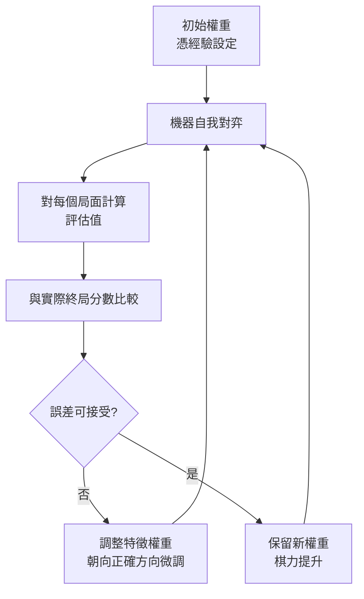

# 1.1 亞瑟·塞繆爾與西洋跳棋程式：機器學習的萌芽（1952-1959）

## 一台機器，一盤棋

1952 年夏天，IBM 701 的問世只有兩年，這台笨重的真空管機器佔滿了一整間房，耗電量足以讓整棟大樓跳一下配電盤。亞瑟·塞繆爾（Arthur Samuel）就在這樣的硬體條件下，寫出了一套西洋跳棋程式。說它是一套「程式」其實不太精確：塞繆爾讓機器自己下棋、自己對弈、自己修正自己的判斷，這套系統的完整度遠超當時任何人寫過的遊戲程式。一開始它只是被當作一個展示 IBM 701 算力的宣傳品，IBM 後來連自己的工程師都半開玩笑地說，這東西「真的能贏」。

要理解塞繆爾的貢獻有多不尋常，得先理解 1952 年的主流共識：機器不該、也不可能「學會」東西。那時的電腦被視為一個高速的算術機器，輸入一組明確的規則，它照做；規則沒寫到的情形，它什麼也不會。塞繆爾在程式裡放進去的不是一套完整的西洋跳棋規則，而是一個**可以被調整的判斷函數**。他把「好棋」這件事拆解成數十個特徵——己方棋子數量、子力位置、邊際受威脅的程度、中心控制——每一項給一個數值，再加權求和。關鍵在於，這些權重不是他憑直覺一次定死的，而是機器在與自己對弈的過程中不斷調整出來的。

塞繆爾在 IBM 701 顯示器上看到的那盤棋，後來在科技史上留下了著名的插曲。1956 年，IBM 讓塞繆爾的程式在展示場合與人類棋手對弈，節目由 IBM 資深工程師 Charles Lieber 主持。塞繆爾的程式贏了——對手是多位有經驗的男性棋手。然而節目播出後，紐約時報一位專欄作家立即撰文指控這是一場「預先安排好的騙局」，理由是那台機器用 CRT 顯示器閃爍棋子，觀眾根本看不清楚到底發生了什麼。更尖銳的批評則來自內布拉斯加州立大學的計算機科學家，指出塞繆爾的程式可能用了某種機器可讀的棋盤，也就是人類看不到但機器能感測到的輔助資訊。

這場示範的技術細節本身就饒有趣味。塞繆爾的程式需要在 IBM 701 上執行，而 701 的輸入機是打孔卡片——也就是說，觀眾看到的棋盤其實是一套「卡片傳輸線」，由 IBM 的操作員把每一步的座標轉成打孔卡，送到機器裡，再把機器選出的著法轉回卡片，最後由人搬到棋盤上。整套流程的延遲長到足以讓現場氣氛變得尷尬，也難怪觀眾無從判斷每一步的來歷。這不是開玩笑的枝節，而是當時「人機互動」在物理層面的真實寫照。

塞繆爾在報紙上公開回應，語氣克制但立場堅定：他承認這場示範的準備過程極不完美，機器當時只用了「機械翻譯」式的原始輸入方式，效率低下，事後看來確實應該用機器可讀的棋盤才對。他同時指出，唯一能證明作弊的方法，是讓程式與真人在完全公開透明的條件下對弈。這個事件之所以重要，不是因為它是一次科學醜聞，而是因為它精準地暴露了「人機對弈」這件事在評估上的根本困境：**觀察者的知覺能力有限，於是所有無法被觀察到的東西，都可以被懷疑是外來的**。這條困境會在六十一年後的 2016 年，以李世乭簽名落子的那一局重新出現，只不過那次的爭議方向剛好相反。

## 為什麼是西洋跳棋

塞繆爾選擇西洋跳棋作為起點並非偶然，而是深思熟慮的結果。1950 年代初，AI 研究者正在尋找一個「玩具問題」——一個既能展現能力的，又足夠簡單到可以在當時的硬體上跑出結果的領域。西洋跳棋的狀態空間數量級約為 $10^{20}$ 位元組的資訊量，遠小於西洋棋的 $10^{43}$ ，更遠小於圍棋的 $10^{170}$ 。這個數字意味著一件事：一台每秒只能做幾千次運算的機器，仍然有可能在有限的時間內「想」出一手好棋。

但狀態空間小還不夠。西洋跳棋還滿足了幾個苛刻的條件。它的規則極簡：棋子只有六種、規則條目不到二十條，每一步合法著法都可以在程式裡完整列舉出來——塞繆爾的程式直接把棋盤表示成一個長度為 $3^{12}$ 的位元向量，每種棋子的三種狀態編碼在各自的位元組裡，一個位元組編碼一格棋盤共 $64$ 格。這種表示法讓「找出所有合法著法」變成一件微不足道的事，機器可以在對手的每一步之後，把自己可能的落子全部攤開來看。

更重要的是西洋跳棋是**完美資訊、零和、回合制**的遊戲。雙方都知道完整的盤面、都知道規則、都知道輪到誰走；在任何一條終局線上，一方得分多必然意味著另一方得分少，沒有平手之外的分歧。這三個性質合起來，讓「最佳著法」在數學上有一個乾淨的定義：讓自己的最終得分最大、對手的最小。也正因如此，這個領域的第一批演算法成果——搜尋、剪枝、評估——能夠乾淨地移植到後來的所有棋類乃至一般決策問題上。

塞繆爾自己在 1959 年的文章中列出選擇西洋跳棋的理由，語氣像一份技術報告：規則簡單、可以完全描述、容易程式化、不需要額外的輔助設備；終局判定明確；最重要的是，遊戲雙方皆為「完美專家」，因此程式強度的提升不可能被歸因於對手是人類。許多年後回頭看，這份清單其實已經預告了六十年後 AlphaGo 團隊挑選圍棋時的同一組判準——規則可形式化、對手極強、勝負絕對。

| 條件 | 西洋跳棋 | 西洋棋 | 圍棋 |
|---|---|---|---|
| 狀態空間規模 | 約 $10^{20}$ | 約 $10^{43}$ | 約 $10^{170}$ |
| 規則條目數 | 少於 $20$ | 數十條 | 上百條，含大量慣例 |
| 一手著法可列舉 | 是 | 是 | 是（但分支因子的平均值更高） |
| 終局判定 | 明確計分 | 明確勝負和 | 明確，但須談判 |
| 完美資訊 | 是 | 是 | 是 |
| 零和 | 是 | 是 | 是 |
| 當時硬體可行性 | 可行 | 勉強 | 完全不可行 |

## 從人寫規則到機器學權重

塞繆爾的程式裡有兩個可以分離的部分，歷史上的重要性卻天差地別。第一個部分是**搜尋**：機器把目前盤面往後想個三四步，把所有後果算出來，挑最好的那個。第二個部分是**評估**：想不動了的時候，用一個數字告訴機器「這個局面對我有多好」。第一個部分是人給的規則，寫好之後就固定不變；第二個部分才是塞繆爾真正投注心力的地方。

在西洋跳棋裡，「終局分數」是可以精確算出的，但「現在這個盤面最後會變成什麼樣子」算不出來——分支因子在實務上高達三十以上，往前看十步就是天文數字。因此必須在某個深度停下來，用一個啟發式的估計值代替真實終局。這個估計值就是**評估函數（evaluation function）**。塞繆爾的關鍵洞見是：既然評估函數本質上只是一堆對盤面特徵的加權和，那麼「哪個特徵重要、權重多少」這件事，本身就是可以學出來的。

塞繆爾的方法是一種非常原始卻非常完整的學習迴圈。他讓程式自己跟自己對弈，每一局結束後，把這一局中評估函數做過的「預測」和「實際終局分數」相比較，然後按差值微調相關特徵的權重——獎勵預測準確的特徵，懲罰誤導方向的特徵。這是一個標準的誤差回饋機制，用今天的術語說，它是價值函數的增量式調整。

塞繆爾在報告中描述的調整規則相當細緻。當預測值 $V$ 高估了真實結果 $R$ （即 $V > R$ ），表示評估函數被某些特徵誤導了，這些特徵的權重就應該被壓低；反之則被拉高。他還引入了「事後正確」的概念：一個特徵如果在後續的實際著法中被證實是好的，那麼它的權重不只增加，而是依據它對結果的貢獻程度增加一個比例因子。這裡有一個容易被忽略但極關鍵的前提：**評估函數必須是可微分地細分的**。如果評估函數是一整塊不可拆解的規則集，就無從談「哪部分該被獎勵」。塞繆爾刻意把它寫成多個加權項之和，就是為了讓學習機制有東西可以下手。這個設計後來被 Perceptron（感知機）與反向傳播一路繼承下去——把整體輸出拆成可加權的特徵組合，再依誤差調整各項權重，正是深度學習最早的直覺。

塞繆爾的自我對弈並非無限制地耗下去。他知道機器時間寶貴，因此在每一輪中設定固定的對局數量，把學到的權重更新後再進行下一輪比較。他也做了一項關鍵的對照實驗：用「只靠搜尋、不更新權重」的版本與「會學習的版本」對弈，結果後者的棋力隨訓練持續上升，前者則停滯不前。這個對照第一次以實驗形式證明，改變權重這件事本身就能帶來實質進步，而不是搜尋本身的功勞。

塞繆爾並非第一位寫下棋程式的研究者，Claude Shannon 在 1949、1950 年就已發表過用電子計算器下棋的理論框架。但 Shannon 關注的是「怎麼用有限的機器記憶去覆蓋巨大的狀態空間」，也就是搜尋策略；而塞繆爾關注的是「機器能不能自己判斷好壞」。這個區別不是程度的差異，而是方向的差異。Shannon 的問題是工程問題，塞繆爾的問題後來被命名為學習問題。

## 1959：給「機器學習」一個名字

1959 年，塞繆爾在 *IBM Journal of Research and Development* 上發表了 *Some Studies of Machine Learning Using the Game of Checkers*。在這篇論文中，他對「機器學習」給出了當時最清楚的定義之一：所謂機器學習，就是**在沒有被明確程式化的情況下，機器仍能夠自行改變它的行為**，使得這種改變能夠改善它在未來任務中的表現。

塞繆爾在文中引入了一個概念，用以區分「學習到的」與「被給定的」知識。他借用心理學的語彙，把這些觀念稱為「學到的概念」（learned concept），並特別強調它與「被程式化的概念」（programmed concept）的對比。他舉例說明：如果程式裡寫死了「如果對方把某一枚棋子推進到那個位置，就回應某個動作」，那這是程式化概念；而如果機器因為大量對弈而自己發現「這種局面下某種應對特別有效」，那就是學到的概念。兩者在執行時的外觀可以完全一樣，區別只在於它如何進入機器的。

| 概念類型 | 來源 | 例示 | 誰的智慧 |
|---|---|---|---|
| 程式化概念 | 設計者寫入 | 明確的開局規則表 | 人類專家 |
| 學到的概念 | 機器從經驗中歸納 | 子力配置的加權偏好 | 機器自身 |

這篇文章還有另一層歷史意義：它是「機器學習」這個詞第一次被系統性地用在一個計算機科學的脈絡裡，並且把它定義成一個有明確成功判準的工程目標——不是「機器變聰明」這種模糊敘述，而是「在特定遊戲的對弈強度上持續提升」這種可以量測、可以比較的指標。這個指標化的傳統一路延續到今天：西洋跳棋的 Elo 評分、圍棋的超級九段、國際象棋的超級分，任何關於「博弈 AI 變強」的論述都建立在同一種可量測的基礎上。

值得強調的是，這篇文章在寫作形式上已經完全是現代的機器學習論文：有明確的任務定義、有可重現的訓練過程、有對照實驗、有量化指標、有對失敗原因的誠實分析。塞繆爾在結論中坦白指出，電腦在西洋跳棋上表現仍不及人類高手，主要障礙不在算力，而在機器缺少人類那種能從混亂局面中迅速辨識結構的知覺能力。這個判斷在六十一年後被 AlphaGo 精準地兌現——當評估函數本身改由機器學出時，機器終於跨過了人類專家的門檻。

## 為什麼這比「更大的搜尋」更根本

塞繆爾的程式最終能打敗業餘高手，靠的不只是搜尋深度，更是那個被學出來的權重表。這裡出現了一個在整部 AI 史上反覆出現的辯證。搜尋再深，若評估函數很差，深度只會讓機器更精確地走向錯誤方向——因為它把每條分支的評分都算得更精確，卻把整棵樹的落點判斷反了。反過來，評估函數再好，若搜尋深度為零，機器只能看見眼前的盤面，看不見三步之後的陷阱。兩者相乘才構成棋力。

塞繆爾本人在 1959 年的文章末尾對此有相當冷靜的陳述。他觀察到，要讓電腦下好西洋棋，所需要的規則數量龐大得驚人：光是各種位置的名字與分類就可能多達數十萬條，更別說還要涵蓋例外情況。這種做法違反了「通用方法比特定知識更重要」這項原理，他稱之為「暴力式細節化」（brute-force detailing）。他並非否定規則的價值，而是預言：**當規則數量膨脹到某個臨界點時，通用方法終將勝過特定知識**。

這段預言在當時聽起來像是天真的樂觀。六十七年後，AlphaZero 在西洋棋上用零人類棋譜的自我對弈達到超越頂尖引擎的水準，把塞繆爾的直覺變成了可重現的工程事實。而 2017 年的 AlphaZero 更徹底：它連規則都不是被程式化的，而是從對局中學出來表示與規則本身。

但塞繆爾真正的第一個里程碑，遠早於 AlphaZero，甚至遠早於西洋棋專用硬體。他的貢獻是把一個關鍵問題從「不可能」變成「可以動手」：機器能否不靠人寫死的規則，而靠自己在經驗中調整一個判斷依據。評估函數不再是一張人給的常數表，而是一組**可被學習的參數**。這是機器學習的第一塊里程碑，也是後續六十年一切進展的源頭——因為參數可以學，規則可以學，連遊戲規則本身也可以學。塞繆爾在 1959 年寫下的那個定義，至今仍未失效：所謂機器，就是那個不必被明確教導、卻能靠經驗改變自己行為的裝置。
