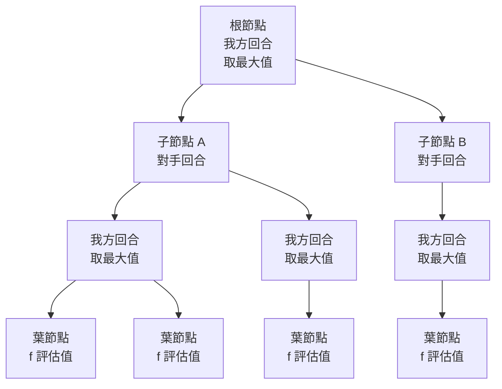

# 1.2 評估函數（Evaluation Function）與極小化極大演算法（Minimax Algorithm）

## 一個數字，決定一切

上一節結尾我們留下兩個組件：搜尋與評估。本節要把這兩個組件拆開來看清楚，因為它們各自對應 AI 歷史上的兩條不同路線，而它們的組合方式，正是整個古典搜尋時代的骨架。

先看評估函數。它是一個從盤面狀態到實數的映射：

$$
f : S \longrightarrow \mathbb{R}
$$

其中 $S$ 是遊戲狀態的集合，也就是所有可能盤面的集合。  $f$ 的值代表這個局面對**某一方的有利程度**：對我方而言，  $f$ 越大越好；對對手而言，同一個局面的評價值恰好取相反的符號。這個約定在數學上極為關鍵，它把「我方利益」與「對手利益」統一成同一個數值的兩種讀法，讓所有推理都可以只在一個方向上進行。

一旦有了 $f$ ，「該走哪一步」就變成一個明確的問題：在所有合法著法中，挑那個讓後續局面評價值最高的。在最簡單的形式下，這甚至不需要搜尋——只看一步就好。但一步是不夠的，因為對手下一步就會把你剛剛取得的優勢拿走。於是必須往下想兩步、三步、更多步。

## 搜尋樹：把「想」變成一棵樹

把遊戲規則展開成一棵樹，是搜尋的第一個基本動作。根節點是目前的盤面；每個節點的子節點是由它經過一步合法著法所能到達的下一個盤面；節點的層級（深度）代表已經走了幾步。樹的葉節點則是「不再往下想」的那些節點——通常有兩種原因：已經分出勝負（終局），或者達到了預設的深度上限 $d$ 。

這個展開的代價可以用一個簡單的模型描述。設每個節點平均有 $b$ 個合法著法（分支因子），搜尋到深度 $d$ 時需要檢視的葉節點數大約是：

$$
L \approx b^{d}
$$

在西洋跳棋中 $b$ 的實務平均值大約在 $10$ 到 $30$ 之間，國際象棋約 $30$ 到 $40$ 。以 $b = 30$ 計，往前看 $10$ 步就是約 $5.9 \times 10^{14}$ 個葉節點。就算有一台每秒能評估十億個局面的機器，也要花上將近兩個月。這就是為什麼「暴力搜尋」在直覺上明明最正確，實務上卻行不通的原因。

在西洋跳棋裡，狀態空間的大小是 $10^{20}$ 這個量級，遊戲樹的大小則要大得多——那是局面數乘上每個局面之後各自延伸出的分支。塞繆爾的程式之所以能在 1950 年代的機器上跑得動，靠的正是他不會真的走到底：他只在有限深度停下，並且——這是下一節的主題——大量地砍掉不可能贏的分支。

## 極小化極大：把對手的反應算進我的目標

極小化極大（minimax）演算法是處理這棵樹的第一個正式框架。它的想法直覺得近乎口語：**我走一步，我期望的是最好的結果；但對手會回應，而對手會挑那個對我最壞的回應。**

形式上，遞迴定義如下。對某個節點 $s$ ，令 $v(s)$ 為從 $s$ 出發、在給定深度內所能保證的評估值。若 $s$ 是葉節點（深度已達上限或已終局），則 $v(s) = f(s)$ ；若 $s$ 是我方的回合：

$$
v(s) = \max_{s' \in \mathrm{moves}(s)} v(s')
$$

若 $s$ 是對手的回合：

$$
v(s) = \min_{s' \in \mathrm{moves}(s)} v(s')
$$

「max」與「min」這兩個字的交替，就是極小化極大這個名字的由來。從根節點往下走，深度為偶數的一層用「取最大」，深度為奇數的一層用「取最小」，如此類推，最後回到根時得到的就是這一步的評估值。

這個結構的深意，在於它第一次把「對手的反應」形式化地納入了「我的目標」。在極小化極大出現之前，尋找最佳著法的主流直覺是「找一步讓我現在最有利」，這在很多場合下會被對手輕易反制。極小化極大告訴我們：一個好著法不是讓局面變好的著法，而是**讓局面變好、而且在對手最不情願的回應之後仍然變好**的著法。用一句話說，它是「壞消息優先」的樂觀主義。

正因為如此，極小化極大天然具備一個性質：它輸出的是「保證值」（minimax value），指的是在雙方都採取最佳策略的假設下所能達到的結果。這個保證值只依賴於遊戲規則與評估函數，不依賴任何對手的建模。對零和遊戲而言，這個量同時也是「我方能保證的上限」與「對手能強加的下限」，兩者相等，這是零和博弈的值定理。

| 特性 | 說明 | 意義 |
|---|---|---|
| 只用終局結果 | 葉節點的 $f$ 值代表最終收益 | 需要一棵完好的評估函數 |
| 保證值語義 | 在最壞對手回應下的結果 | 不需猜測對手的心理或弱點 |
| 樹形結構 | 節點即局面，邊即著法 | 把博弈變成可系統化搜尋的物件 |
| 交替結構 | 我方層取 max、對手層取 min | 對手的理性被建入目標函數 |
| 深度受限 | 實際上搜不到葉，只能停在 $d$ | 需要評估函數做近似 |
| 複雜度 | 節點數約 $b^{d}$ | 必須搭配剪枝才可行 |

## 另一個源頭：von Neumann 的博弈論

極小化極大並不是憑空冒出來的。1928 年，數學家 John von Neumann 在 *Zeitschrift für die angewandte Mathematik* 上發表了關於零和博弈的理論，為嚴謹的弈棋程式奠定了基礎。他給出了對玩家 I 和 II 最優策略的數學描述，並證明在這類遊戲中必然存在鞍點，也就是雙方各有一個策略，使得任何一方單方面改變策略都不會變得更好。

這個定理在當時並不純粹是數學遊戲：它意味著「最佳著法」在數學上是有定義的，而不是像棋壇老將間的口味之爭。von Neumann 也考慮過更一般的非零和情形，指出一般-sum 遊戲不保證有純策略鞍點，因此必須用混合策略——這句話在六十年後被 MCTS 的隨機性設計重新提起，只不過那時人們已經知道要在哪裡隨機、隨機多少。

把 von Neumann 的理論與塞繆爾的評估函數接起來，就得到極小化極大的全部零件：遊戲樹代表狀態轉移，葉節點的效用值代表終局收益，max/min 的交替代表雙方的最佳反應。極小化極大並非一個孤立的演算法發明，它是博弈論在計算機上的第一個實作。

## 一個具體的最小例子

為了看清楚遞迴的結構，考慮一個只有兩步的小遊戲。輪到我在兩個局面 $A$ 與 $B$ 之間選擇；我不論選哪一個，輪到對手時對手各有兩個回應，每個回應的終局分數如下：

| 我方選擇 | 對手回應 | 終局分數 |
|---|---|---|
| $A$ | $A_1$ | $+3$ |
| $A$ | $A_2$ | $+8$ |
| $B$ | $B_1$ | $-5$ |
| $B$ | $B_2$ | $+2$ |

對手會選對自己最不利的回應，也就是讓我方分數最低的那個：在 $A$ 之下是 $+3$ ，在 $B$ 之下是 $-5$ 。既然我方知道對手會這麼做，那麼在 $A$ 之下我方能保證的是 $+3$ ，在 $B$ 之下是 $-5$ 。於是我方選 $A$ 。極小化極大算出的根節點值是 $+3$ ，而那個 $+8$ 與 $+2$ 從頭到尾沒有影響到結論。

這個例子已經揭示了極小化極大的浪費所在：它計算了四個葉節點，其中兩個的結果最終被取 min 或 max 操作直接丟棄。如果樹再深十層，這種浪費就會膨脹成災難性的浪費。而「丟棄那些不可能改變結果的分支」正是剪枝的核心動機。

## 負極大與狀態改寫

實作上還有一個常見的等價變體叫**負極大**（negamax）。它的做法是把整棵樹的每個節點都視為「輪到當前這一方」的視角，於是遞迴一律寫成取最大值：

$$
v(s) = \max_{s' \in \mathrm{moves}(s)} \left( -v(s') \right)
$$

負極大的好處在於只需要寫一份遞迴式，不必分辨「我方回合」與「對手回合」，程式碼少一半，而且天然適用於同一份評估函數在兩邊都用得上的情況。代價是每次遞迴多一次取負號的運算，在現代硬體上這點開銷可以忽略。

另一個實作細節是把遊戲狀態改寫成**狀態不變量**，讓「找合法著法」與「套用著法」變成獨立的函式。塞繆爾在西洋跳棋上用的位元向量表示就是這條路線的先聲：棋盤編碼、合法著法生成器、著法套用器三者分離，搜尋器便可以在上面反覆迭代而不用擔心細節正確性。這個「表示與運算分離」的架構，後來在整個 AI 工程裡被反覆證明其價值。

## 保證性與它的代價

在完美資訊、零和、深度有限的遊戲中，極小化極大有一個很漂亮的性質：**它給出的答案是保證正確的**。也就是說，如果真的能搜到終局（  $d$ 無限大），回傳的策略在「對手也採取最佳策略」的前提下是最優的；即使對手不是最佳，極小化極大算出的值也只是高估，而不會低估自己的實際收益。這個單向誤差的性質，是它在工程上極為珍貴的。

代價則是那個 $b^{d}$ 。極小化極大在學術上漂亮，在實務上是災難——它的「保證」是用不可承受的計算量換來的。塞繆爾的西洋跳棋程式之所以只有大約三到四層的搜索深度（外加一層或兩層的啟發式排序），基本上就是被這個複雜度逼出來的。而 1997 年深藍之所以需要三台 RS/6000 平行工作站與專用晶片去處理每秒兩億個著法，也正是為了把同樣的 $b^{d}$ 再往下壓幾層。

因此接下來的問題是必然的：既然某些分支的答案已經好到不可能改變結果，能不能不要去算它們？答案就是剪枝，而剪枝的第一個通用答案，就是下一節的阿爾法貝塔。

還有一個更激進的問題：既然樹的形狀與節點數是被 $b$ 和 $d$ 決定的，而 $b$ 是遊戲規則的產物，那麼能不能不展開樹，改成某種「在樹上直接下注」的方法？這是蒙地卡羅樹搜尋在 2006 年之後的提問，也是整個第四章的伏筆。

在極小化極大之後，搜尋效率的問題從「怎麼算得更准」轉移成了「怎麼少算」。這個轉向本身就意味著，人們已經接受了一件事：在完美資訊遊戲裡，答案的品質主要取決於計算的深度與品質，而中間那些枝幹並不影響最終結論。剪枝的任務，就是把那些「不影響結論」的枝幹辨認出來。

## 搜尋深度的極限與「深度換廣度」的取捨

既然節點數是 $b^{d}$ ，那麼在固定的時間預算下，深度與分支因子之間必然有取捨。塞繆爾的西洋跳棋程式選擇了較淺的深度加上更好的排序；1950 年代的國際象棋程式則常選擇「每個節點都按著法價值排序、只展開最有希望的幾個分支」的近似做法，深度反而更深。

這裡出現了極小化極大框架內部的一個根本張力：搜尋深度讓評估函數的誤差被稀釋，而評估函數的品質讓深度變得不那麼必要。兩者相乘才構成棋力，但兩者都受到硬體的限制。1960 年代的硬體使這道乘法題變成了一場殘酷的資源競賽，而 1997 年的深藍之所以要用 $480$ 顆專用晶片、每秒評估兩億個局面，其本質就是在為 $b^{d}$ 這個乘積硬生生地填入資源。

直到 AlphaGo 出現，人們才認識到還有第三個乘數：讓機器自己去學「哪些分支值得展開」——這正是下一節阿爾法貝塔剪枝所要觸及、卻始終停在人給啟發式的境界上的那個問題。

## 隨機搜尋與啟發式的分工

在極小化極大之前，還有兩種更樸素的策略值得對照，因為它們點出了搜索與啟發式的分工。

第一種是**隨機搜尋**。讓機器隨機選一步、再隨機選一步，如此走到某個深度，用評估函數評分，重複很多次，取最好的一次。這種做法完全不需要建樹，實作簡單，但樣本效率極低——在分支因子 $30$ 的遊戲裡，要靠隨機抽樣找到「對手會犯錯」的那條分支，需要天文數量的樣本。

第二種是**純啟發式**。完全放棄搜尋，只靠評估函數對當前局面直接評分，選出評分最高的那一步。這是塞繆爾的評估函數單獨能做的事。它的效率最高，但視野最短——完全看不到對手的反擊。

極小化極大的出現，恰恰是把這兩者結合起來：用啟發式的評估函數作為深層終點，用搜尋把「我方與對手的交替反應」納入考量。於是形成了一個分工明確的架構：**搜尋負責深度與對抗性，評估函數負責把無法搜尋到底的深處近似掉**。這兩塊拼圖，後來分別長成了 MCTS 與價值網路，在 AlphaGo 那裡重新合體。

| 方法 | 每步計算量 | 能看見的深度 | 品質來源 |
|---|---|---|---|
| 隨機搜尋 | 高（需大量重複） | 固定但淺 | 樣本中的最好一次 |
| 純啟發式（只看 $f$ ） | 極低 | 零 | 評估函數的權重 |
| 極小化極大 | 極高 | $d$ 層 | 規則 + 評估函數 |
| 極小化極大 + 剪枝 | 高但可承受 | $d$ 層 | 規則 + 評估函數 + 排序 |

## 為什麼這是歷史上第一個正式框架

把極小化極大放回它出現的年代，會看到它的價值不在於多聰明，而在於多**一般**。在 1950 年代中期，絕大多數的機器學習研究還在處理「識別單一特徵」這類問題——把像素分類、把字元辨識出來。極小化極大卻直接處理「在對手的阻礙下達成目標」這個問題，而且用一個可以用紙筆推導、可以用課本教會、可以用機器執行的遞迴式把它寫了下來。

它還帶來了第一個明確的「目標函數」概念：所謂好著法，不是某種直覺的品質，而是某個實值函數在遞迴結構下的最大化。這個觀念在後來的一個半世紀裡不斷復現：強化學習中的回報（return）、AlphaGo 的策略網路與價值網路、AlphaZero 學到的數值表，背後都是同一種「把目標寫成一個可最大化的數」的結構。

而它留下的那個問題，正是塞繆爾已經開始觸碰的那個：極小化極大保證正確，但極小化極大是**人寫的**。遞迴結構、max 與 min 的交替、深度上限的設定——這些全是設計者的選擇，不是機器從遊戲本身推導出來的。剪枝的門檻可以學嗎？分支因子可以預測嗎？搜尋該有多深？評估函數該看哪些特徵？這些問題會一路帶到第 4 章、第 6 章，而 AlphaGo 與 AlphaZero 的答案，最終是把它們全部交給學習。

極小化極大是人類寫下的第一份「把對手算進我的目標」的正式藍圖。塞繆爾證明的是，這份藍圖裡的一塊磚——評估函數——可以讓機器自己去填。
