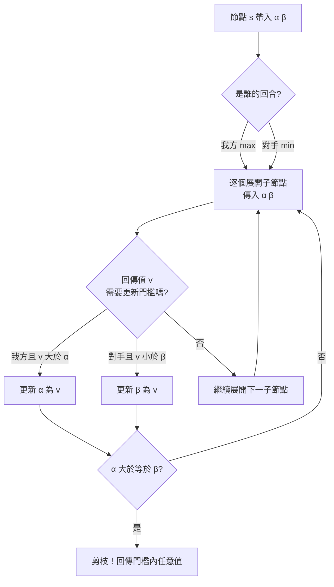
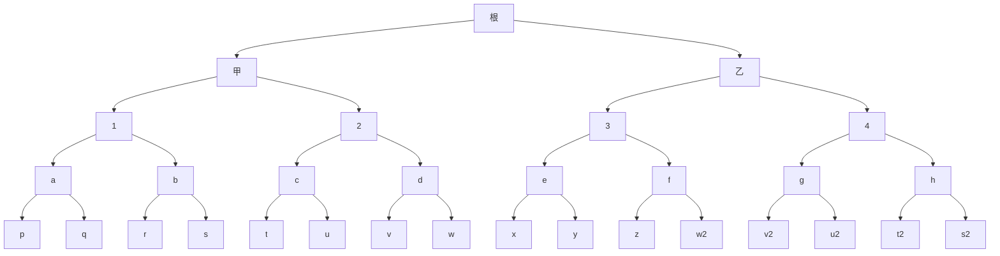

# 1.3 阿爾法貝塔剪枝（Alpha-Beta Pruning）：大幅提升搜尋效率（1958-1959）

## 浪費從何而來

上一節結尾留下一個明確的問題：極小化極大在深度 $`d`$ 、分支因子 $`b`$ 的遊戲裡要檢視約 $`b^{d}`$ 個葉節點，而其中絕大多數的計算結果，最後根本不會影響根節點的答案。那個只有兩步的小例子已經顯示，四個葉節點裡有兩個是被白白丟棄的；樹再深十層，這種浪費就會從「兩分之」膨脹到「九成九」。

剪枝的思想很簡單：既然某些分支已經被證明無論如何都不可能改變最終結論，那麼就別去展開它們。問題在於，搜尋器在進行中的某一刻，如何「知道」一個分支已經無關紧要？這需要的不是對整棵樹的先知，而是對**已經算出的部分結果**做精確的邊界推斷。

阿爾法貝塔剪枝（alpha-beta pruning）就是這樣的機制。它的思想源頭可以追溯到 Shannon 在 1958 年發表在 *Bell System Technical Journal* 的〈Programming a Computer for Playing Chess〉。Shannon 提出的不是一個實作細節，而是一個數量級的估計：透過在某個深度檢查局面並依某個啟發式計分來剪枝，棋力的提升大約與「搜尋深度取對數」的速度相當——也就是說把深度從 $`n`$ 加到 $`n^{2}`$ ，棋力約相當於把葉節點數從 $`b^{n}`$ 降到 $`b^{\sqrt{n}}`$ 。這個數量級的改善在硬體受限的年代極為誘人。

真正把這件事做成可用演算法的是 John McCarthy。1959 年，他在史丹佛的研討會上演示了一個名為「Kali」的西洋跳棋程式，首次公開了完整的阿爾法貝塔實作。McCarthy 的貢獻不在於數學上的新意，而在於把 Shannon 模糊的直覺變成了一段任何人可以寫出來、並且效率顯著優於極小化極大的程式碼。

阿爾法貝塔剪枝在今天已經成為教科書裡最普及的搜尋演算法之一，幾乎每一本 AI 教材都會把它與極小化極大放在同一章講解。但值得留意它的提出年代：1959 年，比 IBM 701 晚了七年，比塞繆爾的西洋跳棋程式晚了七年。也就是說，當時的機器計算能力比塞繆爾手上有還要充足一些，剪枝卻不是被「硬逼出來」的，而是被「想出來」的——人們意識到，在計算這個瓶頸裡，有相當一部分浪費是可以用演算法而非硬體來消除的。

McCarthy 後來回憶，Alpha-Beta 這個名字取得相當隨意：因為剪枝涉及兩個門檻，就照著字母表的順序叫了 alpha 和 beta。他也承認，最初的實作裡有著種種「笨拙之處」——門檻的更新邏輯被寫成好幾個互相重疊的函式，邊界情況常常出錯，需要反覆除錯才讓整棵樹的搜尋結果與完整極小化極大完全一致。這個「除錯到結果一致」的過程，恰恰說明了剪枝是一種**保持語義的加速**而非啟發式的近似：它不允許改變答案，只允許跳過不可能影響答案的計算。這個性質在後來所有以剪枝為基礎的加速技術中都被嚴格遵守。

## 兩個門檻的語義

阿爾法貝塔的核心是兩個隨著遞迴下行而更新的門檻值。把它們想成「我還願意接受多少損失」與「我還能承受多少損失」，會比背定義容易得多。

令 $`\alpha`$ 為目前這條路徑上**我方已經能保證達到的最好下界**，令 $`\beta`$ 為**對手能強加給我方的最壞上界**。在節點 $`s`$ 上呼叫搜尋時，帶入 $`(\alpha, \beta)`$ 兩個參數，節點傳回一個值 $`v(s)`$ ，同時可能把兩個門檻一起更新。

規則可以分成兩個方向：

- 在**我方回合**（取最大值的一層），若某個子節點回傳值 $`v > \alpha`$ ，就更新 $`\alpha \leftarrow v`$ 。因為找到了比我方原有保證更好的選擇。
- 在**對手回合**（取最小值的一層），若某個子節點回傳值 $`v < \beta`$ ，就更新 $`\beta \leftarrow v`$ 。因為找到了比對手原有上界更壞的結果。

關鍵的剪枝時刻是：**當 $`\alpha \ge \beta`$ 時，這個節點就可以直接剪枝**，回傳一個落在門檻之間的任意值即可，因為根節點的最終結論已經不可能被這條分支改變。

這個「 $`\alpha \ge \beta`$ 就停」的想法，用一個日常比喻來說明最清楚：當我在議價時已經報出一個價碼，而對手能接受的最高價已經低於我的底線，我知道再談下去也成交不了，那我就可以離開桌子。搜尋樹裡的剪枝，正是這種「發現無共識就早退」的系統化版本。

## 剪枝前後的樹

為了直觀看出剪枝省下多少東西，可以畫出兩棵對照的樹。假設分支因子為 $`2`$ 、深度為 $`4`$ ，根節點的分支被安排成一個「好在前、差在後」的順序。

在這棵完整的樹裡，每個葉節點代表一次評估函數的呼叫，共 $`16`$ 次。若著法順序完美，阿爾法貝塔只需展開其中約一半。

在完全排序（每次都先展開最有可能最好的著法）的理想情況下，阿爾法貝塔只會展開大約一半的葉節點；最壞情況則是完全没有剪枝，與原始搜尋相同。Shannon 與 McCarthy 得到的量級估計是：完美排序下節點數從 $`b^{d}`$ 降到約 $`b^{d/2}`$ 。以 $`b = 30`$ 、 $`d = 10`$ 為例，完整搜尋約需 $`5.9 \times 10^{14}`$ 個葉節點，理想剪枝後約只需 $`7.7 \times 10^{7}`$ 個——相差七個數量級。這就是為什麼剪枝在硬體受限的年代不是「優化」，而是「生存」。

| 排序品質 | 剪枝後節點數 | 相對完整搜尋 |
|---|---|---|
| 完美排序 | 約 $`b^{d/2}`$ | 減少約一半指數 |
| 良好排序 | 介於兩者之間 | 實務上最常見的情況 |
| 最差排序 | 約 $`b^{d}`$ | 幾乎不剪枝 |

## 排序本身就是知識

這裡浮現出一個極重要的直覺，而它正是整個「從規則到學習」轉捩點的第一塊磚。

剪枝效果完全取決於著法的展開順序。如果最好的著法排在前面，搜尋很快就會把 $`\alpha`$ 拉高、把 $`\beta`$ 壓低，後面的分支立刻被判定為無關而遭剪去；如果最差的著法排在前面，機器要先花大量成本去探索那些最終會被丟棄的分支， $`\alpha`$ 遲遲拉不高，剪枝也就遲遲不發生。

換言之，**順序本身就是一種知識**：它告訴機器「先看哪裡」。而這個知識，在阿爾法貝塔的原始形式裡，是由人類棋手憑直覺編寫的。塞繆爾的西洋跳棋程式裡就有這樣的機制：他依子力價值對著法排序，依位置好壞對子節點排序。麥卡錫的 Kali 同樣如此。

於是這裡浮現出一個尖銳的問題：搜尋框架是強的、通用而優雅的，但它所需要的每一份「加速」都以人類知識的形式從外部注入。門檻傳遞規則是人寫的，深度上限是人設的，著法排序是人排的，評估函數是人給的（塞繆爾雖讓它可學，但學習訊號仍來自人類設定的特徵與對弈框架）。剪枝並沒有讓機器變得更「自主」，它只是讓人類的直覺更有效率地發揮作用。

這也解釋了為什麼 AlphaGo 時代的第一批工作是把深度神經網路「插進」極小化極大樹裡：用網路來學評估函數與著法排序，而保留人類的樹狀框架作為骨架。策略網路負責排序，價值網路負責評估——這兩者正好對應阿爾法貝塔最依賴的兩份人類知識。到了 AlphaZero，連這兩份知識都被丟掉，樹結構改由蒙地卡羅樹搜尋承擔，而排序與評估全部由一個共享的網路從自我對弈中學出。

## 實作上的變體與難題

阿爾法貝塔的基本形式在實作上有些麻煩，主要圍繞在「剪枝時到底回傳什麼」這個問題上。當一個節點因為 $`\alpha \ge \beta`$ 而提前中止搜尋時，它的真實值並未被求出來。此時可以有兩種處理方式：**硬失效**（fail-hard）直接回傳門檻本身，回傳值可能超出實際範圍；**軟失效**（fail-soft）回傳一個「至少比某數好」或「至多比某數差」的邊界值，這個值雖然不精確，但更接近真相，也讓上層的門檻更新更有效。

第二個難題出現在並行的環境。今天的引擎幾乎都是多執行緒並行搜尋，而 Alpha-Beta 的剪枝判斷本質上是序列的：只有在看完某個子節點之後，才能決定要不要展開下一個。所以並行版本必須在「同時鋪開多個子節點」與「保留剪枝效率」之間取捨，實務上常見的折衷是先展開少數幾個高度懷疑的著法（例如前 5 個），其餘等第一個結果出來再決定。

第三個難題是「選擇性搜尋」：在某些節點不展開全部著法，只展開被認為有希望的幾個，剩下的用評估函數直接估值。這已經不再是純粹的剪枝，而是一種帶有啟發式色彩的近似，也正是我們下一節要談的「排序與選擇本身就是知識」的入口。

| 變體 | 核心差異 | 影響 |
|---|---|---|
| 硬失效剪枝 | 回傳門檻值本身 | 簡單但回傳值可能失真 |
| 軟失效剪枝 | 回傳不精確但合理的邊界值 | 門檻更新更有效，實務上較常用 |
| 並行剪枝 | 同時鋪開多個子節點 | 犧牲部分剪枝效率換取並行度 |
| 選擇性搜尋 | 只展開部分著法 | 速度快但引入啟發式近似 |
| 主變化搜尋 | 先搜一個著法，後續著法以零窗口驗證 | 現代引擎常見的實作基礎 |

## 排序的藝術與它的極限

既然排序品質決定剪枝效果，那麼工程上就出現了一整套「把排序做好」的技巧。最基本的是依著法本身對當前玩家的立即價值排序——例如國際象棋中能得子、能得王、多半能穩定吃掉對方車的著法排在前面。其次是**殺著**（killer move）技巧：記住上一層搜尋中曾導致快速剪枝的著法，在同層再次遇到時優先嘗試，因為它很可能同樣有效。**歷史啟發**（history heuristic）則更進一步，跨層累積每個著法被嘗試時的表現，把長期表現好的著法往前排。

這套技巧的效率驚人。在實測中，加入 killer move 與 history heuristic 的引擎往往能獲得一到兩個數量級的效率提升——這意味著同樣的硬體時間可以多看好幾層。這也解釋了為什麼同一套演算法，不同引擎的強度可以差出上百個 Elo。

但這套藝術有它的極限，而且極限的本質是殘酷的：所有排序技巧都在利用**人類下棋時的結構性偏見**——人類會優先考慮攻擊、會優先考慮中心、會優先考慮自己熟悉的計畫。這些偏見對人類棋手有效，是因為人類的搜尋同樣受限。但一旦機器有了比人類強得多的搜尋能力，這些偏見就會變成浪費：花費大量資源去探索一個被規則保證無法成功的變化，正是純粹的浪費。

於是一個自然的問題浮現：如果順序是一種知識，那麼能不能讓機器自己學出更好的順序？這正是策略網路的起源動機。2013 年，Silver 等人用捲積神經網路訓練出一個以局面為輸入、以各著法機率為輸出的策略網路，它的用途恰恰就是替引擎做排序，把人類的排序啟發式換成從數百萬局人類棋譜中學到的統計傾向。而到了 AlphaZero，連棋譜都不用了，排序完全由自我對弈產生。

## 剪枝的極限與AlphaGo的問題意識

讓我們退一步，看阿爾法貝塔剪枝所處的整體位置。它是一個**通用**的加速機制：它不依賴任何特定遊戲的知識，只依賴「我方最大化、對手最小化」這個結構。這就是它能從西洋跳棋一路沿用到國際象棋、圍棋、以及後來的 MCTS 的原因。

但它也是一個**人類設計**的加速機制。門檻的語義、排序的依據、深度上限的設定、評估函數的特徵清單——每一項都是人給的。整個古典搜尋時代可以說是「人寫啟發式、機器做計算」的時代；阿爾法貝塔則是這個時代最精巧的加速器，也是它最徹底的成就。

然而 2016 年 AlphaGo 的出現，正是因為有人問出了一個古典時代沒有人問的問題：**如果這個人類給的啟發式本身，就是圍棋失敗的原因呢？**

圍棋的狀態空間約 $`10^{170}`$ ，博弈樹約 $`10^{360}`$ 。在這種規模下，再精巧的剪枝也不夠，因為剪枝的比例再高也壓不過指數本身。更關鍵的是，圍棋的評估函數極難用人寫的方式做好——形勢是流動的，地是空的，厚薄與虛實需要長期累積才見分曉。人類寫不出好的圍棋評估函數，於是「人類給的啟發式」就成了瓶頸。

AlphaGo 的回答是：讓機器自己學評估（價值網路）與自己學排序（策略網路），再把這兩者塞進 MCTS 裡，用數值網路來做節點的選擇與剪枝判斷——換句話說，把阿爾法貝塔那套「門檻與排序」的思考方式，用一個從零學起的網路重新實現了一遍。

這就是阿爾法貝塔剪枝在歷史上的位置：它是人類直覺的最後一次大規模制度化，也是它被機器學習取代的起點。1959 年 McCarthy 寫下那段剪枝程式碼的時候，他解決的是「怎麼讓機器算得更快」。六十年後的問題變成了「怎麼讓機器自己想出該算什麼」。前者是演算法的課題，後者是學習的課題，而後者顯然更難，也更接近人之所以為人的那件事。

回頭看，阿爾法貝塔在整個歷史序列中的位置相當特別。它是「古典搜尋」時代的頂點，同時也是這條路線的終點。在它之後，棋類 AI 的進步不再主要來自新的剪枝規則，而來自三個新方向：更好的評估函數（從人寫的特徵，到神經網路）、更好的搜尋取樣策略（從窮舉遍歷，到蒙地卡羅樹搜尋的選擇—擴展—模擬）、以及專用硬體（從通用伺服器，到 TPU）。

而它的思想遺產在今天依然完整活著。每一個 MCTS 的節點擴張都帶著類似 $`\alpha`$ 、 $`\beta`$ 的門檻語義：節點的價值一旦被某條路徑拉高，其他路徑就變得不再值得探索。UCT 公式（Upper Confidence bound applied to Trees）把這個想法推廣到非確定性的抽樣情境，用「探索次數的不確定性」取代了絕對門檻。Killer Move 與 History Heuristic 這類排序技巧則是「順序即知識」在人類設計的引擎裡的直接殘影。

最耐人尋味的一點是：McCarthy 在 1959 年實現的這個演算法，本質上是把人類棋手在樹上搜索時的直覺——「先看最有希望的變化，不行就換一條」——寫成了可以自我執行的規則。它是一份被形式化了的人類經驗，六十年後，人們又花大力氣讓機器自己去學出同樣的直覺。某種意義上，AlphaZero 的整個研究計畫，就是要把阿爾法貝塔裡那兩個人類參數——順序與評估——交還給機器。

在塞繆爾的機器只能笨拙地數著棋子、在幾百毫秒內決定一盘的年代，人類已經在直覺上知道「該看哪裡」。阿爾法貝塔做的事情，是把這個直覺變成了一段程式碼。而機器學習要做的事情，是讓這段程式碼從此不必由人寫。
