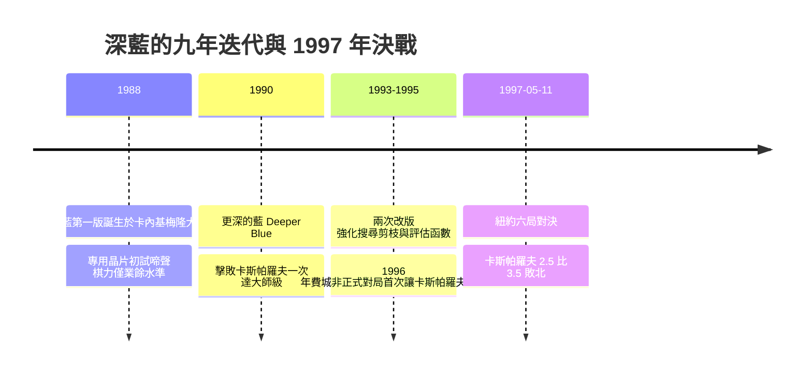
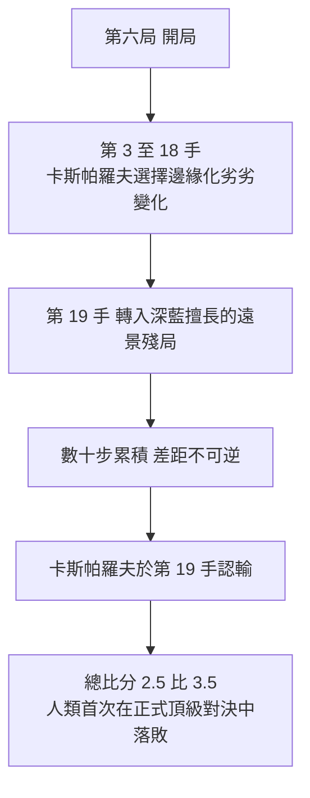
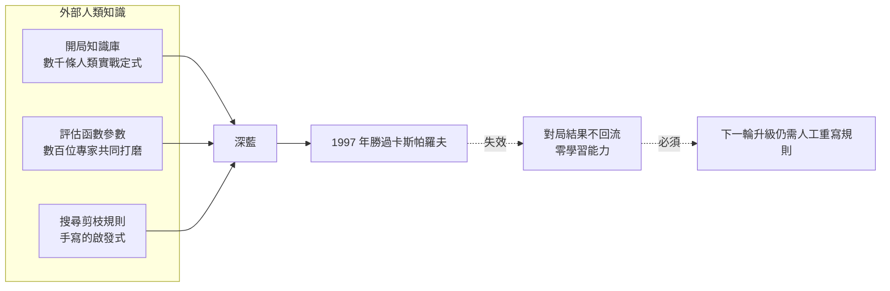

# 2.1 1997 年卡斯帕羅夫對決深藍的歷史意義

## 一、故事真正開始的年份不是 1997，而是 1988

1997 年 5 月 11 日至紐約大西洋酒店的那場對局，幾乎是人工智慧史上最有名的一場比賽，也是最容易被人記錯的一場。它最容易被記錯的地方，在於人們傾向把它當成故事的起點——仿佛在那一天之前，電腦下棋只是一串乏味的學術實驗。然而真正的事實是，IBM 團隊在這場比賽之前已經默默運作了整整九年，而那九年的每一輪迭代，才真正決定了 1997 年那場勝利可能的物理基礎。

故事的第一個節點是 1988 年。IBM 的一支研究團隊在卡內基梅隆大學（Carnegie Mellon University）完成了深藍（Deep Blue）的第一個版本。那時它的形態還相當笨拙，採用的是 IBM 專為處理器設計的巨型主機與大量平行晶片，評估函數粗糙，搜尋深度淺，開局知識幾乎空白。它在實力上與頂尖人類棋手相差甚遠，只能說明了一件事：把西洋棋交給專用硬體去窮舉，方向是可行的。

第二個節點是 1990 年的「更深的藍」（Deeper Blue）。團隊換上更快的晶片與更好的搜尋控制，同時請來美國棋界頂尖的頂尖棋手與電腦專家共同打磨評估函數。1990 年的版本達到了國際象棋大師段位，並且在正式比賽中贏過卡斯帕羅夫一次——那是一場圍棋式的短賽，歷史學家普遍認為那次勝負並不能代表真實棋力差距，因為雙方的時間控制與準備方式都偏向於製造戲劇效果。

接下來的七年間，深藍並沒有出現在聚光燈下，卻是最關鍵的七年。團隊在 1993 年與 1995 年各進行了一次改版，重點不再是單純提升速度，而是讓機器學會「不搜那些已經知道沒有用的節點」。搜尋深度、評估精度、開局知識三者被反覆揉合，終於在 1996 年的一次非正式對局中讓卡斯帕羅夫首次落敗——那場比賽安排在費城，結果是兩勝一負和棋，媒體的注意力遠不如後來。

這段沉默期最值得記取的一點，是團隊所採取的開發哲學：每一次改版都不是「讓機器更聰明」，而是「讓同一份人類知識被查到更深的地方」。評估函數的參數沒有變聰，但搜尋能穿透的殘局層數變多了；開局庫沒有變大，但能被正確引用的定式變多了。這是一種與機器學習時代截然不同的演進節奏——它的每一次進步都要由人先把知識整理成可被程式檢查的形式，機器本身不貢獻任何新的東西。這條限制會一路貫穿深藍的整個生涯，也構成本章第三節要處分的主題。

## 二、紐約之戰：比分之外的真正事件

正式比賽於 1997 年 5 月 11 日在紐約的西奧多大飯店進行，由 IBM 出資，總獎金一百四十萬美元，是當時西洋棋史上規模最大的比賽。比分的形式是六局制、三局為和，最終卡斯帕羅夫以 $2.5$ 比 $3.5$ 落敗。但真正決定歷史意義的，不是總分，而是第六局。

賽前三天，紐約金融區擠滿了記者與電視轉播車，IBM 在酒店門口搭起巨大的看板，棋盤被投影到會場牆上。棋手每走一步，數百名圍觀者同時看見那個有點像觸控螢幕的顯示設備上跳出的數字。那畫面在當時是全新媒介：觀眾第一次不只觀看棋，而是在觀看一台機器運算。圍棋與西洋棋之間長久以來那種「棋盤是抽象的」距離感，就在那一晚被硬體撕開了。

前五局打成二比二，第五局卡斯帕羅夫获胜，這是整場比賽裡最著名的一局——他以將軍的姿態收官，媒體歡呼雀躍，認為人類至少守住了尊嚴。然而第六局出現了完全不同的性質。卡斯帕羅夫在開局後便走出劣勢，棋評者指出他選擇了一條「在人類棋理上完全站不住腳」的變化：他在第十八步附近放棄了中心控制，把棋子推向邊緣地帶，而那正是深藍最擅長以遠景計算反覆收割的區域。從第十九步起，局勢在深藍的計算下不可逆地傾斜，無論卡斯帕羅夫如何掙扎，數十步之後已成定局。他在第十九步就已經認輸。

| 局次 | 結果 | 性質與意義 |
| --- | --- | --- |
| 第一局 | 卡斯帕羅夫勝 | 深藍在開局階段出現明顯時序錯誤，被人類抓住 |
| 第二局 | 深藍勝 | 卡斯帕羅夫一次過早的交換判斷失誤，中局崩解 |
| 第三局 | 和棋 | 雙方均保守，試探彼此的極限 |
| 第四局 | 深藍勝 | 長局消耗，深藍在殘局以精確計算取勝 |
| 第五局 | 卡斯帕羅夫勝 | 卡斯帕羅夫漂亮的將軍收官，媒體視為人類的反攻 |
| 第六局 | 深藍勝 | 第 19 步即認輸，差距在人類認為安全的地方被累積 |

那條長達十九步的將殺路徑之所以關鍵，在於它不是靠一步離譜的壞棋取勝，而是靠一連串在搜尋樹中被反覆驗證、每一手都讓人類覺得「還好、還能撐」的選擇，最終被累積成無法挽回的差距。人類棋手在第六局裡幾乎沒有任何一步是明顯的錯誤，但每一手都在深藍的深層計算中略差半分。這就是暴力美學最典型的形態：它不靠奇招，它靠深度。

## 三、為什麼這是一場分水嶺，而不是「機器智力」的證明

1997 年的媒體敘事幾乎一致地把它讀成「機器第一次在智力上超越人類」。但若以 2010 年代之後的技術眼光回頭看，這個讀法在技術層面是錯的，在歷史層面則會遮蔽真正重要的東西。

技術層面錯在哪裡？深藍並不會「理解」棋。它不會從自己的經驗中學到任何東西，它不會解釋自己為什麼在某個局面選擇某一手，它甚至不會在下完一局之後記住任何一點東西。它的整體能力來自三件事的加總：把人寫好的評估函數硬編碼成電路、把人寫好的開局知識塞進查表、用窮舉把搜尋深度推到人類無法企及的高度。沒有任何一項是「從經驗中湧現的智慧」。它更像是一把被磨到極致的尺子，而不是一位會思考的棋手。

更關鍵的是，它不是獨立完成的。深藍的評估函數裡包含了數百位人類棋手的知識：哪種結構在實戰中好、哪種交換划算、哪種局面該立刻求和。這些知識由頂尖專家提供，機器只負責把它們放大到極致。換句話說，深藍是「人類智慧的蒸餾物，被送進了比人類快上億倍的蒸餾器」。把這樣的結果稱為「機器智力」，等於把「混合了人類基因的機器人跑贏了馬拉松」說成「機器人長出了腿」。

還有一個容易被忽略的量觀點。人類棋手在第六局裡心算的深度，大約是三到四層的變化，加上對殘局表格的記憶與模糊的模式辨識。深藍的實際深度是數十層。差距之所以變成勝負，不是因為深藍「懂得更多」，而是因為它能把更多可能性一起攤開來比較。這是計算量與知識量兩條不同的軸，而 1997 年的敘事幾乎總把它們混為一談。

歷史層面真正重要的是：這場比賽讓「人類頂尖棋力」這個指標，第一次被公開、可量化地跨過了。從此以後，整個西洋棋界心知肚明，人類冠軍已經不再是終點線，而是一個需要被重新定義的參考基準——一個會隨著硬體升級而移動的移動標靶。這才是分水嶺的真正含義：它不是終點線被跨越的那一刻，而是「終點線從此固定下來」這件事被承認的那一刻。

## 四、卡斯帕羅夫的疑慮與事後的解釋

賽前，卡斯帕羅夫並不抱持必敗的態度。他的公開表態裡有一種罕見的雙重清醒：一方面他承認深藍的速度與資料量遠超人，另一方面他強調西洋棋史上大量認真的作品至今仍無法被任何機器以一致的深度算出來，他相信人類在這個領域還有「尚未被轉化為數字」的東西。他甚至在賽前公開表示，相較於 1990 年那次短賽，他這次的準備更充分。

賽後，他的解釋則極為克制且耐人尋味。「深藍有時會做出很笨的選擇，」他說，特別是在那種不需要計算就能判斷清楚的簡單局面裡，它偶爾會走出讓人不可思議的次佳手——在人類看來無可挑剔的地方，它卻選擇了一條更費力而結果更差的路。這句話後來被無數次引用，因為它精確地命中了深藍的技術本質：它的力量來自一致性的深度，而它在「不需要深度的地方」缺乏人類那種近乎本能的品味。

這位世界冠軍後來成了反對把西洋棋 AI 視為人類智慧終結的倡導者之一。他把比賽稱為一次偉大的計算機工程成就，同時反覆強調人類棋手並未失去創造力，反而因為看見了機器做不到什麼，而更能理解自己直覺的來源。他的診斷是對的：深藍缺的不是算力，而是那種能夠辨認「哪裡根本不需要算」的智慧。而這正是後來深度學習要處理的問題。

## 五、商業化與公共敘事

深藍在賽後沒有走進實驗室，它走進了廣告。IBM 把它推上 IBM Think 大會的舞台，一句「讓國王流淚」的廣告詞把技術勝利轉譯成企業信譽。這次轉譯產生了長遠的經濟後果：IBM 在 1997 到 2001 年間的股價與品牌認知度大幅上升，IBM 也藉此重返在 1991 年出售個人電腦業務後逐漸流失的市場信心地位。深藍的商業化因此不只是售出機器，而是把「專用硬體可以兌現通用智慧」這個敘事賣給了全世界。

公共敘事也在此處分岔出兩條線。一條通往終極樂觀：既然西洋棋可以被窮舉，圍棋為何不行？既然人類頂尖棋力可以被超越，其他需要智力的領域為何不行？另一條通往冷靜的懷疑：既然這場勝利其實建立在人寫的知識之上，那麼所謂「AI 超越人類」的說法，是不是把工程成果誤認成了智能湧現？

值得留意的是，IBM 團隊自己對此非常清楚。IBM 研究院科學家 Murray Campbell 在賽後受訪時明確指出，深藍並沒有解決西洋棋，它只是把西洋棋推到了一個經典搜尋方法的極限，並且需要不斷餵入人類的規則與知識才能繼續前進。這個評價在當時被媒體當作謙辭，卻在半個世紀後被證明是全篇最準確的預言。

Campbell 說的那句「不斷餵入」，後來被團隊裡負責搜尋控制的權威 Bruce Pandolfini 說得更直白：深藍就像一台跑得極快的計算機，快到你沒空思考，但你得先把規則寫進去它才能運轉。他還補了一句意味深長的話——如果對手是一台同樣快的機器，深藍大概會輸，因為那時它沒有什麼特別的東西可以拿出來贏。

## 六、為什麼「深藍不是終點」：每一次前進都要重新餵養

要理解深藍的侷限，最簡單也最殘酷的方式是：把它的知識來源全部抽掉。深藍若沒有開局資料庫，就會在常見的開局中浪費時間；若沒有數百位專家打磨過的評估函數，它的搜尋再深，也會在細微處判斷錯誤而丟掉整個中局。它不會從比賽中學習——1997 年那一場的所有對局，對深藍而言是完全空白的。棋手會記住「我昨天那局不該那樣走」，深藍不會。

於是我們得到一個有點諷刺的結論：深藍每贏一局，都需要人類重新餵養一次。這正是古典系統的定義性特徵——知識來自外部，能力來自算力，進步的邊際成本由人類承擔。1997 年的媒體想講一個「機器站起來」的故事，但技術事實是另一個故事：人類把累積了幾百年的頂尖知識，做成了一台能以億倍速度執行的機器，而機器本身對這些知識的來源一無所知。

這條斷裂線，就是本書後續所有章節的起點。第 3 章會說明當狀態空間膨脹到 $10^{170}$ 量級、博弈樹深到 $10^{360}$ 量級時，純粹加深搜索會如何撞牆。第 4 章與第 5 章會說明，AlphaGo 之所以能在 2016 年贏下圍棋，關鍵正是把「人類知識的餵養」換成了「自我對弈的迴圈」。而第 2.3 節將在本章的基礎上更仔細地拆解「棋力不等於智慧」這個命題，看看深藍的盲點究竟盲在哪裡。

值得再補一句，因為它常被略過：深藍所代表的古典系統並非毫無價值，它確立了後來所有博弈 AI 都仍在使用的骨架——局面表示、搜尋樹、剪枝、評估、走法生成。AlphaGo 並未推翻這副骨架，而是在其上嫁接了神經網路作為啟發式引擎。所以更準確的說法不是「深藍錯了」，而是「深藍的路線抵達了終點，而它的骨架被人類保留下來、換上了新的引擎」。這也提醒我們，技術演進很少是拋棄式的，更多時候是「同一副骨架、新的血肉」，而判斷一項技術的侷限，往往要等到下一種材料出現時才看得出來。

另一個同樣重要的事後視角是：深藍並沒有真的終結西洋棋。它改變的是西洋棋的樣貌——頂尖職業棋手開始使用與深藍同類的引擎做訓練對局與分析，引擎的評估輸出（evaluation score）成為新的通用語言，棋譜的價值判斷基準被重新校準。人類棋手沒有消失，但他們的工作從「跟機器比記憶與計算」轉向「提煉更好的啟發式給自己用」。這正是 2.3 節要談的張力：人類從來就不是被機器淘汰，而是被迫升級自己與機器的分工方式。

在 1997 年的那個房間裡，卡斯帕羅夫看著螢幕上自己第 19 步認輸的結果，IBM 的工程師看著他們花費九年、匯聚數百人智慧的機器第一次被寫進了勝負記錄。歷史的分水嶺不在於誰贏了，而在於那一刻人類清楚地看見：機器可以贏，而且贏的方式非常笨拙，非常依賴人。
