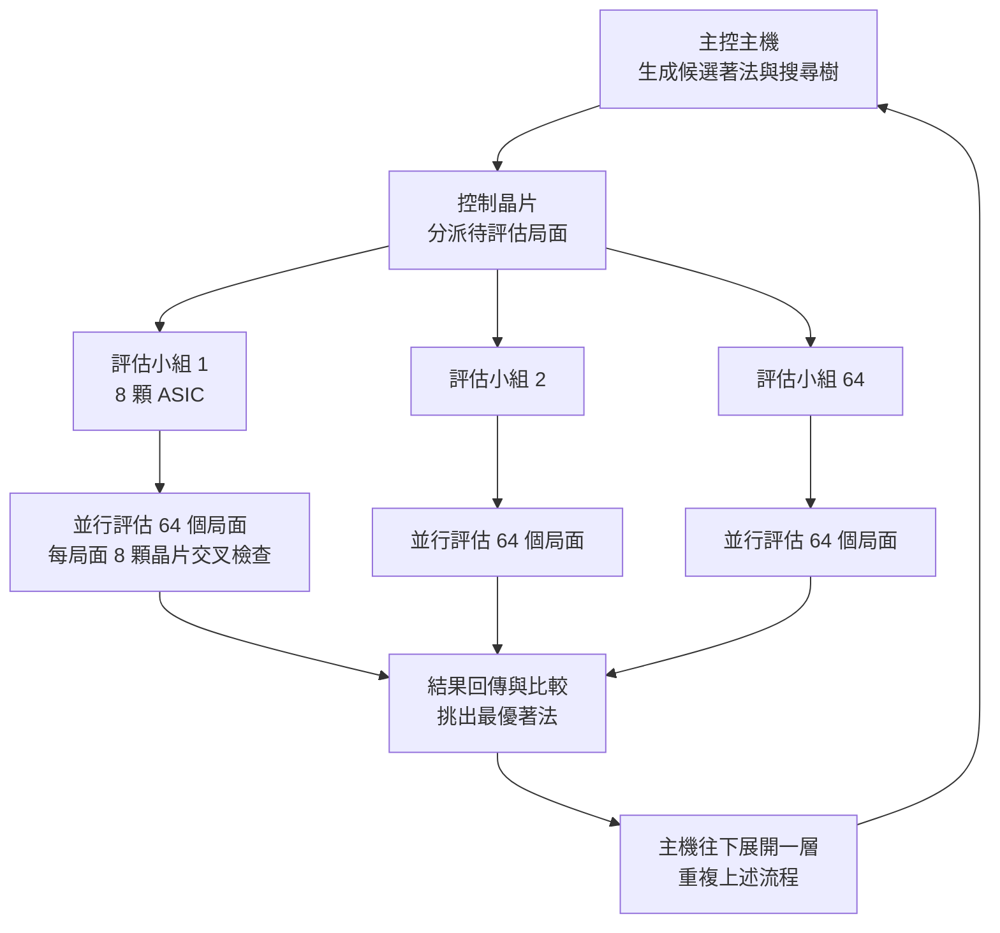
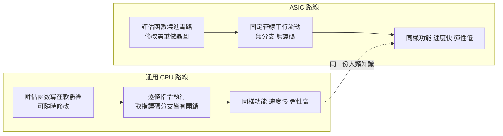

# 2.2 專用晶片與平行運算：暴力美學的極致

## 一、1997 年那台機器的真實形貌

談論 1997 年的深藍時，最容易出現的錯誤想像，是把它當成一台放大的桌上型電腦。事實上它是一整套機器：主控處理器加上數百顆專用晶片，構成一台體積龐大、需要冷卻、耗電以千瓦計的機器，放在紐約大飯店的比賽現場。棋手面對的顯示設備只是介面，真正運算的是 IBM 位於遠端機房的整機系統，比賽室的網路延遲被嚴格控制在毫秒級。

公開的硬體規格大致是這樣的：整機共有 $`480`$ 顆專用晶片，每顆晶片內含 $`8`$ 個評估器，合計 $`3840`$ 個評估器同時工作。為了讓資料流動有效率，晶片被組成 $`64`$ 個評估小組，每個小組由 $`8`$ 顆晶片組成，共同評估 $`64`$ 個不同局面。整機的峰值速度約在每秒上億個局面的量級。資料在晶片之間以平行方式流動，每個小組各自比較結果並挑出最優者，這種結構使得硬體的複雜度被壓在晶片內，而軟體只負責下達「算哪些局面」與「回報哪個最好」的指令。

| 規格項目 | 1997 年深藍 | 說明 |
| --- | --- | --- |
| 專用 ASIC 晶片數 | $`480`$ 顆 | 以標準化晶圓量產，非客製單顆設計 |
| 每晶片評估器數 | $`8`$ 個 | 合計 $`3840`$ 個評估單元並行 |
| 晶片分組方式 | $`64`$ 組，每組 $`8`$ 顆 | 每組同時評估 $`64`$ 個不同局面 |
| 整機評估吞吐量 | 每秒上億個局面 | 峰值量級，非平均值 |
| 記憶體 | 數百 MB 等級 | 含開局庫與殘局表 |
| 連線方式 | RS-485 序列匯流排 | 1990 年代的標準平行匯流排技術 |
| 搜尋深度 | 約數十層 | 視局面類型與時間控制而變 |
| 開局知識庫 | 數萬條實戰定式 | 由人類棋手整理維護 |

這個架構最迷人的地方，在於它把「深度」與「廣度」的取捨變成了一個純粹的硬體問題。傳統軟體在同樣的記憶體與時脈限制下，每多算一層就得多花時間，而時間就是分數。深藍的做法是：既然單顆通用處理器太慢，那就讓數千顆專用晶片同時把同一層的兄弟節點全部算完，讓機器在牆上的時鐘裡能鑽得比人類深得多。

這裡還有一個常被略過的工程細節：深藍的每手棋必須在時間控制的框架內完成，包括所有後台運算都得算在內。這意味著搜尋不是無限深，而是必須在固定時間內決定「還算不算下一層」。於是搜尋控制策略變得極其重要——它是一種帶著計時器前進的啟發式：什麼時候該繼續深入，什麼時候該用當前最佳著法當暫定答案，什麼時候該認輸並把時間還給人類。這部分軟體邏輯與硬體同等重要，事後看來，它其實是深藍身上最接近「智慧」的部分——儘管它依然完全是人寫的規則。

## 二、為什麼自訂 ASIC 有效：把評估函數變成電路

要理解專用晶片為什麼在 1997 年是合理的選擇，而不是過時的怪獸，必須先理解當時通用 CPU 的處境。那時的處理器擅長的是循序的通用指令，任何一個乘加運算都要經過取指、譯碼、執行的完整管線。然而西洋棋的評估函數本質上是一組固定形狀的運算：掃描盤面、統計子力、計算結構特徵、套用一組權重、加總。把這整套固定形狀反覆執行數十億次，卻要為每一個運算支付通用指令集的全部開銷，這是一種純粹的浪費。

專用積體電路的解法是把這組運算硬編碼成固定的電路。一旦硬編碼，評估一個局面就從「執行數千條指令」縮減為「讓電路跑一遍」；資料在晶片內部以固定的時序平行流動，不需要任何分支判斷，不需要任何快取失配的懲罰。工程上的代價是：晶片設計完成後就無法改變評估函數的任何一個參數，改一個權重就要重做整條晶圓的流程。這個代價在 1997 年可以接受，因為深藍團隊每隔一兩年就會重新設計一輪。

換句話說，專用晶片把原本存在於軟體裡的「規則」下沉到硬體裡。規則被燒進矽晶之後，就不能隨時修改，但也因此獲得了通用 CPU 永遠無法提供的速度。這是一種非常典型的工程取捨：拿掉可塑性，換取吞吐量。

這個取捨在 1997 年之所以被普遍視為合理，是因為西洋棋本身是封閉的：規則不會變，目標不會變，硬體的唯一任務就是同一件事。因此「專用」的資產負債表非常乾淨——設計一次，用很多年。而如果任務本身會變化，專用化的代價就會急遽上升。這正是深藍走到盡頭的根本原因之一：它把整個價值主張押注在一個永不改變的規則集上，而這個押注在圍棋與現實世界都不成立。

另一個容易被忽略的好處是能效與成本結構。由於每個晶片只做一件固定的事，同樣的電費能榨出更多有效運算。IBM 能夠承擔這台機器的成本，一半靠的是半導體量產的紅利，一半靠的是把運算集中在少數幾種固定運算上的取捨。這種「用重複性換效率」的思路，後來在 TPU 的設計哲學裡被發揚光大。

## 三、與後來 GPU 通用算力的對照

1997 年的專用晶片路線，在硬體史上是一個孤立的高峰；它的邏輯在二十年後以完全不同的形式重新主流化，而推動這次主流化的，恰恰是深藍所缺的那一項能力：學習。

2016 年挑戰李世乭的 AlphaGo 使用了約 $`1200`$ 顆 NVIDIA GPU，分布在數台機器上，並且需要多個 TPU（張量處理單元）協助策略網路與價值網路的前向運算。表面上這與深藍的 $`480`$ 顆 ASIC 數量相近，但兩者的設計哲學根本不同：GPU 是通用資料平行加速器，相同的線路同時處理大量彼此獨立的資料流；深藍的 ASIC 則是專為一種運算形狀定製的電路。GPU 的優勢在於同一套硬體可以跑任何模型，只要把運算寫成適合資料平行分解的形式；ASIC 的優勢在於針對單一工作負載榨出最高效率。

這張對照表其實正是「硬體與演算法共演化」的教科書案例。2016 年的 GPU 之所以能用來贏棋，前提是 AlphaGo 的模型結構設計成能夠被大量資料平行分解的捲積形式；如果 AlphaGo 是一套深度依賴分支判斷的樹搜尋程式，  $`1200`$ 顆 GPU 也幫不上忙。同樣地，深藍的 ASIC 之所以能發揮威力，前提是它的評估函數是固定形狀、可大量複製的運算。

| 面向 | 深藍 1997 | AlphaGo 2016 | 比較的重點 |
| --- | --- | --- | --- |
| 加速器類型 | 專用 ASIC | 通用 GPU 與 TPU | 專用最佳化 vs 通用資料平行 |
| 晶片數量 | $`480`$ 顆 ASIC | 約 $`1200`$ 顆 GPU | 數量相近，性質不同 |
| 運算內容 | 固定形狀的評估 | 卷積、矩陣乘法 | 硬體需配合演算法結構 |
| 演算法可否改 | 幾乎不可改，需重製晶片 | 只需改模型與權重 | 軟硬體耦合深度的差異 |
| 知識來源 | 人工編寫參數 | 從資料與自我對弈學得 | 決定了能否持續進步 |
| 彈性 | 換任務即報廢 | 同一硬體可跑其他模型 | 通用性帶來長期紅利 |

從 $`480`$ 顆只能下西洋棋的 ASIC，到 $`1200`$ 顆能下圍棋也能跑影像模型的 GPU，中間發生的不只是製程進步，更是價值觀的翻轉：1990 年代的工程師相信「把問題寫成電路」，2010 年代的工程師相信「把問題寫成程式」。

值得留意的是，這兩種信念各自押注的是「什麼最稀缺」。1990 年代最稀缺的是晶圓產能與億次運算的成本，因此值得為單一任務犧牲通用性；2010 年代最稀缺的是能持續迭代的演算法與資料，因此通用硬體加可修改軟體的組合更有價值。價值觀的翻轉，背後永遠是瓶頸的位移。而深藍在 1997 年之所以被視為工程壯舉，正因為它把當時最稀缺的東西用到了極致。

## 四、硬體與演算法的共演化

回頭看深藍的開發史，可以看見一條極清晰的規律：每一次硬體升級，都讓某些在舊硬體下不可行的舊方法重新變得可行。

1988 年的第一版深藍受限於當時的晶片速度，搜尋深度只有淺薄的一兩層，評估函數也很粗。那個階段唯一可行的策略，是把大量時間用於開局知識的查表與排序，讓機器在開局階段就避免損失。當 1990 年更快的晶片到位後，搜尋深度足以覆蓋中局，「精算式」的評估函數才開始有意義。到了 1993 與 1995 年的改版，機器已經能在終局階段接觸到更深的搜索樹，於是「大量預先計算的殘局表」與「深度搜索」之間的取捨被重新分配，終局表才值得占用寶貴的記憶體。

這說明一件事：演算法的選擇從來不是純粹的學術判斷，而是「當下算力邊界的函數」。今天被視為理所當然的技術，往往只是當年算力邊界的直接後果。啟發式剪枝之所以存在，是因為全搜尋太貴；殘局表之所以能存，是因為記憶體終於夠大；深度學習之所以能取代手工特徵，是因為 GPU 的算力終於讓「讓機器自己找特徵」變得划算。

因此，把 1997 年的勝利歸因於「人類知識的積累」是不完整的。正確的說法是：人類知識決定了搜尋的深度能被多有效地轉化成分數，而硬體決定了搜尋能有多深。兩者是乘法關係而非加法關係，任何一項為零，結果就是零。深藍的教訓是，深度學習時代同樣適用：當算力被推高一個數量級，某些被判定「太貴而不可行」的演算法會重新變得合理。

這條規律也解釋了為什麼在深藍之後，西洋棋界整整二十年沒有出現另一個「擊敗頂尖棋手」的爆紅新聞。西洋棋的硬體天花板遠未到頂，1997 年的深藍若把晶片數再乘上十倍、評估函數再精細十倍，理論上仍能壓過人類頂尖棋力。但市場不再需要這個示範：1997 年已經證明了，剩下的問題不再是「能不能贏」，而是「有沒有更好的方法去做需要智力的事」。資金與人才因此轉向圍棋、轉向深度學習、轉向從遊戲走向科學的應用。而深藍的機器本身在 1997 年之後就被閒置下來，成為 IBM 研究中心裡一件著名的歷史標本。

## 五、暴力美學：把算力直接兌成棋力

「暴力美學」這個說法，指向深藍最核心也最容易被誤解的一點。它的暴力不在於盲目地枚舉一切，而在於它把一個價值判斷——某個局面對誰更有利——變成了一個可以大量複製的純函數，然後把這個函數執行到極限。整個系統的美感正來自這種極端的一致性：沒有例外，沒有例外，沒有例外。

這種美學在 1997 年是全然的創新，在往後二十年則變成了某種心態的先聲。當整個深度學習領域確立「加大模型、加資料、加算力就能換到更好表現」的經驗法則時，那條法則背後的心理結構，與深藍團隊「買更多晶片就能下得更好」的直覺，其實是同一個。兩者的差別只在於：深藍升級的是固定的電路，深度學習升級的是可以持續微調的權重。固定電路的天花板在設計完成時就已經決定，而可微調權重的天花板可以隨著經驗累積而持續上移。

這正是暴力美學的兩面。它在短期內無比有效，能讓你在一年內就把成績推到世界頂尖；但它把進步的主導權交給了工程資源而非方法本身，一旦搜索空間的規模超過硬體可承受的臨界點，就會撞上一堵無法用錢推高的牆。西洋棋的 $`10^{47}`$ 量級狀態空間還能被暴力覆蓋，圍棋的 $`10^{170}`$ 就不能。

這個歷史教訓在第 3 章會被完整鋪陳：純粹的暴力美學在圍棋面前如何失效，以及蒙地卡羅樹搜尋如何用「有偏抽樣」取代「無限窮舉」。而在第 5 章，我們會看到 AlphaGo 把暴力美學重新拿回來，但這次它撒的不是「算力」而是「啟發式」。深藍留下的真正遺產，或許正是這個提問方式：當你無法窮舉時，你能不能用一種更好的方式去猜？

值得補充的最後一點，是暴力美學在心理層面的誘惑。它之所以誘人，是因為它給出一個極其乾淨的因果鏈：買晶片、寫規則、跑搜尋、贏比賽。這條鏈上的每一環都在工程師的控制之下，不需要運氣，不需要奇蹟，也不需要信任任何不可解釋的過程。對研究者而言，這種可控性比任何微妙的直覺都更有吸引力。整整二十年間，學術界在設計評估函數與改進搜尋上投入的精力，遠大於投入「讓機器自己學會評估」的精力。

然而 2016 年之後，這條鏈的末端被替換掉了。AlphaGo 的價值鏈變成：收集資料、訓練網路、跑自我對弈、再訓練、再對弈——迴圈是封閉的，沒有人能在環節之間手動調參。這不再是一條線性的工程鏈，而是一個自我加速的系統。深藍時代的「暴力」是把算力堆上去，AlphaZero 時代的「暴力」是把試錯次數堆上去。兩者共享同一種相信「量會換來質」的樂觀，而這正是後來 scaling law 心態的真正源頭。
