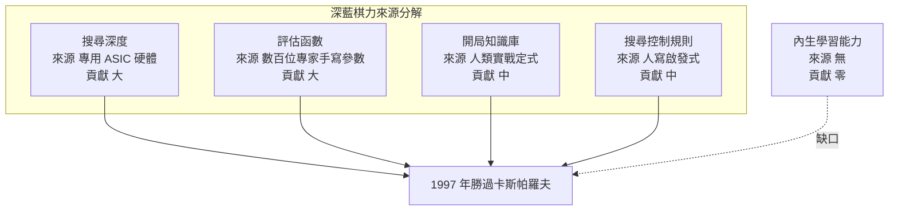
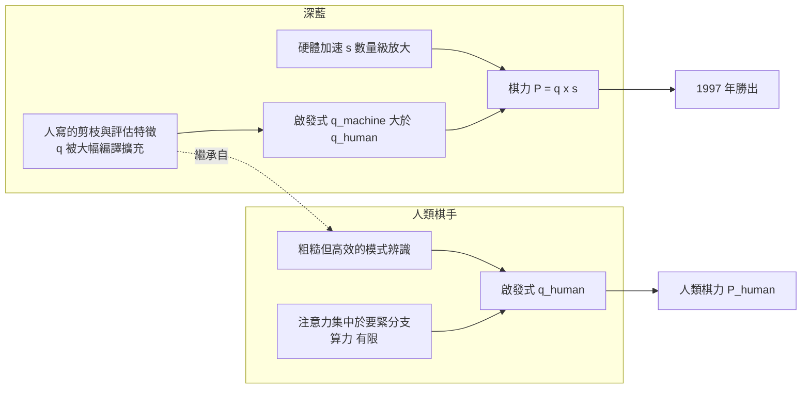
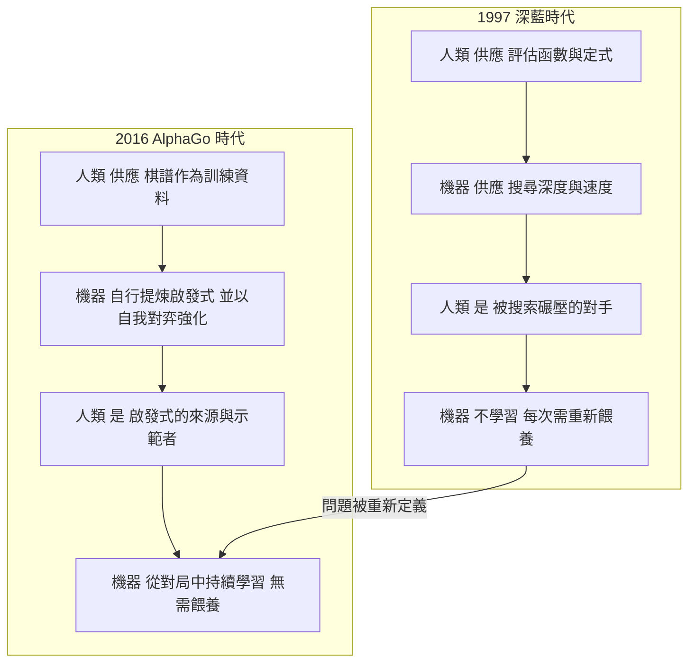

# 2.3 棋力不等於智慧：硬體優勢與盲點

## 一、把勝利還原成零件：深藍的四個盲點

要檢驗「棋力不等於智慧」這個命題，最好的方法是把深藍的棋力拆解成構成它的零件，然後逐一檢查每一個零件的來源與侷限。拆開之後會發現，深藍的每一分棋力都來自外部人類知識的某種形式，而不是來自任何內生的學習或理解。

第一個盲點是評估函數。它的參數是數百位頂尖棋手與電腦專家花了數年共同打磨出來的：哪些棋子結構在實戰中好、哪些交換在什麼條件下划算、什麼樣的局面該立刻求和、什麼樣的殘局不能拖。這些知識被寫成數百個具名特徵與一組權重，再燒進 ASIC 電路。它非常有效，但它是「被給予」的，不是「被學到」的。深藍無法解釋為什麼某個結構是壞的，正如它無法解釋為什麼皇后比城堡更有價值——那對它來說只是一組常數。

第二個盲點是開局知識庫的偏食。深藍的開局庫收錄了數萬條人類實戰定式，每一條都是人類棋手在真實對局中反覆使用、反覆檢驗過的結論。這意味著它的開局選擇沒有任何原創性，也沒有任何覆蓋率保證——它只會走出人類已經走過的路。更關鍵的是，這些定式本身帶著人類的偏好與盲區：人類偏好的出子風格、人類認為安全而非冒險尖銳的實戰選擇、以及人類在漫長歷史中集體忽略的邊際變化，都會原封不動地滲進資料裡。開局庫越完善，機器在開局階段越像一台複印機。

第三個盲點是缺乏學習。1997 年的深藍沒有梯度、沒有權重更新、沒有任何形式的經驗累積。它下完一局之後，記憶是零。同一個局面，它會給出與第一次完全相同的評估；同一個開局，它會引用同一條定式。這意味著它無法從敗局中學到任何東西，而棋類進化的核心恰恰是從敗局中提取資訊。
第四個盲點則是最根本的：規則必須被人類重寫。每一輪深藍升級，評估函數的特徵、權重、剪枝規則、開局庫都需要人工重新設計與調校。機器本身不生產任何新的知識，它只是把已存在的知識加速播放。

| 盲點 | 具體表現 | 根本原因 | 後來由誰解決 |
| --- | --- | --- | --- |
| 評估函數外來 | 特徵與權重全由專家手寫 | 機器無內生目標 | 價值網路從自我對弈學得 |
| 開局庫偏食 | 只會複印人類定式 | 資料來自人類且有盲區 | 策略網路自行探索新開局 |
| 缺乏學習 | 對局結果零回饋 | 沒有梯度與權重更新 | 強化學習與自我對弈迴圈 |
| 規則須人寫 | 每次升級都要重新設計 | 規則是被給予的 | AlphaZero 連規則都從對弈中學 |

## 二、「非人類的笨棋」：深藍在什麼地方讓人發愣

卡斯帕羅夫那句「深藍有時會做出很笨的選擇」，聽起來像是一句客氣的圓場，但把它當成客套話就錯了。它是一個相當具體的技術觀察，而且有豐富的賽局記錄可以佐證。

最典型的情境是：局面上有一手顯然更好的選擇，人類棋手只需一眼就能排除劣著，而深藍卻把它列進候選並且選了。這在 1997 年的比賽中反覆出現，棋評者能清楚指出深藍「放棄了顯而易見的走法」。原因並不神秘：深藍的評估函數是一組固定的特徵加權，它無法判斷「這個局面根本不需要計算」這種人類近乎自動的判斷。人類看到「白車被釘死」會直接把它當作事實，而深藍看到的是一堆特徵值，必須讓搜尋樹在有限時間內把這些特徵值的後果算出來。

另一個令人不安的面向是它偶爾會走出人類認為不可理喻的棄子。在 1997 年的第六局，卡斯帕羅夫正是因為走了一手在人類棋理上站不住腳的變化，才被拖進了深藍擅長的殘局計算。這裡出現了一個歷史性的反諷：人類認為不合理的走法，在人類的啟發式框架裡確實是錯的，但在一個足夠大的搜尋框架裡，它可能是通往更優終局的路徑。深藍不是在「犯錯」，它是在用人類沒有能力執行的方式思考。

這種現象在後來的引擎對局裡被更清楚地量化。頂級引擎之間的高水準對局中，偶爾出現人類棋手多年來從未考慮過的著法——有的確實精妙，有的則是明顯的「引擎特色」，來源於引擎評估函數裡某個奇特的特徵權重。人類稱之為「非人類」的笨棋，指的正是這個：它不是錯在判斷力，而是錯在觀看世界的角度。機器用的是一副人類設計的透鏡，卻不按人類的視覺習慣去使用它。

值得補充的是，這種「笨棋」並非毫無價值。事後的引擎分析常常顯示，那些在人類棋理下看起來離譜的著法，其實通向數步之後人類根本看不到的資源交換或反擊機會。也就是說，深藍的「非人類」有時反而比人類的直覺更接近真相，只是人類的評估框架無法辨認它。這正是「非人類」這個詞最精確的意思：不是錯，而是超出人類的判讀範疇。

## 三、人類的直覺 vs 機器的窮舉：一個被誤述的對立

關於 1997 年最流行的一個框架是「人類靠直覺，機器靠窮舉」。這個說法聽起來深刻，卻在技術上是錯的，而且錯得相當關鍵，因為它讓人以為人類與機器使用的是兩種互補的、可以相加的能力。

事實是，人類棋手用的也是啟發式，而且是很粗糙的啟發式。人類判斷一個局面，靠的是長期累積的模式辨識：一個子力的位置、一個結構的鬆緊、一個威脅是否「真」的直覺。這些模式當然不完美，否則人類棋手也會被搜尋擊敗——他們確實會。人類在西洋棋上的頂尖水準，本質上是一組優於業餘者的啟發式，其價值在於能把注意力集中在少數真正要緊的分支上，而這正是啟發式搜索的全部目的。

所以真正的對立不是「直覺 vs 窮舉」，而是「人類的啟發式 vs 更大的啟發式」。深藍同樣沒有窮舉整棵樹——它比任何人類都更依賴剪枝，更依賴「不用算也知道這條線沒用」的判斷。差別在於：深藍的剪枝判斷來自於一個更寬廣、更有經驗、也被硬體加速過的啟發式庫，而它的啟發式庫又是從數百位人類專家那裡編譯來的。

把這個關係寫成一個簡單的式子會更清楚。若把棋力視為啟發式品質 $q$ 與搜尋規模 $s$ 的乘積，

$$
P \approx q \times s
$$

那麼人類與深藍的差距並不主要體現在 $s$ 上，而是體現在 $q$ 上，並且是透過硬體把 $s$ 也放大了。這個分解也解釋了為什麼「再買十倍晶片」的說法並不完整：晶片買來的是 $s$ ，而 $q$ 必須由人來提供。深藍之所以能贏，靠的是團隊在 $q$ 上的多年投入，再加上 $s$ 的硬體放大。

這個分解還有第二層意義：它顯示所謂「機器超越了人類」這種說法在數學上是含混的。當人與機器的 $s$ 差距拉開到數個數量級時，即便機器的 $q$ 只和人類相當，結果仍然是碾壓。所以「人類被機器超越」這句話裡的「超越」，實際上指的是乘積被超越，而不是人類的那個因子被超越。把兩者混為一談，是 1997 年以後最普遍的認知錯誤。

於是「人類靠直覺」這句話的真正內容是：人類的直覺是一種**極度節省算力**的啟發式。它之所以珍貴，不是因為它比窮舉更高明，而是因為它在算力極度受限的條件下，把算力投對了地方。任何在算力充裕時做出的「笨選擇」，都可以用更多的搜索掩蓋過去——這正是深藍能贏的根本原因，也是「人類的直覺其實是一種壓縮」這個更精確的說法。

## 四、可解釋性：一個只有人類 有的特權

另一個更根本的差異不在棋力，而在「知道自己在做什麼」。人類棋手可以指著某個局面說出理由：這裡少了一個兵，這個王受到牽制，這個交換在殘局會贏。這種解釋能力讓人類能學習、能教學、能遷移、能創新。人類不只是產出答案，還能產出答案背後的可攜規則。

深藍完全做不到這一點。它可以給出一個評估分數，但無法解釋那個分數為什麼是這個數；它可以選出一手棋，但無法說出為什麼另一手更差。它的分數來源於數百個特徵的加權與一層層搜尋的累積，這個過程的可解釋性遠低於人類的一個直覺。當卡斯帕羅夫說「有時會做出很笨的選擇」時，他實際上是在描述一個無法被理由化的偏差——人類看得出偏差，卻說不出機器為什麼會那樣想。

這帶來一個值得深思的後果：人類無法從深藍身上學到任何東西，除非人類棋手本人先把那些著法解釋成可理解的原則。而這正是後來西洋棋界發生的事：頂尖棋手開始用引擎分析自己的對局，把引擎給出的最佳著法轉譯成自己理解的模式與原則。人類從機器身上榨取價值的唯一途徑，就是先把自己的直覺提升到能與機器對話的水準。這是一種極深的相互依賴。

還有一個更根本的不對稱：人類的錯誤會被修正，機器的錯誤只會被重複。一個頂尖棋手在比賽中下出一步爛棋，賽後他會知道那一步錯在哪裡，並在下一次避免同類的判斷——他的策略庫因此收斂。而深藍在同一個判斷點上會一次又一次選出同樣的壞棋，因為它沒有任何機制記住「上次這裡栽了」。這意味著深藍的棋力在實戰中是**不會累積**的，它永遠停在工程團隊交付它的那一天。反過來說，每一次對局的失利都完全不會讓它變得更強。

## 五、2016 年為什麼才是真正的轉折

把視線移到 2016 年 3 月，AlphaGo 在圍棋上擊敗李世乭。為什麼這場勝利才真正改變了問題的性質？

因為在圍棋裡，人類不再是「搜索的對手」，而變成了「啟發式的來源」。這是一個根本性的角色互換。在西洋棋裡，深藍與卡斯帕羅夫對抗的維度是搜索深度——人類靠啟發式在有限的深度裡作戰，機器靠更多的深度碾壓。人類的角色是對手的防禦者。到了圍棋，純粹的搜索深度早已失效（博弈樹約 $10^{360}$ 量級，沒有任何硬體能窮舉），勝利的唯一途徑是擁有**好的啟發式**——能告訴搜尋「該往哪裡看」的判斷力。而唯一在圍棋上擁有高品質啟發式的來源，就是人類自己的棋譜與教學。

所以 AlphaGo 的訓練過程是把人類棋譜當作初始資料（監督學習），再用自我對弈把啟發式不斷強化。機器的啟發式從人類身上學來，卻在強度上超越人類。人類在這場比賽中的角色不是被搜尋碾壓的對手，而是啟發式的供給者與示範者。這正好回答了本章的核心問題：AlphaGo 的勝利並不證明機器有智慧，它證明的是機器能**吸納**人類的智慧並且把它推得更遠。

同時要指出，這個轉折並不意味著人類的直覺被否定。恰恰相反，AlphaGo 的策略網路裡保留了人類棋手那種「直覺式」的特徵辨識，只不過是由卷積網路從幾百萬局資料中自行提煉出來。人類的直覺在本質上是一種**經過壓縮的啟發式**，機器學習做的事，是把這種壓縮重新自動化。兩者不是對抗關係，而是同一種能力在不同載體上的實現。

更能說明問題的是 2016 年第四局李世乭那步著名的「神手」。那一手之所以震撼，不只是因為它贏了，而是因為它完全不在任何棋書與人類棋譜的套路裡——它是在人類沒有去過的分支上，由機器自己的啟發式判定為最佳。換句話說，那一刻機器已經不只是人類直覺的執行者，而是自己產生了人類不曾擁有過的判斷。人在那一步上不是被搜尋碾壓，而是被**啟發式**碾壓。這是與 1997 年性質完全不同的事件。

## 六、深藍留下的真正教訓

回頭看，深藍最珍貴的貢獻不是那場勝利，而是它把一個含糊的問題「機器能否思考」逼成了一個可以拆解、可以驗證的工程問題。拆解之後的答案很明確：深藍不思考，它搜尋；它不學習，它被餵養；它不理解，它最佳化。把這三件事講清楚之後，人類才第一次能夠精確地問出下一個問題——如果機器不只是被餵養，而是能自己產生啟發式呢？

這個問題，AlphaGo 在 2016 年給出了第一個正面答案，AlphaZero 在 2017 年給出了更徹底的答案：連人類棋譜都可以丟掉，連規則都可以由機器重寫。第 6 章與第 7 章會完整交代這段歷史。但路徑的源頭，就埋在 1997 年那台笨拙的、由數百顆專用晶片組成、每次都要靠人類重新餵養的機器裡。

深藍教給人類的，是一個關於自身價值的重新校準。它的勝利不是人類智慧被取代的證明，而是人類智慧第一次被要求說明自己：你的直覺究竟由什麼構成？它能不能被形式化？它能不能被更大量、更快、更沒有偏見的東西取代？所有在 2016 年之後重新投入圍棋、投入遊戲、投入科學研究的人類，都在回答同一個問題。深藍贏了棋，但它贏的方式是笨的——而正是這種笨，讓人類看清了自己聰明的地方究竟在哪裡。
