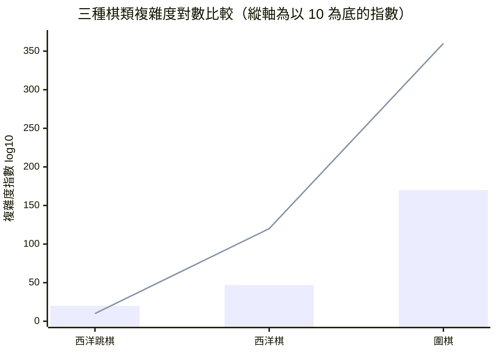

# 3.1 棋盤狀態的天文數字：狀態空間複雜度與博弈樹複雜度

## 一個改變問題性質的數字

上一章結束於深藍的鐘聲。1997 年五月，世界棋王卡斯帕羅夫在第 6 局僅用了十九分鐘就向一台機器投降。這場勝利依賴兩件事：一副特製的專用晶片，以及一個被反覆搜尋過的龐大局面樹。當時沒有人追問一個更根本的問題——那棵樹到底有多大？如果把它的大小寫成一個數字，人類是否還會覺得「暴力」是一個可行的策略？

答案取決於遊戲。對西洋棋而言，暴力尚有邊界；對圍棋而言，那個邊界根本不存在。本節的目的不是提供一組讓人震驚的數字，而是說清楚這些數字究竟在量什麼、怎麼量，以及為什麼它們會把整個研究範式逼向完全不同的方向。

要討論這件事，先得把兩個經常被混用的概念分開。第一個是**狀態空間複雜度**：所有可能出現的局面總共有多少個。第二個是**博弈樹複雜度**：把每個局面的所有合法後手都接續下去，形成的整棵搜尋樹共有多少個節點。前者衡量「棋盤可能長什麼樣」，後者衡量「把所有可能性走一遍要花多少力氣」。兩者之間的差距，往往比任何一個數字本身更具有決定性。

## 狀態空間：從 $10^{20}$ 到 $10^{170}$

西洋跳棋是第一個被精確計算過的商業遊戲。1994 年，Allis 與 de Vreede 與 Irving 合作的《Solving the 8×8 Draughts Problem》給出了完整的分析：跳棋的狀態空間複雜度上界約為 $10^{20}$ ，而考慮到合法性與可達性之後，真正的有效局面數落在 $10^{18}$ 的量級。這個數字大到讓窮舉失效，卻小到讓阿爾法貝塔剪枝加上一副好機器尚可支撐——1980 年代末的西洋跳棋程式確實逼近或超越了世界冠軍的水準。

西洋棋的情形大約放大三十個數量級。長久以來被引用的估計是 $10^{47}$ ，指的是所有可能局面組態的數量；若只計入真正可以出現在合法對局中的局面，數字會明顯下降到約 $10^{43}$ 至 $10^{44}$ 的區間，但無論哪一個版本，都已經遠超任何硬體在物理時間內能窮舉的範圍。

圍棋的數字則讓前面兩者顯得像是小玩具。19×19 的棋盤共有 361 個交叉點，每個點可以是空點、黑子或白子，若不加任何限制，總共約有

$$
3^{361} \approx 10^{172}
$$

種擺法。但圍棋規則立刻淘汰了絕大多數：不能填自己的眼（自殺禁著），一個群組必須有氣才能存活，而一局棋在規則下不可能出現無氣群組。這些約束合稱為「空氣效應」——一個擺法看起來稀疏得可以呼吸，實際上卻根本無法在任何一局真實對局中出現。Tromp 在 2016 年的論文中用隨機取樣估計，合法局面只占所有擺法的百分之一量級上下。換句話說，你能想到的擺法裡，絕大多數是幽靈。

## Tromp 的嚴格估計

John Tromp 與 Pascal B. Wolff 在 2016 年發表的〈The Game of Go: the State Space Complexitiy〉一文，為「圍棋到底有多複雜」這個看似文學、其實是數學的問題給出了迄今為止最嚴謹的答案。他用一個窮舉但高度壓縮的狀態編碼，計算出 19×19 圍棋合法局面數的一個精確上界：

$$
N_{\text{legal}} \leq 2.08 \times 10^{170}
$$

這個數字後來成為 AlphaGo 系列論文中引用率最高的圍棋複雜度數據。它的重要性不在於「大概就是這麼大」，而在於它是一個有證明的上界：任何一個只會讀懂圍棋規則的人，理論上都可以寫出程式驗證它。

Tromp 同時指出，這個上界與實際可達局面之間還有相當距離。圍棋一局的長度通常是數百手，許多「理論上合法」的擺法需要極其迂迴的走法才可能出現。他給出的直覺是：把狀態空間當成一個整體來看，真正會在實戰中出現的局面，只是其中一個極小的子集合。

| 遊戲 | 狀態空間複雜度 | 博弈樹複雜度 | 主要複雜度來源 |
|------|-----------------|-------------|----------------|
| 西洋跳棋 | 約 $10^{20}$ （有效局面約 $10^{18}$ ） | 約 $10^{10}$ | 狀態數、分支因子小 |
| 西洋棋 | 約 $10^{47}$ （有效局面約 $10^{43}$ ） | 約 $10^{120}$ | 狀態數大，但深度淺 |
| 圍棋 | 上界 $2.08 \times 10^{170}$ | 約 $10^{360}$ | 分支因子大且遊戲深度長 |
| 橋牌 | 約 $10^{47}$ | 隱藏資訊，無法窮舉 | 不完全資訊 |
| 麻將 | 遠小於圍棋，但含隨機抽牌 | 隨機性主導 | 隨機與隱藏資訊 |

順帶一提，狀態空間複雜度與博弈樹複雜度在西洋跳棋那裡幾乎是同一件事。跳棋的分支因子不大，平均只有十幾個合法著點，一局的深度也很淺，所以整棵樹的大小與局面數只差了一兩個數量級。這正是它在 1980 年代能被暴力搜索解決的原因——同樣的遊戲，不同的結構參數，導致完全不同的工程結論。

## 博弈樹：比狀態空間更殘忍的數字

狀態空間複雜度回答的是「有多少個不同的局面」。博弈樹複雜度回答的是「要窮舉所有走法序列有多難」。兩者的關係可以用一個簡單的乘法表示：

$$
N_{\text{tree}} \approx N_{\text{state}} \times b^{d}
$$

其中 $b$ 是平均分支因子，也就是平均每個局面有幾個合法後手； $d$ 是遊戲的深度，也就是平均要下多少手才結束。這個公式裡的指數項是關鍵：即使狀態空間只大了一個數量級，分支因子與深度的乘積效應卻可以把它放大很多個數量級。

西洋棋的深度很淺，一局平均約 80 手，分支因子約 35；但更致命的是大多數分支會因戰術理由被剪掉，因此實際搜尋的樹遠小於理論值。圍棋則是另一種結構：平均分支因子常被估在兩百多個合法著點的量級，而一局的長度在數百手之間。兩者相乘的結果是 $10^{360}$ 這個量級——Tromp 引用並整理的估計，也是 AlphaGo 論文裡最常出現的圍棋博弈樹數字。

把它換成人類可理解的尺度：可觀測宇宙中的原子總數約 $10^{80}$ ，也就是說，圍棋的完整博弈樹所包含的節點數，比宇宙中所有原子的總數還要多出 280 個數量級。或者更具體地說，假設每秒能檢查十億個節點，一天檢查 $10^{14}$ 個，一年不過 $10^{22}$ 個——窮舉完圍棋所需的時間，是宇宙年齡的 $10^{280}$ 倍。

這就是為什麼「多買幾台機器」在圍棋上不是一個工程問題，而是個數學問題。深藍靠的是硬體偏食：它把西洋棋的搜尋空間硬生生削到可算的範圍內。而圍棋沒有這種幸運。對圍棋而言，暴力搜尋不是太慢，而是原理上不可行。

## 三種資訊性質：把圍棋的困難放對位置

要精確地說明圍棋為什麼難，有必要先區分三種讓搜尋變難的機制。

第一種是**完美資訊**。所有參與者都能看到完整的局面，沒有任何隱藏資訊。西洋棋、西洋跳棋、圍棋都屬於這一類。第二種是**隱藏資訊**，玩家的資訊不對稱，例如橋牌中別人手裡的牌、美式撲克中看不到的牌面。第三種是**隨機性**，也就是局面的演進包含不可預測的機率成分，例如擲骰子的遊戲或抽牌的麻將。

一個常見的誤解是把圍棋的困難歸因於「複雜」或「不確定性」，彷彿它是介於西洋棋與麻將之間的東西。這個看法完全錯了。圍棋是標準意義上的**完美資訊、零隨機、回合制、有限步結束**的遊戲——它的資訊條件比西洋棋更乾淨，因為西洋棋至少還有重複規則造成的局面識別問題。圍棋比西洋棋難，絕對不是因為它有更多隱藏資訊或更多隨機性。

那麼差別在哪裡？在**分支因子**與**深度**這兩個純粹的量上。圍棋每一步的候選著點數是西洋棋的數倍，而且一局圍棋的下手數遠多於一局西洋棋。這兩項相乘，就足以讓博弈樹複雜度從西洋棋的 $10^{120}$ 級跳到圍棋的 $10^{360}$ 級。圍棋的困難是**組合性的**（combinatorial），不是**資訊性的**（informational）。這個區分極其重要，因為它意味著正確的解法必須從計算量下手，而不是從貝葉斯推理或機率估計下手。

## 有限深度下的計算量估算

抽象的複雜度數字容易讓人麻木，所以我們把它換算成具體的算力需求。假設今天有一台超級電腦，每秒可以展開十億個搜尋節點，並且擁有近乎完美的剪枝與平行加速。我們依序檢視三種棋。

西洋棋：若要窮舉整棵博弈樹，需要遍歷約 $10^{120}$ 個節點。以每秒 $10^{9}$ 節點計算，需要約 $10^{111}$ 秒，也就是 $10^{103}$ 年。宇宙年齡是 $10^{10}$ 年，因此這已經超出宇宙年齡 $10^{93}$ 倍。

西洋跳棋：狀態空間 $10^{20}$ ，博弈樹約 $10^{10}$ ，在 $10^{10}$ 節點的規模上是可算的——這解釋了為什麼西洋跳棋在 1980 年代末就能被強程式擊敗頂尖棋手。

圍棋：即使只搜尋到 10 手深，且每層分支因子以保守的 100 計（遠低於實際的兩百多），節點數也已經是 $100^{10} = 10^{20}$ ，配合每個葉節點還要跑一次評估，總成本遠超西洋棋的完整窮舉。若把深度放寬到 20 手，成本立刻升到 $10^{40}$ 量級；若放到實戰常用的 30 到 40 手深度，便進入 $10^{60}$ 到 $10^{80}$ 的領域——這已經和「把整個宇宙的原子拿來算」是同一個層級的不可行。

關鍵在這裡：這些估算已經假設了最好的硬體、最完美的剪枝，以及一個能瞬間給出評估分的理想評估函數。任何一項落空都會讓實際情況更糟。

## 為什麼「把樹搜深」在圍棋上永遠不可能

現在可以做那個關鍵的提問了：既然圍棋的困難只是計算量，而人類的硬體還在以指數速度成長，那麼只要再等幾十年，是不是終究能把整棵樹搜完？

答案是否定的，而且理由不是工程上的，而是結構上的。我們來看決策論中最基本的量。在完美資訊遊戲中，一個策略的下棋強度可以用兩個數字概括：**樹的寬度**（分支因子 $b$ ）與**樹的深度**（所需搜索深度 $d$ ）。西洋棋的巧妙之處在於它同時擁有較小的 $b$ 和較淺的 $d$ ，所以 $b^{d}$ 雖然看起來大，卻仍在可算範圍內——這是西洋棋被稱為「搜尋之友」的原因。

圍棋的問題在於， $b$ 與 $d$ 都是大數，而 $b^{d}$ 對這兩個參數都極度敏感。即使我們把硬體速度提高一千倍、一億倍、一百億倍，也只相當於把 $b$ 減少很少的一點，或者把 $d$ 增加大約半手。相較於把指數底數從兩百降到一百，收益微乎其微。更關鍵的是：深度是**不可交易**的。圍棋裡一條被忽略的戰術可能牽動三千手之後的勝負，任何固定的深度都存在系統性的盲點。

這裡有一個更深的教訓。搜尋深度不只是計算量的問題，更是**資訊量的問題**：搜尋到深度 $d$ ，你只「看見」了前 $d$ 手的所有變化，之後的世界對你是完全不透明的。對西洋棋而言，深度 30 手已足以讓多數人無法理解走法，深度 60 手足以涵蓋絕大多數戰術組合。對圍棋而言，即使看見前 100 手，你仍然對這盤棋的終局毫無把握。

因此在圍棋上，「把樹搜深」不是一條可以靠工程努力延伸的路，而是一面牆。任何希望在牆上開個洞的努力，都必須改變問題的提法。

## 逼出另一條路：不求窮舉，只求有偏抽樣

也正是在這個節點上，學術界出現了一個轉向。傳統搜尋的哲學是：既然無法窮舉，就用啟發式剪枝去逼近窮舉的結果——阿爾法貝塔剪枝放棄部分分支，但保留「足夠好的」那一條；西蒙的人工通用智慧啟發式搜索則主張只搜尋「有希望」的分支，本質上都是**對完整搜尋的系統性近似**。

但圍棋讓人懷疑的不只是「近似得好不好」，而是「近似的對象是否正確」。在西洋棋裡，棋局過程中局面的好壞，與最終勝負之間存在著穩定的對應，因此可以定義一個評估函數，把深層搜尋的成果壓縮成一個數值。圍棋的形勢判斷卻是整體的、全域的，單一局面的價值往往取決於遠方幾十手之外的形勢，而且隨著對手的應手不斷改寫（這一點將是 3.2 節的主題）。

於是另一條哲學浮出水面：**既然窮舉整棵樹不可能，那就只隨機地抽樣其中一小部分，用這個樣本的統計量去推估整棵樹的價值**。抽樣必然是有偏的——它放棄了系統性覆蓋每一個分支的可能性——但它把不可能完成的任務變成了「只要再多算一點，答案就會更準」的增量式過程。

這就是蒙地卡羅樹搜尋（Monte Carlo Tree Search, MCTS）的思想起點，也是下一節的主題。但要注意，單純的隨機抽樣還不夠：真正關鍵的問題是，該抽哪些分支？在完全隨機的抽樣下，樣本會大量集中在明顯虧損的分支上，效率極差。設計一個能夠自動偏向「有希望」分支的抽樣規則，才是 MCTS 真正的技術核心——那個規則，就是著名的 UCT 公式。

第一組柱狀為狀態空間複雜度，第二條折線為博弈樹複雜度。圍棋的博弈樹指數比西洋棋高出 240 個數量級，這個差距不是靠更好的剪枝或更快的硬體能填上的。

## 小結

本章的核心結論可以濃縮成三句話。第一，圍棋的狀態空間上界是 $2.08 \times 10^{170}$ ，博弈樹複雜度約 $10^{360}$ ，這是經過嚴格計算的數字，不是文學修辭。第二，圍棋的困難是純粹的組合爆炸，不是隱藏資訊或隨機性造成的，因此解法必須來自計算策略而非資訊推理。第三，窮舉與剪枝這條路在圍棋上是結構性地走不通的，必須換一個提問方式——不是「怎麼把樹搜完」，而是「怎麼在抽樣中取得有用的統計」。

這個轉向，正是接下來兩節的起點。3.2 節將說明為什麼在這樣龐大的樹底下，人工寫的評估函數會失效到什麼程度，以及這個失效如何直接催生了深度學習的必要性。3.3 節則會交代 MCTS 如何在 2006 到 2010 年間被引入圍棋領域，並為 2016 年的突破鋪設道路。
