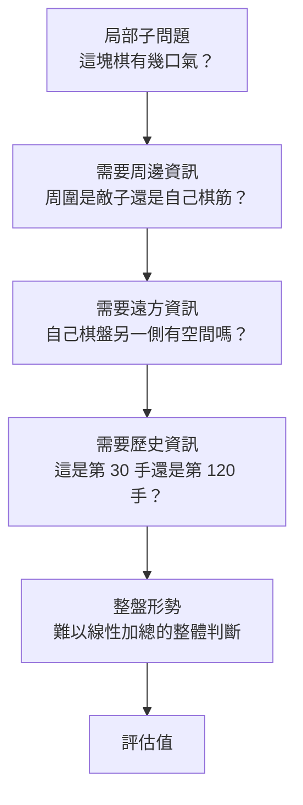

# 3.2 評估函數的死角：圍棋形勢難以量化的本質

## 搜尋的另一半：一個必須回答的問題

在極小化極大演算法裡，有兩個角色：負責往深處看的**搜尋**，和負責在葉節點給出分數的**評估函數**。前一章處理了搜尋的天花板，但只要我們把深度限制在某個可算的數字上，剩下的事情就全部壓在評估函數身上——它在葉節點說出的那個數字，將決定整棵樹的走向。

用一個更直白的比喻：搜尋像顯微鏡的倍率，評估函數則是被放在載玻片上的那塊標本。倍率再高，如果標本本身是空的，看得再清楚也沒有意義。

西洋棋的評估函數可以粗略地說是「子力價值和加上位置小獎勵」，這種做法之所以能奏效，有一個重要前提：棋盤上每一個子元的價值大致**可加**，而「位置」之類的次要因素可以作為微小的修正項疊加上去。圍棋則完全不是這個樣子。本節要說明的，是圍棋評估為什麼在「質」而非「量」上困難，以及這個困難如何直接演變成深度學習的必要性。

## 形勢判斷是全域的，不是區域的

圍棋術語裡有「形勢」這個詞，指的是雙方在棋盤各區域的力量配置對比——這是一個把整張棋盤視為單一的、互相牽動的系統所產生的判斷。「這條龍連著三塊棋筋，比對方那條孤零零的蟬石強」，這句話裡的每一個名詞都只在全盤的語境裡有意義。

這帶來圍棋評估與西洋棋評估的第一個根本差異：**局部沒有獨立的價值**。圍棋棋盤不是若干獨立子遊戲的拼圖——那是西洋棋的結構——而是一個連續張力的場。右上角一個看起來很厚實的棋塊，如果它的周圍是對方的厚勢，那麼它的「厚」是假的，因為它其實沒有空間。反過來，一塊看似孤立的棋，只要它周圍是自己的勢力支撐，就可能是一塊極有價值的棋。

第二個差異是**互相牽制**。圍棋棋塊之間有「厚薄」之別：薄的棋需要更多眼位才能存活，厚的棋能承擔更多壓力。但「厚」的定義不是局部的——一塊棋厚不厚，取決於周圍有多少空間可以把敵子驅走，取決於遠方有沒有己方的接應，取決於對手會不會從別處攻擊。棋盤任何一個角落的一手棋，都可能改變三千手之外的資源分配。

第三個差異是**全局語境決定局部死活**。判斷一塊棋是活是死，所需資訊遠多於那塊棋所在的區域。當一塊棋被對手包圍時，它能不能活，取决于：自己的棋盤另一側有沒有可以做出眼位的空間？對手的弱著會不會在未來幾十手內被攻擊？自己的外勢能不能在關鍵時刻接應？所有這些問題的答案，都不在那塊棋周圍。

這意味著任何只關注局部特徵的評估器都必然失準。一個只看「這塊棋有幾口氣」的程式，會判斷一塊被包圍但四周都是自己棋筋的棋為死棋；一個只數「有多少眼」的程式，會判斷一塊尚未做出眼但形勢極好的棋為弱子。

## 為什麼線性加權特徵不夠

在深度學習之前的年代，圍棋評估的主流做法是「手工特徵 + 線性加權」。典型特徵包括：己方與對方的領地數、活子數、大致的目數估計、逃出的子數、棋盤各區域的影響力統計。一個典型的評估函數形如：

$$
V = w_1 \cdot \text{territory} + w_2 \cdot \text{alive} + w_3 \cdot \text{eye\_count} - w_4 \cdot \text{atari\_count}
$$

這個形式在西洋棋裡是能奏效的，因為「一個車等於九個兵」這種加法在西洋棋裡近似成立。在圍棋裡它為什麼失效？三個理由。

第一，**特徵之間的交互作用是非線性的，且不可忽略**。「目數」本身幾乎沒有絕對意義——多兩目的棋只有在比對方多兩目的時候才是優勢；如果雙方目數相同，那兩目差在實戰中可能完全無意義。在西洋棋裡，子力差可以線性地轉換成勝率；在圍棋裡，目數差與勝率之間的關係是階梯狀的、非線性的，並且高度依賴於其他條件。

第二，**許多關鍵資訊無法被離散的計數器捕捉**。「厚勢」不是一個可以用計數器表示的量。一塊厚勢的價值在於它給了周圍棋子的自由度，而這個自由度是連續的、情境依存的。「這支棋很厚」不是「厚度 = 3」這種可以寫在紙上的等式，而是「這支棋在未來能支撐多少種不同的下法」。

第三，**有些資訊根本不存在於棋盤的靜態描述裡**。形勢是演化出來的，不是擺出來的。同一張棋盤上的同一個子，如果它是這盤棋的第 120 手，評價可能與它是第 30 手時截然不同，因為期間已經消耗了許多手數、許多劫材、許多變化。而評估函數在深度搜尋中看到的葉節點，是一個已經被「過度展開」的狀態——搜尋看得越深，這種失真越大。

這就是圍棋評估真正的死角：不是特徵不夠多，而是**特徵的本質是一組壓縮過的總結，而圍棋的答案存在於被壓縮掉的那些脈絡裡**。

## 與西洋棋的對比：為什麼「子力價值和」在圍棋裡失效

我們把兩種遊戲並排放在一起，可以看清楚差異。

在西洋棋裡，「子力價值和」之所以能當評估基礎，是因為棋子的價值主要來自它自身的攻守能力，而進攻與防守能力在相當程度上可被交換。你少一個車，多三個兵，通常是壞消息；你少一個車但佔據了對方的車頭位置，則可能不虧。價值的來源相對集中，因此加總不會太離譜。圍棋則相反：圍棋的每一個子幾乎沒有獨立價值，價值完全寄生在周圍的關係網上——一條「活龍」在自己的地盤上威風凜然，離開地盤瞬間變成待宰的廢物。

更根本的差別在於**遊戲目標的性質**。西洋棋的目標是將死對方國王，是一個可以用單一狀態變數描述的終局條件；圍棋的目標是爭取最後的生存空間與子力，終局由「雙方剩餘地盤大小比較」決定，而這取決於幾百手累積的走法選擇。圍棋的局面價值是歷史的累積，西洋棋的局面價值更接近當下的快照。

| 比較面向 | 西洋棋 | 圍棋 |
|---------|--------|------|
| 棋子價值 | 大致可加，車馬象rook有相對固定的點值 | 幾乎不可加，價值寄生於周圍關係 |
| 局部性 | 子元大體獨立，局部交換可線性近似 | 局部與全局強耦合，局部無獨立價值 |
| 關鍵特徵 | 子力價值和為主，位置為次要修正 | 厚薄、勢、眼位、眼形、風向均不可數化 |
| 評估特徵關係 | 近線性 | 高度非線性且情境依存 |
| 局面歷史依賴 | 中等 | 極高，同一盤面在不同階段意義不同 |
| 頂尖評估特徵數量 | 數十個 | 數百個以上，且仍不足 |
| 可否用單一數值近似 | 可（子力和加微調） | 幾乎不可 |

## 領域知識最重的部分

這裡出現了一個尷尬的對比。在西洋棋裡，領域知識其實很輕。棋子少、規則直觀，一個中等程度的高手可以把「車價值 5、馬價值 3、兩個兵等於一個馬」這類知識在幾小時內教給電腦。搜尋演算法也是領域中性的：極小化極大與阿爾法貝塔剪枝移植到任何完美資訊遊戲都能用。

在圍棋裡，領域知識卻重得嚇人。要寫出一個能用的圍棋評估函數，你必須懂得：什麼叫「厚」，這塊棋算不算「淨活」，這條蛇是不是「双活」，這個「劫」該不該提，「氣」的多少該如何折算成目數，「先手價值」在當前局面該如何修正，「勢」能不能轉化成地，以及這盤棋整體上是「早、中、晚」哪個階段。每一条規則背後都藏著幾十年高手之間口耳相傳的判斷。

更糟的是，這些知識彼此衝突。經驗豐富的圍棋 AI 程式師常說一句話：圍棋評估是「專家系統的墓園」。當你手寫第十五條評估規則時，會發現它與第五條在某些局面互相矛盾；當你為了修正特例而加上第二十條時，局面數已經覆蓋不到任何有意義的常見情境。

這句話當然有些誇張，但方向是對的。**手工圍棋評估的真正難點不是寫不出特徵，而是無法窮舉特徵之間的組合、衝突與情境**，而這恰恰是機器學習擅長、人類最不擅長的事。

值得補充的是，這個「專家系統的墓園」效應並非圍棋獨有。西洋棋同樣有大量歷史悠久的評估規則，雖然它們在頂尖引擎裡已經被數值化並調校到極致，但底下仍然是同一套邏輯：人先把棋盤切成幾十個概念類別（子力、將軍、壞車、王的安全），再為每個類別手寫權重。圍棋的差別在於概念類別的數量級：不是幾十個，而是數百個，而且它們之間的邊界本身就是模糊的。

換個角度說，圍棋的形勢判斷更接近「文學」而非「會計」。會計有明確的科目與加總規則，形勢判斷沒有；它更像是一位資深棋手看完盤面後 心裡浮現的那個整體印象。這種「看完盤面就有感覺、但說不清怎麼來的」的能力，恰恰是機器學習擅長模仿、而人類無法用規則完整表述的東西。

## 這個缺口正是深度學習要填的

於是問題的反面就是解法的正面。如果人寫不出好的圍棋評估函數，那就不要人寫。讓機器自己從大量棋譜裡學一個。

2012 年底 AlexNet 在 ImageNet 上的成功，讓整個人工智慧社群意識到一件事：當資料足夠、模型容量足夠時，深層卷積網路可以學會「看著一張圖判斷它屬於哪一類」——而沒有人寫過「熊」或「虎」的特徵規則。人類只提供了答案（標籤），特徵是學出來的。

把這個思路搬到圍棋上，邏輯是順暢的。棋盤是一張 $`19 \times 19`$ 的圖，每個交叉點上的黑白子是像素，圍棋的「形勢判斷」正是一種對這張圖的整體理解。AlphaGo 之前，2012 年到 2013 年間，Silver 與 Kocsis、Schmitt 與 Hazan 等人已經在做的事，就是把圍棋局面視為影像，讓卷積網路直接從業餘到頂尖的實戰棋譜裡學出 policy。

在這條路上，深度學習做了一件手工方法原理上做不到的事：它不是找「一個好的評估值」，而是學「一個能看懂盤面的表示」（representation）。這兩者的差別是決定性的。手工評估函數試圖用幾個數字概括全局；深度模型則在內部建立大量中間特徵，這些特徵可能是「某種形狀的定式」「某種厚勢的輪廓」「某種眼位的排列」，它們由資料決定，不受人類想像力限制。最終輸出的仍然是一個數值，但這個數值背後的豐富度，是人工特徵無法企及的。

## 為什麼是卷積神經網路

那麼，為什麼圍棋的深度學習要用卷積神經網路（CNN），而不是全連接網路或循環網路？理由來自棋盤本身的兩個結構性性質。

**第一，二維局部結構。** 圍棋的形勢判斷建立在空間鄰域之上：一塊棋的價值取決於它周圍八個方向的相鄰關係、再往外一圈的關係。全連接網路會把 $`19 \times 19 = 361`$ 個位置全部攤平處理，參數數量隨棋盤大小平方級增長，而且更糟的是，它必須從頭學會「相鄰」這個概念。CNN 則用捲積核天然地捕捉局部模式：一層核大小為 $`3 \times 3`$ 的濾波器就是「看這格的鄰居」，多層堆疊就能表達「看這塊棋周圍一圈的情況」以及「看半個棋盤的態勢」。

**第二，平移對稱。** 圍棋規則沒有方向偏好——左上角的一個角與右下角的一個角，在規則上地位相同。卷積的權重共享正是為此設計：同一組濾波器套用在所有位置，自動學到「所有角落都該這樣判斷」的通用規則，而參數量只與核大小有關，與棋盤大小無關。

這兩點合起來解釋了一個關鍵的效率差異。手工特徵要由人寫出數百條規則，CNN 則讓同一組參數在 361 個位置上重複使用，把「學會一個通用模式」的成本從數百次降到一次，再乘上資料量。

這個流程圖說明了為什麼「局部計數器」式評估必然失敗：每一層都需要上一層的輸入，而最後一層還需要整局的歷史脈絡。手工規則無法把這條鏈條完整寫下來，但深度模型可以在資料中隱式地學到它。

## 小結：困難是生成的

本章要留下的是一個關於「困難從哪裡來」的理解。圍棋評估之所以是圍棋 AI 最難的部分，不是因為人不够聰明或不夠努力，而是因為這個遊戲的答案天然以全域、連續、情境依存的形式存在，而手工評估器只能處理離散、可加、局部的特徵。這是一種結構性的落差，不是技巧上的不足。

這個落差的後果非常具體。當我們在 3.1 節確認了「窮舉不可能」、在這裡確認了「人手寫的評估也不行」之後，圍棋 AI 只剩下一條路：讓機器自己學出一個能看懂盤面的表示。

但這還不夠。學會評估只是其中一半。MCTS 的思想——用抽樣取代窮舉——早在 2006 年就被引入了圍棋領域，它需要的正是「每個葉節點有個評估值」這個前提。那麼，在深度學習之前的那十幾年裡，這個前提是怎麼被勉強湊齊的？答案是一個非常反直覺的想法：不要評估，改用「隨機走到底，看誰贏」。
