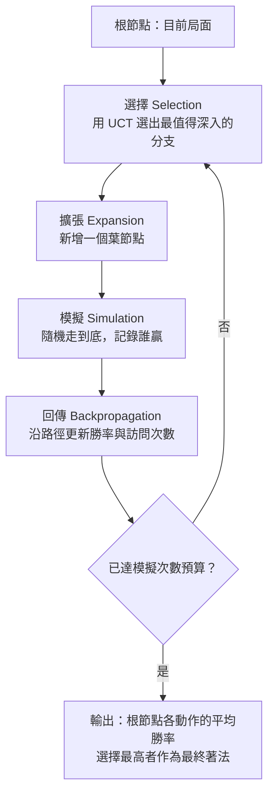

# 3.3 蒙地卡羅樹搜尋（Monte Carlo Tree Search, MCTS）的早期引入（2006-2010）

## 一個來自物理的念頭

故事要從一個和圍棋毫無關係的地方開始。1940 年代末，洛斯阿拉莫斯的一間辦公室裡，物理學家斯坦尼斯洛·烏拉姆（Stanislaw Ulam）正在思考一個惱人的問題：蒙地卡羅方法的誤差隨樣本數的平方根衰減，收斂得太慢，怎麼樣才能讓電腦算得更快？

他注意到一個巧妙的改進。既然模擬一次核反應的代價太高，那就讓電腦自己「玩」這個物理過程：把參數隨機設定，記錄結果，再根據結果調整下一輪的抽樣分布。這個循環一旦跑得夠多，就會把樣本自動集中到有價值的區域。他和 Nicholas Metropolis 在 1949 年發表了這個想法，隨後整個蒙地卡羅方法家族在物理學、統計學、隨機最佳化領域生根發芽。

Ulam 是國際跳棋與西洋棋的狂熱愛好者，晚年甚至幫 IBM 設計過一台專門下西洋跳棋的機器。他很清楚這個「用遊戲代替計算」的方法在自己的棋類熱愛中意味著什麼。1980 年代末到 1990 年代初，電腦圍棋界確實開始嘗試隨機的方法，隨機 rollout 的想法在不同的研究群體裡獨立浮現。

但真正的整合，要等到一個更聰明的機制出現。

## Kocsis 2006：把 MCTS 的名字給了這個圈子

Levente Kocsis 是匈牙利裔的數學家，在荷蘭阿姆斯特丹自由大學工作，長期研究蒙地卡羅方法在遊戲樹搜尋中的應用。他在 2006 年出版了《Computer Go》，這本書在電子版中被人稱為 MCTS 的「聖經」，但真正改變歷史的是他在書中明確提出的概念：**蒙地卡羅樹搜尋（Monte Carlo Tree Search, MCTS）**。

MCTS 這個名字本身就是一個宣言。它把「蒙地卡羅方法」這個統計學的名字，直接搬到了遊戲 AI 的舞臺上，向所有讀者宣告：這不是隨便試試的取巧做法，這是一種有數學根基的演算法。

MCTS 的核心機制是這樣的：與其用一個啟發式評估函數去猜測某個分支的價值，不如從那個分支出發，隨機地（後來會用學習到的策略）把棋隨機走到底，看誰贏。這個結果被回傳更新到路徑上的所有節點。於是每個節點不再是靠靜態的「這局面好不好」來排序，而是靠「從這裡出發，我的平均勝率是多少」來排序。

這是一個根本性的轉換。傳統搜尋問的是「這個局面的價值是多少」，MCTS 問的是「從這個局面出發，平均而言我能贏嗎」。後者把一個困难的評估問題，轉換成一個可以用實驗直接量測的統計問題。

## Cazenave 2010：把這套方法寫成可用的引擎

MCTS 在概念上被命名之後，下一步是讓它真的能在圍棋上跑得動。2008 年，Remi Coulom 在法國 LYON 的 INRIA 實驗室發明了 AlphaGo 之前的關鍵演算法——UCT 樹搜尋，並將其應用於圍棋。

另一條重要支線來自法國。Gérard Cazenave 與 Sylvain Gelly 等人把 MCTS 的各種變體系統化地實現，並在 2010 年發表了〈Monte-Carlo Search for Monte-Carlo Go〉，同時出版了《Computer Go》的新版本，成為 MCTS 在圍棋領域的第一個完整實作框架。他們做的事情包括：設計樹節點的選擇規則、處理隨機走到底（rollout）時的合法著點挑選、處理劫（ko）的規則限制、以及設計並行的 rollout 策略。

Cazenave 的貢獻在於把 MCTS 從一個漂亮的數學想法，變成一個工程上可調優、可並行、可在真實圍棋程式裡落地的引擎。此後數年裡，圍棋 AI 的進步很大程度上就等於 MCTS 各個環節的進步。

## UCT：探索與利用的數學平衡

MCTS 最關鍵的技術問題是：**在擴展樹的時候，下一個該往哪個分支走？**

兩個選項互相拉扯。一個是「利用」（exploitation）：走向目前統計上表現最好的分支。另一個是「探索」（exploration）：走向還沒被充分訪問、可能隱藏著驚喜的分支。如果只做利用，樹會過早收斂在一條主線上，永遠發現不了其他可能；如果只做探索，樹就退化成隨機搜尋。UCT 公式給出的，是這兩者之間一個有理論保證的平衡點：

$$
\text{UCT}(s, a) = Q(s, a) + c \sqrt{\frac{\ln N(s)}{N(s, a)}}
$$

其中 $`Q(s, a)`$ 是從狀態 $`s`$ 走動作 $`a`$ 後的累計價值，  $`N(s)`$ 是狀態 $`s`$ 被訪問的次數，  $`N(s, a)`$ 是動作 $`a`$ 被訪問的次數，  $`c`$ 是一個探索常數，用來調節偏向探索的程度。

這個公式背後有非常乾淨的機制。第一項 $`Q(s,a)`$ 記住的是「這條路徑平均讓我贏幾成」，是**利用**。第二項則是一個對「被探索得越少就越值得再去看看」的獎勵：  $`N(s,a)`$ 在分母上，所以一個才被走過兩三次的分支會得到巨大的加分；而 $`\ln N(s)`$ 隨著父節點被訪問次數緩慢上升，代表著整個節點被研究得越深，就越應該分出去一些注意力給少數分支。這個形狀是刻意設計的：它讓那個「落後但機會大」的分支，在被拜訪一次之後獲得的探索紅利就會顯著下降，因此不會被無限重複跟進。

UCT 的理論血統來自多臂老虎機（multi-armed bandit）問題與UCB（Upper Confidence Bound）族演算法。Kocsis 等人在 2006 年的論文中明確指出：UCT 是 UCB 演算法在遊戲樹上的推廣，它在「哪個動作最值得再抽樣一次」這個 bandit 問題上給出了近似最優的策略保證——每個動作被選中的次數以對數差距接近其最佳回報次數。

這個保證聽起來保守，但它非常合適：MCTS 並不需要找出樹中最優的那個葉節點，它只需要把**搜尋資源集中到有希望的分支上**，而 UCT 保證了那些被冷落的分支終究會獲得足夠的抽樣機會。抽樣是有偏的，但偏差方向是對的。

## Rollout policy：反直覺的核心

現在來到 MCTS 最反直覺、也最重要的一環。

一個直覺上合理的設計是：走到底的時候用一個「還算不錯」的評估函數去判斷勝負。MCTS 恰恰相反。在純 MCTS 裡，rollout policy（隨機走到底的策略）可以簡單到近乎白痴：**在所有合法著點中隨機選一個，一直走到分出勝負為止。**

這聽起來完全不可接受。一個隨機亂走的圍棋程式，會下出什麼樣的棋？它會讓自己的棋被提掉、把自己的眼位填掉、毫無章法地送死。業餘圍棋者去參加比賽，都比它下得好。

但這恰恰是關鍵。rollout 的目的**不是**下出好棋，而是產生一個**統計上無偏的勝負樣本**。由於規則對雙方對稱、隨機策略對雙方對稱，一局隨機對局結束後得到的勝負結果，在統計上就是當前局面的勝率估計——如果你有足夠多的樣本的話。棋下得多爛不重要，重要的是樣本多。

在極小化極大與評估函數的世界裡，「評分」是連續的、可微的、可微調的量。而在 MCTS 裡，「勝率」是一個二元的量：贏了就是 1，輸了就是 0，沒有中間值。這聽起來是資訊的損失，實際上是資訊的解放。

理由在於：**二元量在大量重複下，平均值具有非常高的信賴度**。假設隨機 rollout 給出的勝率估計是 0.62，它不告訴你這盤棋的形勢好在哪裡、優勢在哪一邊，但它告訴你一件對決策直接有用的事——在這個局面落子之後，你贏的機率大約是六成。對於 MCTS 來說，這就足夠了，因為 MCTS 要做的只是在樹裡比較不同分支的**平均勝率**，然後把計算資源倒向勝率較高的那一側。

更妙的是，勝率這種量天然地把 3.2 節講的那個困難**繞開了**。手工評估函數之所以在圍棋上這麼難寫，是因為形勢判斷是全域的、非線性的、情境依存的。而隨機 rollout 完全不需要回答「這局面好在哪裡」這個問題，它只需要回答「這局面誰會贏」——而後者可以由規則自動裁決，不需要任何領域知識。這是 MCTS 在 2000 年代能夠改變圍棋 AI 面貌的根本原因：它把一個極難的評估問題，變成了一個極易的實驗問題。

當然，代價是樣本效率。一局圍棋平均數百手，每一步又有多個合法著點，一次 rollout 要模擬數百個節點。要讓勝率估計達到統計上可用的精度（例如誤差在幾個百分點之內），需要成千上萬次 rollout。而整場搜尋要在合理時間內對根節點的每個候選動作都累積到足夠樣本。

| 元件 | 作用 | 傳統搜尋的對應 | 2006-2010 年的做法 |
|------|------|---------------|-------------------|
| 選擇（selection） | 決定往哪個分支擴展 | 排序候選動作 | UCT 公式平衡探索與利用 |
| 擴展（expansion） | 加入一個新葉節點 | 展開一個著法 | 每個節點記錄統計量 |
| 模擬（simulation） | 從葉節點走到終局 | 到達深度上限後用評估函數 | 隨機 rollout 到終局，看誰贏 |
| 回傳（backpropagation） | 更新路徑上的統計量 | 更新極小化極大值 | 更新累計勝率與訪問次數 |
| 節點統計 | 支撐選擇決策 | alpha / beta 值 | $`Q(s,a)`$ 、 $`N(s)`$ 、 $`N(s,a)`$ |

這個四步迴圈，就是 MCTS 的全部。每一圈的成本是一次完整 rollout，而每一圈都讓根節點的勝率估計變得更準一點。演算法是**增量式**的：你給它十倍時間，它就給你十倍的樣本量，而不是十倍的深度。這種「用時間換準確度」的性質，在硬體受限制的年代特別珍貴。

## 從 Ulam 到圍棋：為什麼這個方法在圍棋上特別合適

值得停下來想一想：為什麼 MCTS 這套「隨機抽樣」的方法，會在圍棋這個特定領域率先成熟，而不是在西洋棋上？

答案有兩個層次。第一個層次是統計的。在西洋棋裡，你其實有更好的辦法：寫一個還算準的評估函數，然後靠搜尋把它推到很深，因為西洋棋的分支因子小、深度淺，深度十幾手就足以覆蓋絕大多數戰術組合。深度搜尋比抽樣更有效率。在圍棋裡，深度十幾手什麼都看不到——中盤的形勢判斷需要的是對未來數十手變化的某種整體把握，而那個把握無法靠有限的深度取得。

第二個層次是對稱的。圍棋規則嚴格對稱，黑白雙方完全平權，任何一個「局面好壞」的判斷都必須對輪換雙方一致。這個對稱性讓「隨機 rollout 的勝率就是局面價值」這個等式成立得乾乾淨淨。而西洋棋裡，白方先行的價值、黑方強開的價值、以及Castling 這種規則性結構都讓局面價值帶上了不對稱的偏置，同樣的技巧用起來要麻煩得多。

還有一個更實際的理由：MCTS 需要的算力是**並行的**。一次 rollout 的分支彼此獨立，幾千次 rollout 可以同時丟到幾千個核心上。2000 年代中期的多核 CPU 恰好提供了這個能力，這讓純 MCTS 圍棋程式在純 CPU 時代就能跑出相當不錯的棋力。硬體的發展方向與演算法的結構在此刻奇蹟般地一致了。

## 當時的算力：一句話的歷史背景

2006 到 2010 年，運算硬體正處於從 CPU 轉向 GPU 的轉折點，但消費級 GPU 的算力仍遠不足以支撐大規模 rollout 吞吐。一局圍棋的 rollout 成本是數百個節點的模擬，每個節點需要處理合法性判斷與著點列舉；要在根節點的三百多個候選動作上累積統計，需要的總節點數以百萬計，而當時一個圍棋程式在一局對局中能完成的模擬數常常只有數萬。

更麻煩的是 rollout policy 的品質。純隨機 rollout 的樣本效率極低：它不關心死活、不關心眼位、連提子都提得莫名其妙。要讓同樣的樣本數產生更小的估計方差，就需要一個**好得多的 rollout policy**——一個至少懂得基本死活判斷、能下出合理棋的策略。2000 年代末的圍棋程式在這上面投入了大量工程。

而在 2012 年 12 月，AlexNet 改變了一切。

## 為 AlphaGo 鋪路：當網路讓每個 rollout 變便宜

現在我們可以清楚看見 AlphaGo 的組件是怎麼拼起來的，而每一個零件都在 3.1 與 3.2 節的困境中有來歷。

MCTS 解決了搜尋：把不可能的窮舉換成可行的抽樣。但 MCTS 的效率取決於兩個環節：**葉節點的評估品質**（決定勝率估計有多準）與 **rollout policy 的品質**（決定同樣樣本數下的方差有多小）。純隨機 rollout 這兩項都很差，所以純 MCTS 圍棋程式的棋力長期停在業餘水準。

深度學習正好一次解決兩個問題。

**策略網路（policy network）** 直接給出一個合法著點的概率分布。用它取代隨機選擇，rollout 立刻變得「像樣」：它會避免送死、會避免填自己的眼、會下出人類風格的著法。同樣數量的樣本，方差驟然下降，勝率估計變得精準數十倍。**價值網路（value network）** 則直接輸出當前局面的勝率預測，等於在 MCTS 的樹上做剪枝時就給出了高品質的葉節點估計，不必真的把棋走到底才知道輸贏。

於是 AlphaGo 的架構邏輯變得無懈可擊：

$$
\text{AlphaGo} = \text{深度學習表示} \times \text{MCTS 搜尋} \times \text{自我對弈強化}
$$

這三個元件的分工，正是 3.1、3.2、3.3 三節所鋪陳的三個困境的答案。3.1 節說窮舉不可行，3.3 節給出了抽樣的替代方案；3.2 節說人寫不出評估函數，深度學習給出了資料驅動的替代方案；3.3 節的最後一步——「我們需要更強的網路來讓每個 rollout 變便宜」——正是 AlphaGo 論文的核心動機。

## 小結

本章的歷史線索可以整理成幾個時間點。1950 年代的 Ulam 提供了「用遊戲代替計算」的原始想法，1990 年代的圍棋程式把它以隨機 rollout 的形式悄悄用起來。2006 年，Kocsis 在《Computer Go》中為這套方法正名為 MCTS，並在同一時期由 Kocsis 等人給出了 UCT 公式，把它與 bandit 理論接上了線。2008 年，Coulom 將 UCT 應用於圍棋並發明 AlphaGo；2010 年，Cazenave 等人出版了可用的 MCTS 圍棋框架與分析論文。整個 2006 到 2010 這段時間，圍棋 AI 的關鍵詞是**抽樣**而非**搜尋深度**。

而這五年的準備工作，幾乎每一項都在 2016 年 3 月的時候被 AlphaGo 重新組合起來：一個用 CNN 從棋譜學會的政策與價值網路，被放進 MCTS 的迴圈裡，扮演了那個「比隨機好得多、比人寫的規則好得多」的 rollout policy。

2016 年 3 月 15 日，李世乭與 AlphaGo 的對弈開始了。但在棋盤坐下之前，那個吃掉數百萬次隨機模擬、把暴力搜尋重新定義為有偏抽樣的引擎，已經在幾百萬局自我對弈中被反覆磨練。整個故事的高潮還沒有開始，但零件已經全部到位。
