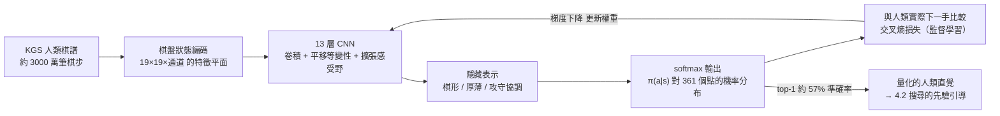

# 4.1 政策網路（Policy Network）：學習人類專家的下棋直覺（2013）

## 一家公司的收購，一門技術的集結

要理解政策網路為何在 2015 年初突然成形，得先回頭看 2014 年的那場收購。谷歌（Google）買下 DeepMind 的時候，這家公司的公開實績只有 Atari 電玩上的深度 Q 網路，但谷歌看到了它在「神經網路加強化學習」這條路徑上的通用潛力。收購帶來的不只是資金，更是算力：大規模 GPU 叢集讓原本只能在小規模上驗證的想法，得以上真實的複雜問題做檢驗。圍棋正是那個被選中的檢驗場。

在 AlphaGo 正式問世之前，學界其實已經有若干先行嘗試，把監督學習的直覺搬上 19×19 的棋盤，其中最早以嚴謹實驗揭露這條路徑的一篇，是 Chris J. Maddison 於 2015 年發表的專題論文。它用小規模的網路直接在 KGS 上的棋譜（約四千七百萬筆棋步）上訓練，證明了「以人類棋譜為標籤訓練深層網路」在圍棋上是可行的。過去我們在 3.2 節看到，為什麼手工特徵在圍棋上失效；這些先行研究則展示了另一條路：不要再去人手定義特徵，直接讓網路從原始的棋盤狀態上學。

緊接著，2015 年 Clark 與 Storkey 的 CNN（卷積神經網路）圍棋論文進一步提升了成功率，用更大的輸入表示和更深的網路，把數十萬筆人類棋譜直接投影到網路上。不過這一段先行嘗試的瓶頸很清楚：它們訓練的網路只是用來「選點」，真正要下棋時，仍然是人手寫的搜尋邏輯在掌控局面；網路在整個系統裡的角色，多半只是一個估計器，而非主體。AlphaGo 論文就以這個「主體」的角色作為切入點。

時間軸之外，還有一個歷史紋理值得留意。Maddison 的研究動機來自「用神經網路比對 Top 大師落子分布」的念頭，而它的實驗規模太小，遠不足以支撐一個完整棋手；Clark 與 Storkey 則把論點立在「著法預測可以當成 MCTS 的先驗」。DeepMind 把兩個線索合流，才組成 2015 年論文的政策網路原型。學術史上常常有這種現象：每一塊磚頭都各自存在，缺的是把它們搭成大廈的建築師。這一節要寫的就是那個大廈的第一根柱子。

## 為什麼圍棋需要 CNN

2015 年 1 月，Silver 等人在 *Nature* 期刊上發表了一篇論文，正式提出了 AlphaGo 的諾大原型。整個系統的核心是一個 13 層的 CNN（卷積神經網路），訓練資料是 KGS 資料集約 3000 萬筆專家級的棋譜。這三個數字——13 層、3000 萬筆樣本、19×19 棋盤——是這段歷史的關鍵座標。

在這之前，為什麼這個任務需要 CNN，而不需要例如 RNN（循環神經網路）或全連接網路？理由從數學形式上說，與空間結構有關。圍棋棋盤是一個 19×19 的二維結構，棋子之間的關鍵關係——提吃、叫吃、攻守間隔——都存在**局部的小窗格**裡。一個點的價值隨著周圍幾步、十幾步範圍內的配置而變，而距離它很遠的、暫時無關的區域就必須先被排除。

CNN 的結構恰好能表達這種偏見：卷積核就是一個小小的局部窗口，它掃過整張棋盤，每個位置的計算方式都相同。這正是卷積的**平移等變性**（translation equivariance）：棋盤上某個譜形如果平移到另一處，網路的內部運算不變。這種偏見對圍棋極為重要，因為圍棋的規則本身就不在乎絕對座標，只在乎相對距離。最後，堆疊多層卷積可以自然形成連續擴張的**感受野**（receptive field）：淺層只看五點半徑的小區域，深層則已能涵蓋大半張棋盤。圍棋評估中「局部與全局強耦合」的問題，在這個架構裡以層次化的方式被逐步吸收。

輸入的編碼方式也值得說明。盤面不是直接以「黑白石子」的圖像丟進網路，而是被拆成一組**特徵平面**（feature planes）：每個交叉點有沒有己方棋子、有沒有對方棋子、這手棋是第幾手落下、是否處於叫吃狀態、對局的先手資訊，各自占據一個 19×19 的 0/1 平面，疊成一個三維的張量。這個做法的巧思在於：既保留了原始棋盤的空間結構讓卷積得以施作，又把少數真正需要引擎照會的規則性資訊（例如劫的禁止、叫吃狀態）明確地攤在輸入上，不必指望網路自行從零推出。特徵平面的數量不多——2015 年論文中約莫四十八個平面——但它們共同構成了輸入語言的詞彙表：網路理解圍棋的一切，都是從這疊平面開始的。

值得一提的是，這種「用二維平面表示盤面」的想法並非 2015 年才出現。更早的研究者曾經用線性模型或淺層神經網路在同樣的平面上做著法預測，但效果始終有限，原因就在於淺層模型無法表達「一個點的價值由遠處的配置共同決定」這種多層次的依賴。2013 年前後，圍繞著法預測的突破不來自演算法的新穎，而來自兩個前提同時成熟：其一，ImageNet 之後的深度卷積網路已經證明自己在自然圖像上的威力，而圍棋棋譜在本質上就是一種「圖像」；其二，GPU 訓練的標準化流程使得在數千萬樣本上訓練 13 層網路不再是難事。

## 政策網路：以 softmax 分類人類著法

政策網路的目標很簡單：給定當前盤面，輸出「人類專家會下哪一手」的機率分布。形式化地說，神經網路的輸入是盤面狀態 $`s`$ ，輸出是對每一個可能的合法著法的分數，透過 softmax 轉成一個機率分布：

$$
\pi(a \mid s) = \frac{ \exp( f(s, a) ) }{ \sum_{ a' } \exp( f(s, a') ) }
$$

把 360 個合法點視為 360 個類別，把「人類棋譜的下一手」視為正確類別標籤，這個問題就變成了一個**監督分類**問題。訓練用了交叉熵損失，正確類別的機率越高，損失越小；說白了，網路在學「模仿人類」這個任務，而標籤來自數千萬盤真實的對局。

這一個步驟，與第一章塞繆爾的做法有本質上的不同。塞繆爾的學習目標是贏棋（後效回饋相當稀疏），政策網路的學習目標只是「還原人類的下一手」（每一手棋譜都自帶正確答案）。後者的反饋在每一手棋上都存在，這讓梯度的訊號極其稠密，訓練因此快而穩定。

## 準確率的突破：57% 的意義

這個「模仿人類」的結果，在 2015 年已是劃時代的表現。經過充分訓練後，這個 13 層網路在測試棋譜上的 top-1 準確率接近 57%，意思是每兩手棋譜裡，至少有一手它排在首位的著法和人類專家相同。而它的 top-3 與 top-10 命中率則分別達到約 72% 與 82%；先前最好基準大約只在四成上下，這一步提升在當時的圍棋 AI 界幾乎是質變，但更關鍵的是它帶來的後續機會。

誠然 57% 的天花板看起來並不高，但要正確地理解這個數字，必須問一個反向的問題：人類專家之間的差距使得「最優手」其實沒有唯一解。兩位頂尖九段在同一局面下選擇的局面可以截然不同，但棋力都在同一個層級。因此「與人類的平均選擇一致」本身不是最終目標，阿爾法貝塔式的窮舉式「正確」在圍棋上不可得，能找到的就是一個與專家**分布相符**的近似分布。

拿它跟先前的系統對比，57% 的份量才看得出來。2010 年前後最好的著法預測器（大多是線性模型配上手工特徵）的 top-1 準確率約在三成四到四成之間；Clark 與 Storkey 的小型 CNN 能逼近五成；而 13 層的政策網路一步跨過了五成五。對 MCTS 而言這個提升不是線性的：作為搜尋樹的先驗分布，一個更好的 policy 意味著搜尋資源被導向更可能正確的分支，同等算力下的棋力提升是**複利式**的。論文裡的實驗也證實了這一點：只用政策網路的先驗（不做 rollout、不做價值評估）搭配標準 MCTS，棋力已經超過當時最知名的開源圍棋程式 Pachi。換句話說，還沒有 AlphaGo 的完整架構，光是「人類直覺 + 統計搜尋」就已經作出了一個新的業餘高手。

換個說法，這個網路學到的，是一個把人類棋手的**直覺量化**出來的 表示。過去直覺不可言說，此刻它變成了一組可計算的機率：給定任意盤面，系統能立刻告訴你，人類九段會在每一個點放上幾分機率。這是歷史上第一次，人類在棋盤上「羚羊掛角」的那一回觸，被攤開成一組數字。

更值得強調的一點是，這個網路在訓練時學到的不只是「哪一步合法」。合法性的判斷早已存在於棋盤上的簡單規則裡；它真正學到的，是盤面的一個**隱藏表示**（hidden representation）——也就是那些原本只存活於棋手腦裡的棋形、厚薄、攻守協調等概念，被 13 層卷積以分布式的方式逐層壓縮出來。這個隱藏表示，正是此後所有機器學習門檻的「專家知識」的載體——3.2 節裡手寫評估函數抓不住的那些微妙耦合，如今就藏在那 13 層的中間層激活裡。

「直覺的量化」這個說法值得再往深處推一步。人類棋手說「這一手棋形很好」時，其實是在把數千盤經驗壓縮成一句無法展開的評語；當 AlphaGo 訓練時，網路在每一個卷積層把一張棋盤拆成、再重新組合成越來越抽象的特徵，最後僅僅輸出 361 個數字。這些數字沒有標籤告訴我們哪一層對應「厚薄」、哪些神經元代表「死活」，但研究者在事後的視覺化分析裡確實看到：某些中間層的激活對棋形、邊角、攻防區域有明顯選擇性。換句話說，人類棋術的整部詞典——小尖、飛、滾包、倒垂——被濃縮成一種無人能完整反解，但對所有任務都有效的數學語言。這是本書第一次真正面對「隱藏表示」這個概念，它也將在後續所有章節反複現身：價值網路（4.2）繼承同一套語言，AlphaZero（第 6 章）也用同一種語言重新寫作。

| 範式比較 | 淺層線性模型（2010 之前的圍棋 AI） | 13 層 CNN 政策網路（2015） |
|---------|----------------------------------|------------------------------|
| 空間結構利用 | 手寫特徵，局部性塑造有限 | 卷積核 + 平移等變性 |
| 長距離上下文 | 無法表達遠距離關係 | 感受野逐層擴張 |
| 人類棋譜的使用 | 數萬盤為上限 | 數千萬筆棋步 |
| 輸出 | 分數，須轉換解釋 | 直接是可分類機率分布 |
| 任務 | 評估盤面 | 預測下一手 |
| top-1 準確率 | 約三四成 | 約 57% |

## 監督學習的定義，以及它的天花板

到此我們可以把「這是監督學習」說得更精確：輸入是盤面，輸出是人類棋譜的下一手，標籤就是事實上的人手，轉換方式是交叉熵。這個框架叫做行為模仿（behavior imitation），而模仿的對象是有血肉的棋士——因此它的上限，用一句話總結：**人類棋譜的上限，就是人類的上限**。

而且這個上限還有更細的裂縫。首先，人類棋譜的數量與風格有偏：KGS 上的對局，多半是幾位活躍棋手的風格，其中一度流行的某一手可能在棋譜裡被反複重複，而冷門但更好的著法則缺乏樣本。第二，本節的網路只回答「哪一手比較可能被下」，不回答「下了這一手之後**誰占優**」。它是一個「該走哪裡」的估計器，不是一個「我現在贏不贏」的估計器。而當一個搜尋系統要把有限算力集中在最有希望的分支上時，後者才是真正需要的資訊。

第三個裂縫則來自**訓練分布與使用分布的錯位**。政策網路在訓練時見到的盤面，全部來自人類之間的對局；但在 AlphaGo 的搜尋樹上，它將被詢問的盤面，是搜尋自己催生出的變化——其中有人類從未走過的局面。監督學習的網路在陌生盤面上的表現如何，教科書沒有保證，而自我對弈正是要透過資料分布的更新，把這條溝壑填平。這是 4.3 節的伏筆。

最後，還有一個更深刻的問題：**模仿人類與打敗人類是兩件事**。AlphaGo 最終要對上的是李世乭，而不是 KGS 上的某一群人類棋手。模仿得再像，只要停在這一步，它就是一個更精緻的棋譜檢索器。超越人類的下一步，得靠自我對弈——那正是 4.3 節的主題。

在進入下一節之前，我們先看一眼整個資料流：棋譜以矩陣表示、逐層卷積、softmax 輸出機率，這 13 層網路，將在 4.2 節的搜尋系統中擔任「先驗引導」的角色。

曾有一個瞬間可以把這個網路的性格看得很清楚：**1997 年深藍的評估函數，是一個可以被讀出來的清單；2015 年的政策網路，是一個無人能完整講述的判斷**。深藍的每個特徵與權重都有人對應，問責鏈條是線性的；政策網路輸出的 57%，則是三千萬筆棋譜在一個非線性函數中的平均，其中任何一個特定判斷都無法被指著某一行程式碼回答「為什麼」。有人因此批評這是黑箱，但本書採取另一種視角：人類棋手的直覺從來也是黑箱——屠龍師傅能說「不好下在這裡」，但說不出那是多少個腦神經突觸的統計結果。不同之處只在於，人腦的黑箱我們察覺不到，而機器的黑箱是工程選擇的結果。這個視角的差異，成為後續章節不斷交鋒的哲學地雷。

## 小結

本節的三段敘事，正好組成政策網路的誕生史：先行研究證明了可能性，2015 年 1 月的 *Nature* 論文完成了工程上的整合，而 CNN 的空間偏見則使「模仿人類」在 19×19 的盤面上成為可訓練的任務。從此，圍棋 AI 這座大厦的第一個承重牆——直覺——有了量化形式，但它是監督學習的產物，天花板由人類棋譜畫定。

真正的關鍵，在於政策網路產生的機率分布只是一個**先驗**。它把搜尋的視野從「361 個點都看」收縮到「少數幾個高機率的點」，但每個被選中的點最後好不好、顯著不占優，都得由另一個網路來回答。那個網路衡量的是盤面的價值，也就是下一節的主題。
