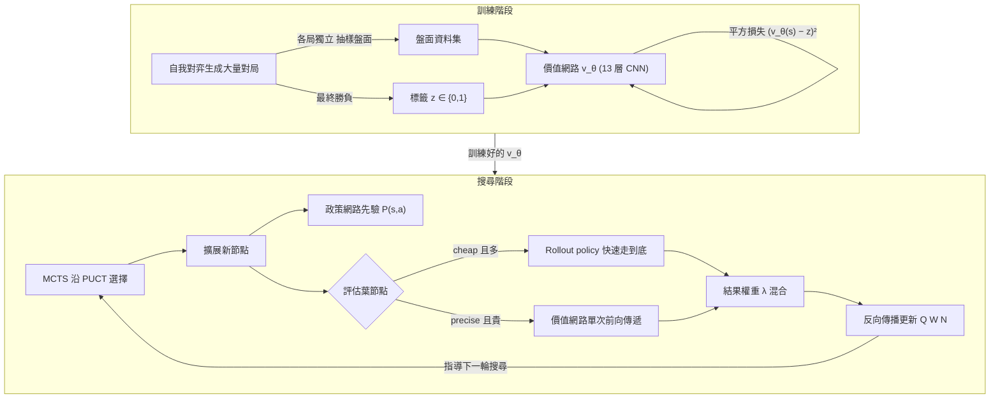

# 4.2 價值網路（Value Network）：評估盤面勝率的審時度勢（2015）

## 從「該下哪裡」到「誰占優」

上一節的政策網路回答的是一個**行動**問題：在這個盤面上，人類專家會把棋子放在哪裡。但一個完整的搜尋系統還缺另一半，那就是**形勢**問題：這個盤面，誰占優？優劣差多少？前者的輸出是對著法的信心，後者的輸出是對結局的判斷。在塞繆爾的西洋跳棋程式裡，這兩件事其實被統一在評估函數的概念之下；在 AlphaGo 的架構裡，它們被拆成了兩個互相獨立的網路——政策網路與價值網路。一個偏重行動，一個偏重形勢；一個告訴搜尋「往哪裡看」，一個告訴搜尋「看見了之後值多少」。

價值網路的數學形式很簡潔：它是一個從**盤面**到**勝率**的函數，輸入盤面狀態 $`s`$ ，輸出當前玩家最終獲勝的機率，落在 $`[0,1]`$ 區間：

$$
v_{ \theta } : s \mapsto [ 0, 1 ]
$$

注意這個函數沒有行動參數。它不吃「你想下哪裡」，只吃「現在局面是什麼」。這正好呼應 3.2 節的結論：圍棋的形勢不是「哪一手好」可以推算出來的，它是一個把整張棋盤壓縮成單一實數的全域判斷。要做出這個判斷，手工特徵整整失準了三十年，而 2015 年的做法，是讓一個在監督學習下已經擁有棋盤語言的 CNN，去承擔這個壓縮。

## 搜尋為什麼需要價值

MCTS（蒙地卡羅樹搜尋）在 3.3 節已經介紹過：它用模擬代替窮舉，把搜尋資源集中在統計上看起來最好的分支上。但純 MCTS 的模擬品質受制於 rollout policy——搜尋到葉節點之後拋出一串隨機的、質量不高的走法，用這串走棋的結局來近似該節點的勝率。這個近似在圍棋上非常嘈雜：兩顆戰力相當的棋，一串隨機走法收出來的結果可能天差地別，讓搜尋的估計噪聲蓋過真實的優劣。

價值網路改變的正是這一件事。在搜尋到葉節點之後，不必再抛一串 rollout，直接讓價值網路評估：這個盤面，我贏的機率多少。這等於把「模擬到底」的窮盡模式，換成了「一個已經學過數千萬盤局的人來冷眼判斷」。當估計噪聲降低，搜尋樹的資源才能真正傾斜到最有希望的分支上。所以價值網路在系統中的角色，不是與 MCTS 並列，而是與 MCTS **嵌合**——它是搜尋葉節點的評估器。

回過頭來說，為什麼 4.1 節的監督學習只解決了一半？因為政策網路是行動的信心，價值網路是形勢的判斷；兩者的訓練訊號不同（前者每一手都有人類下一手當標籤，後者的標籤是一局棋的最後勝負），功能也不同。一個只有政策網路的系統，可以生成像樣的著法，卻無法在選擇之間做深度的優劣取捨。

用棋手的語言來比喻，兩個網路的分工接近職業棋手的兩種訓練：打譜（背定式、模仿高手、學「通常手」）與形勢判斷（目數感、厚薄感、「這盤我貼目七點半，現在到底先手還是有餘裕」）。打譜可以速成，但真正決定棋力的，往往是形勢判斷的準度——一個每手都下「通常手」但形勢判斷一塌糊塗的棋手，會在盤面已經落後的情況下還按常規走，輸掉所有該賭的局。MCTS 的行為也一樣：它需要「通常手」來收窄搜尋範圍，但最終選擇哪一個分支，靠的是「往下看三百步，勝率還剩多少」的判斷。前者由政策網路供應，後者就是價值網路的職責。

## 訓練：從 RL rollout 得到的標籤

價值網路的訓練目標，是以盤面為輸入、以**該盤面最終的勝負**為標籤。形式上，網路的輸出 $`v_{ \theta }(s)`$ 與實際勝負 $`z`$ 之間，以平方誤差做損失：

$$
L( \theta ) = \bigl( v_{ \theta }(s) - z \bigr)^2
$$

在 AlphaGo 的訓練管線裡，這個標籤 $`z`$ 有兩種來源。第一種是**真實棋局的結果**：把一整盤人類或人工對局，拆成每一手作為一個訓練樣本，標籤就是該局最終的勝方。第二種是強化學習 policy network rollout 的結果：先訓練出一個強化學習版本的 policy network，再讓它自己展開對局，用這些**自我展開**對局的勝負為標籤。在 2015 年的論文裡，後一種做法才展現出暢通的訓練成效：因為 rollout policy 會走出人類棋譜裡不存在的變化，讓價值網路見到更多樣的盤面，避免它只是背下人類棋譜的結果。

這個混合方式的關鍵，仍然回到一個老問題：**監督學習的標籤從哪裡來**。4.1 節的標籤是人類棋譜的下一手；本節的標籤，是搜尋與 rollout 生成的對局結果。標籤的來源從「人」換成了「搜尋產生的模擬」，這一步跨越了本書一個重要的門檻。

值得停下來的不是斷句，而是工程細節上的一個坑：**同一盤棋的兩百個盤面之間高度相關**。若把一局自我對弈的每一手都當成獨立樣本使用，梯度會被少數幾盤棋的結局支配，訓練等效樣本數遠低於名義樣本數。因此 AlphaGo 論文在實作上，以「不同自我對弈對局之間的獨立」來換取樣本的多樣性——用同一個強化學習政策、在不同初始擾動下生成大量對局，再從每局中抽樣盤面。這個做法的哲學，與統計抽樣完全一致：若資料點彼此相依，寧可减少每局取樣、增加局數。工程細節決定了價值網路學到的是「盤面到勝率」的通用映射，還是只是幾百盤特定棋局的記憶。

另一個訓練上的微調是**對手的角色**。自我對弈時，價值網路看到的盤面會老是在「同水準的兩個棋手」之間相持的形勢下出現；但實戰中 AlphaGo 要判斷的盤面，是「自己若走出政策網路最想走的那一手之後」的局面。如果訓練盤面與使用盤面的生成方式不一致，評估就會系統性地失真。為此，自我展開時的 policy 選擇與搜尋時的擴展方式被刻意對齊，讓價值網路在「未來將被詢問」的那類盤面上被訓練。細節聽起來講究，但在 2016 年首爾那五局棋的成敗裡，這些講究一個都不能少。

## 全書第一次「網路 + 搜尋」閉環

我們把視角往上拉，看看這一節在整本書的位置。前面我們一直說，棋類 AI 的核心是兩件事：**搜尋**與**評估**。從 1950 年代到深藍，這兩件事是獨立的：搜尋是人寫的演算法，評估是人寫的函數，兩者互不學習。但 AlphaGo 的架構第一次讓它們**互相生成對方的訓練資料**：

- 搜尋產生自我展開的對局，對局的勝負成為價值網路的標籤；
- 價值網路訓練完成後，回到 MCTS 擔任葉節點的評估器，指導下一輪搜尋的走向；
- 更好的搜尋再產生更準的對局、更強的 policy，標籤品質就再次提升。

這是本書第一次見到網路與搜尋之間形成閉環。搜尋產生標籤，網路學標籤，再回去指導搜尋，一個正向回饋的循環。過去在西洋棋的世界裡，閉環是硬體的（更快的機器產生更深的搜尋，但評估函數的品質不變）；現在閉環是**學習的**。這個閉環的雛形，將在 4.3 節成就 AlphaGo 的自我對弈，在 AlphaZero 那一章被推到極致。

回頭檢視塞繆爾，其實早在 1952 年就我下過閉環的雛形：他的西洋跳棋程式先用與自身不同的策略自我對弈，再用對局結果校準評估函數。深藍之後的西洋棋研究幾乎拋棄了這條路，改採人手調特徵加評估，直到 AlphaGo 時代才又被重撫。塞繆爾的路線與 AlphaGo 的路線之間隔著近六十年，而關聯幾乎是一比一：**用對局的結果做標籤、調整評估、返回搜尋**。塞繆爾用的是跳棋、人工特徵、線性校正；AlphaGo 用的是圍棋、CNN、數千萬層深的非線性函數。形式的精緻度相差幾個數量級，閉環的拓撲是同一個。歷史上這種「老想法在新材料上身」的現象，往往比全新的想法更可靠——因為它早已被獨立證明過一次。

## 與 3.2 節的對照：從手寫特徵到勝率標籤

價值網路與 3.2 節的關係，值得用一段專門的筆墨。手寫評估函數用**中間代理量**做評估——目數、氣數、活子數——然後用信心承認這些代理量與勝率的映射是人寫的。價值網路直接使用**終局勝率**這個客觀事實當標籤，中間所有的概念——厚薄、地盤、大龍——全部交給 CNN 自己去學。這就是本節與 3.2 節最根本的差異：同樣名稱的作品，一個是人寫的，一個是判斷學出來的。

名稱不變、內涵不同，是本節的主軸：價值網路還是個評估函數，但它已是被訓練出來的，而不再是人手一字一句撰寫的公式。這一個躍遷——**評估函數從人手寫變成學出來的**——在 2015 年不僅在圍棋上有效，也預告了評估函數這個角色在整個 AI 領域的未來：從遊戲到 AlphaFold，把客觀結果當標籤、讓網路自行學習評估，都將成為同一套方法。

這裡也有一個容易被誤讀的地方。從 3.2 節的角度看，價值網路似乎讓那些「無法被數字化的」圍棋概念全數消失——厚薄、眼位、政閒之類——都被網路的學習吞掉了。但更準確的說法是：它們沒有消失，只是轉化了**存在形式**。書本上以人類語言寫下的定理，被 2015 年的訓練系統翻譯成一組卷積核與激活模式；一個見過上千盤提子攻勢的網路，與一位下過上千盤局的人類棋手，身上都攜帶著同一類知識，只是前者可被梯度更新、後者只能被長年修煉。3.2 節的手寫評估函數失敗，不是因為目數、氣數這些概念錯了，而是因為**用線性可數的代理量做評估**這個形式錯了；價值網路保留概念的內涵，僅僅抛棄的是其人寫外殼。

| 比較面向 | 手寫評估函數（3.2 節） | 價值網路（本節） |
|---------|------------------------|-------------------|
| 評估形式 | 線性加權特徵和 | 非線性 CNN 映射 |
| 評估對象 | 中間代理量（目數、氣數） | 終局勝率（客觀結果） |
| 特徵與權重 | 人類定義、手調 | 從資料中學出 |
| 訓練信號 | 無（或少量自我對弈） | 全局勝負標籤 |
| 局部與全局耦合 | 難以表達 | 由深層感受野逐步吸收 |
| 對搜尋的反饋 | 搜尋結果不會回流改進標籤 | 搜尋與網路形成閉環 |

## Rollout policy 與價值網路的搭配

價值網路不是萬能的。它的輸入是一次前向傳遞，計算成本相當可觀；而 MCTS 要在每個節點反複評估，把純價值網路當做唯一的 rollout 引擎，算力立即枯竭。因此 AlphaGo 的實作採用**雙軌並行**：rollout policy 是一個極端輕量的模型（一個線性模型，一次評估只需數微秒），靠它快速產生隨機但有點道理的走法，以獲取統計上有許多樣本的近似；價值網路則精但昂貴，只在樹上的關鍵節點做精確評估。

一個便宜的抽樣器、加上一個昂貴的權重估計器，這個搭配的意義在於**取樣多樣性與估計準確性的折衷**：rollout 描述 breadth（廣度）、價值網路描述 depth（深度）。沒有前者，價值網路的估計只局限在一兩個字形上；沒有後者，rollout 的收局結果在圍棋上完全失真。兩者的混合配比，將在 MCTS 談到 PUCT 時（9.2 節）更進一步被形式化。

實測資料是 4.2 節價值網路學習效果最直接的證明之一。2015 年的論文裡做過一組並排比較：純 rollout 搜尋、輔以 SL policy 的搜尋、輔以 RL policy 的搜尋、以價值網路評估的搜尋，四個結構在 KGS 棋力上各自分段驗證。結論大致是：rollout 數量雖多但雜訊大，價值網路雖貴而單次估計精確，兩者在搜索樹上的搭配顯著優於任何單一來源；唯一的例外是 rollout policy 的數量可以大幅增加，因為它只需要人或線性成本。這組消融實驗（ablation）在教科書上值得做為範例：AlphaGo 的整個架構沒有一個組成件是可以砍掉的，砍掉任何一個，效能都跳樓式下跌。這也是系統工程的意義——單一元件的好壞，只有在整體上下文中才有意義。

## 價值網路的能力邊界

價值網路的成功並不表示這個問題已經完全被解開，仍有兩個值得記錄的警示。第一，**訓練分布的外推**：自我對弈生成的盤面再多，也只是當時 policy 能造訪的盤面。一旦搜尋在前沿使出訓練中少見的著法，價值網路就開始在陌生區域估計，這種盲估在實戰中往往正是形勢最關鍵的節點。第二，**訓練與推論的目標差異**：訓練時的標籤是「自我對弈的勝負」，同一個 policy 下的自我對弈，雙方棋力相當，盤面的真實勝率容易接近一半；而實戰時，AlphaGo 要估計的是「自己對手的水準不同於訓練自己」的情形，勝率尺度被微調的餘地在訓練中並未出現。這兩個問題都在 2016 年之後陸續被改進，但並未在 2015 年的論文中完全解決。AlphaGo 內部對這些侷限的界線，其實正是它在賽前預估「勝率五五開」而非「碾壓」的合理原因。誇張和低估都不會，就是「誠實的不確定」。
## 小結

價值網路補上了政策網路沒有回答的那個問題：不是「該下哪裡」，而是「誰占優」。它的訓練標籤來自 rollout 與搜尋產生的對局結果，而它的評估能力又反身改變了搜尋的走向，形成了本書第一次「網路 + 搜尋」的閉環。價值網路不是一個新的評估函數定義，而是定義塌縮到客觀勝率之後的一個訓練方法。如今兩個網路都到位了——政策網路掌握直覺、價值網路掌握形勢——但是要讓整個系統的能力超過它的訓練素材，也就是超過人類棋譜本身的水平，還需要一塊拼圖。

那塊拼圖就是**自我對弈**：讓系統不再依賴人類棋譜，而是自己生成對局、自己修正政策、自己生成標籤，形成一個不再有「人類」的閉環。4.3 節將說明這個閉環如何在 2015 年至 2016 年之間被實際運轉，以及它為什麼困難——而最終，它在 2016 年 1 月的論文裡，成為擊敗李世乭的推手。
