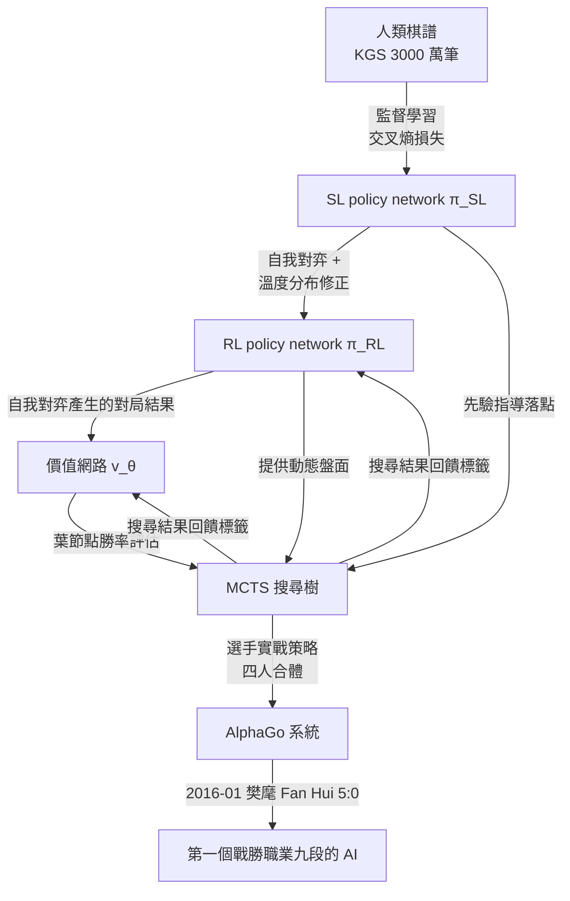

# 4.3 監督學習（Supervised Learning）與自我對弈（Self-Play）的結合（2015-2016）

## 人類棋譜的兩個天花板

4.1 節的政策網路用監督學習擷取了人類直覺，為什麼還不夠？因為模仿的框架自帶兩個天花板。第一個是**局數有限**：即使把 KGS 上三千萬筆棋步全部丟進訓練，樣本也只是人類歷史上打過的那些盤面。棋譜之間存在高度重複——流行布局被下了一萬次，而人類從來沒想過的變化則一次也沒有出現。第二個是**風格偏誤**：棋譜來自特定時期、特定圈子、特定規則下的特定棋手，模仿它的系統會同時模仿人類的偏見與盲點。如果人類頂尖棋手的某一步其實是次佳的，模仿的系統會把它當成標準答案。

這兩個天花板的嚴重性，可以借歷史的一幕來掂量。2015 年以前的圍棋 AI，全部停滯在業餘高段，多年無人相信它能升到職業。停滯的原因不是算力不夠——2015 年的 GPU 已經可以在數天內燒完過去十年的算力總和——而是**資料的形狀**：人類棋譜最多只告訴系統「人認為好的著法」，從不告訴它「客觀上最佳的著法」。當訓練分布被鎖死在「人類當下的理解」上，無論模型多深、資料多厚，系統的上限就是人類當下的理解。

塞繆爾在 1950 年代就撞上過類似的問題：如果訓練素材永遠是與舊自我、或與固定教材的對局，程式會停滯。他的解法是讓程式自己與自己下棋。AlphaGo 沿著同一句格言往前走了一步——但要讓自我對弈真正有效，得先解決一個看起來很技術、實則深刻的問題。

## 自我對弈的邏輯：同分布的資料從哪裡來

自我對弈的目標，是讓系統生成與**當前策略同分布**的訓練資料。什麼意思？政策網路現在的棋力是 $\pi_{ \theta }$ ，那麼訓練它下一版時，最好用的資料就是「 $ \pi_{ \theta } $ 自己下出來的棋」——因為 $\pi_{ \theta }$ 未來真正要駕馭的，正是與這些棋局同分布的盤面。反過來說，人類棋譜是 $\pi_{ \text{human} }$ 下的，而 $\pi_{ \text{human} }$ 與 $\pi_{ \theta }$ 不同分布：當系統的棋風偏離人類（不管是變強還是變怪），人類棋譜對這些新出現盤面的標註就慢慢失效。

這就是為什麼自我對弈不只是「一種省標籤成本的方法」，而是**強化學習對分布漂移的內建解法**。資料隨著策略一起更新，訓練永遠發生在當前策略能造訪的盤面上。在這個意義上，自我對弈回答的是 4.2 節那個「閉環」問題的最後一塊：不只是價值網路由搜尋餵標籤，政策網路本身也由搜尋生成的對局餵標籤。

## 分布修正：只下最強的一手會走進死胡同

然而，純粹的自我對弈有一個反直覺的陷阱。最天真的做法是：訓練 policy、讓它與自己對弈、每一步都下機率最高的那一手、用這些對局的勝負更新 policy。這樣一路迭代，策略會很快**收斂到局部極值**。為什麼？因為如果每盤棋的每一步都走同一條固定的最強路徑，那麼訓練資料裡出現的盤面會極端有限：這條「唯一路徑」會被來來回回地強化，而路徑之外的所有著法慢慢失去訓練樣本。策略因此變得越來越狹窄——它不是在變強，而是在對自己過去的選擇過度自信。

這是強化學習裡的經典問題，一個策略在自我對弈下永遠以「最可能的反應」回應「最可能的局面」，盤面的分布會塌縮成比人類棋譜還要小得多的集合。解法是**分布修正**（distributional correction）：主動不要每一步都下 argmax 的那一手。2016 年 Silver 等人的論文提出了兩個校正手段，第一個是**溫度參數** $\tau$ ：在自我對弈的前若干手，不取機率最高的著法，而是從 softmax 調整後的機率分布中抽樣：

$$
p(a \mid s) \propto \pi(a \mid s)^{ \frac{ 1 }{ \tau } }
$$

當 $\tau > 1$ 時，分布被壓平，次佳的著法也有被抽中的機會，於是自我對弈造訪的盤面多樣化，政策不會被鎖死在單一路徑上。第二個校正手段是在對局初期（前一手或前幾手）隨機放置，避免整批自我對局因為第一手固定而塌成同一開局。這兩個手段的原理是相同的：**訓練樣本的分布，必須保證覆蓋策略可能遇到的盤面空間**。alpha beta 搜尋的世界裡，多樣性由搜尋樹的分枝保證；在學習的世界裡，多樣性必須被刻意餵進資料集。

還有一個更隱蔽的病灶，很多人第一次聽到時不敢相信：**自我對弈可以教會你打敗最差的自己，卻教不會你打敗最好的對手**。一個策略在自我對弈中「贏」的定義，是「打敗副本的那個版本的我」；如果兩個副本一起鑽進一個共同的怪癖，它們可以互相承認對方的怪癖，在這個雙方都錯的領域裡纏鬥，而整個訓練管線毫無警訊——因為勝負確實在反映誰更接近對方的弱點，而不是誰更接近圍棋的真相。2016 年的 AlphaGo 對此的解法是務實的：訓練過程中混用較早版本的自我弈棋作為對手之一，避免所有樣本都出自「當前棋手」與「當前棋手」的內部對話；同時保留人類棋譜的監督訓練做為一層校正錨，使策略不會完全漂離人類經千年提煉的常識區。這個「錨」的意義，是讓訓練在「擴展」與「不迷失」之間取到折衷：多樣性負責擴展搜尋能造訪的盤面空間，人類棋譜負責避免誤把一種奇藝當成棋理。

## 為什麼純自我對弈需要更多技巧

理論上，只要自我對弈的條件完備，系統可以自己長出超越人類的棋力；但實際操作時，離開人類棋譜的人很快會發現反饋變慢了。原因在於監督學習與強化學習的信號密度差異：在人類棋譜的學習架構下，每一手棋都自帶標籤（人的下一手），反饋是**即時且稠密**的；而在自我對弈中，標籤是一整局棋的勝負，當一局棋長達兩百手時，這個勝負資訊必須被拆解成兩百個 credit assignment——其中許多步其實與勝負毫無關係。reward 的信噪比因此大幅下降，訓練需要的對局數量與工程技巧同時增加。

第二個問題是自我對弈的**評估盲點**：當系統只跟自己下棋，它無法知道自己的棋力是否真的在進步，還是只學會了對付自己的怪癖。一個純自我對弈的系統可能陷在「互相免疫而無實質進步」的循環裡。AlphaGo 的解決方案，是把自我對弈放在人類棋譜預訓練的基礎上：政策網路不是從零開始自我對弈，而是從一個已經有專家直覺的網路出發，把自我對弈當作精煉而非啟蒙。這個混合策略——**監督學習打底、強化學習精煉**——是 2016 年版本最核心的方法學選擇。

評估盲點還有第三層：**棋力的度量衡在自我對弈裡也是內生的**。跟人類對弈時，段位是外部的參照系；自我對弈時，「贏了昨天的自己」能說明什麼？訓練過程裡只能靠等到樊麾這類錨點才能校準——而錨點稀少且昂貴（跟職業棋手打正式比賽的成本不是 GPU 秒數能衡量的）。2015 年的團隊用的是一套內部代理指標：政策網路對人類棋譜的預測準確率、不同版本之間的勝率賽、價值網路對專家解說的吻合度。這些指標各測一角，沒有一個能直接回答「這個網路的圍棋到第幾段」。圍棋 AI 的評估難題，在本質上比西洋棋困難——西洋棋可以跟世界上最好的人常態化打比賽，圍棋的度量衡直到 2016 年才短暫地以李世乭為錨。評估的正規化會一直到 AlphaZero 的 Elo 自評體系才算完整，那是第 6 章的範疇。

這裡可以預告下一章的走向：2017 年的 AlphaGo Zero 才證明，加強工程與加強閉環本身之後，連這個打底都可省略——從亂下一手開始的自我對弈，也能達到並超越李世乭等級的棋力。但在 2016 年，混合管線是現實的正解。

用一句話把兩條管線的哲學差異講透：監督學習是在**別人的軌道上**跑步，自我對弈是在**自己的軌道上**跑步。前者穩定、稠密、永遠有標籤可依，但軌道定義了終點；後者自由、可以通往任何地方，但沒有現成的軌道，每一步反饋都要自己付費。2015 至 2016 年的 AlphaGo 是兩條軌道的接駁設計——先走別人的軌道把前期成本付掉，再切到自己的軌道往上衝。這種設計不是折衷主義的偷懶，而是對兩者短板的精確避讓：只走前者撞人類天花板，只走後者在最早期連合法像樣的對局都生成不出、反饋信號純是垃圾。接駁，是工程上的最優。

## 混合管線的全部面貌

我們可以把 2015-2016 之間的完整訓練流程攤開。第一階段：以人類棋譜監督訓練 policy network（4.1 節）。第二階段：以這個 policy 的自我對弈**強化訓練** RL policy network，用隨機先前版本的自我對弈產生對局，以勝負作為 policy 標籤；這一步需要溫度校正與多樣性抽樣，避免收斂到局部極值。第三階段：以 RL policy 的對局結果訓練價值網路（4.2 節），此次訓練帶來了一個嶄新的能力：評估任意盤面的勝率。三個網路（SL policy、RL policy、value network）再加上一個輕量 rollout policy，四者編織進 MCTS，構成了 2016 年那台擊敗李世乭的機器。

編織的效果是質變的。僅用 SL policy 搭配 MCTS，在 KGS 上只達到業餘水平；僅用 value network 或僅用 RL policy 也都落在同一區間；但把四個網路全部納入 MCTS 折衷成一個靈活系統後，AlphaGo 在與樊麾（Fan Hui，歐洲圍棋冠軍）的五番棋大戰中拿下五比零，成為第一個在正式比賽中戰勝人類職業圍棋頂段棋手的 AI。

值得注意的是，這條管線並不是「各階段做完就丟」的流水線，而是一個**層層餵養的鍊條**：監督階段提供起點，強化階段消化起點，價值階段消化強化階段的產出，最後搜尋階段把三者綁在同一棵樹上。每一階段的輸出品質，都直接成為下一階段的資料質量——資料不良，後面全部連坐。這種層級結構在 2016 年文獻中公布的訓練規模上有很清楚的印證：監督訓練使用了三千萬個盤面、耗費數週的 GPU 時間；強化訓練投下的自我對弈局數更為浩大；價值網路則需要再一批獨立的自我對弈資料。整條管線的粗略成本，在當時已是 Google 等級公司才負擔得起的水準——也為後來第 10 章討論「大規模訓練的硬體經濟學」埋了伏筆。

## 2016 年 1 月：樊麾之戰，與首爾的預告

2016 年 1 月 27 日，*Nature* 期刊登出 AlphaGo 的完整論文；同一天，DeepMind 公布了另一個消息：AlphaGo 已於前一年 10 月在閉門比賽中，以五比零戰勝樊麾。這個成績在公開時是炸彈：多數人認為圍棋 AI 還要十年才能觸及職業頂段，而 AlphaGo 已經把這個日期提前了整整十年。樊麾本人的描述很有分量：「我以為 AlphaGo 與人類還有距離，但真正下了之後，我才知道距離有多遠。」

樊麾之戰在歷史上肩負兩個角色。它是 AlphaGo 在公開舞台上的首場科學聲明：在被正式審查的方法論之上，附贈了一個不可反駁的實戰成績。它同時也是一場預告：DeepMind 隨即拋出了下一場對局的地點與對手——2016 年 3 月，首爾，對手是李世乭（Lee Sedol），一個被形容為「圍棋界活躍創造力的代表」的九段棋手，抱走過包括富士通杯、三星杯、LG 杯在內的多座世界冠軍獎盃，生涯國際賽頭銜約有十八個。

比「戰勝樊麾」更值得記錄的，是這個戰績的**量級校準**。樊麾是職業二段、歐洲第一，但他與李世乭之間存在體育界難以想像的實力差——頂級九段與歐洲職業第一的水平差，大致相當於濟濟一城的頂尖選手與鄉鎮好手的差距。所以五比零的意義不是「AlphaGo 達到職業水準」，而是「突破進入了過去被認定為 AI 禁區的職業區間，並且正在以自我對弈的速度往上爬」。DeepMind 團隊在 2016 年 1 月受訪時也坦承：媒體上「十年」開始縮成「幾個月」。從發表到首爾之戰，AlphaGo 只走了兩個月的訓練光陰；這兩個月以自我對弈產生的對局數，超過了過去所有監督訓練的棋譜總量。曲線的斜率，才是最令人不安的部分。

從 3.1 節推算出的 $10^{170}$ 狀態空間，到 3.3 節的 MCTS，再到本節的監督學習與自我對弈混合管線，這條線在本書的敘事裡走到 2016 年 3 月的門口。門後面的故事——第四局的神來之筆、AlphaGo 的幕後運算架構、以及這一戰如何改寫 AI 的產業與科學版圖——是下一章的主題。在那裡，哲思的問題將會被拷問得最直接：當機器在人類最後堡壘上取勝，我們是見證了一種更強的算力，還是一種更高明的**智慧**？

## 小結

本節的關鍵，是把「監督學習」與「自我對弈」兩條管線縫合成一條完整的訓練路徑。監督學習把人類直覺濃縮成網路的初始化權重；自我對弈把這個初始能力沿著勝負的反饋往上推。這條管線裡的自我對弈不是純粹的——它被溫度校正、多樣性抽樣、人類棋譜打底等多個技巧精心控制在收斂的軌道上，這證實了一件事：在 2016 年，**混合**才是可行的選擇，純自我對弈要等到 2017 年才會真正登場。

用一張表把整章的技術座標收齊：

| 技術元件 | 訓練資料 | 學習方式 | 回答的問題 |
|---------|---------|---------|-----------|
| SL policy network | 人類棋譜（KGS） | 監督學習、交叉熵 | 「專家會下哪一手」 |
| RL policy network | 自我對弈（溫度抽樣） | 強化學習、勝負信號 | 「對弈中誰會贏」 |
| rollout policy | 監督階段訓練的特徵組合 | 輕量近似 | 「快速往前推演」 |
| value network | RL 對局的勝負 | 平方損失回歸 | 「誰占優」 |
| MCTS | — | 統計取樣 | 「把上述全數合流」 |

但方向已經清楚：閉環一旦閉合——資料生成自策略、標籤生成自結果、網路指導搜尋、搜尋精煉網路——人類的角色就從「訓練素材提供者」，轉變為「制度的設計者」。剩下的，是讓一個已經學會審時度勢的系統，去面對那個宣稱「人類直覺不會被超越」的頂尖棋手。
