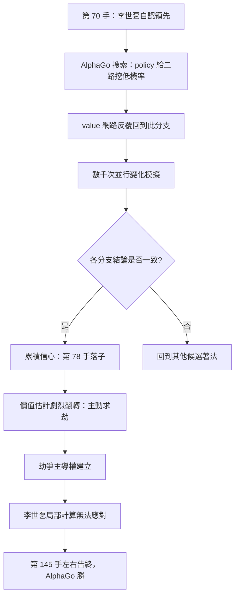

# 5.1 第四局的神來之筆：「神手」（Move 78）與人類的震撼

## 2016 年 3 月，首爾

首爾瑞草洞的高級酒店裡，五張棋盤同時擺開。觀眾席坐滿了從世界各地趕來的人，攝影機的鏡頭幾乎找不到角度可以把整張棋盤與落子的手同時收進畫面。這場五局三勝的對局，事先並沒有像 1997 年深藍挑戰卡斯帕羅夫那樣沸騰。圍棋界的主流看法相當一致：一個英國的團隊、一個來自台灣的業餘五段棋手、加上圍棋這塊全世界最難的棋盤，輸贏並不是值得報導的事件。

然而棋迷的直覺常常比官方態度敏銳。預測戰績的文章裡，出現了一些奇怪的說法：AlphaGo 之所以強，是因為它在網路上爬了大量棋譜；只要不看它的棋譜，它就什麼都不是。這句話在半年前看起來像是一個無關緊要的牢騷，甚至像是一種嫉妒。直到第一局結束，它變成了全盤的解釋。

## 第一局：李世乭的複製術

3 月 9 日，第一局開始。李世乭執黑先行，他選擇了一個 AlphaGo 自己也會選的開局——當時被棋手們稱為「二間高掛」或類似的常見佈局。落子之後，AlphaGo 在三十秒內回應，選擇的定式與網路上能找到的職業棋譜幾乎一模一樣。

這一幕被記錄下來的時候，現場的反應是安靜的困惑。接下來的一百多手裡，AlphaGo 幾乎每一手都能在網路棋譜庫裡找到對應，人們彷彿看見一台機器在翻一本巨大的棋書。它下得規規矩矩、毫無驚人之處，偶爾還會犯下明顯的局部錯誤。而李世乭恰恰利用了這些錯誤——他不追求妙手，只追求「 AlphaGo 熟悉的場合」。

第一局就這樣輕易地結束，李世乭贏了子。賽後 AlphaGo 團隊的老將 Demis Hassabis 在記者會上承認了一個尷尬的事實：他們為防止作弊，刻意限制 AlphaGo 不要從網路棋譜中直接抄定式，但在實際比賽中禁得不夠徹底。結果是 AlphaGo 第一局近乎一場「示範性的模仿」，而李世乭用這種模仿贏了盤。

這個結局對圍棋界的意義，比任何單局勝負都更為重要。它證明了兩件事：第一，2015 年底問世的 AlphaGo 版本確實在「模仿人類」這件事上做得極好，好到讓人類覺得自己看穿了它；第二，一旦模仿人類的範圍被限制住，這個系統仍然有極大的可被攻破的空間。人類棋手第一次意識到，所謂圍棋的「正確下法」在網路上早就被窮舉過一遍，而這正是 2016 年 3 月 10 日第二局轉折的起點。

## 第二局：AlphaGo 學會了不照本宣科

第二局開始前，DeepMind 團隊做了兩件事。第一是修正第一局暴露的問題，讓 AlphaGo 擺脫對人類棋譜的直接依賴，改為更依賴自身的價值判斷與搜索。第二是重新調整了分散式運算的設定，把整場對局使用的運算資源從一千兩百顆 GPU 降到了三百顆，讓 AlphaGo 更像一個「棋手」，而不是一台永動機。

3 月 10 日的第二局，是整場對局裡AlphaGo 展現出完全不同面貌的一局。它開始下出人類沒有見過的著法，其中一手「五路肩線」的變化被現場 commentator 形容為「非常alphago 的一手」。它不再是人類棋譜的複製品，而是一個有自己偏好的存在。

李世乭在這局裡明顯感到不適應。他開始主動下出對抗性很強的「試探手」，試圖把局面搅亂，讓 AlphaGo 的判斷失準。這一招後來被回顧為對局中的關鍵誤判：AlphaGo 最擅長的，恰恰是在混亂中以價值判斷取代局部計算，而人類的試探手等於是主動把手伸進了它最擅長的領域。

第二局 AlphaGo 扳回一城。整場對局從「人類輕取」瞬間變成了一比一。這是心理學上的轉折點。李世乭贏了第一局之後那種「我看得懂它」的篤定消失了，取而代之的是一種更深的不安：他開始覺得自己面對的不是一台機器，而是一種他沒有棋譜可以參照的東西。

## 第三局：形勢判斷的差距

3 月 11 日的第三局是「形勢判斷課」。AlphaGo 執白先行，中盤時在右邊做出大膽的一跳，把一整片區域連通，李世乭的應手則顯得保守而退縮。棋評者們注意到一個現象：AlphaGo 願意放棄大量的「可計算利益」去換取「可計算之外的結構」，這在人類棋手身上極為罕見。

李世乭自己在賽後檢討時提到，第三局他之所以落入下風，是因為他太依賴「第 78 手以後形勢會如何」的局部計算，而 AlphaGo 在更早的階段就已經放棄了那些局部。圍棋的殘局常出現這樣的情形：每一塊棋的局部交換都是虧的，但合起來卻是賺的。人類棋手受制於算清的局部，未必能在那個時點承認全局的結論。

## 第四局：Move 78

3 月 12 日，第四局開始，李世乭執白。整場對局進行到第 70 手左右時，盤面是一個李世乭自認占優的局面——他估計自己的實空領先。然而 AlphaGo 在第 78 手落了一子，位置在棋盤右下方的「二路挖」，一個完全違反人類定式感覺的地方。

人類棋手在當時的判斷是：這一手無法理解。圍棋有數百年的定式累積，二路挖在人類的語彙裡屬於被反覆研究過的變化，而 AlphaGo 走的偏偏是「像挖、但又不對」的一手。很多時候，人類的反應是「看不懂」被等同於「錯棋」，因此不予理會。

但 AlphaGo 的價值網路看到的是另一件事。第 78 手之後，整個棋盤的價值估計發生了劇烈的翻轉：AlphaGo 判斷自己的實地雖少，卻能藉著這一手製造出一個大規模的劫爭，而劫爭一旦開打，自己握有劫材的優勢，價值將遠超李世乭表面的領先。於是在這一手之後，AlphaGo 的所有後續著法都圍繞著同一件事——把劫爭的主導權握在手裡。

事後的分析顯示，AlphaGo 在落子當下並不是「已經知道」這一手能贏。它的 policy 網路給這一手分配的機率極低，遠低於許多看起來平庸的著法；真正的理由是 value 網路在搜索過程中反覆回到這個分支，而每一條被模擬出來的後續變化都指向同一個結論。數千個變化分支在人類的直覺裡是零散的、互相矛盾的，需要靠棋手的心智逐一驗證；對機器而言，它們不過是數千次廉價的並行評估，而一致性本身就能累積成信心。

李世乭在前 78 手與後續數十手之間並非沒有反應的機會，但局面在數十手之內就已經被 AlphaGo 的劫爭計畫綁死。最終第四局 AlphaGo 贏了二子半到七子半之間（依當時記錄為四子半），棋局在第 145 手左右告一段落，五局三勝提前確定。

| 局次 | 日期 | 結果 | 關鍵事件 |
|---|---|---|---|
| 第一局 | 3 月 9 日 | 李世乭勝（黑） | AlphaGo 大量複製網路舊手，李世乭以熟悉度取勝 |
| 第二局 | 3 月 10 日 | AlphaGo 勝（白） | 擺脫棋譜依賴，出現人類未見的「五路肩線」變化 |
| 第三局 | 3 月 11 日 | AlphaGo 勝（白） | 放棄局部利益換取結構，勝在全局形勢判斷 |
| 第四局 | 3 月 12 日 | AlphaGo 勝（黑） | 第 78 手「二路挖」引發大規模劫爭，價值估計翻轉 |
| 第五局 | 3 月 13 日 | 未舉行 | AlphaGo 3:1 提前奪冠，李世乭第三度戰敗 |

## 圍棋解說者的沉默

值得記錄的還有一個細節：第四局進行到第 78 手之後，直播間裡的解說者沉默了相當長的一段時間。這種沉默與「看不懂」的沉默不同——它是看到了一個自己沒有能力解釋的結構，卻又無法反駁它。在圍棋的傳統裡，解說者的權威性來自於能說清楚每一手的道理；當這種權威失效，比棋局本身更令人不安。

事後 AlphaGo 團隊把整場對局的搜尋節奏公開了大致輪廓：每一手平均要進行數百到數千次的模擬，而第 78 手這種「非定式」的著法，往往正是那些被反覆抽樣、反覆評估之後才浮現的候選。人類棋手在實戰中面對的是一個已經篩選過的輸出，而那個篩選過程本身，才是這場比賽真正的內容。

## 「它沒有情緒、沒有恐懼」

賽後的記者會上，李世乭說了整場對局最被引用的一句話。他說，AlphaGo 沒有情緒、沒有恐懼。它不會因為局面不利而焦慮，也不會因為自己的一手被叫好而喜悅。這句話之所以重要，是因為它精準描述了 AlphaGo 與人類在決策結構上的根本差異。

人類棋手在長考時會累積疲勞、會產生自我懷疑、會在「這盤棋是贏棋還是輸棋」的框架下被侷限。一個壞的直覺會產生自我強化的迴圈，讓棋手愈算愈相信自己的錯誤方向。AlphaGo 的搜索是無記憶、無情緒、無疲勞的：它對每個候選分支的評估不帶任何前一次的偏好，同樣的盤面它會給同樣的分數。這種性質讓它在形勢判定上不受人類心理狀態的干擾。

但李世乭的這句話很快被挑戰了。2016 年 12 月，在烏鎮舉行的三對三圍棋峰會上，柯潔在第二局輸給 AlphaGo 之後，主動挑戰整盤棋採用了當時排名第一的 Alphago（編號為 Master 的版本）。他贏了那一局，並且贏得乾乾淨淨。賽後他針對「AlphaGo 沒有恐懼」的說法提出反駁：AlphaGo 的冷靜不是天賦，而是設計；它之所以能下出人類想不到的棋，是因為它是**人類造的**。人們寫了卷積網路、寫了強化學習、寫了蒙特卡洛樹搜尋、寫了分散式系統，還提供了數百萬局人類棋譜當作燃料。

這句反駁在科學史上是一件大事。它把「AI 超越人類」的敘事從神秘主義拉回工程學：AlphaGo 的「直覺」是數百萬小時人類知識工作的累積所浮現的樣態，而不是某種獨立的智慧。柯潔的那盤棋同時也說明另一件事——**人類頂尖棋手仍然能贏**，只要他懂得用什麼樣的方式去贏。

## 「人類從來沒有發明過」

烏鎮對局之後，AlphaGo 團隊公開了一份「自我對弈棋譜」，裡面包含大量定式序列。柯潔在研究後驚嘆，這些變化人類從來沒有發明過。有些變化在人類的定式體系裡找不到對應，有些則是已知定式的意外延伸。更引人注目的是，這些棋譜在 AlphaGo Zero 的相關研究中被歸納成新的定式集合，而它們後來真的被職業棋手拿來使用。

這件事的科學意義不在「機器更聰明」，而在於它揭示了兩種截然不同的知識表徵。人類棋手的棋感，是一套在數千局實戰中沉澱下來的**局部啟發式**：它依賴形狀記憶、依賴定式索引、依賴對「常見局面」的快速辨識，並且依賴一套被歷史篩選過的常識——人類認定「二路挖」在這個位置不合常理，因為過去的棋譜裡它總是以另一種結果收場。

AlphaGo 的表徵則不同。它的 policy 網路並不直接「知道定式」，它學的是空間特徵的層次組合；它的 value 網路並不「讀懂」局面，它學的是整個盤面的價值函數近似。當這兩者被放進搜索裡，機器並不必然使用人類的定式詞彙。它可以找到一個人類從未命名的、卻在數學上更嚴密的位置。Move 78 就是這樣的一個位置。

因此，人類的「棋感」並非謬誤，但它是一種**被誘導的局部啟發式**：它在人類的搜索深度與人類的形狀偏見共同限制下運作，效率極高，卻存在系統性的盲區。機器用另一種表徵——不是更多的知識，而是不同的知識——看到了全局。這一點，比「機器贏了」重要得多。

## 為什麼 Move 78 是一個科學事件

圍棋界內部對第 78 手的評價，長久以來集中在「這一手漂亮」或「這一手像人類」這類審美語言上。但從科學的觀點看，Move 78 提供了一個極難得的、可被形式化的觀察對象。

它讓 policy 與 value 的分工第一次被公眾看見。人類棋手其實也做類似的事：直覺告訴你「這裡應該怎麼下」，全局判斷告訴你「這盤棋值不值得這樣爭」。但人類的直覺幾乎總是壓過全局判斷，因為直覺快、全局慢，而且直覺帶著情緒。AlphaGo 相反：policy 給這一手低機率，若只有 policy，它絕對不會落子；是 value 在搜索中把它反覆撿回來，一次又一次，直到一致性累積成信心。

從數學上說，這對應到一種不對稱的決策結構。policy 網路輸出的是一個機率分佈 $`\pi(a \mid s)`$ ，描述「在狀態 $`s`$ 下，選出著法 $`a`$ 的合理程度」。value 網路輸出的是一個標量 $`V(s)`$ ，描述「在狀態 $`s`$ 下，預期能取得的總收益」。在蒙地卡羅樹搜尋中，兩者的分工可以寫成選擇階段的準則：

$$
Q(s, a) = Q(s, a) + c_{\mathrm{prior}} \cdot \pi(a \mid s) \cdot \frac{\sqrt{N(s)}}{1 + N(s, a)}
$$

其中 $`N(s)`$ 與 $`N(s, a)`$ 分別是狀態與著法的訪問次數，  $`c_{\mathrm{prior}}`$ 控制「先驗直覺」在探索新分支時的加成強度。這個式子的關鍵不在形式，而在它把「直覺」和「實證」拆成了兩種可獨立加減的量。

在第 78 手的情境裡，若只有 policy 直覺，  $`\pi(a \mid s)`$ 極小，那麼 $`Q`$ 值低到不可能被選中；真正讓這一手浮現的，是隨著該分支被反覆模擬，  $`Q(s, a)`$ 本身的實證項持續被更新並站穩了腳跟。這正是 value 網路在全局層面「看見」了 policy 在局部層面看不見的東西。人類棋手也有類似直覺與計算的分工，但他們幾乎無法讓後者系統性地推翻前者——因為人類的「更新」受到記憶、疲勞與尊嚴的干擾。

換句話說，Move 78 示範的是一種**用評估覆蓋直覺**的決策風格。它也示範了人類會犯的錯：把「我不懂」當成「它錯了」。當一位當時最強的圍棋手連續在數十手中無法解釋一個分支的價值，而機器始終沒有動搖，人類才第一次被迫承認，直覺的邊界不是世界的邊界。

2016 年 3 月 13 日，李世乭在第三局落敗後，走到攝影機前深深鞠躬。整個現場是沉默的。這不是一場慘敗，這是一場觀念的崩解：人類花了三千年累積的圍棋智慧，在五局之內被證明不是這件事的終點。
