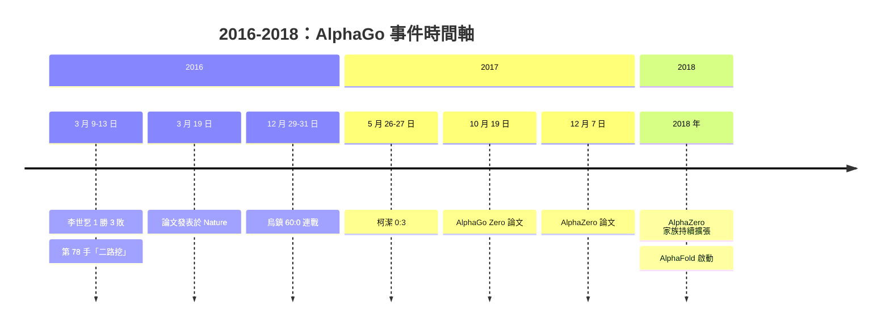

# 5.3 這一戰對人工智慧產業與全球科學界的歷史轉折（2016-2017）

## 三月之後：論文與封面

2016 年 3 月 19 日，AlphaGo 的技術細節以論文形式發表於 *Nature*，標題是〈Mastering the game of Go with deep neural networks and tree search〉。這篇論文把 policy 網路、value 網路與蒙地卡羅樹搜尋的結合完整公開，也把訓練過程中「以人類棋譜為先驗」與「以自我對弈強化」兩個階段分開描述。

論文發表當天即登上 *Nature* 封面，並成為該雜誌歷史上最受關注的計算機科學論文之一。任何熟悉科學出版的人都知道，這種曝光量在計算機科學領域極為罕見。圍棋是一個高度封閉、內向的專業領域，它的規則簡單到近乎數學，但它的難度讓它自成一格；而 *Nature* 的讀者群是生物學家、物理學家、醫學家與一般科學讀者。一篇圍棋論文登上封面，意味著「機器學習」這件事第一次以一種不需要專業背景就能理解的方式，進入了大眾科學的視野。

更值得注意的是論文的共同作者名單。除了 Demis Hassabis 與 David Silver 等 AlphaGo 的核心成員，還有 Aja Huang 等負責實作的研究者，以及圍棋界的重要人物——包括中國圍棋協會與韓國棋院的支持者、以及在賽前協助整理訓練資料與規則的韓國圍棋高手 Mu-Chu Chang 與 Feng-hsiung Huang（後者後來加入 DeepMind）。這份名單本身就說明了這個系統的性質：它把人類的規則知識與機器的學習能力擰在一起。

## DeepMind 成為核心研究實體

2014 年，Google 收購了 DeepMind。當時外界對這樁交易的評價相當兩極，媒體報導的收購金額在數億美元的量級，而評論者質疑一家成立不到五年的公司憑什麼值這個價。2016 年 3 月之後，這個疑問有了答案：Google 在 2017 年把 DeepMind 正式升格為母公司 Alphabet 旗下與 Google 並列的單位，一度傳出 DeepMind 放棄部分商業應用、把資源全面投入科學與基礎研究的說法。

從組織史的角度看，AlphaGo 是 DeepMind 從「研究原型」轉向「世界級研究機構」的轉折點。在此之前，DeepMind 的知名成果是 DQN 在 Atari 遊戲上的表現，雖然驚艷，但仍在「遊戲 AI」的範疇內。AlphaGo 把同一套方法論——深度強化學習搭配高價值搜尋——推到了一個全世界圍棋最高境界的場景中，並且獲得了人類世界冠軍的讓子勝。這使得 DeepMind 的研究路線獲得了難以用財務數字衡量合法性：它不再只是「做遊戲 AI 的公司」，而是「能把AI 帶到最難問題上的研究機構」。

這個定位在接下來幾年裡不斷被強化。蛋白質摺疊的 AlphaFold、可以玩數百款遊戲的 MuZero、通用演算法 AlphaZero，一個接著一個出現在同一間實驗室裡。若只看棋類，DeepMind 會是一個很成功的博弈 AI 公司；但把圍棋、將棋、西洋棋、蛋白質摺疊串成一條線，DeepMind 的研究敘事就變成了「用學習與搜尋解決人類未曾解开的難題」，這是一個完全不同量級的機構形象。

## 2017 年 5 月：烏鎮

三局零和，是 AlphaGo 在 2016 年之後留下的最後一個懸念。2016 年 12 月的烏鎮峰會上，版本更新後的 AlphaGo（內部稱為 Master）以 60:0 的戰績擊敗了當時世界排名第 60 至第 100 的頂尖棋手，橫掃中國圍棋協會、韓國棋院與日本棋院，三天之內完成了 60 場連戰而無一敗績。

2017 年 5 月 26 日至 27 日，烏鎮的「棋聖」峰會上，柯潔以九段身分挑戰 AlphaGo。這一次採用的是 2016 年 10 月在 *Nature* 發表的改進版本，官方稱之為 AlphaGo 的新一代版本，並且在後來被描述為使用 60 線的版本（相較於先前的 19 線）。柯潔在第一局採用了當時世界上並不存在的新開局「宇宙流」——他在右上角以「三三」著手開局，一度讓觀戰者驚呼。AlphaGo 在應對時出現了被廣泛討論的「二路打三路」這類在人類棋理上不成立的應手，但那些應手並非混亂，而是另一種邏輯的產物。

三局比分為 0:3，柯潔全敗。賽後的公開評論裡，柯潔的表現被很多人視為科學家式的冷靜：他沒有崩潰，也沒有過度渲染，而是在頒獎儀式後主動走向 AlphaGo 的運算節點，試圖觀看它的運作過程——由於 AlphaGo 在雲端運作，他只能在終端機上看到內心獨白式的機率輸出。這個動作後來被反覆引用，成為「人類以理性方式接受AI 超過自己」的象徵。

| 事件 | 時間 | 形式 | 結果與意義 |
|---|---|---|---|
| AlphaGo 對李世乭 | 2016 年 3 月 9-13 日 | 五局三勝 | 3:1 勝，首次擊敗頂尖人類棋手 |
| 論文發表 | 2016 年 3 月 19 日 | *Nature* | 首度公開完整方法，登上封面 |
| 烏鎮 60:0 | 2016 年 12 月 29-31 日 | 連戰 60 局 | Master 版本橫掃三國頂尖棋手 |
| AlphaGo Zero 論文 | 2017 年 10 月 19 日 | *Nature* | 零人類棋譜，自我對弈三天 100:0 |
| 烏鎮柯潔三局 | 2017 年 5 月 26-27 日 | 三局 | 0:3，AlphaGo 完勝；柯潔嘗試新定式 |
| AlphaZero 論文 | 2017 年 12 月 7 日 | 論文預印本 | 同一演算法通吃西洋棋、將棋與圍棋 |

## AlphaGo Zero 與 AlphaZero：範式的收斂

2017 年 10 月，DeepMind 發表 AlphaGo Zero 的論文。它與 2016 年版的差異不是「更強」，而是「更簡單」。它不再使用任何人類棋譜作為初始訓練資料，也不再手寫任何圍棋規則；它只從零開始的隨機著法出發，用同一個網路同時輸出 policy 與 value，靠自我對弈的結果作為唯一的獎勵訊號。

三天之內，AlphaGo Zero 在數百顆 TPU 上完成自我對弈，棋力達到 100:0 擊敗擊敗李世乭的版本。這個結果的重要性遠超棋力本身：它證明**人類的圍棋知識不是必要的**。人類三千年累積的定式、術語與直覺，都只是同一個學習問題的「暖啟動」捷徑，而捷徑是可以被完全拿掉的。

AlphaZero 的論文隨後在 2017 年 12 月發表，把同一套方法推廣到西洋棋與將棋，一個通用演算法同時處理三種棋類。從 1952 年塞繆爾的西洋跳棋程式，到 2017 年的 AlphaZero，中間六十五年，人類走過「機器學習評估函數 → 搜尋剪枝 → 專用硬體 → 卷積網路 → 強化學習 → 零樣本自我對弈」的完整階梯，最後把三種棋類收斂到同一個演算法之下。

## 對 AI 研究的方法論衝擊

AlphaGo 帶來的產業與科學衝擊，可以從「什麼變成了主流」這個角度來衡量。

在 2016 年之前，強化學習在 AI 圈裡是一個相對邊緣的方向。它缺乏大規模的、可重現的實證成果，訓練不穩定、樣本效率低、難以在標準基準上取得讓人心服口服的數字。相較之下，監督學習有 ImageNet 這樣成熟的基準，深度神經網路有清楚的工程路徑與商業回報。強化學習更像是一個學術上的優雅想法。

AlphaGo 改變了這件事。它提供了一個無法被質疑的成果：把強化學習、深度網路與搜尋結合，超越了一個被認為不可能被超越的人類基準。從此，整個領域的資源配置開始轉向——大量研究團隊投入自我對弈、分散式訓練與策略最佳化。短短兩年內，AlphaZero 的概念被推廣到機器人控制、網路路由最佳化、藥物分子設計等領域，「用自我對弈學會複雜行為」成為 AI 研究的主軸之一。

另一個方法論層面的轉折，是「**搜尋加學習**」典範的確立。在 AlphaGo 之前，人工智慧的兩條主流路線被視為互斥的：一條是符號式的搜尋與規則系統，一條是連接式的學習與神經網路。AlphaGo 說明這兩條可以分工：一個負責在可能性的空間裡探索，一個負責對每個狀態給出準確的評估。這個分工不僅適用於棋盤，它後來成為 AlphaFold 折疊搜尋的骨架，也成為今天大型語言模型的推理增強路線的直覺來源。

## 對社會的衝擊：斷裂感與監管

技術上的勝利並沒有自動帶來社會上的理解，反而製造了明顯的斷裂感。許多圍棋界人士與一般民眾在 2016 年之後表達的，並不是欽佩，而是一種被拋下的失落感：他們熟悉的整個文化體系——師徒制、段位、天才少年、對弈室的深夜——在幾天之內被重新定義為「一種人類會被超越的活動」。這種情緒在 2016 年底到 2017 年初發展成一個實際事件。

2017 年 1 月，圍棋界發生了一件被廣泛報導的爭議：一位名叫吳文義的中國圍棋甲級棋手被指在與 AlphaGo 的網路對弈中，利用軟體作弊。事件曝光後，體育總會與中國圍棋協會介入處理，吳文義被禁賽、取消比賽資格。輿論隨即擴散到一個更大的問題：如果 AI 已經能贏頂尖棋手，那麼業餘棋手用軟軟作弊為何還需要被單獨譴責？是否所有業餘對弈都應該重新懷疑？

這個事件之所以重要，不是因為一場處分，而是因為它讓「AI 參與」這個變量第一次進入大眾的道德討論。原本，業餘棋手在網路上對弈作弊只是圈內的倫理問題；AlphaGo 之後，它變成了公眾議題——人們開始重新想像一個「棋手用 AI 幫忙」的世界會是什麼樣子。與此同時，職業棋手體系也開始重建自身的評價框架：AI 對局的商業價值、AI 時代的段位意義、以及「人對人」比賽與「人對機」比賽應該如何區分與記錄。

最終的主流做法是分開計算。職業圍棋界確立了「業餘棋士段位不被承認為職業段位」的規則，並要求業餘棋手遵守更嚴格的反作弊規範；同時，圍棋賽事開始設立專門的 AI 比賽項目，讓人機對弈有獨立的賽事脈絡而非混入職業聯賽。回頭看，這套區隔正是 2016 年之前不存在、而 2016 年之後無法避免的制度遺留。

## 為什麼連續兩年上封面

《自然》雜誌在 2016 年 3 月以 AlphaGo 論文為封面，2017 年 10 月又以 AlphaGo Zero 論文為封面，連續兩年在同一個主題上登上封面，這在科學出版史上極為罕見。

理由有三。第一，AlphaGo 與 AlphaGo Zero 代表的不是同一件事的兩個版本，而是兩次範式轉移：前者證明「機器可以超越人類頂尖專家」，後者證明「人類的知識傳承並非必要」。前者是結果，後者是機制，科學價值更高。

第二，圍棋這個領域具有特殊的科學敘事能力。它足够簡單，規則可以在幾句話內說完；它又足够深，十年來被公認為「最後一個尚未被攻克的人類智力高地」。這種「簡潔規則、深邃策略」的組合，讓它成為哲學與科學交界處最好的案例。圍棋為什麼算智力、機器是否可以理解、創造力是什麼——這些問題都能藉由一盤棋被公眾直觀地討論。

第三，也是最重要的：這是一個可以量化的、沒有爭議的成果。AlphaGo 不是「看起來很聰明」，也不是「在某個模糊的人類評測上表現良好」，而是明確地、以圍棋的既定規則、由一位人類世界冠軍親手認輸。所有模糊性都被消除了。當一個領域需要向社會交代自己的價值時，「打敗了李世乭」是最有效的一句話。

而在 2018 年，*Nature* 的封面主題轉向了 AlphaFold——同一個團隊，把同一副「搜尋加學習加硬體」的骨架從棋盤搬到生物分子。圍棋這場斷裂，隨即成了通往下一個領域的跳板。

## 教科書與文化的轉折

除了產業與科學界，這場比賽還悄悄改變了圍棋本身作為一種文化的樣貌。

在 2016 年以前，圍棋教學的主流是「定式手筋 → 實戰 → 大量題目」的傳統路徑，定式是死的，題目是為了熟悉題目而存在。AlphaGo 之後，一批年輕棋手開始用另一種方式訓練：他們不再死背變化，而是研究 AlphaGo 的對局記錄，看它如何建構一個定式的每一個分支，看它如何選擇放棄多少子去換取多少形勢。這套「以引擎的思路為師」的方法，後來被許多國家的圍棋協會正式納入青少培訓課程。

更根本的變化發生在「什麼樣的棋是好棋」的判準上。過去圍棋的美學建立在效率與必然性之上——好棋是不浪费一手、不給對手機會的棋。AlphaGo 卻屢屢下出在效率上明顯吃虧、但在其他維度上極其划算的棋，圍棋界因此不得不重新思考「效率」是不是唯一的價值尺度。這個美學上的重新定位，會在後續章節裡成為一個獨立的主題。

而在日本與韓國，衝擊的感受尤為強烈。兩國的圍棋長期與各自的歷史文化緊密相繫，韓國圍棋協會在 2016 年 3 月的比賽現場承受了難以言喻的壓力；日本則在 2016 年 3 月底的世錦賽上，看到韓國頂尖棋手在李世乭落敗後一個個上去挑戰 AlphaGo 的「維納密」版本，全數落敗。那幾天的對局室裡，圍棋不再是日常技藝，而是一場逼近人類文化底線的圍觀。歷史學家日後談到 2016 年時，確實會把它稱為日本圍棋與韓國圍棋的「震撼之年」。

## 從圍棋到科學的通用性

最後還有一個更長期的效應需要記錄：AlphaGo 團隊在 2016 年之後明確地把「用學習與搜尋解決科學問題」當作下一個目標，而 2018 年問世的 AlphaFold 正是這個目標的第一個成果。摺疊預測與圍棋看起來毫不相干，但 AlphaFold 借用了 AlphaGo 的三件事：學習出來的評估函數、蒙地卡羅類的搜尋、以及大規模的專用硬體。

這意味著 2016 年的圍棋對局，並非孤立的奇觀，而是一條技術路線的起點。回頭看整條線索：1952 年塞繆爾讓機器學會一個評估函數，2016 年 AlphaGo 讓機器學會一個能贏頂尖人類的完整決策系統，2017 年 AlphaGo Zero 證明連人類的知識與規則都可以不需要，2018 年 AlphaFold 把同一副骨架帶進生物學，而 2020 年以後它更進一步被用於藥物設計與其他實際問題。

圍棋在這條線上扮演的角色，是最理想的試驗場：規則明確、勝負絕對、人類頂尖水平可被量測。沒有任何其他領域能同時滿足這三個條件，因此圍棋在 AI 史上留下的東西，也就格外具有方法論上的示範性。

## 尾聲

2016 年 3 月 13 日，第五局之前的會場裡，Google DeepMind 的團隊成員交頭接耳，沒有人說話。三比一的結果已經寫在記分牌上，李世乭正在收拾棋盒。

六十年後回頭看，這場比賽真正確定的事情，其實不是「機器比人強」，而是一個更具體、更技術性的命題：一個由人類寫下架構、由人類提供燃料、由人類的硬體承載的系統，能夠在人類最自傲的領域裡，產生人類不曾想到的東西。柯潔那句「它終究是人類造的」，在此時此刻顯得格外精準。斷裂是真的，但它是一次方法論的斷裂，不是智力的斷裂。
