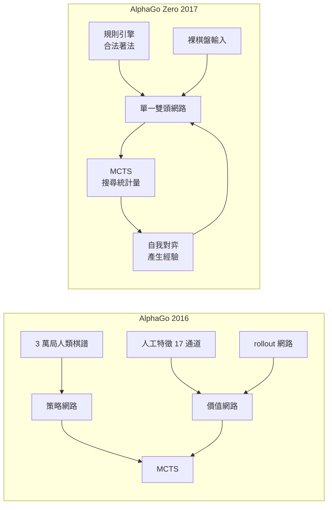

# 6.1 徹底擺脫人類棋譜：完全從零開始的自我對弈（2017）

## 三個被砍掉的東西

2016 年 3 月，AlphaGo 在首爾的四季酒店對上李世乭。當第四局第五十八手落下時，李世乭離開座位去走廊抽烟——那個後來被稱為「神手」的一手讓無數圍棋界人士認定機器即將落敗，連當時在場的許多職業棋手都相信李世乭看到了人類直覺難以解釋的東西。半年後，這支團隊發表了一篇論文，主標題只有幾個字，卻像一紙休克宣告：Master 完勝李世乭，比分 60 對 0，且這一次連棋譜都不用人類寫了。

AlphaGo Zero 與它的前輩之間，差距可以濃縮成三個被砍掉的東西。第一，人類棋譜不見了。2016 年的 AlphaGo 用的是監督學習：它的政策網路先餵了約三萬局頂尖棋手的對局棋譜，價值網路同樣建立在人類標註的盤面勝負之上。三萬局是巨大的資產，但也是一道牆——模型被鎖死在人類棋力的天花板之內，凡是沒有人下過的局面，它就沒有任何理由相信自己能下得更好。第二，人工設計的特徵不見了。AlphaGo 的價值網路輸入不是裸棋盤，而是十七個額外通道，像「對手上一手是什麼」「這手棋被威脅了嗎」這類特徵，裡面凝聚了圍棋界幾百年的常識。第三，用來訓練價值的隨機對局（rollout）政策網路也不見了，取而代之的是蒙特卡羅樹搜尋本身產生的搜尋統計量。

砍掉這三樣之後，剩下的東西少得令人吃驚：棋盤座標，以及規則定義。程式知道哪裡是棋盤的哪一格，知道規則是什麼樣子，此外一概不知。

順帶一提，第三項改動的意義常被低估。AlphaGo 在訓練價值時會用一個小型的 rollout 網路：從當前局面開始，用一個簡單而粗糙的政策隨機下到終局，把終局結果回傳。這是一種「用大量廉價模擬換取評估精度」的技巧，但它同時也是一個隱藏的人類先驗——那個 rollout 網路的權重，是用人類棋譜訓練出來的。所以第三項改動並不是單純的效率提升，而是切斷了價值學習對人類資料的依賴。在 Zero 裡，價值判斷的唯一來源是搜尋樹本身的統計量，一個節點被訪問得越多，表示搜尋在那裡找到的後果越有利。

| 面向 | AlphaGo（2016） | AlphaGo Zero（2017） |
|---|---|---|
| 初始訓練資料 | 約 $3$ 萬局人類棋譜 | 隨機著法產生的自我對弈 |
| 輸入特徵 | 17 通道人工特徵 + 裸棋盤 | 裸棋盤的 $19 \times 19$ 位置平面 |
| 價值估計的來源 | 自我對弈 rollout 網路 | 搜尋樹的統計結果 |
| 學習方式 | 監督學習 + 強化學習 | 純粹自我對弈的強化學習 |
| 對弈對手 | 自我對弈（用來微調） | 只有自己 |
| 最終人類知識含量 | 大量 | 僅限規則與合法著法判定 |

這張表的每一列都是一道牆，而 Zero 把它們一口氣推倒了。這也是為什麼 6.3 那場一百場全勝的實驗，具有教科書級的說服力：它不是某個環節的優化，而是整面牆的移除。

## 白板學習的名詞與血統

「從零開始」在機器學習裡有一個專門的說法：tabula rasa，直譯是「空白石板」。這個詞來自約翰·洛克在 1689 年的《人類理解論》——人的心智起初如同一塊白板，上面沒有預先寫好的觀念，一切內容都由經驗寫上去。把它移植到機器學習語境，意思是：學習系統的初始參數不承載任何關於任務的先驗結構，模型必須把任務的規則從互動中重建出來。

真正把這個想法做成演算法框架的，是理查德·塞頓。1991 年他發表《經驗與模型之間的整合》（Integrating Learning and Planning），提出日後被稱為 Dyna 架構的經典循環。塞頓的論點是：人類之所以能規劃，是因為心中有一個關於世界的模型；人類之所以能學習，是因為能把真實經驗和模型內的經驗混在一起。他把兩種經驗來源並列：真實經驗是環境實際給你的獎勵，模型經驗則是用心靈中的模型「幻想」出來的。兩者的比例若為零，就只剩純規劃；若有模型而無真實經驗，就成了空想；唯有讓模型經驗與真實經驗不斷互相校正，學習效率才會大幅提升。

塞頓在論文裡反覆強調一個權衡：模型可能不準確，若把太多時間花在用模型幻想上，學習會被錯誤的模型污染；若完全不放棄模型，人又無法在有限時間內累積經驗。這個「經驗與模型的平衡」正是 AlphaGo Zero 自我對弈迴圈的理論雛形，只是尺度放大了好幾個數量級。

## 為什麼人類棋譜反而是一道牆

人類棋譜聽起來是純粹的好處：這是全世界最珍貴的資料集，涵蓋幾千年的智慧濃縮。然而在機器學習的框架下，棋譜是一把雙刃劍，而且刀刃朝內。

監督學習的本質是模仿。三萬局頂尖棋手的對局教會模型「頂尖棋手會在什麼局面下走什麼手」，但它無法教模型「頂尖棋手沒下過的局面該怎麼走」。更根本的問題是天花板：模型的能力上限由資料的分佈決定，而資料的分佈由人類棋力決定。三萬局頂尖棋譜所能覆蓋的狀態，相對於 $10^{170}$ 這個尺度，只是無數孤島。模型在島嶼上表現卓越，一旦比賽進入島嶼之外的汪洋，就只能靠內插猜測。

2016 年的 AlphaGo 用大量人類棋譜把模型「拉到」頂尖起點，再靠自我對弈微調，這個兩段式設計非常合理，因為當時算力不足以支撐從零開始的龐大搜尋。但自我對弈微調同樣受限於初始策略的品質——一個從零開始、只學會基礎規則的策略，它自我對弈產生的新局面也是它能理解的局面。雞生蛋、蛋生雞，迴圈需要一個起點，而人類棋譜正是那個起點。

2017 年的實驗證明這個起點是可以拿掉的，代价是必須靠算力與探索把迴圈「燒開」。

## 自我對弈作為唯一的經驗來源

AlphaGo Zero 的訓練迴圈聽起來簡單到近乎荒謬。第一步，用目前最新的網路權重隨機下一手棋，與自己對弈到終局。第二步，把整局棋的每一個盤面與著法記錄下來。第三步，把這局棋的結果（零或一）回填到每一個經過的盤面上，作為價值目標。第四步，用這批新產生的資料更新網路權重。第五步，重複。

這就是 Dyna 架構的實踐：真實經驗是零和對局本身，模型經驗是網路的前向推論與搜尋統計量，而資料一邊被拿來訓練、一邊被拿來指導下一步的生成。整個過程中最關鍵的直覺是：**一局棋不只是一局棋**。它同時是評估器的一份教材、政策的一份教材，以及一份對弈日誌。傳統機器學習的資料是被動收集的樣本，而這裡每一個樣本都是系統自己策略的產物，因此資料的分佈完全隨策略演化而移動。這種會移動的資料分佈，正是強化學習最難處理的議題之一。

Dyna 架構裡「經驗」與「模型」的比例，在 AlphaGo Zero 裡被寫成了一個具體的工程結構。網路權重就是模型，搜尋就是用模型產生的經驗，而真實對局就是唯一被信任的經驗來源。三者的循環次數由硬體時鐘決定：每一分鐘都在進行對局、產生資料、更新權重、替換檢查點。

| Dyna 概念 | AlphaGo Zero 的對應實作 |
|---|---|
| 模型（learned model） | 共享骨幹的雙頭神經網路 |
| 真實經驗 | 自我對弈的實際終局結果 |
| 模型經驗 | MCTS 搜尋統計量與前向推論 |
| 經驗與模型的平衡 | 更新頻率、檢查點替換、探索比例 |
| 規劃 | MCTS 的選擇、擴展、備份 |

要理解經驗量的爆炸性，得注意這裡的資料單位是「局面」。每一盤自我對弈產生約 $200$ 到 $300$ 個樣本，每個樣本都帶著一個明確的結果標籤。累積五十萬盤，就等於有了上億個帶標籤的訓練樣本，而且其中沒有任何一個是人寫的、或者抄自人類棋譜的。

更關鍵的是這些樣本的標籤品質。一個局面在這局裡是黑方必勝還是必敗，取決於整盤棋最終的結果；而每一步的著法則來自搜尋過程中該著法被訪問的比例。兩者結合，等於每一盤棋同時提供了一萬個以上的監督訊號。

## 探索與分布修正：為什麼它不會退化

一個自然的懷疑立刻浮現：如果只用「最可能的那一手」來延伸棋局，難道不會迅速收斂到某個僵硬的策略，然後反覆重播同一盤棋嗎？這個擔心完全合理，而且正是純自我對弈系統最容易掉進的陷阱。

AlphaGo Zero 的對策有兩層。第一層是**探索機制**。搜尋的每個節點不是被確定性選出的，而是透過帶有雜訊的比例選擇規則抽取：多數情況下選出累計價值最高的子節點，但有固定比例的機會改為隨機選取，再用某種混合規則結合兩者的統計量。這讓同一個盤面在不同的對局中走進不同分支，產生的資料因此保留了多樣性。第二層是**分布修正**。訓練政策網路的目標不是「下一手最可能是什麼」，而是搜尋過程中各個著法的訪問次數比例，也就是一個經過樹搜尋加權後的分布。這個分布比原始 softmax 更平坦、更覆蓋全局，把它作為訓練目標，就等於告訴網路「把所有看過的手都學一點」，而不是死抱著最愛的那一手。

結果是棋力曲線不斷上升而不是停滯。若沒有這兩層保護，迴圈會在極短時間內塌縮成自我重複；而有了它，數百萬局裡每一局都在探索新的領地。

更精確地說，「分布修正」改變的是學習訊號的目標分佈，而「探索機制」改變的是資料生成的過程。兩者缺一不可：若只有探索而沒有修正，網路會學到大量低品質的隨機著法；若只有修正而沒有探索，資料會迅速收斂到少數路徑上。Zero 的實驗曲線之所以始終不帶回落，正是因為這兩層機制同時在運作。

這個設計還有一個常被忽略的副作用：它讓「犯錯」變成了一件有價值的事。一個在人類棋譜上做監督學習的系統只會學到「人們常走的路」，因為人們很少下出離譜的著法，而那些著法恰好是最有資訊量的。一個自我對弈的系統會大量產生離譜著法，但每個離譜著法都被打上了結果標籤，因此都被轉化成了關於「這條路徑好壞」的知識。人類棋手直覺上知道要嘗試沒下過的變化，但遠不如機器有耐心去窮舉它們。

## 規則是唯一的先驗

AlphaGo Zero 最值得反覆品味的地方，是它給人類知識留下的份量。把所有輸入列出來：十九乘十九的交叉點、黑白雙方已落的子、輪到誰走、以及規則引擎算出的合法著法集合。這些東西加起來構成一個極其精簡的世界模型，也是整個系統唯一被允許的先驗。圍棋的歷史傳統、術語、標準定式、常見佈局，沒有一條進入系統。

這裡出現了一個深刻的對比。在 1952 年，塞繆爾的西洋跳棋程式裡有幾十個手工特徵，權重要靠人調，但「好棋」這件事本身已經可以被當成一個連續函數來逼近。到 2016 年的 AlphaGo，人類提供了棋譜與特徵，機器負責把遺傳給它。AlphaGo Zero 把這兩者都拿掉了，只留下一個可以程式化的規則引擎。

規則與先驗之間的界線因此變得可以精確描畫：**規則是給定的，因為它定義了什麼算合法；先驗是被學出來的，因為它決定了什麼算好棋**。前者必須由人寫下，後者在這個系統裡完全由經驗湧現。

## 一條六十年的弧線

把本章放回全書的脈絡，AlphaGo Zero 不是一個孤立的高峰，而是塞繆爾那條線的完成形。塞繆爾在 1959 年寫下：機器可以在沒有被明確程式化的情況下改變自己的行為，從而改善未來表現。他當時能示範的版本，是把「好棋」拆成幾十個可加權的特徵讓機器去調權重——先驗由人給，參數由機器學。

六十年後的 AlphaGo Zero 把先驗也拿掉了，只留下規則。而隔年登場的 AlphaZero 更往前走一步：連「圍棋的目標是什麼樣的勝負判定」都被當作可學的東西，規則本身也在對局中湧現，只留下一條最抽象的「兩人轮流下、終局有輸贏」的骨架。

這條弧線可以用一句話概括：**先驗從被寫死，到被調參，到被丟棄**。每一步都是把更外推的結構交給機器自己承擔，而每一步成功的條件，都是前一步先把某種可攜帶的獎勵訊號穩定地保留下來。塞繆爾保留了終局計分，AlphaGo 保留了勝負判定，AlphaGo Zero 保留了規則。下一章我們要看的，是這個系統的心臟究竟長什麼樣——一張網路如何同時學會「怎麼走」與「誰會贏」。

而更耐人尋味的一點是：AlphaGo Zero 的規則引擎本身就是一段「人寫的程式」，裡面包含落子合法性判定、劫的處理、連通的計算、以及計分規則的實作。換句話說，人類並沒有退出這個系統，只是退到了更抽象的層次——不再教怎麼下，而是定義什麼叫做下棋。這其實是對塞繆爾那句「通用方法比特定知識更重要」最精確的實踐：人不再提供圍棋的特定知識，人只提供「圍棋是一個有限、零和、回合制的遊戲」這個領域的框架。特定知識全被丟進經驗裡，而經驗是機器自己的。

本章還刻意留著一個尚未回答的問題。Zero 的迴圈仍然假設規則已知：它知道哪裡能落子、知道什麼叫劫、知道怎麼計分。這個假設在圍棋裡幾乎是免費的，因為規則是死的；但在第 8 章要談的環境裡，規則可能連機器自己都看不見。那時還能保留「規則是唯一的先驗」這個說法嗎？這個問題要留到後面才能回答。
