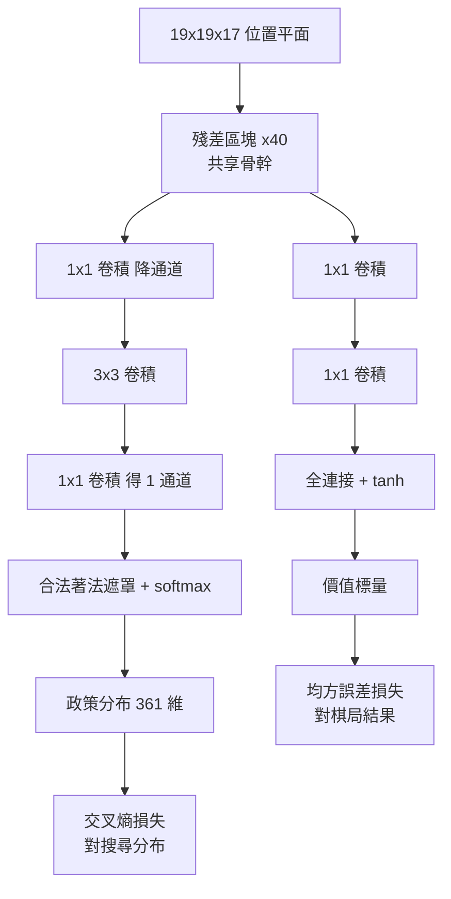

# 6.2 統一的雙頭神經網路（Dual-ResNet）：同時輸出政策與價值（2017）

## 兩種問題，一張臉

圍棋程式必須回答兩個本質不同的問題。走哪一手？這是**政策（policy）**問題，答案是一個從三百六十一個合法著法中挑選的分布。當前局面誰會贏？這是**價值（value）**問題，答案是一個介於負一與一之間的數字。在 AlphaGo 之前的世代裡，這兩個問題由不同的機器回答：政策網路是一個卷積網路，輸出三百六十一維的機率分布；價值網路是另一個獨立的網路，輸入經過人工特徵編碼的盤面，輸出一個勝率。

2017 年的 AlphaGo Zero 把這兩張臉合成了同一張。核心設計極為簡潔：十九乘十九的棋盤被編碼成十七個通道的平面圖，輸入一個殘差卷積網路的中段特徵；這個共享的骨幹之上分出兩個頭，一個是政策頭，一個是價值頭。

這個改動背後有一個更早的伏筆。AlphaGo 論文裡的價值網路原本就是在一個卷積骨幹上接了兩個頭——一個輸出各交叉點的獲勝機率，一個輸出整個局面的勝率——只不過那時政策仍然是另一張獨立的網路。Zero 的貢獻，是把政策網路也搬進來，讓兩個任務共用同一副骨幹。這一步把 2016 年版本裡三張網路（政策、價值、rollout）壓縮成一張，是後面「一天學完」的算力前提。

## 輸入層：十七個平面

具體來說，輸入是 $19 \times 19 \times 17$ 的張量。這十七個通道裡，有十二個描述當前玩家自己的棋子位置（三個通道分別標示黑子、白子與空點），另外十二個描述對手的棋子位置，第十六個是當前行棋方，第十七個則是一個恆為一的全一平面，用來告訴網路棋盤的邊界在哪裡，避免卷積在邊角產生位置歧義。這個設計的重要意義在於：整個輸入裡沒有任何一個通道承載「圍棋的哪個位置有什麼戰略意義」這類人類知識，它只是把「棋子在哪裡、誰是黑」這幾件純幾何事實攤平。

值得留意的是，這個輸入表示相較於 2016 年版本是大幅退步的。舊版 AlphaGo 用了豐富得多的特徵，包括直線與斜線方向的空位數、鄰近棋子的顏色分佈、各色棋子的數量等十七個手工通道。Zero 把這些全部丟掉，只留位置與行棋方。這意味著網路必須自己從像素級的位置資訊裡學出「什麼叫形勢」，工作量大幅增加，但人類偏見也大幅減少。

## 骨幹：一個殘差堆疊

共享骨幹是一串殘差區塊（residual block）。每個區塊的主體是兩層 $3 \times 3$ 卷積加上批量正規化與 ReLU 激活，尾端再接一個跳過連接，把區塊輸入直接加回輸出。跳過連接的意義在於讓梯度可以沿著捷徑直接回傳，避免深層堆疊時的梯度消失，讓幾十層的網路也能穩定訓練。

Zero 的骨幹用的是 AlphaGo 論文中的變體：前四個殘差區塊各用 $256$ 個通道，後三十六個各用 $320$ 個通道，中間夾一個額外的 $1 \times 1$ 卷積做通道數的轉換。骨幹輸出兩個特徵張量，一個供政策頭使用，一個供價值頭使用。

這四十個殘差區塊並非任意堆疊。二十二乘二十二或十九乘十九的小型卷積核能提供密集的局部連接，參數效率高於大核卷積；通道數從 $256$ 緩慢升到 $320$ 而不是暴增，則讓整個模型的計算量落在一個可控範圍。在搜尋需要每秒數千次前向的場景下，參數量的每一次膨脹都會直接轉化為時間成本，因此這種「保守但夠用」的設計是有工程理由的。

值得留意的是，Zero 的骨幹在結構上與 2016 年的 AlphaGo 幾乎相同——換言之，卷積架構本身不是這場革命的變因。真正的變因在資料來源與訓練目標。這是一個重要的教訓：當人們說「AlphaGo Zero 的成功歸功於深度學習」時，更精確的說法是，它歸功於深度學習與自我對弈的結合，而深度學習的具體形狀，早就已經準備好了。

## 兩個頭

政策頭的結構很直觀：骨幹特徵經過一個 $1 \times 1$ 卷積把通道數降到 $2$ ，然後接一個 $3 \times 3$ 卷積，最後是一個 $1 \times 1$ 卷積把通道數壓到 $1$ 。這一張 $19 \times 19$ 的單通道圖就是「每個交叉點作為落子點的合理性分布」，再經過一個遮罩把不合法的著法設為零，最後做 softmax 得到政策分布。softmax 輸出的維度是 $361$ 。

價值頭的路徑短得多：骨幹特徵經過一個 $1 \times 1$ 卷積降到 $1$ 個通道，再做一次 $1 \times 1$ 卷積，最後接一個全連接層與 tanh 激活，輸出一個標量。訓練時這個標量被壓到零與一之間，作為「這局最後黑方獲勝的機率」來使用；推論時它則被解讀為期望勝率。

## 兩種損失與它們的權衡

訓練時，網路的總損失是兩項的加權和。政策端用交叉熵，目標是搜尋樹產生的訪問次數分布；價值端用均方誤差，目標是這局棋最終的結果。

$$
\begin{aligned}
L &= L_{p} + \frac{1}{2} L_{v} \\
L_{p} &= -\sum_{a} \pi(a) \log P(a) \\
L_{v} &= (z - v)^{2}
\end{aligned}
$$

其中 $ \pi(a) $ 是搜尋過程中著法 $ a $ 的訪問比例， $ P(a) $ 是網路輸出的政策機率， $ z $ 是這局棋的實際結果（黑方勝為 $1$ ，白方勝為 $0$ ）， $ v $ 是價值頭的輸出。權重因子取一半，是原始論文中的選擇。

這個權衡並非隨意。政策端的訊號來自搜尋樹，是分布對分布的細緻比對，梯度資訊量大但雜訊也大；價值端的訊號是一個純粹的二值結果，極為乾淨但稀疏——一整局幾百步才換來一個 $0$ 或 $1$ 。若只靠價值目標，學習會非常緩慢；若把政策損失壓得太小，模型又淪為只會贏不會下。

更微妙的是，價值目標在實際訓練中是從網路自己的推論中取出來的：Zero 並不對每個盤面都跑到底，而是在對局結束後才回填結果。因此它採取了一種折衷，讓價值網路去擬合「從當前狀態出發、用目前網路繼續下、能達到的期望結果」，而不是只擬合終局。這讓價值的定義在整個訓練過程中保持一致，也讓自對弈的資料分布與目標分布對齊。

這也是為什麼價值的量綱要與 Elo 或圍棋段位分開談。Zero 的輸出不是「幾段」，它沒有任何人類棋力刻度的解釋；它只在與另一個同樣定義的系統比較時才有意義。所有關於「Zero 達到 Master 水準」的說法，嚴格來說都是這類相對比較。要把 Zero 的數字換算成人類段位，需要靠一連串的參考對局去架起橋樑，而橋樑本身是有誤差的。

## 訓練細節：經驗回放與排程

架構只是一半，另一半是訓練的時序安排。Zero 採用經驗回放：每一局結束後，這一局產生的所有局面都被放進一個巨大的緩衝區，訓練時從緩衝區中隨機抽取小批量做更新。這種做法的理由不只是省記憶體，而是打散樣本之間的時間相關性。若按照產生順序訓練，連續抽到的樣本都來自同一局棋的相鄰局面，彼此高度重疊，梯度會把模型往單一條路徑的方向拉扯。隨機抽樣讓每一批都像是來自多樣化的經驗集合。

學習率採逐步遞減的排程，從初期的大步長緩慢收斂到接近零。這讓模型在初期敢於大幅改變、後期只做細微的精修。

還有一個設計叫「用舊資料做探索」：新的搜尋樹用當前最新的權重生成，而舊的對局資料被保留在經驗池中，不會因為策略更新而立刻作廢。因為在這些舊局面裡，當時被認為次要的著法，也許在更強的網路眼中值得重新評估——搜尋統計量因此會被刷新成新的、更準確的分布，等於把歷史經驗再提煉一次。這是 Dyna 架構裡「模型經驗」與「真實經驗」互相增益的又一個具體落點。

## 為什麼共享骨幹很重要

把政策與價值放進同一張網路，直覺上像是一種精簡的工程改寫，但實際收益遠不止省下參數。

第一是**算力效率**。搜尋需要對數百上千個節點做前向推論，每個節點都要同時取得政策與價值。若用兩張獨立網路，同一個節點就要跑兩次前向，等於把搜尋的成本翻倍。合併後，一次前向同時產出兩個頭的輸出，搜尋的瓶頸直接鬆開。在 AlphaGo Zero 的分散式環境裡，每一毫秒都直接換算成能搜多少節點，這個倍數差是決定性的。

第二是**參數共享與統計效率**。兩張各自獨立的網路若各自訓練幾百萬局才剛好學會辨認基本結構，合併之後，骨幹上的特徵可以同時被兩個任務壓迫著學，而這兩個任務的監督訊號恰好互補：政策任務要求網路分辨「哪裡有潛在的戰術機會」，價值任務要求網路分辨「整體形勢偏向誰」。前者敏銳於局部，後者敏銳於整體，骨幹被迫同時保持兩種敏銳度。

第三是**梯度的耦合**。兩個頭的損失都會回傳進骨幹，於是政策訊號會改造骨幹對價值的表示，價值訊號也會改造骨幹對動作的表示。這種隱式的多任務學習，讓同一組中間特徵被兩條不同的線索持續校準。這是深度學習裡「共享表示比拼接表示更省」的經典案例，只不過在這裡省下的不是參數，而是算力與樣本。

多任務學習在機器學習裡是個老話題：同時學兩個相關但不同的任務，通常比分開學更省資料，原因是兩者會共享一個「什麼是這個領域裡的基本結構」的隱含表示。圍棋裡這個效果尤其顯著，因為政策與價值本來就是同一個領域的兩種觀測。學會辨認一個絞殺形的圍棋問題，既需要知道它的後果有多嚴重，也需要知道下一步該往哪走；兩種訊號都指向同一組底層特徵，只是問的問題不同。

第四是**簡化工程與降低不一致**。分離式架構下，政策與價值可能給出互相矛盾的判斷——策略認為某手好，價值卻認為該局面不利——而搜尋無法分辨到底是誰錯了。統一網路讓兩種判斷共享同一套對盤面的「看法」，矛盾的可能性被結構性地降低。第 9 章會談到搜尋如何把這兩種判斷合成為一個決策。

## 與 4.1、4.2 的分離式雙網路對比

第 4 章描述的 2013 到 2015 年工作，是分屬兩條獨立路線的：Silver 等人的政策網路（用人類棋譜做監督學習）與同期用強化學習訓練出來的價值網路，兩者各自有一整套卷積架構，彼此不共享任何權重。那個階段之所以只能這樣做，有一個很實際的技術原因：分散式訓練的環境還不存在，團隊只能在幾台機器上做小規模的實驗，無法承受把三張大網路一起訓練的通訊與同步成本。Zero 的統一架構之所以能夠實作，前提正是第 10 章要講的那套分散式系統已經就緒。

| 面向 | 分離式雙網路（4.1 / 4.2） | 統一雙頭網路（6.2） |
|---|---|---|
| 網路數量 | 2 張獨立架構 | 1 張共享骨幹 + 2 個頭 |
| 搜尋時前向次數 | 每節點 2 次 | 每節點 1 次 |
| 參數利用 | 各自訓練、特徵不共享 | 骨幹特徵共享 |
| 梯度耦合 | 無 | 雙向回傳至骨幹 |
| 特徵來源 | 人工設計特徵 | 純位置平面 |
| 訓練目標 | 監督學習 + 獨立 RL | 單一自我對弈迴圈 |
| 維護成本 | 兩套架構同步演進 | 單一架構 |

這個改動聽起來像是一個工程層面的重構，卻是 AlphaGo Zero 能夠「一天學完」的物理前提。

可以用一個簡化的算式說明其份量。若搜尋在每個時點需要維持數百個樹節點，每個節點的每次擴張都要做一次前向推論，那麼推論總次數就是兩者的乘積。Double 網路等於把乘數直接翻倍，而搜尋的深度與廣度正是棋力的主要來源之一。把乘數拿掉，等價於把可搜節點數翻倍——在面對 $10^{170}$ 量級的狀態空間時，多搜一倍節點所帶來的深度增加，其邊際效益是驚人的。

另一個被低估的條件是**部署的一致性**。搜尋時用來排序的，正是訓練時學到的同一個函數。如果策略與價值來自兩張各自獨立的網路，那麼搜尋其實是在把兩個尺度不同的判斷硬湊在一起；統一之後，搜尋看到的就是網路的完整輸出，訓練與推論之間沒有縫隙。這種「訓練什麼就推論什麼」的對齊，是把整個系統的複雜度往下壓的關鍵手法。

換句話說，統一雙頭網路不只是省了算力，它還讓整個系統少了一個需要協調的組件。在越複雜的系統裡，每多一個獨立的組件，就多一份可能不一致、可能需要除錯、可能引入額外偏誤的風險。Zero 的設計哲學可以概括為：能從同一個函數裡得到的，就不要再造第二個。

## 一個簡單改動的重量

我們很容易把 AlphaGo Zero 的突破歸給「自我對弈」這個聽起來很浪漫的想法。但把 6.1 的資料迴圈與 6.2 的網路結構放在一起看，才會發現它們是齒輪與齒輪的咬合：自我對弈讓訓練資料源源不斷且自動產生，統一雙頭網路讓每次前向都同時餵出搜尋所需的政策與價值，讓 MCTS 能以可接受的速度在有限的時間內窮盡更多分支。

深藍用了七台的專用晶片來對抗一位世界冠軍。AlphaGo Zero 用單一演算法、一份空白規則手冊、數百台 TPU，在三天之內走完了人類花數千年累積的路。而它的策略與價值判斷，都從同一副骨骼上長出來。

下一章，我們來看這副骨骼在 2017 年 10 月公開實驗中的實際成績：它究竟以什麼樣的姿態，在三天之內贏下了所有對局。
