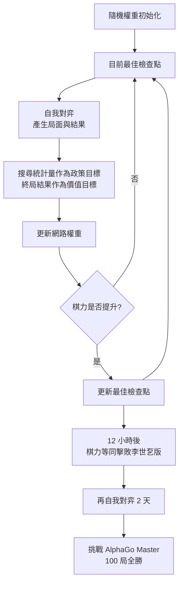
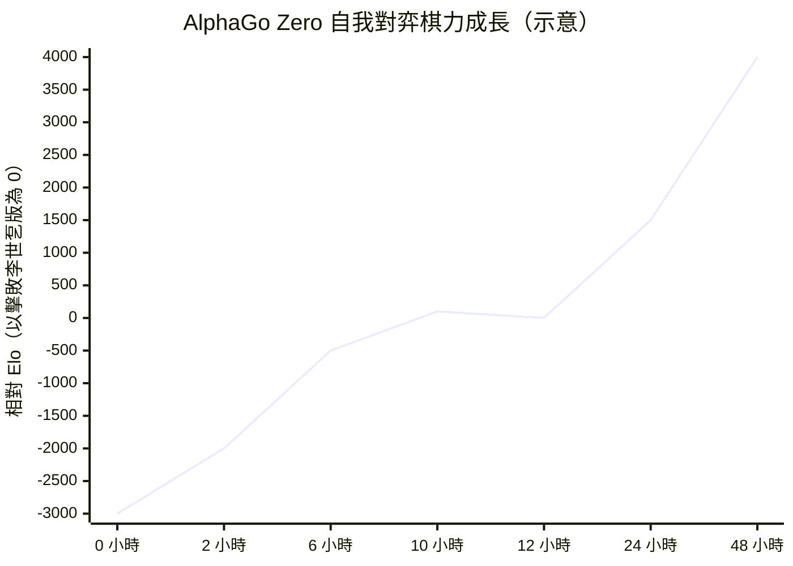

# 6.3 3 天 100 場對局完勝舊版：白板學習（Tabula Rasa）的威力（2017）

## 2017 年 10 月的實驗

2017 年 10 月 19 日，DeepMind 在論文《掌握圍棋，不需要人類棋譜》（Mastering the game of Go without human knowledge）中公布了 AlphaGo Zero 的完整結果。實驗分成兩部分，中間隔了兩個月，中間還穿插了西洋棋與將棋的初步版本測試。

第一部分是最驚人的一場：讓 AlphaGo Zero 在完全沒有任何人類棋譜的狀態下，從零開始自我對弈，僅僅花費十二小時，棋力就已經達到擊敗李世乭的那版 AlphaGo 的水準。所謂「達到水準」，指的是在實測中，Zero 版本的 Elo 評分與 AlphaGo Master 版本相當——而 Master 是 60 對 0 完勝李世乭的系統。

第二部分是把「能打平」變成「能碾壓」。研究者讓 AlphaGo Zero 沿著同樣的迴圈繼續自我對弈，再多花兩天，得到的模型被拿來與擊敗李世乭的 AlphaGo 版本對弈。結果是 $100$ 對 $0$ ——整整一百場全勝，沒有任何一盤落敗。而且這場對決並非只在單機上進行，Zero 與對手都跑在同樣規格的硬體上，避免了算力差異帶來的偏見。

這是圍棋史上第一次出現這種局面：一個系統從完全空白的參數出發，只靠與自己下棋，三天之內就達到了人類幾千年累積所形成的棋力水準，然後用一百場全勝向全世界證明這一點。

為了排除「結果只是運氣好」的疑慮，實驗還做了一項嚴格的控制。研究者用不同的硬體配置重跑了整個訓練流程，並且讓最終挑戰的 AlphaGo Zero 與它的對手——擊敗李世乭的那版 AlphaGo——跑在完全相同的硬體條件下。如此一來， $100$ 對 $0$ 的結果裡就沒有任何「一方算力較多」的成分在起作用，它比較的是純粹的演算法與訓練方法。

另外要說明的是，被挑戰的那一方也不是弱旅。擊敗李世乭的 AlphaGo 是人類史上的最強圍棋系統，它贏過世界冠軍、在 2016 年 3 月那次對局裡逼出了李世乭簽名的「神手」，並且是整個 AlphaGo 品牌最受世人熟知的那個版本。要在同等硬體上把它打到全敗，需要的已經不只是「更好的搜尋」，而是一種根本不同的學習方式。

## 學習曲線的形狀

論文附的那張圖，是整篇文獻最被引用、也最被誤解的圖。橫軸是自我對弈的累積局數與消耗的硬體小時數，縱軸是相對 Elo 評分，線條幾乎是一條平滑上升的曲線：早期陡峭，中期趨緩，但始終沒有停滯或下跌。

這條曲線在文獻中被稱為「通往超級圍棋的階梯」，其重要性在於它把「學習」這個原本模糊的詞變成了可測量的東西。每一個資料點都意味著：系統已經消化了這麼多局對局，而在這些局數裡，它沒有看過任何人類的著法。

曲線的另一個特徵是它的**平滑性**。在人類棋手的成長裡，這條曲線是階梯狀且帶有大量回落：一名棋手可能贏得多也可能輸得多，會經歷高原期，會因為心態與體力而波動。AlphaGo Zero 的曲線沒有任何回落，因為它從來沒有面對一個比它更強、會故意打亂它節奏的對手。每一局都是它自己從某個歷史最優檢查點出發、跟自己的較新版本對弈，因此每一局都是對「我比剛才強了嗎」的一次乾淨量測。

這裡還有一個技術細節值得留意：Zero 採用的是「最佳檢查點」機制，也就是保留表現最好的那一版權重用來生成新對局，而不必然用最新的那一版。這是一種防止策略劇烈退化的小保險栓。

曲線上還有一個容易被忽略的特徵：它在起始階段幾乎沒有平台期。監督學習的曲線通常在很早就會停滯，因為模型把資料裡的模式都學完了；自我對弈的曲線卻是持續上升的，因為每過一段時間，模型的搜索能力就強了一點，於是它能進入以前走不進去的局面，產生以前產生不了的經驗。搜尋能力、資料分布、學習能力三者互相推動，形成正回饋。

所謂「一天學完」的說法，指的正是這個：把「一天」當作單位來衡量一個完整學習過程所需的人類學習時間。零是一個上限的案例。

這張示意圖要表達的不是精確數值，而是一個形狀：從零附近的水平出發，在最初的十幾個小時裡急劇上升，越過「等於 Master」的基準線之後持續攀升而沒有回頭。沒有任何低谷、沒有平台期、沒有崩潰——這在人類學習史上是看不到的。

## 為什麼這是通用學習的最強證據

「通用學習」這個說法，在 2017 年之前從來沒有一個乾淨的例子。所謂機器學習系統，通常都暗含某種領域知識的注入：影像辨識需要人設計的特徵或標註資料，語音辨識需要語音學的先驗，棋類程式需要開局表與評估特徵。所有這些知識最終都來自人類。

AlphaGo Zero 是第一個在人類最擅長的領域之一，把這條紅線徹底切斷的系統。它的全部輸入是：棋盤的尺寸與座標系統、落子規則、合法著法的判定、以及勝負的判定方式。除此之外沒有任何一行人類寫下的「圍棋知識」——沒有定式，沒有死活術語，沒有形勢判斷，沒有歷史棋譜，連一個示範性的開局都沒有。

因此它的學習曲線成為一項關於**學習能力本身**的實驗證據。曲線上升的部分，全部歸因於三樣東西的乘法：演算法的正確性、資料的數量、以及算力的規模。把這三者視為三個獨立的乘數，AlphaGo Zero 的成就便是「一個正確的演算法 × 巨量的自動生成資料 × 廉價可擴張的算力」這個式子的實測值。

這也解釋了為什麼 AlphaZero 的論文裡有西洋棋與將棋的結果：相同的迴圈只換掉規則定義，就在西洋棋上打贏了 Stockfish 引擎（除了在某些起始局面上因讓子規則而和局），在將棋上打贏了 ELMO，同樣沒有任何人類棋譜。2018 年 12 月的論文《從零開始掌握多種國際象棋與將棋》則把這個結論推到了完整的通用演算法地位。

嚴格來說，通用性這個詞在這裡有兩個層次。第一層是「跨遊戲的通用」：同一套演算法，換掉規則，就能處理西洋棋、將棋、圍棋。第二層才是「跨領域的通用」：同一組權重，能同時處理多種遊戲。前者在 2017 年就已經達成，後者要到第 7 章才會被 AlphaZero 的自我對弈通用化版本實現。把這兩層混為一談，是外界解讀這批工作時最常見的錯誤。

值得強調的是，這裡被證明的不是「機器學會了下圍棋」，而是「機器學會了如何學會下圍棋」。前者是一個領域的成果，後者是一個方法的成果。方法可以攜帶，領域的成果則往往一文不值——一旦規則改變，領域成果立刻失效。

| 面向 | AlphaGo（2016） | AlphaGo Zero（2017） |
|---|---|---|
| 初始訓練資料 | 約 $3$ 萬局人類棋譜 | 隨機著法起的自我對弈 |
| 輸入特徵 | 人工特徵加裸棋盤 | 裸棋盤位置平面 |
| 價值的來源 | rollout 網路 | 搜尋樹統計量 |
| 網路架構 | 政策與價值分開 | 共享骨幹的雙頭網路 |
| 達到頂尖所需 | 大量人工前期 | 數天自我對弈 |
| 對戰頂尖 AlphaGo | 60 對 0 勝李世乭 | 100 對 0 勝 AlphaGo |
| 人類知識含量 | 大量 | 僅規則與合法著法 |

## 乘法效應

把棋力曲線和成本放在一起看，會浮現出一個在當時頗為反直覺的事實：AlphaGo Zero 之所以能在三天內達到超越人類的棋力，不是因為它用了更聰明的演算法，而是因為它把「經驗」這個東西的取得成本降到了幾乎為零。

人類棋手要累積數千年的集體經驗，需要數十億人時、繁複的傳承制度、以及語言作為知識載體。AlphaGo Zero 把這整條鏈路替換成：規則引擎加上一台能並行對弈的機器。任何一局棋的產生成本，是幾次神經網路推論加上幾毫秒的規則運算。因此「多下幾盤棋」這件事可以廉價地進行，而廉價的經驗累積，正是曲線陡峭的直接原因。

值得注意的是，AlphaGo Zero 的訓練嚴格遵循「不用人類棋譜」的約束，但用的是人類設計的**演算法**：MCTS 的選擇、擴展、備份步驟，UCT 的探索常數，卷積網路的架構，學習率排程，經驗回放的比例。這些設計本身是幾十年累積的學術遺產，只不過它們屬於「如何學」而不是「關於圍棋知道什麼」。這個區分是整個領域最核心的進步。

用一個不太精確但很直覺的比喻來說：人類花了兩千年整理出一套「如何思考圍棋」的教學法，又花了兩千年累積了數百萬局的具體棋譜。AlphaGo Zero 保留了前者作為工具，把後者整批丟掉，並且證明只要工具夠好，具體棋譜是可以被重新生成的。

那麼，產生經驗的成本到底降了多少？人類棋手下一盤專業對局大約需要兩小時，包含思考、休息與復盤；若以人類累積的專業棋局總數估計，數以百萬計，每盤兩小時，就是數百萬小時的純思考時間，而這還只是一位頂尖棋手的一生，不含歷史累積的傳承成本。AlphaGo Zero 在同樣的時間裡跑了數百萬盤，每盤的機器思考時間遠小於一秒，而且可以無限制地複製。把這兩個數字並排放，差距已經不是量級的問題，而是範式的問題。

更精確的說明在於兩者的邊際成本結構。人類棋手的棋力增長受到一個硬性限制：每一盤棋都要一個真實的人花真實的時間思考，而且棋手的注意力是有限的。機器的限制則是純粹的經濟性的——晶片與電力。因此當算力價格下降時，AlphaGo Zero 這類系統的棋力可以持續往上走，而人類棋手的成長曲線受生理與傳承條件約束。這個差別，正是第 10 章的主題。

## 誠實的極限

如果只用最耀眼的數字講故事，那是在誤導人。AlphaGo Zero 的極限至少有四層，必須老實說出來。

第一，它仍然只解一種遊戲。它的曲線漂亮，是因為規則已知、獎勵明確、回合結束時間有限。把它放到規則不完整、回饋稀疏、甚至規則本身需要猜測的環境裡，就不是同一個問題了——那正是第 8 章 MuZero 要處理的情形。

第二，獎勵函數仍然是人給的。「圍棋的勝負由點數決定、由劫規則決定、由和棋規則決定」這段敘述是規則的一部分，而它最終由人寫下。AlphaZero 往前推進了一步，把這部分也讓渡給學習，但即便如此，最基本的「什麼算目標」仍然是人類設定的邊界。

第三，它仍然需要 MCTS 與大量算力。原始實驗動用了數百台 TPU 晶片與數千個 CPU 核心，持續運轉數天，並且用多個版本的硬體交叉驗證以排除硬體差異的影響。它不是「不需要算力」，而是「每一單位算力的產出被大幅優化了」。這個取捨的細節將是第 9 章與第 10 章的主題：搜尋與網路如何分工，以及硬體如何從配角變成主角。

第四，它的成功高度依賴一個前提：遊戲必須是零和的、可重複的、且每一次失敗都能給出明確標籤。許多現實決策問題都不滿足這些條件。

還有一層更深的極限值得寫下：AlphaGo Zero 的學習並不是真正意義上的「從零」。它仍然在一個被人類設計好的框架裡運轉，而這個框架本身包含了幾個關鍵的人類選擇——用卷積網路而非循環網路表示盤面、選用 MCTS 而非其他搜尋、決定把獎勵設定為勝負而非別的目標、用神經網路更新權重而非表格或符號搜尋。這些選擇都沒有被系統自己檢驗過。系統不會問「如果我不用 MCTS 會怎樣」，也不會問「如果我把勝負之外的目標給它會怎樣」。它只在人類選定的假設空間裡，把假設推到極限。

因此更精確的說法是：AlphaGo Zero 把人類先驗從**棋藝層面**推到了**方法層面**，但並沒有推到零。這個差別在科學上很重要，因為方法層面的先驗仍然是可以被質疑、也可以被下一代研究改寫的。誠實地標示出「先驗被推到哪裡」，比宣稱「什麼都沒給」更有助於理解這套系統的真正貢獻，也更有助於看清它通往何方。

## 通往後面兩章

把這四層極限擺在一起，就會發現它們恰好勾勒出接下來兩章的問題意識。

第 7 章要問的是：**能不能一個模型通吃多種遊戲**？AlphaGo Zero 已經證明同一套迴圈換掉規則就能下西洋棋與將棋，但每次都要從零重新訓練。那麼，能不能讓模型本身從多種遊戲中一起學，得到一個共享的通用棋力？

第 10 章要問的是：**算力在整個故事裡扮演什麼角色**？當一個系統三天就能贏過人類數千年，那麼在人類還沒有碰到瓶頸之前，人類打算怎麼跟機器比？

這兩章的問題其實是同一個問題的兩面。如果算力是唯一的瓶頸，那麼結論是直白的：人類在棋類上的領先時代已經結束，而且是因為工具更強，不是因為人變弱了。但若把視角放到 MuZero 那樣連規則都不要求正確的系統上，就會看到另一種可能——若連環境模型都可以從完全不準確的東西裡學到足夠的資訊，那麼也許真正的瓶頸從來不是算力，而是人類還沒想清楚究竟該給系統什麼樣的獎勵訊號。

而回到第 1 章：1952 年塞繆爾讓機器在西洋跳棋上調整幾十個權重，六十三年後的 AlphaGo Zero 讓機器在圍棋上調整數百萬個權重，而且連「什麼叫好棋」都是自己長出來的。從塞繆爾到 AlphaZero，機器學習的這一條線走完了它最戲劇性的一段。接下來要問的，是當遊戲的規則本身也不再是給定的時候，學習還能不能繼續往前走。
