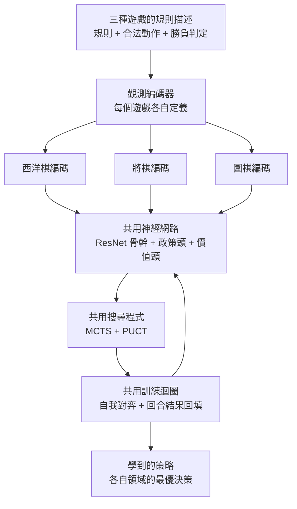

# 7.1 通用演算法的核心架構：不帶領域知識的純粹學習（2017）

## 一把鑰匙，三把鎖

前一章的主線是 AlphaGo Zero 把「人類棋譜」從學習迴圈裡徹底移除。但那仍然只是單一領域的成就：圍棋是一種遊戲，Zero 學會的是一種遊戲的正確策略。要真正完成通用化的證明，還得回答一個更尖銳的問題——如果把圍棋整個換掉，這套方法還能不能用？

2017 年 12 月，DeepMind 給出了答案。AlphaZero 使用**完全相同的自我對弈迴圈、相同的網路架構、相同的搜尋程式**，只替換三樣東西：遊戲規則的描述、觀測的編碼方式、以及合法動作的列舉規則，就分別學會了下西洋棋、下將棋、下圍棋。三個遊戲的規則差異極大——棋盤大小從 $`8 \times 8`$ 到 $`19 \times 19`$ ，勝利條件從「將死國王」到「點數多者勝」再到「王不被將死且剩餘子力多者勝」，回合結構從「雙方輪流」到「任何一方可連續走一步」再到「雙方皆可放棄一步」。但演算法本身一行都沒有改。

這就是通用化的全部要義：**規則已知，但規則不同**。這句話聽起來平淡，卻是整個人工智慧史上的一條分水嶺。在此之前的六十年裡，每一次機器在某个領域超越人類，都要有人先花費可觀的心力把這個領域的知識塞進機器。而 AlphaZero 證明的是另一種可能——只要把「這個領域是什麼樣的博弈」寫成一份介面描述，剩下的事情可以全部交給同一套演算法。

這張圖是理解 AlphaZero 的最好方式。上游是三個遊戲各自提供的「規則描述」與「觀測編碼」，中間是唯一一份完全共用的網路與搜尋，下游是各自領域的策略。共用部分承擔了全部的學習工作，差異被壓縮在最上游那兩個窄窄的介面裡。

## 把遊戲定義成一個抽象的四元組

要說清楚「通用」究竟通用在哪裡，最好的方式是先把遊戲本身抽象掉。現代的遊戲理論習慣把一個兩人回合制、零和、完美資訊的遊戲寫成四個成分：狀態空間 $`S`$ 、動作集合 $`A`$ 、轉移函數 $`T`$ 、以及獎勵函數 $`R`$ 。一個狀態 $`s \in S`$ 加上一個動作 $`a \in A`$ ，經過 $`T`$ 會到達下一個狀態 $`s' = T(s, a)`$ ，並且伴隨一個獎勵 $`R(s, a)`$ 。

AlphaZero 做的事，就是把這四個成分做成**可插拔的資料結構**。規則描述，就是具體填入這四個成分的程式碼；觀測編碼，就是把 $`S`$ 裡的某個狀態轉成網路能吃的向量。網路本身完全不知道自己在下什麼棋，它只看見一個平面陣列，並輸出兩個東西：每個動作機率的政策分布，以及當前局面的勝率價值。

在這個抽象下，通用性不再是個比喻，而是一個可以精確陳述的命題：**只要一個博弈可以用這四個成分描述，而且它的狀態可以被編碼成固定維度的平面，那麼同一組參數結構就能學習它**。這是一個關於表達能力的命題，不是關於人類領域的命題。

這個抽象也讓「領域知識」有了精確的位置。所謂領域知識，就是那些無法從這四個成分推導出來的額外資訊：人類棋譜、常見定式、手寫的形勢特徵、開局表、終局殺法、某個領域特有的評分慣例。AlphaZero 的設計目標，就是讓這四個成分成為唯一的輸入介面。所有其他東西都不許進來。

## 學習目標：搜尋統計量與終局結果

通用架構之所以成立，還需要一個前提：網路在每一步都必須有一個明確的、可以用來更新權重的目標，而這個目標必須在所有三個遊戲裡形式一致。AlphaZero 用的目標有兩個來源，而且兩者都與具體領域無關。

第一個來源是搜尋統計量。當 MCTS 在某個局面展開模擬之後，每個節點的走訪次數會累積成一個分布，這個分布本身就是一個比網路原始輸出更好的著法建議。訓練時，網路的政策頭被要求去擬合這個分布。這一步的妙處在於目標是「自己產生」的，不需要任何外部標註。

第二個來源是終局結果。一局自我對弈結束後，每一個經過的局面都被配上標籤：己方勝記為 $`1`$ ，平手記為 $`0`$ ，己方敗記為 $`-1`$ 。價值頭被訓練去預測這個標籤，而因為整局有多個局面共享同一個結果，價值訊號因此沿著時間軸回填到所有經過的狀態上。

把這兩個目標寫成一個損失函數，形式上非常乾淨：

$$
L(\theta) = - \sum_{s \in B} \pi(s) \log \pi_\theta(s) + \sum_{s \in B} \left( v_\theta(s) - z \right)^2
$$

其中 $`B`$ 是經驗回放緩衝區中取出的局面集合， $`\pi(s)`$ 是搜尋產生的目標分布， $`\pi_\theta(s)`$ 是網路政策頭的輸出， $`v_\theta(s)`$ 是價值頭的輸出， $`z`$ 是該局最終的結果。這個式子裡沒有圍棋，也沒有西洋棋，也沒有將棋——它對任何能產生「分布加終局標籤」的遊戲都成立。這正是「規則已知但規則不同」在演算法層面的對應物：規則改變，損失函數不變。

## 圍棋為什麼需要特殊處理

圍棋是三個遊戲裡最麻煩的一個，原因不在於棋盤更大，而在於它的規則裡塞了幾個西洋棋與將棋都沒有的東西。

第一是棋盤的平面化。 $`19 \times 19`$ 的棋盤必須被拆成多個二維平面，每個平面記錄一種資訊：哪些位置是黑子、哪些是白子、哪些位置因禁入規則而不可落子、以及由雙方上一次落子位置標記出的「前一手在哪裡」。禁入點必須單獨用一個平面表示，因為它是規則動態產生的，不是棋子佔有的結果。與此同時，圍棋棋盤有 $`361`$ 個交叉點，比西洋棋的 $`64`$ 格多出將近六倍，網路在同等深度下能處理的空間複雜度急遽上升。

第二是 pass 動作。圍棋規則允許玩家在自己沒有合法著法時放棄一手，這個動作在西洋棋裡根本不存在，但在圍棋裡是根本性的：它讓棋局在形式上得以終止，也讓「虛手對虛手」成為判定和棋的依據之一。更重要的是，在 AlphaZero 的搜尋裡，pass 不能是一個可以被忽略的次要選項，它必須是一個在政策分布裡占有正式位置的動作，否則網路會學出「永遠不 pass」的退化策略，導致棋局無法終止或黑白雙方互相填子。

第三是終局判定。西洋棋的終局非常明確：國王被將死即敗，或按和棋規則判和。圍棋的終局判定卻涉及劫規則、點數計算、超過規則的收子、以及中國規則與日本規則在同分判定上的差異。在 AlphaZero 的實現裡，這些都被收斂成一個可以程式化的回傳函數：對局結束時回傳 $`1`$ （勝）、 $`0`$ （和）或 $`-1`$ （負），作為回填價值網路的終局標籤。

把這三件事放在一起，就能理解圍棋的規則描述為什麼是最長的一段程式碼。也正因如此，AlphaZero 的圍棋實驗常常被拿來當作通用性說服力最強的一環：規則最複雜的遊戲，反而是它下得最好的那一個。

## 將棋與西洋棋的觀測編碼

將棋的觀測編碼比圍棋簡單，但有它自己的巧妙之處。將棋有 $`9 \times 9`$ 的棋盤，以及數量眾多、種類繁複的棋子——步兵、香車、桂馬、銀將、金將、玉將，以及可以翻轉的飛車與角。AlphaZero 對每種棋子種類各給一個平面，用來表示「這個位置上有沒有這種棋子」，另外還有一個平面表示「這個位置的棋子是否已被翻轉」。這樣編碼的好處是棋子種類與位置都被分開表徵，網路不必自己去學「這是什麼棋」的抽象概念。

除了棋盤平面，將棋的觀測還要編碼兩個與時間有關的量：當前局數，以及目前局面的**重複局面次數**。後者尤其重要，因為日本規則的「連續千日」規則和棋判定、以及棋譜上重複局面造成的循環計次，都依賴它。西洋棋的觀測編碼同樣包含棋盤平面、目前的半回合數（ply），以及依循棋規重複三次即和棋的規則所計算出的重複局面次數。

把這三者並排看，就會發現一個優雅的對稱：**觀測編碼只做三件事——空間狀態、時間進度、以及歷史性規則狀態**。它不含任何關於「什麼局面好」的資訊。它是一個忠實的狀態快照，把遊戲的當前完整狀態以網路能接收的形式寫下來，至於這個狀態好不好，交給學習。

| 面向 | 西洋棋 | 將棋 | 圍棋 |
|---|---|---|---|
| 棋盤規模 | $`8 \times 8`$ | $`9 \times 9`$ | $`19 \times 19`$ |
| 輸入平面 | 12 個：雙方棋子位置、權重、棋種、掩碼等 | 14 個：各棋子種類位置與翻轉標記 | 數十個：黑白子、禁入點、前一手等 |
| 動作空間 | 約 $`35`$ 至 $`40`$ 個合法著法 | 約 $`80`$ 至 $`120`$ 個合法著法 | 約 $`250`$ 至 $`300`$ 個合法著法 |
| pass 動作 | 無 | 無 | 有，且為必要動作 |
| 觀測附加量 | 半回合數、重複局面次數 | 局數、重複局面次數 | 前一手位置 |
| 終局判定 | 將死或和棋規則 | 將死或裁定 | 劫、點數與收子規則 |
| 網路結構 | 共用 ResNet 骨幹 | 共用 ResNet 骨幹 | 共用 ResNet 骨幹 |
| 搜尋與訓練迴圈 | 完全相同 | 完全相同 | 完全相同 |

這張表的重點不在每一列的細節，而在最後兩列的「完全相同」。前三列全部不同，後兩列一個字都沒改。這正是「通用演算法」的定義性特徵：變動的部分被嚴格侷限在資料層，而演算法層保持不變。

## 沒有領域特徵意味著什麼

回頭看第 3 章與第 4 章，主角一直是「評估函數」與「特徵」。圍棋的研究者花費數十年整理形勢判斷的術語：目數多少、領先幾目、哪些形勢是大勢已去、哪些是模樣两分、氣如何算、死活如何定。AlphaGo 的策略網路前處理層，正是把這些術語一一數值化——厚薄、可行棋的目、領先局面、氣數——做成十七個輸入平面。

AlphaZero 把這整層刪掉了。它給圍棋的輸入，基本上只有棋子位置的幾個平面，以及禁入點與前一手的標記。沒有目、沒有氣、沒有厚薄、沒有死活、沒有定式。同一樣的話也適用於西洋棋：AlphaZero 不吃任何手寫評估特徵，不讀任何開局書，連「該不該棄後」的啟發式規則都沒有。

這件事在技術上並非理所當然。人的形勢判斷之所以存在，是因為人類的計算量不足以在整棵博弈樹上窮舉，只能靠局部啟發式壓縮資訊。而深度網路加上 MCTS 恰好提供了另一條路徑：讓網路自己去學一個「壓縮過的形勢判斷」，而且是從零開始學，不需要任何人告訴它該壓縮什麼。經過足夠的自我對弈之後，網路內部自然會演化出某種類似厚薄的表徵——這件事在 2017 年還只是推測，後續的可解釋性研究才逐步看到類似的通道結構。

因此「沒有領域特徵」的真正代價與真正收穫都需要說清楚。代價是樣本效率大幅下降：AlphaZero 需要數百萬局自我對弈、數千顆 TPU 的算力，才能把形勢判斷這種人類只需數年就能部分掌握的能力重新發明一次。收穫是這套能力是從零開始、自由、無歧義地在遊戲規則的邏輯內生成，而且不依賴任何人類對「什麼叫厚」的直覺共識。

## 核心洞察：學會「學習的方法」

如果只能從這一章帶走一句話，那就是：AlphaZero 學到的不是圍棋，不是西洋棋，不是將棋，而是**從經驗中逼近最優決策的過程本身**。

這個說法可以再拆得精確一點。傳統的機器學習系統學到的是一個函數——從輸入到輸出的對應關係，而這個函數的參數是針對特定領域最佳化的。AlphaZero 學到的卻是一套機制：它包含「用當下的網路去搜尋」「用搜尋的統計量當作學習目標」「用遊戲結果回填價值」這三個步驟，並且反覆迭代。這套機制在任何符合介面規格的博弈上都能啟動，而啟動之後產出的策略函數，是針對那個博弈最佳化的。

用一個比喻來說：傳統系統像是一位專家，他被訓練成只會處理某類案件；AlphaZero 像是一位學習方法本身的人，他掌握了「如何從案例中歸納出判斷準則」，因此走進任何一個新領域都能重新開始學習。專家寶貴，但不可攜帶；方法樸素，卻到處可用。

這也是為什麼第 6 章末尾提到的「跨遊戲的通用」與「跨領域的通用」兩個層次最終收斂成一件事。在紙面上，AlphaZero 的實驗是每一個遊戲各訓練一套網路參數——這一點在 2018 年 12 月的論文裡是明確的，AlphaZero 並沒有讓同一組權重同時學會三種遊戲。但論文同時指出，這只是工程上的未完成，不是原理上的障礙：既然網路結構、搜尋程式與訓練迴圈在三個遊戲上完全相同，把訓練資料混合、讓網路用遊戲標籤區分任務，理論上就是可行的。通用化的真正對象從來不是權重，而是**演算法的骨架**。

通用性帶來的，還有一個更深的後果：它讓「AI 需要領域專家」這個預設第一次受到真正的挑戰。在過去的敘事裡，一個 AI 系統的價值取決於它的領域知識有多深，因此領域專家是 AI 研發的必需品。AlphaZero 的存在意味著另一種可能——領域專家的角色從「教系統規則」轉移到了「定義什麼算一個問題」，也就是選擇狀態抽象與獎勵設計。這是一個巨大的角色轉移，也是第 7.3 節的主題。

## 通往下一節

AlphaZero 的架構確立了，但真正的證明必須交給對局。2017 年 12 月，它被放進一場為期數天的西洋棋比賽，對手是當時最強的開源引擎之一。接下來的一節，將描述那場比賽的結果、AlphaZero 呈現出來的棋風，以及為什麼「學來的策略」可以擊敗「被寫出來的策略」。
