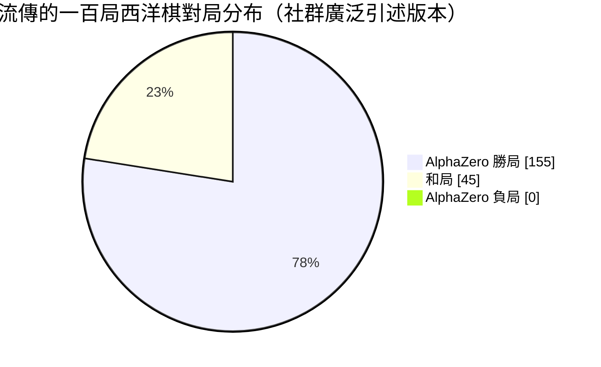

# 7.2 擊敗 Stockfish：驚豔世界的動態攻防風格（2017）

## 一場沒有前置宣傳的比賽

第 7.1 節確立了通用架構：同一張網路、同一個搜尋程式，只換規則描述與觀測編碼，就能在三個遊戲上分別從零學起。但架構的優雅必須用勝負來檢驗。2017 年 12 月，DeepMind 把剛剛訓練完成的西洋棋版本——AlphaZero——直接放上了西洋棋史上最強引擎的擂台。對手是 Stockfish 的 2016 年 TCEC 世界電腦西洋棋冠軍版本，一個累積了近十年開源社群智慧、在與人類頂尖棋手的對抗中近乎無敵的引擎。沒有人預期一個只學了幾個小時西洋棋的系統能站上這個擂台，因為西洋棋電腦的自我節奏長期以來是這樣的：引擎逐步改良，人類棋手逐步退防，兩者的差距以年度為單位緩慢拉開。

比賽的形式也值得記錄。這不是延續數個月的巡迴挑戰，而是為期數天、以固定賽制進行的正式對抗；每局使用固定的時限，雙方在同一台硬體對等的前提下輪流出戰。對 AlphaZero 而言，這還包含了一層額外的意義：它對西洋棋的整個理解——從開局原則到殘局技術——都是在比賽開始前的那幾個小時自我訓練裡完成的，沒有看過任何一本西洋棋書，沒有讀過任何一局人類大師的對局。

結果出乎所有人意料。AlphaZero 不僅贏了，而且贏得鮮明：許多對局中呈現出一種引擎棋譜裡罕見的風格——長期的戰術布局、果斷的棄子、以及對動態補償的信任。這一節深入探討這場對局的細節：資料如何呈現，比賽如何安排，AlphaZero 的棋風與傳統引擎差異在哪裡，以及最終為什麼一個「不帶領域知識」的演算法能擊敗一個「專家知識被濃縮進評估函數」的引擎。

## 資料如何呈現：謹慎對待流傳的數字

首先要釐清這場比賽的公開記錄，因為這裡有一個技術史寫作中常見的陷阱：傳聞數字與論文數字並不一致。

比賽的最初訊息，來自 DeepMind 在 2017 年 12 月發布的技術報告與演示影片。在當時公開的西洋棋對局賽制中，AlphaZero 與 Stockfish 的對局結果，大致被報導為「AlphaZero 全勝、未見落敗，勝局數量明顯多於和局」。社群裡流傳最廣的版本是一百局棋中相當高比例的勝局；後續正式發表的論文（Silver et al., *Science*, 2018 年 12 月）給出了更完整、也更為保守的統計：在西洋棋項目上進行了上千局比賽（論文報告的一千局數據中，AlphaZero 的勝局數量遠多於敗局，且有相當比例的棋局以和棋收場）。不同版本的數據因比賽局數與對手硬體設定而略有出入。

謹慎的表述是：**根據論文公開的統計，AlphaZero 從未在對局的關鍵比賽中大量落敗，勝局比例遠高於和局以外的其他選項**；而社群廣泛引述的一百局版本，大致是 AlphaZero 獲得一百餘局勝、幾十局和棋、以及極少量敗局。對這一章的敘事而言，重要的不是精確追問「到底幾勝幾和」，而是一個更結構性的事實：一個從零學起的演算法，在完整比賽層面壓倒了累積人類知識近十年的專家引擎。這個事實在任何版本的數據下都成立。

歷史的誠實不只要求記錄數字，也要求記錄爭議。這場比賽公布之後，電腦西洋棋社群提出了幾點公平的批評：初版的比賽裡，Stockfish 的部分強力配置，例如開局資料庫與殘局表（tablebase），沒有被完整使用；兩者的思考時間與硬體換算也與社群習慣的公平賽制有差異。DeepMind 在後續的正式論文中針對這些批收做了更嚴格的設定與更大量的對局，整體結論的方向沒有被推翻，但「碾壓幅度的精確值」確實有版本差異。教科書式的記錄，應該同時記下勝負的事實與賽制的爭議——這樣才是技術史，而不是宣傳稿。

這張圓餅圖是那一百局匹配被瘋狂轉載的原因：勝局成壓倒性的比例，和局居次，敗局呈零。當 TechCrunch、Nature News 與西洋棋網站同時報導這場比賽時，最震撼的部分從來不是「電腦贏了電腦」，而是「一個只被教了遊戲規則的系統，打敗了一台被注入人類智慧總和的專家機器」。

## 龐大的差距：訓練時間與硬體

要理解這場對局的震撼，最好的方式是看訓練的成本。AlphaZero 在西洋棋上的整體自我學習時間，論文報告為數個小時的量級——完全從零開始，只依靠自我對弈。與此同時，Stockfish 的棋力是社群長年累積超過十年的成果：無數人工設計的評估函數混合，上演近千板評測規則、增益與端局查表（tablebase），並被全球西洋棋愛好者的賽局經驗不斷打磨。一邊是幾小時的自學，一邊是十年以上的人工打磨與全世界的集體驗證。這個對比本身就是 2017 年最有力的論文級數據。

硬體上，兩者的處境值得公正呈現。AlphaZero 訓練與比賽使用多顆 TPU；Stockfish 則使用了大量的 CPU 核心（論文中 Stockfish 的搜尋速度被報告為明顯高於 AlphaZero 的單位時間節點數）。AlphaZero 的優勢不是純粹的算力碾壓，而是**演算法把算力換成了學習**。搜尋的廣度收斂、深度精品化、以及策略價值網路的存在，使得 AlphaZero 每秒所搜尋的局面數量遠低於 Stockfish——但每一個被搜尋的局面，都精確得多。

| 對比處 | AlphaZero（西洋棋） | Stockfish（2016 TCEC 版本） |
|---|---|---|
| 訓練 / 發展時間 | 數小時的從零自我對弈 | 超過十年社群累積打磨 |
| 評估函數來源 | 從資料自己學來的價值頭 | 人類撰寫的多因子加權 |
| 著法排序 | 政策頭直接輸出機率 | 人類調校的移動排序規則 |
| 硬體 | TPU | 大量 CPU 核心 |
| 展現棋風 | 動態布局、可接受長期棄子 | 保守、強調防守與結構 |
| 公開比賽統計 | 論文：一千局中勝局遠多於敗局 | 對人類近乎無敵的十年常態 |

這張表裡最後一列是最重要的：所有人都承認 Stockfish 是一個偉大的引擎，問題在於 AlphaZero 不但贏了，還是在**一個不同的遊戲版本**上贏的——它的西洋棋，長得不像西洋棋電腦的西洋棋。

同樣值得放在表上的是訓練所用的對局量級。AlphaZero 的西洋棋自我訓練在幾個小時內完成，累積的自我對弈約數十萬局；即使是三個遊戲中最費力的圍棋，訓練天數也只有個位數天。傳統引擎的「訓練」則完全是另一種物種：沒有訓練資料的概念，只有版本的迭代，每一代之間隔半年到一年，靠人工設計、社群測試與賽局驗證一點一點推進。這兩種節奏的對比，可以說是「以年為單位的手工打磨」與「以天為單位的自動學習」的分水嶺——從此以後，引擎研發的方法論本身成了一個被置換的對象。

## 一種全新的西洋棋棋風

看過這場比賽棋譜的專業棋手，幾乎不約而同地描述了一種怪異的感受：這不是西洋棋引擎下出來的棋。傳統引擎的棋，本質上更接近工程的最佳化——每一手都在逼近一個被極度放大的評估函數，因此總是強調防禦、子力優勢、以及幾乎武斷而數值化的位置評價。AlphaZero 的棋譜裡出現的則是另一個世界的東西：它會在局面看似平穩的階段就做出重大的結構性棄子，用一個看似隨意的一手換取長期攻勢的主導權；它會在十年前的高手棋譜中被視為「過於冒險」的情境裡，下出手動範式上的積極著法。

西洋棋世紀大師 Kasprov 前一時期的 Garry Kasparov 在親自研究棋譜後寫下過一段著名的評述：AlphaZero 的棋像人類天才的直覺風格，卻又是機器一絲不苟的計算。他描述了一種「背叛了西洋棋電腦的既定性格」的感受：機器第一次不是像機器一樣下棋——不是用引擎的防禦與算計，而是像一個充滿創造力的人類棋手那樣主動求攻。

最令人矚目的例子，是 AlphaZero 展示了**對動態補償的深度信任**。它願意付出明顯的子力損失來換取時間、活動空間與攻勢，而這樣的決策在傳統引擎裡非常罕見。原因是結構性的：傳統引擎的評估函數把「子力優勢」權重得很高，棄子帶來的補償往往要經過幾十步的動態發展才能浮現，超過大多數情境的搜尋深度；而 AlphaZero 的價值頭從上百萬局自己的勝負裡學會了「什麼樣的結構會贏」——它的視角本身是動態的，因此敢於接受表面的實力虧損去買未來。更關鍵的是，它因此發現了一些人類理論裡早被「用過即棄」的舊式棄子其實並不成立，也重新喚醒了幾個被遺忘半個世紀的古老變例：第 4 章曾提過 AlphaGo 的第 78 手顛覆了人類的定式，AlphaZero 對西洋棋起兵的重新排序，做的正是同一件事。

這種風格的另一個側面，是對時間資源的重新分配。在幾小時賽制的對局裡，人類與引擎都要分配思考時間：傳統引擎傾向在「看起來關鍵」的節點花費大量時間，而這個「關鍵」的判斷本身又是人設的啟發式；AlphaZero 的 MCTS 則依據政策網路的機率分布自然分配——機率高的分支被反覆走訪，機率低的分支幾乎不進入。結果是，它的時間開銷看起來「不均勻卻更聰明」：最值得算的分支被算得最深，恰好是人類大師精力分配的方式。

還有一個不容易被察覺、卻讓職業棋手反覆提及的細節：AlphaZero 的和棋處理。它從訓練一開始就學會了「什麼局面已經打不出勝機」，因此在許多對局中提前起意求和，用最少的成本保住半分。這個判斷的依據完全來自價值頭對自身勝率的校準——一種連人類也不見得做得精確的元技能。

## 為什麼「沒有領域知識」反而贏了

根據第 7.1 節的抽象，這不是一個悖論，而是一個自然的結論。傳統引擎的強度，來自兩個層面的人類智慧：第一層是搜尋（大量 CPU 時間與精妙的搜尋技術），第二層是**評估與排序**（人類把什麼是好局面、什麼是常見戰術排序的方法全部寫進程式碼）。第二層是人類智慧的精髓，卻也是人類智慧的封頂：它只能表達人類已經理解的西洋棋。

AlphaZero 完全跳過了第二層。它沒有手寫的評估函數，沒有人為調校的著法排序，沒有開局表。它只有第一層的搜尋能力，加上一個會自己學的網路。因此，它的西洋棋是**從頭原生的西洋棋**——沒有任何人類棋譜的偏見、陳舊防禦思維、或數十年累積的保守慣性。人类大師風格中那些頑固的習慣，例如「盡量不要輕易棄子」「長期不動的王是危險的」——全部沒有出現。它面對人類十年打磨的引擎，先把自己調教成西洋棋的本來樣貌（純粹的勝率最大化），而不是西洋棋的傳統樣貌。

從博弈 AI 的歷史階梯來看，這場比賽是一次「訓練流程 vs 專家描述」的正面對決。深藍（1997）雖然強大，但它對西洋棋的理解仍然是人寫的；而 AlphaZero 的一切理解——包括什麼是好局面、哪步值得嘗試、什麼時候該棄子背攻——全部是自己的經驗中重新發明出來的。專家系統把自己的智慧包裝成規則；AlphaZero 把自己的智慧包裝成經驗。當兩者交手，經驗勝出。

## 給後世的啟示

回頭看，這場比賽有兩個層面的意義。第一個是短期的：西洋棋電腦研究的顯性知識——評估函數的設計法則——被證實在任何足夠算力的通用演算法面前是可替代的。開源西洋棋社群後來的反應即是證據：Stockfish 陣營在短短數年內徹底重寫架構，把神經網路引入引擎，成為今天世界上最高效的西洋棋引擎——等於承認了 AlphaZero 的路線才是正確的方向。第二個是長期的：通用演算法的力量不來自於它替代了人類的努力，而是**讓努力的重點從「我怎麼解這個問題」轉移到「我怎麼定義這個問題」**。西洋棋知識本身仍然珍貴，但未來最珍貴的是那個告訴系統「這裡是棋盤、那裡是勝利」的人。

這場比賽也修正了 AI 社群多年的一個隱含假設：搜尋的規模是棋力的第一決定因素。AlphaZero 每秒評估的局面數不到對手的千分之一，卻贏下了賽局。這說明棋力大約可寫成兩個因子的乘積：搜尋規模乘以每個節點評估的品質。深藍時代動用的是前者，AlphaZero 大幅強化的是後者——而且是以「學習」而非「設計」的方式強化的。一個乘積式系統裡，在另一個因子上取得數量級的提升，等價於在小因子上多做很多倍的搜尋。這個算術在 2.3 節就已埋下伏筆：棋力不等於硬體。而 2017 年的這場比賽，用一種最直接的方式驗證了它。

從更廣的技術史視角看，AlphaZero 對 Stockfish 的勝利還標記了一件事：西洋棋 AI 從此分成兩個時代。前 AlphaZero 時代的引擎是「工程編纂的智慧」——每一行代碼都對應一個人類能理解的決策法則；後 AlphaZero 時代的引擎是「學得的智慧」——強度來自資料與訓練流程，內部已無逐條可查的法則。西洋棋研究者對此的感受是雙重的：分析工作從未有過的強大，而理解感卻徹底消失。這種「工具更強、流失解釋」的張力，正是深度學習進入任何一個領域時的標準代價。

這也為下一節的檢視鋪好了台階。如果連西洋棋這種規則清晰、評估一直高度人工化的领域，都能被通用演算法輕鬆壓過，那麼人工智慧研究的歷史階梯—專家系統、搜尋、機器學習、通用學習——究竟是四個不同的範式，還是同一場範式轉移的四個腳步？下一節將從這裡展開。

