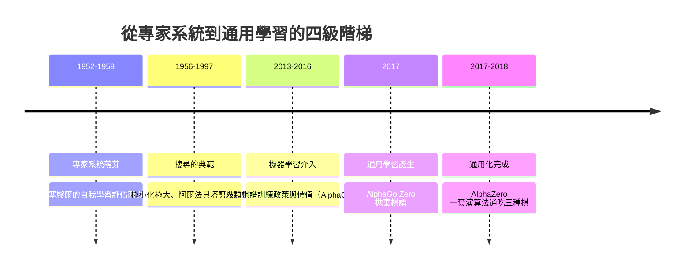

# 7.3 為什麼通用強化學習比專家系統更具革命性（2018）

## 一條走了六十年的階梯

2018 年 12 月，AlphaZero 的正式論文登上 *Science*。它之所以被視為里程碑，不只是因為勝率，而是因為它將人工智慧過往五十年棋盤上的發展，收束成一條清晰的階梯。這條階梯分為四級。

第一級是**專家系統**：人類專家把「這種局面該怎麼辦」譯成一條條規則，系統只負責查表與推論。1970 到 1980 年代，這一級是整個學科的主流承諾：醫療診斷的 MYCIN、化學結構分析的 DENDRAL、刻意向常識與日常物件擴張的 CYC，都屬於這個家族。它們確實在自己的窄域裡有可觀的表現，但它們的授權成本暴露了一個無法迴避的難題——所謂「知識獲取瓶頸」（knowledge acquisition bottleneck）：把專家的內隱判斷翻成顯式規則，所需要的人力遠超過大多數領域可負擔的規模，而且規則改一條常會在中間弄壞另外三條。

第二級是**搜尋**：Shannon 的倡議與 Samuel 的評估函數加上極小化極大與阿爾法貝塔剪枝（第 1 章），讓機器在規則之上枚舉未來。第三級是**機器學習**：從人類棋譜中學出策略與價值（AlphaGo，第 4 章與第 5 章），機器開始從資料中提煉既有知識，而不是在人腦中限量重述。第四級是**通用學習**（AlphaGo Zero、AlphaZero）：既不依賴人類棋譜，也不依賴領域特徵，只依賴遊戲規則與自我對弈這兩個可以從任何遊戲移植的原件。

回過頭看，每一級都在往同一個方向退——人類退居幕後，主動性從人到機器逐級轉移。專家階段，人類要知識就自己去存；搜尋階段，人類還是要補上形勢特徵；學習階段，人類改為編寫特徵與標籤資料；到通用學習，人類把一切都拿掉，僅留規則與介面。

把這四級對應到「人類負擔的消長」，可以列成一張表：

| 辦法 | 誰給規則 | 誰給評價/特徵 | 誰給訓練資料 | 邏輯上可通用的對象 |
|---|---|---|---|---|
| 專家系統 | 人逐條寫 | 人逐條寫 | 不需要 | 幾乎沒有 |
| 經典搜尋引擎 | 人寫規則 | 人寫評估函數 | 不需要 | 規則相近的遊戲 |
| 監督學習（AlphaGo） | 人寫規則 | 人設計特徵平面 | 人類棋譜 | 有棋譜的遊戲 |
| AlphaZero | 人寫規則（介面） | 自己學 | 自我對弈生成 | 任何有規則的遊戲 |

這張表最後一列是全部的重點。從第一列到第四列，人類輸入的相對糾結量一步步縮減，到最後一列，**能通用的對象第一次變成「任何符合介面的遊戲」**，不再是「與這個遊戲相似的遊戲」。革命性不是表現在棋力，而是表現在這個適用範圍從窄到寬的質變。

這條時間軸不只是年份記錄。它展示了一件事：通用學習不是突然冒出來的新物種，而是前三級不斷卸除人類負擔的邏輯終點。每一級都曾經被視為「終極答案」，也都被下一級證明是暫時的過渡。

這四級還有一個容易被忽略的共同點：前三級的每一級，都在自己清理的方法裡留下了「人的印記」。專家系統受到質疑的最大原因，是規則庫的維護成本隨規模線性甚至超線性增長——規則越多，規則之間的衝突與漏洞越多，而除錯靠的還是人。經典搜尋引擎的評估函數是出了名的「一動全動」：調整一個權重，整體棋風就會偏移，工程師只能憑大量對局與經驗去逼近一個滿意的調校。監督學習階段看似最乾淨，但人類棋譜本身就是最大的偏見來源——AlphaGo 學的是人類三千年的開局累積，也包括人類三千年沒想過要走的角落。只到 AlphaZero，這些印記才被一併洗去，留下的是純幾何的棋盤、輸贏的規則與無限的資料供應。

## 「領域知識」的三種負擔

要精確說出「通用」到底卸掉了什麼，最好的辦法是把過去研究者眼中的「領域知識」拆成三種負擔，逐一檢視 AlphaZero 是不是真的全數卸除。

第一種負擔是**規則**：遊戲要如何玩，從棋子怎麼走、何時終局、輸贏怎麼算——這是前三級共同的前提，也是最基本、最形式化的知識。AlphaZero 沒有卸掉這一層；它仍然需要一份規則描述、合法動作列舉與勝負判定的程式碼介面。但它把這層負擔的形態改變了：從「一整個專家系統的核心」縮減為一個插拔元件。

第二種負擔是**特徵**：什麼局面是好局面——這是塞繆爾的評估函數、深藍的能力核心、AlphaGo 的十七個輸入平面做的事。AlphaZero 徹底卸除了這一層：輸入只是裸棋盤的平面編碼，形勢、結構、攻勢全都自己學。這一層的卸除是最革命性的，因為幾十年來它一直是「機器還需人類智慧」的最後防線。

第三種負擔是**標籤**：機器學習時代最貴的資源——要标注、要人確認、要構造訓練資料。AlphaZero 卸除了這一層：它的訓練資料只有自我對弈生成的 (局面、搜尋分布、終局結果)，全部是系統自己產生的監督訊號，不需要任何人類標記。

三種負擔，卸除了兩種，重構了一種。這是精確的描述：「通用」不是「無所不知的架構」，而是**把人類可靠度最高的那部分知識（遊戲規則）留下，把人類最苦最偏的主觀性（特徵與標籤）通通拿掉**。這個分工比「AI 不再需要人類」的說法更具工程價值。

這個分工也有它深刻的社會意涵。前三代的方法裡，最稀缺的人力資源是「既懂領域又懂程式」的中間人：能寫規則庫的醫生、能設計評估函數的大師棋手、能標註資料的研究生。AlphaZero 之後，瓶頸從中間人轉到另一群人身上：能夠設計介面與環境的人（決定觀測該編碼成什麼樣的平面）、以及能夠供得起算力的組織。整行業的需求形狀改了——這是本章最後一節要重新強調的核心，因為它決定了「革命性」這個詞的分發效應：通用化不是把專家趕出 AI，而是把專家換了個位置。

## 範式轉移，還是工程最佳化？

在這裡必須回答一個看似保守但真正重要的問題：AlphaZero 算不算革命？畢竟它用到的每一件技術——MCTS、深度網路、强化學習、自我對弈——都早已存在，它的突破只不過是完美的組合。這個數量的推論不成立，原因是組合出現了一件結構上的事，而不是性能上的事：**領域知識的邊界被重新劃在了不同的地方**。

工程最佳化的判準是：同樣的方法在同樣的架構下把數字變好，範式轉移的判準是：**可以解決以前完全無從下手的問題**。AlphaZero 一套演算法學三種遊戲、訓練幾小時至一天、零人類棋譜、零人工特徵——這樣的能力在前一項技術下根本不可表示。深藍的引擎再強，也不可能在幾小時內學會圍棋；AlphaGo 2016 版再強，也無法被移去西洋棋。而 AlphaZero 能做的事情是：「給我一份這個遊戲的規則，其餘不用告訴我」。這一點不是性能的增長，而是問題空間本身的擴大。

換一種說法：之前三代的方法，其成功本質上是「領域專家化」的成功——你必須找到懂西洋棋的人；AlphaZero 的成功是「領域中立」的成功——你只需要找到懂程式的人。從前的研究者並不缺乏這種想望（通用問題求解器早在 GPS、SOAR 時就被提出過），缺的是一條能夠真正實現的路徑。AlphaZero 證明的事物存在，而不只是理論上的夢想：一個不含任何人類領域知識的訓練流程，可以在完整規則下逼近超人類棋力。

還有一個不常被提到、卻極具歷史諷刺性的角度：這場範式轉移的檢驗正是在西洋棋上完成的。西洋棋自 Shannon 的 1950 之後一直是 AI 研究的果蠅，六十年來所有方法論的變遷都在它的棋盤上亮相；到 2017 年，同一張棋盤又用一場對局宣布了範式的再度更迭。回頭看，這個家族的歷史是一連串「承諾的降級」：六十年前，人們以為棋盤是通往一般智慧的入口；二十年前，人們承認西洋棋可以靠專用引擎解決，但圍棋至少再需二十年；到 2017 年，兩者都在幾個小時到幾天的窗口內被同一套通用方法拿下。每一次降級，都是把「領域的困難」從本質問題降級為工程問題——而 AlphaZero 做的降級，是迄今最徹底的一次：它把「一個領域的智慧需要一個領域的方法」這條信念本身降級了。

## 通用演算法的侷限

正因這是一範式轉移而非幻夢，清楚說明它的邊界就更重要。AlphaZero 的通用性有三個明確的侷限，缺一個都不會被忽略。

第一，它仍然要求**顯式、正確、可執行的規則**。遊戲的規則本身就是對模擬環境的完美模型：每一步轉移都嚴格確定，每一手都可以窮舉。西洋棋、將棋、圍棋全部符合這個條件，但真實世界幾乎沒有什麼是這樣的：天氣的模型有誤差，市場的規則是動態的，而更多情境根本沒有「規則」可言——只有一連串的觀察與回饋。AlphaZero 的訓練迴圈必須能夠「在腦中不掉合一手地模擬走一步」，這個假設的真實範圍有多小，看看生命的例子就知道了。

第二，它需要**大量的算力**。西洋棋幾個小時的訓練，背後是數千局的自我對弈跑在 TPU 叢集上；圍棋的訓練量是幾千萬盤的對局資料。只要超級規模的運算資源都還昂貴，就有許多場景不能承受這種學習方式；同時，這種資源門檻相反又將通用學習向下沒落，成了少數組織的能力。這個「通用性往往集中掌握在少數硬體帝國手裡」的議題，在整個 AI 歷史上反覆出現。

第二，它需要**大量的算力**。西洋棋幾個小時的訓練，背後是數千局的自我對弈跑在 TPU 叢集上；圍棋的訓練量是幾千萬盤的對局資料。只要超級規模的運算資源都還昂貴，就有許多場景不能承受這種學習方式；同時，這種資源門檻相反又將通用學習向下沒落，成了少數組織的能力。這個「通用性往往集中掌握在少數硬體帝國手裡」的議題，在整個 AI 歷史上反覆出現。

第三，它對**規則細節極度敏感**。改變勝負判定的一個條款會直接改變學到的策略，把和棋慣例調整可能讓策略形態偏向相反的著法。這是規則的真確性帶來的脆弱性：沒有辦法把「規則大概正確」的資訊給到演算法手裡。它是一次不留任何模糊地帶的學習者。

還有一條屬於後續追蹤的細節：AlphaZero 每個遊戲各自訓練一套網路參數，並不是同一組權重同時學三種棋。因此嚴格來說，它的通用性是**演算法的通用**，而不是**一個模型的通用**——這個差別在當年就有人指出，也成為後續研究的一條明線：要讓單一組參數同時承載任務族，需要多任務與條件化架構的介入，而那已經超出原論文的範圍。把這條界線講清楚，反而能更準確地讚美 2017 年的成就：它通用的是方法論，而方法論的通用已足以重排整個領域的研究路標。

把這三條侷限放在一起，就得到一個很清楚的開放問題表：沒有規則描述的領域怎麼辦？算力受限的環境怎麼辦？規則只能近似而非嚴格正確的世界怎麼辦？第二與第三條是工程問題，第一條是原理問題。這一原理性的問題，正是 2019 年 MuZero 的起點。

有趣的對照是：這三條侷限裡的每一條，都能在棋盤上找到一個「最像反例」的影子場所。職業棋盤之外的電子遊戲損失了規則的顯式性；發燒友桌上自訂規則的變體棋損失了訓練算力；從來沒有人能對「規則大致如此、細節仍會變動」的社會規則做出完美的引擎。可通用化的博弈類別本身已是一個高度受限的家族，AlphaZero 通吃的是這個家族的全部成員，但這個家族的邊界在 2018 年是被規則的形式化特性劃出來的。要跨出邊界，就得找到不依賴「真規則」也能搜尋的辦法——這正是下一章要說的事。

## 通往第 8 章：連規則都不給的時候

整個第 7 章的敘事可以總結為一個極簡單的公式：把「領域知識」分成規則、特徵、標籤三層，AlphaZero 卸除了後兩層，結構化了第一層。它證明了自我學習可以在規則已知的前提下完全取代特徵工程與人類棋譜，並且以一場讓世界矚目的對局（第 7.2 節）證明它比最強的專家引擎更敏銳、更有創造力。

但這條路徑留下一個明確的縣界：**如果不是所有的前進需要一個「規則如何推動局面」的完整模型，那怎麼能學習？** 圍棋、西洋棋的世界以規則已知的完美資訊遊戲為背景；但 Atari 的畫面轉移，真實世界的物理引擎、經濟引擎、甚至一個大型軟體系統的行為——這些情境裡，無人給你一個可呼叫的轉移函數。而如果連一步都不知道會走成什麼樣子，MCTS 的節點展開就完全不可能進行。

這個問題在 2019 年被 MuZero 回答了，而它給出來的答案比 AlphaZero 本身更顯得有未來感：**不需要正確的規則，只需要一個「對決策有用」的內部模型**。MuZero 自己在收藏的經驗中儲存一個虛擬的轉移函數，讓這個模型能夠為搜尋與策略提供助力，至於它到底是不是真實的物理——沒有人在乎。第 8 章將說：這不是對 AlphaZero 的微小改良，而是把「規則已知」這個最後的人類負擔也搬離了舞台。

