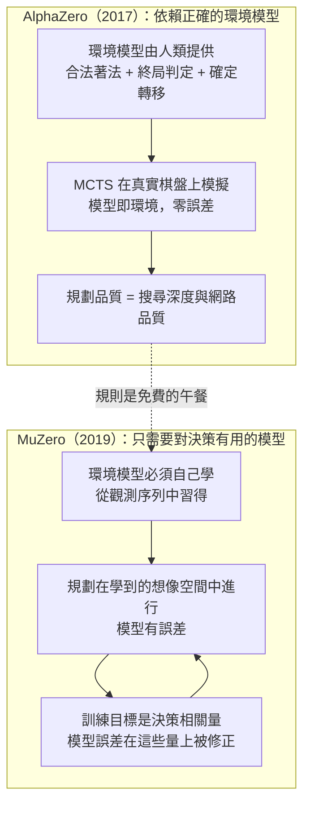

# 8.1 解決現實世界的痛點：當模型不知道環境規則時（2019）

## 免費的午餐總有代價

AlphaZero 在第 7 章完成了一項看似無所不能的成就：同一套演算法、同一份網路架構、同一個搜尋程式，學會了西洋棋、將棋與圍棋，而且在每一項上都達到超人類水準。表面上，這已經是「通用人工智慧」在博弈領域的完整示範。但如果我們誠實地檢視它的輸入介面，會發現一個被敘事掩蓋的事實：**AlphaZero 仍然需要別人先把遊戲的規則交給它**。合法著法清單由程式列舉、終局判定由程式回傳、獎勵就是那個由規則計算出的勝負結果 $ 1$ 、 $ 0$ 或 $ -1$ 。這些东西從來不是學來的，而是作為先驗被注入系統的。

在棋盤世界裡，這個先驗是免費的午餐。西洋棋、將棋與圍棋的完整規則由人類花了數百年整理清楚，可以寫成數百行的確定程式碼，而且執行起來零誤差、零歧義。狀態轉移是確定性的：給定盤面與著法，下一個盤面唯一確定。獎勵雖然稀疏，但只出現在終局，而且意義完全明白——贏、輸、或平。換言之，AlphaZero 的成功建立在一個理想化的假設之上：**環境模型已經被上帝寫好了，只需要有人把它翻譯成程式**。

真實世界沒有這種待遇。

## 真實世界的三重刁難

離開棋盤，第一重刁難是物理規則難以精确模擬。機器人在真實空間中移動，它面對的是摩擦、變形、流體與感測器雜訊；一個想要規劃的演算法如果需要一個「下一狀態」模型，這個模型必須從觀測資料中自己學出來，而且永遠帶著誤差。第二重刁難是獎勵稀疏。棋局的輸贏雖然也在終局才揭曉，但至少確定且語義清晰；真實世界的任務——例如讓代理人在迷宮中找到出口、或讓影片壓縮器省下頻寬——中介訊號往往不存在，動作與結果之間隔著漫長的、充滿隨機性的時間延遲。第三重刁難是觀測高維。棋盤是 $19 \times 19$ 的離散格子，Atari 的畫面是 $210 \times 160$ 的像素陣列，圍棋的狀態可以完整枚舉，像素的狀態枚舉在物理上毫無意義。

這三重刁難共同指向一個核心限制：**在真實世界裡，「環境模型」本身成為被學習的對象，而不是可以先驗假設存在的資源**。任何依賴正確模型的規劃方法，其成效上限被模型誤差封死。模型錯一分，規劃就朝錯誤的方向多走一分；在模型誤差隨深度累積的情況下，看似深遠的規劃可能整段都是建立在虛構上的想像。

## 一個反直覺的提問

2019 年，DeepMind 的研究團隊在 Schrittwieser 等人的帶領下，把問題翻了一個面。過去的典範問的是：**怎樣才能學出一個正確的環境模型？** 學得越像越規劃得越好。他們問的卻是：**我們真的需要一個正確的模型嗎？還是只需要一個對決策有用的模型？**

這個提問的張力在於，它放棄了「模型必須忠實反映環境」這條被視為公理的要求。一個模型可以在像素層面錯得離譜——預測的畫面與真實畫面毫無相似之處——卻仍然在它真正被使用的每一個地方給出有用的答案：哪個動作會得分、哪個動作會輸、長期看哪條路線值得走。判断模型好壞的標準，從「預測誤差有多小」變成「用它做的規劃有多好」。這不是文字遊戲，而是訓練目標的根本重寫：如果我們只拿「決策品質相關的量」去訓練模型，模型就自動學到那些對決策有用的面向，至於其他面向它愛怎麼錯就怎麼錯。

## 思想史上的伏筆：Dyna 的承諾與未竟

把 MuZero 放回強化學習自己的思想史，就會看到它的伏筆早已埋下。1990 年 Sutton 推出的 Dyna 架構，是第一個認真把「學模型」與「用模型」縫在同一個學習迴圈裡的框架：代理從真實經驗更新模型，再從模型生成的虛構經驗更新價值，兩種經驗並行餵同一個政策。Dyna 的洞見在於模型可以放大樣本效率——一條真實軌跡經過模型內部的多步想像，可以等效於數條虛構經驗。但 Dyna 生在表格時代，它的想像被限制在小規模、離散、可窮舉的格子世界裡；一旦環境的狀態空間落到像素尺度，Dyna 式的想像立刻摔落在維度災難上。

三十年後 MuZero 做的事，說穿了是把 Dyna 的承諾在深度學習的尺度上兌現。想像還在（MCTS 在模型上展開），但想像的媒介從表格換成了隱含狀態；模型的訓練目標從「預測正確」換成了「由決策品質界定」，外插因此失去動機，想像不可能失控地走向偏遠的虛構區域。歷史上偶爾有這樣的收束時刻：老問題原封不動，突然所有零件——表徵學習、搜尋、算力——在同一時刻齊備，於是十年內做不到的事一年成了。MuZero 就是這樣的收束。

## 你需要正確的模型，還是好吃的模型

把 AlphaZero 與 MuZero 的差異畫在同一張圖上，對比會非常清晰。

前一章的 AlphaZero 在規劃時受到萬全保護：MCTS 從一個真實局面出發，每一步模擬都由確定無誤的遊戲規則執行，模擬樹上的一切與真實對局在數學上等價。MuZero 沒有這個保護。它的 MCTS 展開在一個由自己學出來的模型構成的「想像」裡：從想像的下一狀態走向想像的下下狀態，每一步都踩在模型的猜測上。表面上看，這是嚴重的退化——想像越深，誤差累積越多，規劃理應越不可靠。

但 MuZero 的設計裡藏著一個關鍵的自我修正機制：模型誤差是在訓練迴圈裡沿著規劃實際會走過的路徑被懲罰的。當想像中的展開 $( s_1, a_1, s_2, a_2, \ldots )$ 沿著搜尋偏好的方向前進時，這條想像路徑上的每一個獎勵預測、每一個價值預測、每一個政策預測，都會與真實的自我對弈結果對照，誤差成為梯度。換句話說，**模型在它最常被使用、也最容易出錯的地方被反覆校正，而在永遠不會影響決策的地方，它既沒有動機也不需要變得正確**。

## 從「學對」到「學有用」

如果我們必須給這個轉變一個名字，那就是從「學對」到「學有用」的典範轉移。傳統基於模型的強化學習把「模型準確度」當作工程目標，誤差越低越好；MuZero 把「規劃後的決策品質」當作工程目標，模型只是一個為決策服務的中間產物。模型的價值不在它自己，而在它撐起來的那棵搜尋樹。

這個轉移可以精確地寫成一句對比。AlphaZero 的邏輯是：環境模型 $M$ 必須滿足 $M(s, a) = s'$ 且 $s'$ 是真實的下一狀態，然後規劃才能進行。MuZero 的邏輯是：只要由 $M$ 撐起的搜尋統計量導致更好的動作選擇即可，形式上我們要求的是最終策略 $\pi$ 的品質提升，而不是 $M$ 與任何「真實模型」的距離縮小。前者的約束是充分必要的，後者把約束放寬成充分不必要——放寬之後，整片原本被精度要求檔在門外的領域（像素觀測、物理模擬、真實感測資料）都變得可以進入。

## 與理論地圖的對位

讀過《強化學習》一書的讀者會記得，強化學習沿著「是否有模型」這條線分野：model-free 方法（如 Q-learning、策略梯度）不看模型，直接學價值或策略；model-based 方法先學模型，再用模型規劃。照這張地圖，MuZero 表面上是 model-based——它確實有一個動態模型而且確實用模型規劃——但它又拒絕了 model-based 文獻中最核心的忠實性要求。它站在兩個傳統之間：規劃的部分繼承自 model-based，學習目標的部分卻來自 model-free 的精神，即**一切訓練訊號都談論決策，不談論環境的再現**。

這個位置正是它創新的所在。純 model-free 方法在稀疏獎勵與長時程任務上樣本效率不足；傳統 model-based 方法在真實環境中受制於模型誤差。MuZero 的答案是取消「模型必須真」這個假前提，讓 model-based 的規劃能力在 model-free 的目標下運作。歷史上許多重要的演算法躍遷——從 shader 談編譯器、從統計學談機器學習——都呈現同樣的模式：兩個成熟傳統各取一半，合成一個前人沒想過的組合。

| 面向 | AlphaZero（2017） | MuZero（2019） |
|---|---|---|
| 環境模型來源 | 人類手寫的遊戲規則程式 | 從觀測序列中自行學習 |
| 模型的角色 | 規劃的全部真實性來源 | 決策的輔助工具 |
| 對模型的要求 | 正確無誤，規劃即真實 | 足以支撐良好決策即可 |
| 規劃場域 | 真實棋盤狀態 | 學到的隱含狀態空間 |
| 觀測型態 | 離散、低維、結構化棋盤 | 允許像素等高維非結構化資料 |
| 訓練訊號 | 搜尋統計量與終局勝負 | 獎勵、價值、政策的預測誤差 |

## 檢視 AlphaZero 的輸入介面：先驗藏在哪裡

要把「AlphaZero 仍依賴規則」這個論斷說得可信，最好逐項盤點它的輸入介面裡到底塞了什麼。第一項是合法著法清單。MCTS 在每個節點要展開子節點時，程式必須先枚舉出當前局面的所有合法動作，供政策分布選取與遮蔽；在圍棋裡，這意味著禁入點判定、劫勢交替與提子清空全部由外部程式即時計算。第二項是轉移執行。MCTS 模擬樹每往下走一步，都由規則程式真實落子：提掉該提的子、翻轉該翻的棋、更新回合數與重複局面計數——這棵樹之所以可信，是因為它的每一次擴展都踩在無誤差的下棋規則上。第三項是終局與獎勵判定。一局結束時，誰勝誰負由規則程式按點數或將死裁定，回傳給價值頭做訓練標籤。

這三項有一個共同特徵：它們都是**確定的、由人寫的、無需學習的**。MuZero 的設計者清楚意識到，這三項在任何非棋類環境裡都會同時消失。機器人沒有可手寫的落子規則，Atari 遊戲的內部邏輯藏在硬體電路裡，影片編碼器與頻寬之間的關係是整個編解碼管線的組合結果。因此若要推廣，必須回答：MCTS 沒有規則可踩，還能不能展開一棵有用的搜尋樹？第 8.2 節的答案是把「踩規則」換成「踩模型」，而模型本身由另一組學習目標餵養。

更深一層看，這個必要性還與獎勵的語義有關。在棋類裡，獎勵 $ -1 $ 、 $ 0 $ 、 $ 1 $ 的定義完全清晰，因為「勝負」由規則唯一決定；在 Atari 裡，獎勵只是畫面上分數的變化，其長期價值要靠折扣與未來收益的估計來拼湊；在影片壓縮裡，獎勵甚至是一個工程選擇——畫質與頻寬之間要怎麼折衷，本身就是個決策問題。換句話說，把規則的代言人從先驗降級為學習產物之後，系統必須自己把「什麼樣的動作是好動作」這個問題也吃進去，這也是為什麼 MuZero 必須連同獎勵預測與價值預測一起訓練，而不是只學一個轉移模型。

## 從機器人與 Atari 看先驗缺位的具體樣貌

抽象地講「真實世界」,不如看兩個當時就存在的具體案例。第一個案例是基於模型的強化學習在控制與機器人任務上的困境。標準做法是收集軌跡、擬合轉移模型、在模型上做想像式規劃或合成資料再訓練策略。這條路在理論講得通,實作卻屢屢敗於模型偏誤:模型在訓練資料分布之外略有好心或壞心,規劃器偏偏喜歡往這些外插區域走,於是策略在想像中大放異彩、在現實中摔成一團。學界花了很多精力研究如何抑制這種惡性外插——保守估計、不確定性懲罰、模型集成——這些都是在「模型必須正確」的大前提下修修補補。

第二個案例是 Atari。AlphaZero 的自我對弈迴圈完全不依賴人類示範，但依賴規則；2015 年前後的 Deep Q-Network 演算法在 Atari 上不需要規則，卻也不做規劃，它是一個純 model-free 的系統，靠海量樣本在沒有想像力的情況下逼近策略。兩種成就各缺一塊拼圖：AlphaZero 有規劃無學習模型，DQN 有學習無規劃。MuZero 的歷史位置，正是把這兩塊拼圖第一次咬合起來——在沒有可手寫規則的環境裡，仍然保留一棵完整的想像中的搜尋樹。這個咬合在 2019 年之前沒有人做成功過，困難點恰在於上面所述的：組合兩塊拼圖的接縫，是要重新定義「模型」的形式與訓練目標。

## 從「學對」到「學有用」的典範細節

## 一扇被打開的門

寫到這裡，本章想要論證的命題已經成形：MuZero 不是 AlphaZero 的又一個微調版本，而是把「環境模型」這個概念從先驗資源變成學習產物的第二跳。第一跳發生在 AlphaGo Zero，把人類棋譜從學習迴圈裡移除；第二跳發生在 MuZero，把遊戲規則從輸入介面裡移除。兩跳完成之後，這套方法的必要輸入只剩觀測、動作與（某種定義的）獎勵訊號，而這正是真實世界願意提供的全部。回頭看這一節的表，兩列之間的每一行差距都對應著一個真實世界的障礙被跨越的瞬間。

下一節將把 MuZero 的架構攤開來看：representation、dynamics 與 prediction 三個函式如何分工，隱含狀態如何在其中被構造出來，以及那個反直覺的訓練目標為什麼不重建像素。在真正理解這些設計之前，8.3 節裡 Atari 57 遊戲與影片壓縮的跨域實驗，也只會是一串漂亮的分數，看不出它們背後那一整個免規則化的思想革命。
