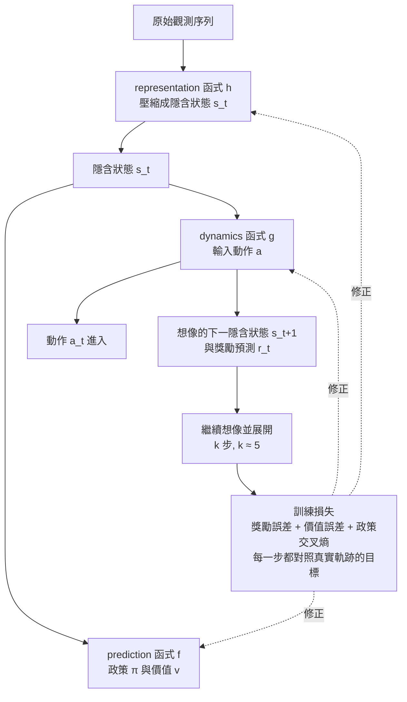

# 8.2 動態模型（Dynamics Model）的隱含狀態學習（2019）

## 三個函式構成的機器

上一節的結論是：模型不必正確，只需對決策有用。這句話要落到演算法層面，就必須回答「模型到底是什麼、怎麼學、學什麼」。MuZero 的答案（Schrittwieser et al., *Nature* 2020）是把整個系統拆成三個神經網路函式，各自名稱平實而分工嚴密。

第一個是 representation 函式 $`h`$ 。它把最近的原始觀測序列壓縮成一個隱含狀態 $`s_t = h(o_1, o_2, \ldots, o_t)`$ 。這個壓縮沒有任何「重建輸入」的壓力，因此它有完全的自由去保留決策需要的東西、丟棄決策不需要的東西。對下西洋棋的 MuZero 而言，一個隱含狀態的語義接近「棋盤局面的抽象編碼」；對下 Atari 的 MuZero 而言，它接近「畫面中與得分相關的物理狀態摘要」。

第二個是 dynamics 函式 $`g`$ 。它承受模型學習的全部重量：輸入當前隱含狀態與動作，輸出下一個隱含狀態與一個即時獎勵預測，即 $`( s_{t+1}, r_t ) = g( s_t, a_t )`$ 。注意這裡的 $`s_{t+1}`$ 不是任何真實世界的量，它是純粹的想像產物；但 $`r_t`$ 卻有真實資料可以對照，因為自我對弈或真實遊戲過程中每一步都有一個實際發生的獎勵。

第三個是 prediction 函式 $`f`$ 。它作用在隱含狀態上，輸出政策 $`\pi`$ 與價值 $`v`$ ，即 $`( \pi, v ) = f( s_t )`$ 。這一對輸出的角色與 AlphaZero 的雙頭網路完全同構，差異只在於它的輸入不再是人類定義的棋盤編碼，而是前三個函式合力建構出來的隱含狀態。三個函式各管一段、且各自有訓練訊號，這個分工是理解整個系統的骨架，剩下的所有細節都是往這副骨架上填肉。

## 規劃在想像中進行

有了這三個函式，MCTS 的搜尋樹就可以在隱含狀態空間中展開。搜尋從某個真實觀測出發，先由 $`h`$ 得到根節點的隱含狀態，之後每往樹下走一步都呼叫 $`g`$ ：從 $`( s, a )`$ 想像出 $`( s', r )`$ ，這個想像出來的 $`s'`$ 成為子節點，再由 $`f`$ 在子節點上給出政策先驗與價值估計。整棵樹上的每一個節點、每一條邊，都是模型產物；搜尋終止時，訪問次數統計與根節點價值估計被用來選擇實際執行的動作。

與 AlphaZero 對照，這套流程的骨架沒有改變——選擇、擴展、評估、回傳四個階段一樣不少，PUCT 公式一樣運作——改變的是樹底下踩著什麼。AlphaZero 的樹踩在遊戲規則的真實狀態上，MuZero 的樹踩在自己構造的想像狀態上。也因為如此，這個系統的規劃完全不需要知道環境的真實動態：**模型即環境，且模型是學的**。

## 訓練目標：三股力的均衡

那麼模型怎麼知道該學些什麼？MuZero 的訓練目標由三個誤差項組成，全部都是決策相關量。第一個是獎勵預測誤差，要求 $`g`$ 在想像路徑上預測的 $`r_t`$ 逼近真實紀錄的獎勵。第二個是價值預測誤差，要求 $`f`$ 輸出的 $`v`$ 逼近該局最終結果沿時間回填的價值目標。第三個是政策交叉熵，要求 $`f`$ 輸出的 $`\pi`$ 逼近 MCTS 搜尋產生的訪問次數分布——也就是說，與 AlphaZero 一樣，**MCTS 本身就是政策的教師**。

把三者寫成一個沿想像軸展開多步的損失函數，形式如下：

$$
L ( \theta ) = \sum_{k = 0}^{K} \left( l^{r} ( u_{t + k} , r_{\theta}^{k} ) + l^{v} ( z_{t + k} , v_{\theta}^{k} ) + l^{p} ( \pi_{t + k} , p_{\theta}^{k} ) \right)
$$

其中 $`u_{t+k}`$ 是真實獎勵， $`z_{t+k}`$ 是價值目標（自我對弈中最終結果 $`z`$ 的折扣形式，Atari 上則取自總回報的一個校正值）， $`\pi_{t+k}`$ 是搜尋訪問次數分布， $`p_{\theta}^{k} , v_{\theta}^{k} , r_{\theta}^{k}`$ 是網路沿想像路徑展開 $`k`$ 步後的預測，而 $`K`$ 就是所謂的 unroll 步數，論文中約取 $`k \approx 5`$ 。實現時，第 $`k`$ 步的想像必須在梯度上「停住」，即想像中的隱含狀態不把梯度倒灌回生成它的上一步 $`g`$ ——這個細節防止了模型的自我幻想被訓練惡性放大，但 $`g`$ 本身的輸出頭、即每一步的獎勵、價值與政策預測仍然照常訓練。

這張圖的關鍵在回饋箭頭：三個函式都被同一個損失驅動，但損失中的每一個目標都來自真實軌跡，因此整個想像鏈條是被現實拉著走的。模型可以自行決定隱含狀態編了什麼，只要這個編碼沿著想像軸能持續支撐合理的獎勵、價值與政策預測。

## 一個俯瞰：訓練迴圈的全貌

在拆解損失函數之前，先從系統層面看一局自我對弈是怎麼變成梯度的。MuZero 的迴圈與 AlphaZero 幾乎同構：程式讓當前網路與自己對弈（Atari 則是與環境互動），每一步都先做一次 MCTS，把搜尋產生的訪問次數分布與落子選擇存進回放緩衝區；一局結束後沿時間軸回填價值目標；訓練時從緩衝區取出一段連續區段，例如二十步，讓 representation 函式把區段開頭的觀望序列壓成根節點的隱含狀態，再由 dynamics 函式沿真正的動作序列逐一想像，同時用真實紀錄的獎勵與回填價值當標籤，計算第 $`k = 0`$ 到 $`K`$ 步的全部損失。

這個迴圈裡有一個容易被忽略但至關重要的設計：搜尋統計量既是政策的教師，也是品質控制器。每一步落子前都做了完整搜尋，等于替系統每天都產生一份「深思熟慮的參考答案」，而網路學的是把這份深思熟慮透過前向傳播快速重現。隨著訓練推進，網路先驗愈強，同次數預算下的搜尋就愈準，產生的教師訊號也愈好，整個系統自然形成一個自我提升的正回授。AlphaZero 玩家早已認得這個飛輪——它的本質是「搜尋改進網路、網路改進搜尋」——MuZero 只是讓這個飛輪的每一圈都行駛在想像之上。

## 實作細節裡的三個護欄

任何一個把「以想像訓練模型」當作核心的系統，都必须直面同一個危險：想像可以自我強化。如果模型用自己想像出來的數據訓練自己，小偏差會被放大成大偏差，這就是先前模型偏誤的深层機理。MuZero 論文與其實作指引列出了幾條護欄，值得逐一點名。

第一條是梯度截斷（gradient dampening），即上一節提到的：想像出的隱含狀態 $`s_{t+1}`$ 在訓練時不把梯度倒灌回產生它的前一步 $`g`$ 與 $`h`$ ，每一步想像只訓練該步的獎勵、價值與政策預測頭。這樣模型永遠只針對真實標籤學習，永遠不會拿自己的幻想當事實。第二條是價值目標的多重打折：Atari 這類遊戲的回報時程很長，若只拿最終回報當 $`z`$ ，訊號過於稀疏且高方差；MuZero 采用了比標準折扣更陡的回報折現，使價值目標偏向近期與可估的範圍，把規劃的重心放在「用不了的時程不規劃」。第三條是行動選擇的溫度控制與探索次數，讓自我對弈的資料分布不致塌縮到單一策略，確保經驗的多樣性。

這些細節單看每一條都平淡，合在一起卻回答了一個可以宣告的問題：一個拿想像當訓練資料的系統，如何不陷入自欺。答案不是一個玄妙的機制，而是一組工程上的品質控制，加一個根本性的選擇——訓練訊號永遠來自真實軌跡，而不是來自模型自己的生成。沿著這個選擇，模型偏誤沒有被消滅，只是被剝奪了餵養自己的管道。

## 為什麼不重建像素

熟悉 2018 年前後世界模型研究的讀者會記得，當時的主流做法是訓練一個變分自動編碼器或循環網路去預測下一幀像素，再在預測出的幀上規劃。這條路線有一個隱含的沉重稅負：模型的容量被大量消耗在複製輸入的外觀細節上——天空的雲、磚牆的紋理、與決策無關的一切。MuZero 的訓練目標中完全沒有重建項，隱含狀態因此沒有義務成為任何一種畫面的近似。

這正是「學有用」在架構層的落實。我們關心的是畫面對決策的影響，不是畫面是否逼真：敵人的位置、分數的變化、危險的方向才是決策變數，而像素裡大部分維度都與這些無關。在隱含狀態空間做動態預測，等於把全部學習容量集中在那少數幾個決策變數上。從資訊論的角度說，representation 函式做的是一個以決策為效用的有損壓縮，而壓縮的損失合理地落在決策無關的維度上。這個取捨在工程上看是犧牲、在理論上看是解脫：模型的第一要務終究是幫忙下好每一步，而不是畫好每一幀。

## 與世界模型傳統的正面對照

要更清楚定位「不重建像素」這個選擇，值得把當時的「世界模型」路線攤開來比。2018 年前後的主流構想大致是：先把觀測壓成低維潛變數，再在潛變數上預測下一狀態，最後把控制器接在這個學到的模擬器上。這條路線的失敗模式有兩個，都與「重建」有關。其一，重建目標把潛變數的容量優先配置給對生成畫面有用的統計特徵，而這些特徵未必是決策需要的。其二，重建出的潛變數往往不夠平滑，基於它的規劃常常被一兩個錯誤的細節帶偏。

MuZero 對這兩個失敗模式各答一問。對前者，它取消了重建，讓潛變數的語義完全由下游三個決策誤差來定義——模型的價值由使用方式反推。對後者，它把「規劃的可靠性」從潛變數的單獨品質轉移到搜尋的系統品質：MCTS 本來就是一個對局部錯誤魯棒的抽樣機制，每個節點的評估都由大量模擬平均，單步模型的輕微偏誤在樹上會被政策先驗與價值平均稀釋。換句話說，MuZero 不指望模型每一步都對，它指望的是搜尋這個系統層面的平均機制能蓋住模型的單步噪聲——這與人類使用不完美地圖的經驗驚人相似：地圖錯一筆，靠多看幾條路與多問幾個人，照樣到得了目的地。

## 模型不對，規劃仍然有效

隱含狀態的語義還有一個更具戲劇性的層面：訓練完成後，我們幾乎無法說出隱含狀態「是什麼」。論文作者在回答審稿質疑時給過一個著名的演示：把西洋棋的 MuZero 的隱含狀態拿出來與各種人類設計的棋盤編碼做深度比對，發現它與任何一種「正確」的棋盤表示都不相似——它既不是棋盤，也不是棋盤的任何標準投影。模型顯然錯了，如果考試題目是「請你畫出當前盤面」。但用它規劃出來的西洋棋棋力，達到超人類強度。

這個矛盾恰恰是本書第 8 章的核心命題的證據。模型不必在表面層忠實，只需在功能層支援決策：沿著想像軸，下一步的獎勵、價值與政策預測對得上現實，這棵想像的樹就能長出接近真實的方向感。錯誤的畫法、正確的用法，兩者可以共存，而且實驗證明它們確實共存了。這也解釋了為什麼 MuZero 能帶著同一套架構直接落到 Atari 上——如果模型必須先學會重現像素才能規劃，跨域的門檻將高得多。

## 算術的份量

在結束架構討論之前，值得用算術的眼睛再看一眼這套設計，因為它對計算的胃口大得驚人。AlphaZero 的每一步落子前要跑幾百次模擬，而每次模擬至少要呼叫一次網路；MuZero 的模擬不只呼叫 prediction 函式，樹上每往深走一步還要再多呼叫一次 dynamics 函式，等於把每局棋的網路前向傳播次數再乘上一個深度因子。若搜尋深度是 $`d`$ 、模擬次數是 $`n`$ ，僅想像部分的前向傳播就是 $`O( n \times d )`$ 次，全部都要求低延遲、高吞吐的推理硬體。再加上 unroll 展開的訓練、回放緩衝區的採樣、以及自我對弈本身產生的資料洪流，MuZero 在單一環境（例如圍棋或西洋棋）上的訓練成本就與 AlphaZero 同量級，而它同時還要跑 57 款 Atari。

這組數字把一個工程事實逼到台前：MuZero 的每一個理論優雅之處——在想像中規劃、用搜尋統計量當教師、以決策誤差訓練模型——都建立在矩陣乘法可以廉價且平行地大規模執行這個現代奇蹟上。這不是敘事的註腳，而是敘事的一部分；讀者會在第 10 章看到，TPU 與分散式訓練不是這場革命的外部贊助者，而是它的第四個必備函式。

## 一個重要科學結果的尺度

回頭看，MuZero 的意義需要放在科學問題的尺度上衡量。它回答的問題不是「機器能不能把遊戲玩得更好」，也不是「模型能不能預測得更準」，而是一個認知科學式的問題：**規劃的目標究竟是預測精度，還是決策品質？** 論文以實驗回答：是後者。當訓練訊號只關心決策相關量時，模型會自主收斂到一種以決策為中心的環境表示，即使這種表示在傳統意義上「不準確」。這個結論對幾十年來關於「世界模型」的直覺構成一個重要的典範修正，也說明為什麼它被視作 2019 年底最矚目的結果之一。

從歷史敘事的角度，這個結果也完成了一次漂亮的貫通。塞繆爾的跳棋程式（1952）學的是一個手寫特徵的線性評估函數；AlphaGo（2016）學的是人類棋譜引導下的棋盤表示；AlphaZero（2017）學的是規則給定下的棋盤表示；MuZero（2019）學的是連規則都不給時的環境內部模型。每一代都把一個曾被視為必需的先驗移交给學習，而每一代移交之後，可行性與強度都沒有崩塌。第 8.3 節將看到，這條移交鏈最後一站的實際戰績：57 款 Atari 遊戲，以及一個與影片壓縮工作相連的生產線故事。

| 組件 | 函式 | 輸入 | 輸出 | 訓練訊號 |
|---|---|---|---|---|
| 表示 | $`h`$ | 最近觀測序列 | 隱含狀態 $`s_t`$ | 由下游誤差間接驅動 |
| 動態 | $`g`$ | $`s_t`$ 與 $`a_t`$ | $`s_{t+1}`$ 與 $`r_t`$ 預測 | 真實獎勵誤差 |
| 預測 | $`f`$ | $`s_t`$ | 政策 $`\pi`$ 與價值 $`v`$ | 訪問次數分布交叉熵與價值殘差 |
