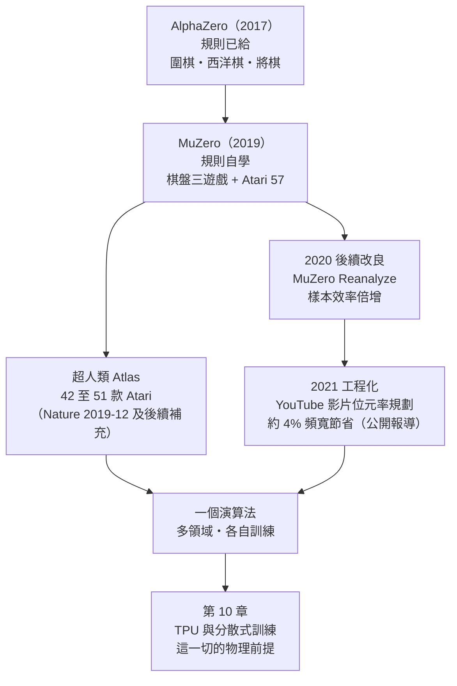

# 8.3 從棋盤遊戲跨足 Atari 遊戲與串流影片壓縮（2019-2020）

## 五十七個世界，一次走進

模型學出來了、想像中的規劃也跑通了，剩下的問題只有一個：這套玩法在「沒有規則可以寫成程式」的環境裡究竟能走多遠。Atari 2600 就是這樣的環境。它的觀測是 $`210 \times 160`$ 的像素畫面，動作空間是搖桿與按鍵的組合，遊戲之間沒有任何共享的規則描述，獎勵來自畫面上的分數而非任何精確定義的終局。換句話說，MuZero 在這裡必須完全依靠自己學出的 representation、dynamics 與 prediction 三個函式來規劃，人類提供不了 AlphaZero 依賴過的任何先驗。

2019 年 12 月，Schrittwieser 等人的論文以《Mastering Atari, Go, Chess and Shogi by Planning with a Learned Model》為題刊於 *Nature*，把 MuZero 的戰績攤在世人面前。在 57 款 Atari 2600 遊戲的基準上，MuZero 於其中多數遊戲達到或超越人類水準，同時在西洋棋、將棋與圍棋上保持 AlphaZero 級別的棋力，且訓練花費的計算資源與 AlphaZero 同一量級。這個結果的意義不在分數本身，而在它的證明範圍：**同一個演算法、同一組介面（觀測、動作、獎勵訊號），涵蓋了從完美資訊棋盤到純像素即時遊戲的兩端**。

超級人類的邊界在 Atari 上是流動的。原始論文的設定下，MuZero 達到超人類水準的遊戲數是 42 款（同設定下可比較的先前最強 model-free 演算法低下不少）；後續隨訓練算力與工程調校的提升，這個數字被推到 51 款（此一 42 至 51 的演進出自 MuZero 論文及其發表時 DeepMind 發布的補充材料與官方說明）。這條補丁提醒我們，超人類與否在 Atari 基準上相當程度是算力預算的函數，方法的真實優勢要用同等成本的對照才能公平衡量。

還有一個容易忽略的對照細節值得記下：MuZero 在 Atari 上的姿態與它在棋盤上不同。棋盤上它與 AlphaZero 同量級即可被視為成功，因為那是更難的標準；Atari 上它的對手表是一票以樣本效率見長的 model-free 演算法，而 MuZero 的獨特之處在於把規劃帶進了一個從來沒有規則可用的領域。分數頂點意義有限，覆蓋範圍的意義無限：從西洋棋的 $`8 \times 8`$ 到 Atari 的像素流再到 YouTube 的位元率，同一份演算法描述文件居然講得完三種世界，這件事本身在 2019 年 12 月之前是科幻敘事的材料。

## 後續改良：MuZero Reanalyze

一個深刻的思想要成為工程上的日常，中間總隔著幾輪打磨。2020 年起，DeepMind 與後續研究者對 MuZero 做了一系列改良，其中最有代表性的是 **MuZero Reanalyze**。它的直覺來自一個樣本效率的觀察：dynamics 函式學會之後，訓練價值頭所需的目標不必依賴漫長的真實軌跡回填，可以改為用已學好的模型在經驗樣本上「重新想像」 denser 的價值目標。也就是在同一條舊軌跡上，反覆呼叫已經變強的模型重算目標——資料不變，資訊變多。

Reanalyze 的效果在 Atari 這種獎勵稀疏、回報時程長的環境中尤其顯著，後續論文報告顯著提升樣本效率，成為許多 MuZero 系變體的標配。沿著這條線，社群又發展出對搜尋與獎勵建模的各種簡化與加速，使「學習的模型 + MCTS」從一個大型實驗室作品逐步下沉為可被中型團隊複現的演算法族。這是任何一項基礎突破的標準命運：誕生時是奇蹟，兩三年後是教科書。

## Atari 實驗在測什麼、怎麼測

把 Atari 基準當作 MuZero 的試金石，首先要理解它考驗的是哪幾種能力。第一是從像素推斷狀態的能力：representation 函式要從連續數幀的畫面中自行定義出「遊戲現在進行到哪裡」的內部表示，沒有人告訴它敵人在哪、分數在哪、掉落物在哪。第二是在異質的動作空間中規劃的能力：57 款遊戲共用同一套搖桿動作集，但語義完全不同——同樣的「向右」在賽車與彈幕遊戲中完全是兩回事。第三是跨遊戲獎勵尺度的處理能力：有些遊戲每秒都在給分，有些遊戲一整局才發一次獎，同一套超參數不許為個別遊戲開小灶。

論文的實驗設計也值得教科書式地記下。MuZero 使用與 AlphaZero 相同的訓練迴圈精神，但在每款遊戲上獨立訓練一個網路，不做跨遊戲的參數共享；與之對照的是當時最強的 model-free 演算法族，採用相同的訓練算力預算；評估時用固定的代理集合與人類資料做正規化分數。在這套規範下，MuZero 在西洋棋、將棋與圍棋上與 AlphaZero 的強度相當——證明學習模型沒有犧牲棋力——同時在 Atari 上取得與最強 model-free 方法可比且在多數遊戲上更好的成績。換句話說，它是一次「既不引入新約束、也不喪失舊能力」的擴容。

## Reanalyze：把想像變成資料增效器

MuZero Reanalyze 的想法值得用一小段數學直覺說清。價值頭的訓練需要每個歷史局面都有一個價值目標 $`z`$ ；在原始工作中，這個目標依賴整局未來的實際回報，因此在獎勵稀疏的遊戲裡，同一局棋裡絕大多数局面的估計都缺乏資訊量。Reanalyze 的做法是在訓練迴圈中重播舊區段時，順便在該區段的各個局面就地展開想像——用目前已經學得更好的 dynamics 與 prediction 函式重新搜尋、重新估計價值與獎勵——把這些「以舊資料想像出的新估計」當作更密集的訓練目標。

直覺上，這是把模型從「規劃工具」兼任為「資料增強器」：每條真實軌跡不再只攜帶一次終局訊號，而是可以在訓練的不同時期被反覆用當前最佳的想像能力重新標註。回放緩衝區中的舊經驗因此像陳年棋譜一般，每一遍重讀都能讀出新的教訓。Reanalyze 論文的報告顯示，這一改動在 Atari 上用更少的訓練互動達到更高的分數，並且成為後續許多 MuZero 系系統的標準配置。從科技史的角度，這是基礎突破進入工程沉澱期的典型跡象：架構不再動，動的是餵養與挖掘資料的方式。

## 影片壓縮為何是序貫決策

2021 年，MuZero 的故事出現了兩年來第一次真正的題材轉換。DeepMind 與 YouTube 團隊合作，把同一套規劃框架指向串流影片的**位元率控制決策**。編碼器在某一時點要為後續影格選擇編碼參數（量化水準、位元率配置等），這個選擇影響接下來一段時間的畫質與頻寬消耗，本質上是一個「動作影響未來狀態與累積回報」的序貫決策問題，只是狀態是影片內容的統計特徵，回報是畫質指標與頻寬的某種組合。

據 2021 年 DeepMind 官方部落格及後續公開報導，這個基於 MuZero 規劃的決策系統在 YouTube 實際流量上部署驗證，節省約 $`4\%`$ 的傳輸頻寬，且不損害可感知畫質（此為公開報導數字，本文以謹慎措辭引述）。把它與 Atari 基準並排，是好一整個時代的替換：觀測從像素畫面變成影片統計，動作從搖桿按鍵變成編碼參數，實驗室基準變成全球規模的生產流量。一個 2019 年為了回答「模型不必正確要用」而誕生的架構，在兩年內把決策先驗的傳遞路徑走完了從棋盤到生產系統的最後一段。

## 影片壓縮為何是序貫決策

影片位元率控制乍看是一個訊號處理問題，其實骨子裡是强化學習的題目。串流影片被切成一組組畫面組（chunk），每送上來一組，系統就要決定用哪些編碼參數去壓這一組：量化得多粗、參照前後畫面的預算怎麼分。決定當下的畫質與頻寬只是第一步，真正的代價在未來——這一組壓得狠，下一組往往因為殘差累積與預測失真而更難壓；這一組壓得鬆，頻寬池立刻吃緊，後面就必須一路補償。這也是『眼下最划算的一步,未必是最好的全局策略』在工程裡的寫照。這是典型的延遲補償結構，正是強化學習價值函數存在的理由：一個好的決策不能只看眼前的率失真曲線，得看整段未來的累計回報。

按 MuZero 的語言重塑這個問題也相當自然：觀測是影片內容的統計特徵（畫面複雜度、運動量、經過的編碼上下文），動作是離散化的編碼參數組合，獎勵是畫質指標與頻寬成本的某種組合，而 dynamics 函式要學的是「這組參數下去，下一組影片的統計特性與代價會變成怎樣」。與 Atari 的差異主要在於環境是真實的生產系統：不能為了探索而不斷輸出爛畫質給真實使用者，訓練與部署都要在不傷害服務的前提下進行。據 2021 年 DeepMind 官方部落格及後續公開報導，這個系統在 YouTube 實際流量上部署驗證，節省約 $`4\%`$ 的傳輸頻寬，且不損害可感知的畫質。本書以謹慎措辭引述這個數字：其確切實驗設定與統計方法以團隊公開報導為準，但方向與量級足以作為「規劃思想走出遊戲」的第一個生產級證據。

## 評註一次：公道地記帳

把三段戰績並列之後，做一次公道記帳有助於讀者看清這兩年的實質。Atari 的成功確證了「規劃在學到的模型上可行」，而且是在與 model-free 競品相同的算力預算下發生的，這珍珠貴重；但超人類計數的浮動（42 到 51）也提醒我們，這個基準的分界線部分由算力超參數決定，不宜當作方法優劣的絕對分水嶺。影片壓縮的成功證明決策思想可以遷移到非遊戲的生產系統，而且是以全球規模的部署驗證的；但它同時是與工程團隊深度合作的產物，問題的形式化、獎勵的設計、安全的部署方式都是人類專家提供的，MuZero 並未把這些也學掉。讀史至此，正確的姿態既不是把 MuZero 神化成萬能解題器，也不是用生產系統裡的人類工程去貶低它的思想突破——它提出並回答了一個精確的科學問題，這個問題的答案現在是所有後續規劃系統的常識地基。

## 從棋盤到像素到底跨越了什麼

回頭看這段遷移路徑，被跨越的障礙可以特徵化成一組否定句：**規則不可手寫、觀測非結構化、動作複雜、獎勵稀疏**。Atari 的規則沒有可列舉的形式（每一款遊戲內部邏輯都藏在 Atari 硬體的互動行為裡），觀測是像素而非編碼後的棋盤平面，動作是離散但語義豐富的控制組合，獎勵不僅稀疏還隨遊戲語義劇烈變化。MuZero 能在這樣的環境裡規劃，等於把上節「模型只需對決策有用」的理論命題做了一次最嚴苛的實操檢驗。

同樣值得強調的是這次跨越**沒有**假裝完成的部分。MuZero 在 Atari 上仍然需要一個由環境提供的獎勵訊號（分數變化），而真實世界往往不提供這種乾淨的標量；它的動作空間仍然離散，連續控制領域的對應版本要到後續工作才逐步補齊；41 款尚未達超人類的 Atari 遊戲提醒我們，稀疏獎勵與探索問題在特定類型的遊戲裡仍未被這個架構解決。讀科技史，記得突破的是什麼，也記得不是什麼，兩半都算本書的任務。

把視角再拉高一些，這次跨越還有一個常被低估的後果：它把「規劃」這個概念的地理學重寫了。在 AlphaZero 的時代，規劃是棋盤上的特權——因為規則明確，才值得也可能規劃。MuZero 之後，規劃變成了任何時間序貫決策問題的通用工具，只要能定義觀測、動作與獎勵訊號，就能在不同的「世界」裡搭建想像。三年前還需要在論文裡解釋「學習模型上的規劃是可行的」，三年後這已經被寫進新一代規劃系統的設計預設。『玩家心裡都想贏，但棋盤外也還有棋局』——2019 年的這一步，是把棋盤往外推了一大格。

## 與 AlphaZero 的「三把鎖」對照

第 7 章用「一把鑰匙開三把鎖」概括 AlphaZero：一個演算法配置三份規則描述，同時開啟圍棋、西洋棋與將棋三扇門。MuZero 的通用性表述形式相似，內容不同：它是一個演算法涵蓋多個領域，但**各領域之間沒有共用世界的模型，各自獨立訓練**——下 Atari 的 MuZero 與下圍棋的 MuZero 不共享任何已學表徵，只有相同的學習原則。AlphaZero 的「通用」是演算法通用而規則手動注入；MuZero 的「通用」連規則這個注入環都省掉了，通用性第一次完整落在演算法一側。

| 實驗 | 觀測 | 動作 | 獎勵訊號 | 環境模型 | 水準 |
|---|---|---|---|---|---|
| 圍棋・西洋棋・將棋（2020 *Nature*） | 棋盤狀態編碼 | 合法著法 | 終局勝負 | 自學 | 與 AlphaZero 同級 |
| Atari 2600（2020 *Nature*） | $`210 \times 160`$ 像素 | 搖桿按鍵組合 | 畫面分數變化 | 自學 | 多數遊戲達或超人類 |
| Atari SuperHuman 計數 | 同上 | 同上 | 同上 | 同上 | 42（原始）至 51（算力加強後） |
| YouTube 影片壓縮（2021） | 影片內容統計 | 編碼參數 | 畫質與頻寬的組合 | 自學 | 約 $`4\%`$ 頻寬節省（公開報導） |

## 給下一章鋪路

這一章的主線說完了：MuZero 把環境模型從先驗變成學習產物，用決策導向的訓練目標訓練它，以想像中的 MCLS（準確說是 MCTS）規劃它，最後在純像素環境與生產系統中驗證。但它能成立的條件裡有一個始終沉默的角色——算力。想像中的規劃每一步都是神經網路前向傳播，自我對弈要量，訓練要梯度，57 款遊戲從頭到尾要堆疊千百萬次決策與更新的算術，而這些代價最終要由 TPU 叢集與分散式訓練來支付。從塞繆爾的跳棋到 MuZero 的影片編碼器，七十年間棋盤上累積的每一塊思想積木，最後都在某個更大的棋局裡重新被用上。第 10 章就打開這個一直被藏起來的地窖：沒有硬體的物理前提，這一切優雅的演算法只是紙上的駆魔儀式。
