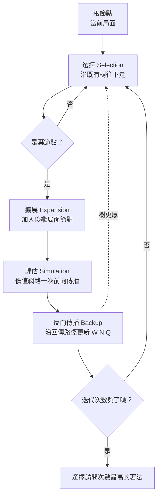

# 9.1 樹狀搜尋中的選擇、擴展、模擬與反向傳播

## 一個被誤解的名字

當 AlphaGo 的論文在 2016 年震撼世界時，大多數媒體的注意力都放在神經網路上，彷彿這場勝利完全屬於深度學習。但對演算法研究者而言，這場革命還有另一條同等重要並行不悖的線索：蒙地卡羅樹搜尋（Monte Carlo Tree Search，MCTS）的內部結構被徹底改造了。要理解 AlphaGo Zero 之後的系統為什麼如此強大，必須先拆開 MCTS 這部機器，看看它的四個齒輪——選擇（selection）、擴展（expansion）、模擬（simulation）與反向傳播（backup）——是如何咬合轉動的，以及神經網路究竟在哪幾個齒輪上做了替換。

MCTS 的本質很簡單：它不企圖窮舉博弈樹，而是反覆地「沿著樹往下走一步、長出一個新節點、估計它的價值、把價值沿原路傳回去」。每一次迭代都讓樹的統計資料更豐富一點，而數以千計的迭代堆疊起來，就形成一張經過取樣而非窮舉的局部地圖。AlphaGo 的天才之處，在於它並沒有發明新的搜尋框架，而是把框架中所有需要「人類先驗知識」的環節，全部換成了可學習的統計量。

## 第一步：選擇——從根走向葉

每一次迭代的起點都是根節點，也就是當前的實際局面。演算法沿著已存在的樹逐層往下走，每一層都面臨一個問題：這個節點下有這麼多子著法，該走哪一個？答案不是隨機的，也不是固定的，而是由一條著名的選擇規則給出，我們將在 9.2 節詳細展開。這裡只需要知道一件事：選擇規則在「已經證明自己好的分支」與「還沒被充分試過的分支」之間做權衡，前者傾向利用（exploitation），後者傾向探索（exploration）。

選擇階段持續進行，直到到達一個**葉節點**——也就是還沒被擴展過、或統計資料尚不足以支撐決策的節點。這裡必須引入一組關鍵的區分。**內部節點**是已經被造訪過、擁有完整統計紀錄的節點：它知道自己的每一個子節點被走過多少次、平均價值是多少。**葉節點**則是樹的邊界：它存在於樹中，但它的後繼局面還沒有被納入這張地圖。樹的生長，本質上就是葉節點一次次被推出去、被擴展成內部節點的過程。

選擇階段為什麼值得被稱為四步中的核心？因為它是一次迭代中唯一「決定資源流向」的環節。搜尋預算是有限的：給定時間，機器只能做數百到數萬次迭代。每一次迭代被引導到哪個分支，那個分支就獲得一次統計更新，樹就更可能在這裡生長。換言之，整棵樹的形狀不是配置出來的，而是由成千上萬次選擇決策**湧現**出來的。選擇品質差，樹就長歪；選擇品質好，即使在同樣的運算預算下，關鍵分支也會得到遠比其他分支深入的探勘。這正是後續所有改良集中火力攻擊的環節。

## 第二步：擴展——樹的生長點

到達葉節點之後，演算法把這個節點的所有合法後繼著法展開，加入樹中，成為新的葉節點集合。在古典 MCTS 中，擴展通常一次只加一個子節點，以避免在還沒有任何統計依據時就把整層攤開；這是一種把「未知」保留在小單位裡、逐次驗證的保守策略。

在神經網路引導的版本裡，擴展獲得了一個全新的意義。當新節點被建立時，系統立刻把它的局面送進神經網路，取得一對關鍵輸出：政策向量——即 $`P(s,a)`$ 所代表的每一個候選著法的先驗機率——以及價值估計 $`v(s)`$ 。前者為每一個尚未造訪的子節點賦予了一個「出生時的排序」，後者則給了這整個分支一個即時的價值錨點。這兩個數字，將在下一步與第三步中分別接管原本屬於隨機模擬的工作。

## 第三步：模擬——從數百步到一次前向傳播

模擬（或稱評估）是要回答一個問題：這個新局面到底好不好？古典 MCTS 的答案是「下完才知道」：從葉節點開始，用一個快速但粗糙的策略隨機落子，直到終局，再用勝負作為這次模擬的價值。這就是「蒙地卡羅」三個字的來源——用大量隨機對局的平均來逼近真實勝率的期望值。

這個設計在西洋棋與圍棋早期並行不悖地運作過，但有兩個成本高昂的缺點。第一，一次 rollout 可能要走幾百步才能分出勝負，而每一步都需要呼叫規則引擎生成局面；以西洋跳棋為例，這可能只要幾毫秒，但在圍棋裡每步都要反覆處理提子與劫的判定，開銷非常可觀。第二，隨機策略產生的終局估計雜訊極大：真正勝率 60% 的局面，一次次單次模擬可能在 20% 到 85% 之間劇烈擺動，需要大量的模擬才能平均出有意義的訊號。

名稱中「模擬」這一步的關鍵變革，正是把整段數百步的隨機對局，替換成晶片上的一次**前向傳播**。第 4 章介紹的價值網路在此接管了工作：網路直接輸出 $`v(s) \in [-1, 1]`$ ，表示從這個局面出發估計可得到的勝率期望值。這個替換的意義遠遠不止於省時間。一個訓練良好的價值網路，其單次估計的雜訊遠低於單次 rollout 的終局觀測，因為它不是在量測一個隨機事件的結果，而是在直接讀取一個經過數千萬局對局所訓練出的函數。速度與雜訊這兩個量的改善叠乘起來，等於每一次搜尋迭代獲得百倍有效的統計更新。在 AlphaGo 的工程實作裡，這使得樹中的每一次擴展都能在同時併行的硬體上得到即時評估，從而把整棵樹的訊息密度推到全新的數量級。

## 第四步：反向傳播——把資訊寫回整條路徑

最後一步是把剛得到的價值估計，沿著選擇階段走出的那條路徑，逐節點寫回。每個被經過的節點都會更新三份統計量：記為 $`W`$ 的累積價值總和、記為 $`N`$ 的造訪次數，以及由這兩者派生的平均價值 $`Q`$ 。以葉節點 $`s`$ 沿一條邊 $`a`$ 的統計為例，其更新規則可以寫成：

$$
N(s, a) \leftarrow N(s, a) + 1
$$

$$
W(s, a) \leftarrow W(s, a) + v
$$

$$
Q(s, a) = \frac{W(s, a)}{N(s, a)}
$$

這裡的 $`v`$ 所代表的，正是剛才由神經網路直接取得的價值，或——在尚未完全取代 rollout 的混合版本中——rollout 與網路評估的加權組合。反向傳播的精妙之處在於它的「路徑局部性」：這一次迭代得到的資訊只寫回走過的節點，樹的其他分支完全不受影響。這聽起來像是一種浪費，實際上卻是一種高度選擇性的記帳方式——它讓統計量保留了「這串著法曾經被嘗試過」的歷史，而不會被無關局面的取樣稀釋。

讀者會注意到這個字與深度學習的反向傳播（backpropagation）撞名，兩者確實在某些意義上同構：都是把一個下游的評估，沿著一條既定路徑逐層傳遞回上游。但 MCTS 的反向傳播不含可訓練的參數，它只是在更新統計快取；而神經網路的反向傳播是在更新權重。在 AlphaGo 的完整架構裡，這兩者共同運作：樹中的反向傳播把網路的評估寫回樹的統計，而訓練程序中的反向傳播則把樹的統計目標傳回網路權重。這條閉環，正是下一章要展開的主題。

## 四步的循環與樹的生長

現在可以把四步串成一個迴圈。整個搜尋過程沒有建立任何持久性的「剪枝清單」或「淘汰名單」，只在樹結構上不斷累積 $`W`$ 、 $`N`$ 與 $`Q`$ 三種統計量。換句話說，MCTS 對其他分支從來不下「確定不重要」的判決，只在「尚且不重要」的狀態下保留它們。這種保守性不是缺陷，而是對圍棋式長期模糊局面的誠實——任何一手今天看似平緩的棋，都可能在十步之後忽然展值為戰鬥的中心。樹若有機會繼續生長，那些看似休眠的分支隨時可能以新的統計證據翻案。

從根出發，選擇一條路徑走到葉，擴展出一組新節點，用網路取得即時價值，再把價值沿原路寫回。每執行一輪，樹就多一層局部知識，下一次選擇就有更好的依歸。這個迴圈重複數百到數千次後，根節點下每一個合法著法的 $`N`$ 與 $`Q`$ 都被塑造成一份經過取樣驗證的排序，機器便選出其中訪問次數或平均價值最高的一手，把實際局面推過去。

## 樹的記憶與跨手重用

MCTS 還有一個在教科書敘述裡容易被遺漏、但在對局工程上極為重要的性質：樹可以被重用。當機器完成數千次迭代、選定某一手落子之後，對手回覆的那一手，通常就是樹的根節點下已經存在的一個子節點。此時整棵樹不必丟棄——只要把根移動到這個子節點，其他無關的分支繼續保留，搜尋就帶著上一手累積的全部統計資料，接著往下生長。對手若走出查核清單之外的變化，舊樹即使大部分作廢，保留下來的部分仍然可以為新一輪迭代省下數百次的冷啟動成本。

這個重用性在時間分配上意義巨大。圍棋對局中真正值得深思的局部戰鬥，往往連續橫跨好幾手；如果每一步都從空白開始搜尋，等於把同一片戰場反覆重新認識。樹的重用讓知識有了跨越時間步的連續性，使運算預算可以像個會記帳的棋手那樣，把資源持續灌注在正在進行的戰線上，而不是每一步都把世界重新看一遍。古典 Alpha-Beta 程式同樣發展出了跨手保留搜尋視窗的技巧，但那是在剪枝架構下的小修小補；MCTS 的重用則是結構性的——統計本身就是樹的骨架，所以帶著骨架走，就是帶著知識走。

與此相關的另一個工程現實是平行化。第 5 章介紹過 AlphaGo 對局時調用了大量的 CPU 與 GPU：CPU 群用來平行跑樹的多個迭代，GPU 則用來批次處理神經網路的前向傳播。MCTS 的四步結構天然適合這種分工——選擇與反向傳播是對共享樹結構的輕量遍歷，可以由多個執行緒同時進行；模擬階段被網路接管後又恰好是可批次化的矩陣運算。換句話說，神經網路不僅提升了每一步迭代的品質，也把 MCTS 中最貴的環節搬到專門為它而生的硬體上。四步結構的「模組化」，是它能吃下平行硬體紅利的根本原因。

## 與第 1 章的兩張對照表

把這套機器與第 1 章的極小化極大與阿爾法貝塔剪枝並排放置，可以看得非常清楚。後者是全局確定性的：只要證明一個分支會被對手忽略，就在整個搜尋過程中永久擱置這個分支。這種裁決在西洋棋這類淺而尖銳的分支空間中極其高效，卻有一個致命的假設——評估函數的剪枝信賴在任何已經搜尋過的地方都值得被用來做全域裁決。圍棋的評估函數做不到這一點，於是這個假設整個崩塌。

MCTS 則徹底放棄了這種裁決權。它不做全域剪枝，任何人也不會因為某次取樣不利而被永久淘汰；它只是把有限的預算集中到最有希望的樹枝上，讓沒被造訪的節點保持「相對不重要」的狀態而非「確定不重要」的狀態。兩者的差異可以用一張表直接呈現：

| 對比項 | Alpha-Beta 剪枝（第 1 章） | MCTS（本章） |
| --- | --- | --- |
| 搜尋模式 | 系統性展開整棵樹 | 反覆取樣、統計累積 |
| 剪枝行為 | 全域確定式剪枝 | 不剪枝，預算自然集中 |
| 評估來源 | 人寫的評估函數 | 模擬或神經網路 |
| 中斷後可用 | 部分結果未必方便回退 | 任意時刻可中斷、立即可用 |
| 統計意義 | 適用於淺而尖銳的空間 | 適用於深而模糊的空間 |

表格中最後一列「任意時刻可中斷」所對應的概念，在演算法文獻中被稱為 **anytime** 演算法：無論在迭代一百次時被打斷，還是在一萬次時被打斷，它都能交出一份當前最好的答案。AlphaBeta 在時間壓力下出現的困境──剪枝到一半的分支既無法被信任、也難以匆忙收尾──在 MCTS 這種帳目更乾淨的結構下完全不存在。這不是一個小功能，而是工程上決定性的性質：實際對局中搜尋時間為何，是由時鐘決定的，而不是由理論決定的。

有一個觀念上的誤解需要在此點明：MCTS 的「不剪枝」並不等於它沒有偏好。相反地，正因為它沒有永久裁決的機制，選擇環節才必須承擔全部的引導責任——每一次迭代把預算送到哪裡，就等於在哪裡投下一票。因此整個演算法的品質，幾乎完全押在「選擇怎麼定」這一個問題上。這個問題的高明答案，並不只是一個工程細節，而是一條深刻而優雅的公式。它來自看似與下棋毫不相干的另一個領域——賭局與排隊論的數學，這一點本身就是本書反覆出現的主題又一次重演：一個領域的邊角工具，成為另一個領域的核心引擎。這正是下一節的主題。

## 本章小結

MCTS 不是一個新奇的發明，而是一個極度通用且乾淨的框架：選擇、擴展、模擬、反向傳播，四步構成一個可以被任意「評估函數」餵食的閉迴圈。古典 MCTS 用 rollout 餵它，神經網路版的 MCTS 用前向傳播餵它，而正是這次替換把每一步迭代的資訊量提升了百倍。但這個迴圈推翻了阿爾法貝塔的全域剪枝，也就必須另找一條精度更高的規則來填補空缺。這條規則的所有精華，都濃縮在一次選擇裡──每一次迭代中，機器要抬頭看一眼所有分支，然後把腳落在其中一個上面。這一「看」與一「踩」，就是接下來兩節的主題。
