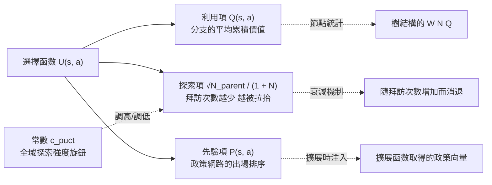
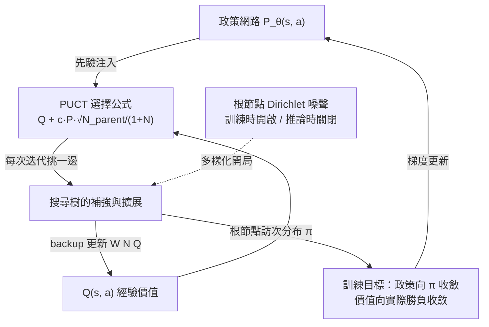

# 9.2 UCB 公式（PUCT）在神經網路引導下的改良

## 從吃角子老虎機說起

要理解 AlphaGo 的搜尋為何如此有效，必須先退回到一個看似與棋類毫無關係的經典問題：多臂老虎機（multi-armed bandit）。想像你站在一排吃角子老虎機前，每台機器的賠率分布未知，你只有有限的時間，該怎麼分配投幣，才能讓總收益最大？這個問題有兩個互相撕扯的目標。一是**利用**：把錢投到目前看起來賠率最好的那台機器。二是**探索**：偶爾試試別的機器，因為目前的「最好」可能只是抽樣運氣好。任何策略都必須在這兩者之間找到平衡，而失衡的代價在理論上是可量化的——它被稱為遺憾（regret），即你的策略相對於一開始就知道最佳機器的那個假想策略所損失的期望收益。

2002 年，Auer、Cesa-Bianchi 與 Fischer 等人發表了 UCB1（Upper Confidence Bound）演算法，給出一個華麗的答案：在每一步，選擇使以下值最大的機器：

$$
\bar{x}_i + c \sqrt{\frac{\ln n}{n_i}}
$$

這個公式的哲學直白而深刻：不要只看平均收益 $\bar{x}_i$ ，還要看它的**置信上界**。造訪次數 $n_i$ 少的機器，第二項（與 $\sqrt{\ln n / n_i}$ 成正比）就大，於是被自動拉抬成分數升高——「你還不了解我，所以請來試試我」。隨著造訪次數增加，第二項以 $n_i$ 的平方根速度衰減，機器必須靠第一項、也就是真實的平均收益，來保住自己的排名。Auer 等人證明，這個簡單規則的累積遺憾以對數速度增長，而對數增長在資訊上等於「你已經以最經濟的方式洞察了所有機器」。這是探索與利用權衡問題上最著名的理論成果之一。

## UCT：把 bandit 掛到樹上

四年之後，Kocsis 與 Szepesvári 在 2006 年的論文《Bandit based Monte-Carlo Planning》中邁出了關鍵的一步：既然 MCTS 每次迭代中的選擇階段，本質上就是一個 bandit 問題——在某節點下，你要決定把這次迭代「投幣」給哪一個子分支——那為什麼不直接把 UCB1 嵌進去？這個組合被命名為 UCT（Upper Confidence Bounds applied to Trees）。在 UCT 中，樹的每一個內部節點都被當成一個獨立的 bandit 實例管理：分支被選中的次數是 $n_i$ ，分支的累積價值經反向傳播後成為平均收益 $\bar{x}_i$ 。UCB1 的公式就在樹的每一層被重複執行，一次迭代沿路經過的每一層都做一次「bandit 決策」。

UCT 幽默之處在於，它把兩個原本分屬不同學科的成果「縫合」：蒙地卡羅取樣的真實勝率估計，搭上 bandit 理論中嚴格證明的借貸平衡規則。這道縫合線把 MCTS 從一個啟發式工具變成了一個有理論依託的演算法。在棋類社群立刻產生迴響——Fuego、Pachi、CrazyStone 等 MCTS 圍棋引擎在那幾年以驚人的速度刷新棋力紀錄，第 3 章描述的圍棋程式革命正是從這裡開始的。

## AlphaGo 的 PUCT：三個參數

然而 UCT 在 AlphaGo 迎戰的環境下有一個隱患。UCB1 是一個**頻率論的方法**：它必須累積足夠的抽樣統計，才能對每個分支穩定地形成平均收益。在圍棋的局面裡，每個節點下的合法分支高達數百個，而每次迭代預算有限，多數分支只會被造訪一次或幾次——此時以 $\bar{x}_i$ 為主體的打分幾乎沒有鑑別力，樹在很淺的地方就被大量「平權」地亂長。AlphaGo 的補救是在 UCB 中加入第三個參數 $P$ ，在 DeepMind 的論文中稱為 PUCT（Prior Upper Confidence bounds applied to Trees）：

$$
U(s, a) = Q(s, a) + c_{\text{puct}} \, P(s, a) \frac{\sqrt{N_{\text{parent}}}}{1 + N(s, a)}
$$

AlphaGo 在每一次迭代中，選出使 $U$ 最大的那條邊往下走。這條公式的三個組成部分，各自承擔完全不同的角色，值得逐一拆開：

| 項目 | 數學形式 | 源頭 | 意義 |
| --- | --- | --- | --- |
| 利用項 | $Q(s, a)$ | 樹上累積的反向傳播 | 這個分支目前被證明的評分 |
| 探索項 | $\sqrt{N_{\text{parent}}} / (1 + N(s, a))$ | UCB1 的平方根規則 | 還沒被充分試過的分支會被拉抬 |
| 先驗項 | $P(s, a)$ | 政策網路的一次前向傳播 | 網路對這條邊的直覺排序 |

## 從 UCT 到 PUCT：一張系譜表

把兩代公式並排在一起，改動其實驚人地小，意義卻是斷代性的：

| 對比項 | UCT（2006） | PUCT（2016-2017） |
| --- | --- | --- |
| 打分公式 | $\bar{x}_i + c\sqrt{\ln n / n_i}$ | $Q(s,a) + c_{\text{puct}} P(s,a) \sqrt{N_{\text{parent}}} / (1 + N(s,a))$ |
| 利用項來源 | rollout 終局勝負的平均 | 神經網路價值估計的反向傳播 |
| 探索項形式 | $c\sqrt{\ln n / n_i}$ | $c_{\text{puct}} P(s,a) \sqrt{N_{\text{parent}}} / (1 + N(s,a))$ |
| 冷啟動行為 | 無先驗，初期近乎隨機平權 | 先驗 $P(s,a)$ 立即排序 |
| 理論保證 | 對數遺憾（奧義成立於有限臂） | 無嚴格保證，靠先驗品質補位 |

這張表值得多看幾眼。第一列顯示，兩代公式共享同一個骨架：一個經驗項搭配一個隨造訪次數衰減的探索項。第二、三列顯示，神經網路不是替換了骨架，而是在骨架的每一個槽位上各塞了一份更好的原料——價值網路取代 rollout，政策網路填補冷啟動的真空。第四列則是工程上最直接的差異：在圍棋那種每節點數百個分支的環境裡，UCT 的初期行為近乎「亂槍打鳥」，而 PUCT 從第一步起就是有方向的。

最後一列看起來像是退步：UCT 有 Auer 等人背書的理論保證，PUCT 卻沒有同等嚴格的收斂結論。這正是本書反覆出現的主題在演算法層面的重演——工程有效性不等於理論優雅。在龐大到無法窮盡的狀態空間裡，任何 bandit 保證的假設（抽象自洽的臂集合、可無限重複取樣）都已經名存實亡；此時真正決定成敗的，是先驗的品質。既然反正沒有理論保證可依賴，不如把賭注押在可以不斷改進的先驗上。深度網路恰好是這樣一個可以持續改進的先驗源頭，而這筆交易的報酬，在 2016 年之後已經被對局結果反覆驗證。

$P$ 的作用：不用等統計就能排序

在 PUCT 的三個參數中， $P$ 是最革命性的。它的含義是：政策網路在這個局面的一次前向傳播中，對每一條候選著法輸出的機率。這個數字不需要任何樹上統計，只要在擴展節點時呼叫一次網路就能立即得到，而它恰好補上了 UCT 最薄弱的那一環——「初期誰比較可能更好」。

在純 UCT 中，被拜訪過一次的分支，其 $Q$ 只反映一次 rollout 的結果；兩個都只被拜訪過一次的分支，在選擇上幾乎無可分辨。於是寶貴的搜尋預算被浪費在缺乏資訊的平局上。有了 $P$ ，同一批分支從被擴展那一刻起就按網路的直覺排好序：一個 $P$ 很高的著法，即使 $Q$ 還是零，探索項也已經足以把它迅速帶入計算焦點；一個 $P$ 極低的著法，則要等到別的分支證明自己都失敗時才會被動地累積拜訪。換句話說， $P$ 把整棵樹的搜尋**冷啟動曲線**整體往前移：原本要幾百次拜訪才能浮現的樹形，如今在開場的十幾次拜訪內就現形。

值得注意的是 $P$ 進入公式的方式。它不是被加在 $Q$ 上面那樣簡單，而是乘在探索項那一側： $c_{\text{puct}} P \sqrt{N}/(1+N)$ 。這在數學上等於把「探索的折扣」乘以一個網路給出的折扣比——網路覺得這條邊愈可能，我們就愈願意在沒有樹上證據時多拜訪它。這是一種精巧的設計：先驗機率高並不直接綁架最終的選擇（樹上累積的 $Q$ 仍然有一票），但會大大改變「這條邊多快被充分試過」的速度。到穩定階段，誰勝出的最終判決權仍然在 $Q$ 手上。

## $N$ 的自然衰減：公式的內共振

PUCT 公式內含一個漂亮的自我節制機制，值得被明確指出。分母中的 $1 + N(s, a)$ 隨著拜訪次數增長而增大，而分子中的 $\sqrt{N_{\text{parent}}}$ 只是隨大局增長——因此探索項 $P\sqrt{N_{\text{parent}}}/(1+N)$ 在 $N$ 增加時**平緩但確定地**衰減。這意味著：

在搜尋初期，所有分支的 $N$ 都小，探索項主導打分，政策先驗 $P$ 幾乎獨自決定搜尋展開的方向；隨著迭代推進，被大量拜訪的分支其探索項逐漸消退，打分越來越由 $Q$ 主導，也就是由樹上累積的證據主導。整顆樹在一個動態下成長：初期具有頻率論的擴散性，後期收斂為深度學習的確定性。這兩個階段不是以程式中的 if-else 分界，而是自然而然地由 $N$ 的增長驅動。

讀者此時可能會問：那 $c_{\text{puct}}$ 呢？它排在三者之末，卻是工程師手上唯一真正可以調的旋鈕。把它調大，公式傾向於聽從先驗並廣泛撒網，搜尋更早展開更多分支，但深度可能不足；把它調小，公式傾向於深挖已經顯示價值的分支，但可能過早收斂、錯失真正的妙手。AlphaGo 論文中這個實值是通過自我對弈實驗校準出來的，而非理論推導——這是整個系統中少數仍帶有手工痕跡的參數之一。AlphaZero 延續了這個設定，MuZero 亦然，可見這個數字的高低，已被證明對三種遊戲都足夠穩健。一個旋鈕對付三種規則不同的遊戲，本身就是對公式結構正確性的強力佐證。

也很值得把 PUCT 與人類棋手的思考方式做個直覺對照。人類大師看盤面時，並不對所有著法平權著手：多年經驗讓他們一眼便知道哪些形勢值得深算、哪些可以略過——這正是先驗的天然形式。而當他們沿一條變化深入計算後，也會根據計算結果修正自己對那條分支的信心——這正是 $Q$ 的更新。PUCT 等於把這套「直覺安排計算、計算反饋修正直覺」的人類思考習慣，寫成了一行精確的數學。神經網路在這裡扮演的角色，正是塞繆爾在第 1 章所追求的那個「可以自我改進的評估直覺」，只是規模大了六個數量級。

## 根節點的 Dirichlet 噪聲

PUCT 中還有一個易被忽略但意義重大的細節：**只在根節點**注入的 Dirichlet 噪聲。在訓練期間，AlphaGo Zero 在根節點的先驗不再取自純網路輸出，而是取自以下混合：

$$
P(s, a) \leftarrow (1 - \epsilon) \, P_{\theta}(s, a) + \epsilon \, \eta \sim \mathrm{Dir}(\alpha)
$$

其中 $\eta$ 抽取自成參數為 $\alpha$ 的 Dirichlet 分布，實務上 $\epsilon$ 取約 0.25 （西洋棋取 0.3 ）、 $\alpha$ 與每步的合法著法數目成比例（例如圍棋取 0.03 ）。這種設計的精妙之處在於範圍的控制：噪聲只加在根節點，也就是**每一步真正要下出的那一層**，不污染下方的變化樹。它的作用是保證在自我對弈中，即使政策網路已經訓練到很強，開局的多樣性也不會枯竭，避免網路把自己的最強一手複製上千萬次、陷入「開局僵化」。在推論（正式對局）時，這個噪聲**完全關閉**，先驗回到純網路的乾淨輸出。訓練時開、上場時關——這個開關的對稱性，正是自我對弈作為一種「資料生成器」與正式對局作為一種「能力展示」在需求上的根本差異：前者要的是多樣的經驗樣本，後者要的是最高的著法品質。同一條公式，靠一個噪聲開關在兩種角色之間切換，不需要任何程式結構的改動。

## 學習與搜尋的耦合接口

理解了 PUCT 的工件結構，就能看清 AlphaGo Zero 之後整個系統的一個關鍵性質：政策網路的最終品質，並不是直接擬合人類棋譜或自我對局的勝負，而是擬合**搜尋樹的訪問次數分布**。樹上被反覆探勘的分支，反映了綜合先驗與價值證據之後的綜合判斷——這個判斷總是比網路一次前向傳播的直覺更可靠，因為它包含數百次迭代的算力投入。把這個更強的結果蒸餾回網路，等於把一整場運算的成果壓縮成一次前向傳播的直覺。下一輪自我對弈時，網路以更強的直覺啟動新的搜尋；搜尋再度超越網路；再蒸餾。這一來一往，就是「學習」與「搜尋」彼此推動的永動機。

把這一節收束起來：PUCT 不是一條普通的排序公式，而是整個 AlphaGo 架構的**核心接口**。這一邊，它把政策網路的先驗 $P$ 餵進搜尋樹，決定每一次迭代把預算送到哪一條邊上；另一邊，樹上累積的統計又被拿來當作訓練目標——以根節點的訪問次數分布 $\pi$ 為樣本，訓練政策網路向它加權靠攏。於是公式同時服務於兩件事：在搜尋中，它把網路的直覺轉換成有效分配的運算預算；在訓練中，它把搜尋運算的結果轉換成更好的網路直覺。接下來章節裡的每一個自我對弈迴路，都會在這條公式上立足。這不是一個巧合，而是**搜尋與學習真正耦合**的關鍵：網路引導搜尋，搜尋引導網路，而兩者的通信語言正是這一行公式。MuZero 從 AlphaZero 手中繼承的，是同一個接口而只是換了新的低層狀態描述；可見它是這個時代的搜尋演算法真正的骨骼。

## 本章小結

從 bandit 的 UCB1、樹上的 UCT、到神經網路引導的 PUCT，這條公式演化路線描繪了一個方向的變遷：**排序的依據從純統計，變成統計與先驗的混合**。 $Q$ 代表樹上實證的證據， $P$ 代表網路先驗的直覺， $\sqrt{N}$ 與 $1+N$ 代表造訪次數的衰減節奏， $c_{\text{puct}}$ 是工程師手上唯一的旋鈕——各就其位，而沒有任何一個參數可以同時扮演多個角色。這是最完美的公式之美：數個成份交互拉扯，整體上在一個鮮明的動態下自我修正。更重要的是，這同時把搜尋與學習以一條合約綁定在一起，構成了整個 AlphaGo 架構真正的骨骼。回頭看這條系譜，還有一個令人玩味的細節：從 UCB1 到 PUCT，數學上被改動的只是「加進一個乘法因子 $P$ 」，但正是這個小小的改動，把一個依賴統計累積的頻率論演算法，變成了一個依賴學習成果的先驗引導演算法。公式沒有變大多少，問題的性質卻整個翻轉了。這再次提醒我們：演算法史上的重大躍遷，往往不是靠推翻原有的結構，而是靠找出結構中最薄弱的那一環，然後用一個更好的部件換掉它。MCTS 的骨架在 2006 年就已經立好，等到 2016 年，人們才終於找到了餵飽它的那個部件。
