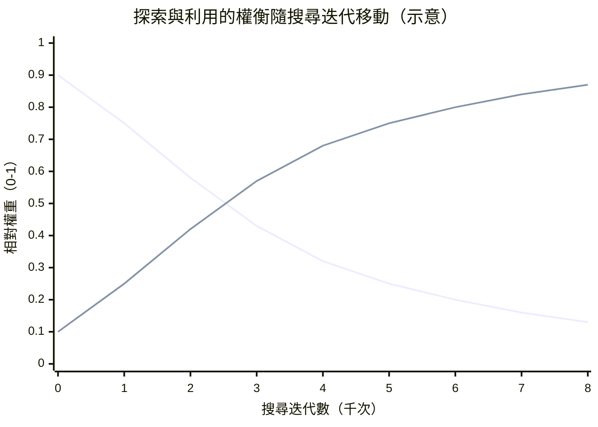

# 9.3 探索與利用（Exploration vs. Exploitation）的完美平衡（2017-2020）

## 一個比決策學更老的問題

探索與利用的對立，是人類面對不確定環境時最古老的一對張力。去常去的那家餐廳，還是試試街角新開的那一家？走熟練的通勤路線，還是繞一條可能更快的路？前者穩定地從已知中收穫，後者花費成本去換取可能的資訊與機會。在決策理論中，這對張力被精確化為一個單一問題：當收益分布未知時，一個有限預算的策略應該如何在「榨取當前最佳估計」與「收集能改善估計的資訊」之間分配它的每一筆投入。

本書至此已處理過這個問題的幾個版本。塞繆爾的跳棋程式在調整評估函數時面對它；深藍的開局庫背後有它；而在上一節，我們看到 UCB1 用一條公式給出了它在 bandit 問題上的最著名答案。但 MCTS 把這個問題提升到了一個全新的尺度：在 bandit 裡，你的「臂」是給定的幾十台機器；在 MCTS 裡，你的「臂」是樹上成千上萬的分支，而且每走到一層，臂的集合還會不斷裂解、再生。前一節的 PUCT 公式，正是在這個尺度下重新解決這對張力的嘗試。本節要做的事，是退後一步，把「平衡」本身當作觀察對象——看看這個系統如何自我平衡，平衡點如何隨時代與硬體移動，以及當理論保證失效時，是什麼接替了它的位置。

## 在 MCTS 中，探索是隱式的

一個常見的誤解是：在 MCTS 中，探索需要一個專門的「探索階段」，與利用階段交替執行，像某些強化學習演算法中以機率 $`\epsilon`$ 隨機行動那樣。實際上並非如此。在 PUCT 公式裡，探索從來不是一個獨立的行為，而是被打分公式的結構**隱式地承擔**了：只要一條分支的 $`N(s,a)`$ 落後於它父節點的 $`\sqrt{N_{\text{parent}}}`$ 增長，探索項就會持續偏置它；一旦它被充分拜訪，偏置就自動消退。探索不需要安排時間表，因為訪問次數本身就是時間表。

這種隱式控制有一個非常優雅的性質：它隨著證據的成熟自動地從探索主導滑向利用主導，中間沒有任何階段切換的程式碼。搜尋初期，樹淺、統計薄，公式的分數幾乎由 $`P`$ 與探索項主導，行為像是廣撒網；隨著迭代累積， $`Q`$ 的可信度上升，經過充分驗證的分支逐漸取得主導，行為像是深掘井。一個單一而連續的打分函數，同時涵蓋了兩種截然不同甚至互相矛盾的策略人格，而兩者之間的交棒是連續的、不可分割的。

這條示意曲線值得仔細讀。兩條線的交叉點落在迭代中期，此時先驗排序、樹上證據與探索張力大致等權——這正是搜尋過程中「形勢判斷最不確定」的階段，也是一局棋中最容易走出人類難以理解之手的階段。AlphaGo 在第二局下出讓人類棋界為之震動的 Move 37 這類著法，其時代背景正是這種以探索先驗引導為主的搜尋行為：一條分支如果在政策網路中不被看好，卻在樹上持續顯示價值，它就能以足夠的訪問數量翻案——這是純利用策略永遠做不到的事。

## 自我平衡的機制

更深入的觀察是：PUCT 的平衡並不是靜態的配比，而是一個有負回饋回路的動態系統。考慮一條被高估的分支——比如先驗機率被政策網路高估，或運氣眷顧了前幾次價值估計。它會在初期吸納不成比例的訪問次數。但每一次訪問都帶來新的統計， $`Q`$ 被不斷以新證據重灌；同時它的探索項因 $`N(s,a)`$ 增加而衰減。兩股力量同時作用，分支的評分被逐漸校正並攤薄。反過來，一條被低估的分支——先驗低、或前期價值估計不幸——不會因此鎖死，因為只要父節點的總訪問 $`N_{\text{parent}}`$ 在增長，它那條 $`\sqrt{N_{\text{parent}}}/(1+N(s,a))`$ 就會緩慢把它的分數往上墊，直到獲得足以翻案的資源。

再考慮這個機制在**多分支間**的表現：所有分支共享同一個父節點的 $`\sqrt{N_{\text{parent}}}`$ ，所以分子對每一條邊都相同；競爭的關鍵落在分母的 $`N(s,a)`$ 與 $`P`$ 上。換句話說，公式在平面上做的是「**按先驗分配訪問次數**」的事：最終每條分支獲得的訪問比例，大致正比於先驗機率乘上某些修正項，而訪問比例又反過來決定誤差的收斂速度。這是這條公式真正的天才之處——它讓誤差大、不確定性高的分支多得到注意力，讓已經收斂的分支不再吸入無謂的算力。整棵樹在統計意義上像一個自動配置預算的投資組合，而這一切不需要任何額外的程式碼。

在自我對弈的構造下，這個自我平衡系統又多了一層外部控制器。每一局對弈結束後，樹上累積的訪問分布被拿去訓練政策網路，把當時最優先被計算的著法壓縮進新的先驗中；然後下一局、下一手，新的先驗又從一個更強的起點跑樹。於是「平衡」不再只在一次搜尋之內發生——它也跨局演化。搜尋把網路拉向更強的排序，網路把下一輪搜尋拉向更準的先驗，探索張力則確保過程不會塌縮在局部。三者的合力，使得平衡點本身也在移動，而移動的方向是整體棋力的提升。

## 訓練與推論的差異

同一台機器，在訓練與對局兩種角色下，走的卻是不同的平衡曲線，這是 AlphaGo Zero 之後最值得注意的工程決策之一。訓練期間，根節點的 Dirichlet 噪聲被開啟：先驗被隨機混入一份成分隨機的偏置，使得即使政策網路早已高度分化，多數分支在每一手仍然有非零的入場機會。更深一層，訓練期間的自我對弈會在達到溫度控制條件時，按訪問分布的軟化版本（加上溫度參數 $`\tau`$ ）取樣落子，而不是每次都選 $`N`$ 最高的一手。換句話說，訓練系統在刻意**降低其最優策略的確定性**，以保證經驗流的多樣性、避免自我對弈收縮到同一條主線的循環。

到了正式對局（推論），一切反轉。噪聲關閉，溫度歸零，落子規則退化成「選擇訪問次數最高的著法」。搜尋不再肩負生成資料的責任，它只需要一件事：在每一手用盡預算，交出當前最有證據支持的判斷。同一條 PUCT 公式，同一顆樹，同一個網路，卻因為兩個開關而呈現完全不同的行為策略。讀者可以把這組對照理解為決策系統的兩種人格：一個是多樣性至上的學習者，一個是確定性至上的執行者；而它們共享同一套底層機制。這也解釋了為什麼 AlphaGo Zero 的對局中人類棋手常感到它的著法「幾乎不可動搖」——因為在推論模式下，這棵樹的全部統計資源都在證明同一個結論。

## 當理論保證失效，取而代之的是什麼

回到上一節鋪陳的那條線索：UCT 在 bandit 理論中享有一個漂亮的結論——在固定數量、獨立同分布的臂下，它的累積遺憾以對數速度增長，也就是說它的探索成本是漸近最優的。但把這個結論移植到棋盤上，必須先問：假設還成立嗎？臂的集合是固定的嗎？顯然不是。樹在增長，分支在裂解，「臂」的總數隨深度指數擴張；分支的價值也非獨立同分布——兄弟分支的價值由同一局對局的規則綁在一起；而 MCTS 的預算遠不足以把任何一條分支的估計收斂到理論平台。嚴格地說，在 $`10^{170}`$ 量級的狀態空間裡，任何 bandit 理論的保證都已是美麗的裝飾，而非可靠的承諾。

那麼是什麼接替了理論保證的位置？答案是**先驗的品質**。當探索與利用無法在足夠多次取樣後靠統計證據收斂時，決定局勢的不再是取樣的理論效率，而是你在開始取樣前帶進來的那份直覺有多準。如果政策網路把真正的妙手排在前列，PUCT 可以在最少的迭代中把算力送到關鍵分支，搜尋就像是一把精準的鏟刀；如果先驗把妙手排得太平庸，再高的迭代數也救不了整棵樹。這就是為什麼 AlphaGo Zero 中政策與價值頭的品質提升，被換算成「同樣搜尋強度下的棋力提升」，也為什麼 MuZero 寧可允許模型學得不精確，也要把先驗訊號對準決策相關的部分。

在這個意義下，深度網路時代的取捨可以一句話說清：**以可學習的先驗，取代不再有效的理論保證**。理論保證在 2006 年把 MCTS 送到大家的桌面上，讓人相信這條路是可行的；而 2017 年之後，真正把棋力推上天花板的，是一個沒有理論背書、卻被實戰反覆驗證的公式與一片被訓練到極致的先驗。這並非理論的失敗，而是理論誠實地標出自己的邊界之後，工程接手了剩下的事。

## 工程上的極度有效：沒有保證卻屢屢奏效

理論上的落空，日常經驗上的強勁表現，兩者的落差必須有一個說得通的理由。這個理由至少有三條腿。第一，**一次搜尋之內的誤差會被同一棵樹的另一處吸收**：即使某條分支的 $`Q`$ 收斂得很慢，只要先驗把它放在前排，它每一手都會被重新走過一遍，訪問證據會在跨手的重用與跨局的重訓中持續累積——時間尺度被放大到整個訓練生命週期，理論上「不收斂」的分支在工程時間上往往是收斂的。第二，**誤差的方向不是隨機的**：深度網路的先驗誤差有其結構，自我對弈閉環會在每個局末把真實勝負的梯度注入價值頭，把最常被訪問的分叉口的排序率先矯正，這種「重點區域優先修復」的模式使得大誤差先被清掉，留下的小誤差在實戰中不構成勝負差。第三，**成本可攤提**：一次搜尋的失誤代價僅是一手棋，而下一次搜尋從殘留的樹與更新過的網路出發，錯誤會被系統性地重估而不是被攜帶下去。

從這三條腿可以看出，為什麼許多研究者最初對 AlphaGo Zero 的成果抱持懷疑——它放棄了 roll-out、放棄了人類棋譜、放棄了理論保證，一切只剩下一條公式與一次前向傳播——而最終贏得這場辯論的，不是某一份更精細的證明，而是三天之後那個 100 比 0 的自我對弈結果。工程有效性在此完成了一次漂亮的示範：它不否認理論的價值，它只是不等理論。

## 2017-2020：平衡的精修年代

從 2017 到 2020，這條平衡公式的具體參數經歷了一輪精修。AlphaGo Zero 在圍棋上把 $`c_{\text{puct}}`$ 和 Dirichlet 參數與棋盤自由度連動；AlphaZero 把同樣結構搬到西洋棋與將棋，並證明噪聲強度與溫度需要按遊戲的分支因子重新校準，但公式形態完全不動；MuZero 則是在沒有真規則可言的狀態模型上重新跑同一套思維，第 8 章的標題「連規則都不用教」在某種意義上，正是這條探索平衡公式成熟到不再依賴任何領域知識的證明。這幾年出現的公開與衍生實作——包括 AlphaZero 論文的社群重啟與 Leela Zero、KataGo 等圍棋引擎——在全球愛好者間反覆確認同一件事：這條平衡是穩定的，結構是可遷移的，而最後的幾個參數每一位實作都得自己靠對局校準一次。

把這個時期的經驗合起來，這個平衡可以整理成一張小表：

| 場景 | 探索通路 | 利用通路 | 主要差異 |
| --- | --- | --- | --- |
| 訓練期的自我對弈 | 根節點 Dirichlet 噪聲、軟化取樣 | $`Q`$ 與搜尋統計 | 需要多樣性，容忍雜訊 |
| 正式推論 | 噪聲關閉、溫度趨零 | 訪問次數最大者落子 | 需要確定性，使用全部預算 |
| 跨遊戲遷移 | 噪聲與分支因子連動 | 公式形態不變 | 只重校參數，不重寫結構 |

## 與 bandit 理論的最後一點聯繫

平衡定理的失效並不等於 bandit 理論失去了話語權。它以另一種形式留在這個系統裡：PUCT 公式的**形態**本身，就是 UCB1 的形態——一個經驗項搭配一個以平方根速率衰減的置信加成，這個形態繼承自一條被嚴格證明的規則。理論的保證雖然在極端規模下失效，但它制定的**結構**被完整保留了下來，成為工程得以穩定運作的骨架。這是理論在應用中最高貴的一種命運：它提出的承諾被現實折衷，它揭示的結構卻成了現實的地基。

有一個平行的歷史足跡可以佐證。第 1 章的阿爾法貝塔剪枝理論，其最壞情況與最好情況之間的天壤之別，關鍵在於著法排序的品質——而這個排序早年被人工啟發式掌控，後來被歷史啟發式、殺手啟發式這類從搜尋自身經驗中學習的機制所接管。同樣的戲碼在 MCTS 上重演：理論框架不變，框架中的品質變數由人工直覺換成深度網路。兩條線索跨過六十年遙相呼應，本書似乎一直在告訴同一個故事的兩個版本。

## 本章小結

探索與利用的平衡，是整個 MCTS 故事中最抽象、卻也最好用的遺產。在 bandit 的世界裡，這對張力有優雅的理論封頂；到了棋盤尺度，理論保證讓位，取而代之的是一個由先驗引導、由訪問次數調節、由學習閉環推動的自我平衡機制。它沒有辦法被證明最優，卻能被證明可用、可遷移，並在 2017 到 2020 年間從圍棋游到西洋棋，再到 Atari 的像素世界。一對古老的哲學張力，最終被封裝在短短一行公式的三個數字裡。這也是本書想留給讀者的另一個視角：優雅的理論啟動方向，務實的工程完成交棒，而歷史把掌聲平均地分給了兩者。
