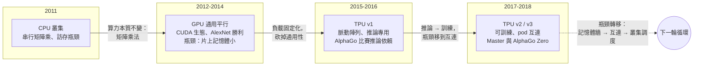

# 10.1 矩陣運算與深度學習加速器的崛起（2011-2017）

## 算力的本質：一切都是矩陣乘法

要理解 AlphaGo 為什麼必須生在一個硬體恰好成熟的年代，得先回答一個看似平凡的問題：一個深度神經網路的前向傳播，到底是什麼樣的計算？答案很樸素——它幾乎全是由矩陣乘法與卷積構成的。一個卷積層把輸入特徵圖與多組濾波器做滑動窗口的乘加運算，而這種運算在實作上可以被改寫成一次大型矩陣乘法；全連接層更不用說，本身就是 $ y = Wx + b $ 的形式，其中 $ W $ 是一個權重矩陣。換句話說，深度學習的計算結構單一到令人驚訝：同樣的乘加操作，在巨大的資料量上重複億萬次，彼此之間幾乎沒有依賴。

這種「規則簡單、資料巨大、高度並行」的負載，恰好是硬體設計者夢寐以求的形狀。一個乘加單元一小時做一千萬次，沒有任何理由不能同時放上萬個乘加單元讓它們一起做。理論上的加速上限，可以用下面的式子粗略刻畫：

$$
\text{吞吐量增益} \approx \frac{\text{並行乘加單元數} \times \text{單元頻率}}{\text{記憶體可供給資料的速率}}
$$

分母正是問題所在。矩陣乘法中每個權重會被反覆使用，但每次使用都需要從記憶體把資料搬進計算單元；當計算單元的總算力成長速度遠超過記憶體頻寬的成長速度（這是 2010 年代初摩爾定律演化的實際狀況），瓶頸就從「算不夠快」轉移到「資料餵不進來」。這就是所謂的**記憶體牆**：許多深度學習負載在理想實作下呈現的性質，更接近訪存密集而非計算密集。誰能在片上放更多資料、誰的資料通路更寬，誰就贏——這一點決定了後面十年加速器設計的主旋律。

## GPU：從圖形流水線到通用平行

第一個抓住這個機會的，不是為神經網路而生的晶片，而是顯示卡。GPU 的原生意圖是圖形渲染：把數百萬個頂點與像素，用同一組著色程式平行地變換與著色。工程師很早就發現，這種**大量執行緒對大量資料做相同操作**的架構，本質上就是一台科學計算機器。2007 年 NVIDIA 推出 CUDA，把這條路走通了——開發者可以用接近 C 語言的方式，把計算任務拆成成千上萬個執行緒丟給 GPU。起初的用戶是氣象模擬與分子動力學，直到神經網路研究者意識到：反向傳播恰好也是矩陣乘法的組合，GPU 完全吃得下。

轉折點發生在 2012 年。Krizhevsky、Sutskever 與 Hinton 的 AlexNet 用兩張 GTX 580 GPU 訓練一個深層卷積網路，在 ImageNet 影像辨識競賽上把錯誤率從前一年的約 $ 26\% $ 一舉壓到 $ 15\% $ 出頭，甩開第二名一大截。這場勝利的重要性怎麼強調都不為過：它同時證明了三件事——深層卷積網路是真的、大資料是有用的、以及**GPU 是讓兩者咬合起來的關鍵槓桿**。此後整個深度學習社群的預設訓練平台變成了 GPU，NVIDIA 的資料中心業務也從此起飛。到了 2015-2016 年，用多張 GPU 訓練大型網路已是標準做法，Google 團隊訓練 AlphaGo 的前代網路時，用的正是這套基礎設施。

還有一個常被忽略的細節：矩陣乘法的效率高度依賴**批次大小**。一次只算一個樣本的前向傳播，矩陣是矮胖的，算術強度低，算力大量閒置在等待資料；把一百個局面堆成一個大批次，矩陣變得方而大，每搬一位元組的資料可以換取更多的乘加，硬體利用效率隨之陡升。這個性質在後面將反覆出現：AlphaGo 把樹搜尋中待評估的葉節點打包成批次送往推論叢集，正是在替加速器的矩陣單元「湧入足夠的工作」。硬體的特性如此，演算法就被迫長成能夠批次化的形狀——這是共演化在微觀層面的第一個證據。

## 專用加速器：TPU 的登場

但 GPU 畢竟是為圖形設計的通用平行機器，為了渲染它攜帶了許多神經網路用不到的部分：複雜的紋理單元、為隨機訪存設計的多級快取、以及相對有限的片上記憶體。當矩陣乘法成為資料中心最主流的負載時，「只做矩陣乘法、做到極致」的專用晶片就有了存在理由。Google 在內部觀察到，2013 年前後語音辨識模型的推論需求幾乎要吃掉一倍資料中心擴建預算，於是決定自研晶片。2015 年部署的第一代 **TPU（Tensor Processing Unit）** 是一個純粹的推論加速器：它把整個晶片的主要面積讓給一個巨大的**脈動陣列（systolic array）**——一個 $ 256 \times 256 $ 的乘加單元網格，資料像心臟泵血一樣在相鄰單元間流動，每次流動都順路完成一次乘加。它搭配超大容量的片上記憶體，把「記憶體牆」的問題用蠻力繞開。

TPU v1 只做推論，不做訓練。訓練需要的不只是前向傳播，還有反向傳播中的梯度累加與參數更新，以及多顆晶片之間的高速互連。2017 年發表、並在 2018 年論文中正式公開的第二代與第三代 TPU 補上了這一塊：v2 引入了可用於訓練的浮點矩陣單元與高頻寬互連（多顆晶片可組成支援資料並行與模型並行的 pod），v3 把脈動陣列加倍、增加記憶體頻寬，並引入液冷。到了 2018 年，一個 TPU pod 已經能容納上千顆晶片協同訓練一個模型——這正是 AlphaZero 式訓練所需要的機器。

## 硬體作為 AlphaGo 的物理前提

現在把鏡頭拉回 2016 年 3 月的首爾。AlphaGo 在對局中的時間預算是每手最多數十秒——這不是刻意放水，而是規則與職業棋手的節奏所決定的。在數十秒內，系統要完成數百次以上的 MCTS 迭代，每次迭代都包含數十次神經網路推論。把帳算出來就會明白，若單次推論延遲是 $ \Delta t $ ，每次搜尋迭代平均需要 $ K $ 次推論，則單機串行所能達到的迭代次數只有 $ 30 / (K \Delta t) $ 的量級；要做到數百次迭代，唯有把推論批次化並行發送。這就是硬體的角色：**它不改變演算法的正確性，它決定演算法在比賽規則內能不能跑完**。

| 對局階段 | 所需能力 | 硬體依賴 |
|---|---|---|
| 單手搜尋（數十秒） | 高頻寬批次推論、低尾延遲 | 推論叢集必須即時待命 |
| 大批次矩陣乘法 | 片上大記憶體、高算力密度 | TPU 脈動陣列契合此形狀 |
| 樹統計的一致更新 | 低延遲互連 | 資料中心網路基礎設施 |
| 賽後繼續訓練與測試 | 大規模吞吐 | 數百顆晶片量級的持續運行 |

根據 DeepMind 團隊的公開說明，2016 年比賽版本的情況是：實際比賽（如對李世乭的五番棋與後來的對弈交換）期間，對局系統運行在**單機多 GPU 的設備**上，而網路推論背後依賴的是部署在 Google 資料中心的 **TPU**；到 2017 年的 Master 連勝以及 AlphaGo Zero 的訓練，使用的已是第二代 TPU。這一條時間線本身就是產業史的縮影：從「湊合用通用晶片」到「演算法與晶片一起設計」，只花了一年多。

## 硬體與演算法的共演化

硬體並不只是被動地「支撐」演算法，兩者關係更像一段互相拉扯的共同演化。2016 年之前的圍棋程式（包括 early AlphaGo 的原始版本）依賴大量 **rollout**——用快速隨機策略把棋局走到終局來估計形勢，這種方法對硬體的算力形狀要求分散且混亂。當網路評估變得夠便宜，rollout 就被價值網路取代；評估成本從「每步幾十毫秒的多次推論」降為「一次批量推論」，等效搜尋深度立刻翻倍。搜尋深度的倍增意味著棋力的躍升，而棋力躍升又鼓舞團隊投入更多硬體去訓練更深的網路，回頭又讓評估更準、搜尋更值得花。這個正回饋迴圈，是 AlphaGo 在 2016 到 2017 年間實力突飛猛進的真正動力，而迴圈裡每一圈都由年度的硬體升級擰緊一格。

## 兩條路徑：深藍的 ASIC 與 TPU 的世界觀

把 1997 年的深藍拿來對照，可以看得更清楚。深藍的核心是為西洋棋評估函數量身定做的 **ASIC**：它把「每個棋子的位置價值表、攻防關係判定」直接鑄進電路裡，讓一座晶片每秒評估數百萬個局面。這是一條「**知識進硬體**」的路徑——領域知識被固化在矽裡，換一個遊戲就幾乎要重畫晶片。TPU 走的是完全不同的路：它不改任何領域知識，它只是把「矩陣乘法」這個中立的原語做到極致，而把知識全部留給**可訓練的權重**。深藍的晶片諳熟西洋棋卻對圍棋一無所知，TPU 則對西洋棋、圍棋、將棋乃至下一個任務一視同仁。

| 維度 | 深藍 ASIC（1997） | GPU（2012-2016） | TPU v1-v3（2015-2018） |
|---|---|---|---|
| 設計哲學 | 領域知識固化進電路 | 通用平行、為圖形而生 | 中立原語（矩陣乘）做到極致 |
| 可編程性 | 幾乎不可編程、換遊戲需重做 | 高（CUDA 軟體生態） | 中（編譯器映射到脈動陣列） |
| 適用負載 | 西洋棋 alpha-beta 搜尋 | 廣泛的平行計算、DL 訓練與推論 | 大規模 DNN 推論，後及訓練 |
| 對 AlphaGo / Zero | 無關（路徑不同） | 比賽版本之單機多 GPU 設備 | 推論骨幹，Zero 訓練主力 |
| 共同的瓶頸 | 沒有（知識夠用） | 記憶體頻寬相對低 | 互連頻寬、規模成本 |

這組對照揭示了本章想留下的核心判斷：**硬體的勝利不在於更快，而在於選對了不變量**。深藍押注「西洋棋的知識結構不變」，贏了一場比賽；TPU 押注「矩陣乘法作為計算原語不變」，贏了一個十年。AlphaGo 能在首爾每手只思考數十秒，AlphaZero 能在三天內從零學會圍棋，背後都不是單一晶片的功勞，而是「可並行的矩陣運算 + 記憶體層次明智的加速器 + 能把上千顆晶片當一台機器用的基礎設施」三者的合成。接下來一節，我們把鏡頭轉向訓練端，看 AlphaZero 這種強化學習系統，如何把硬體需求推到一個全新的維度。
