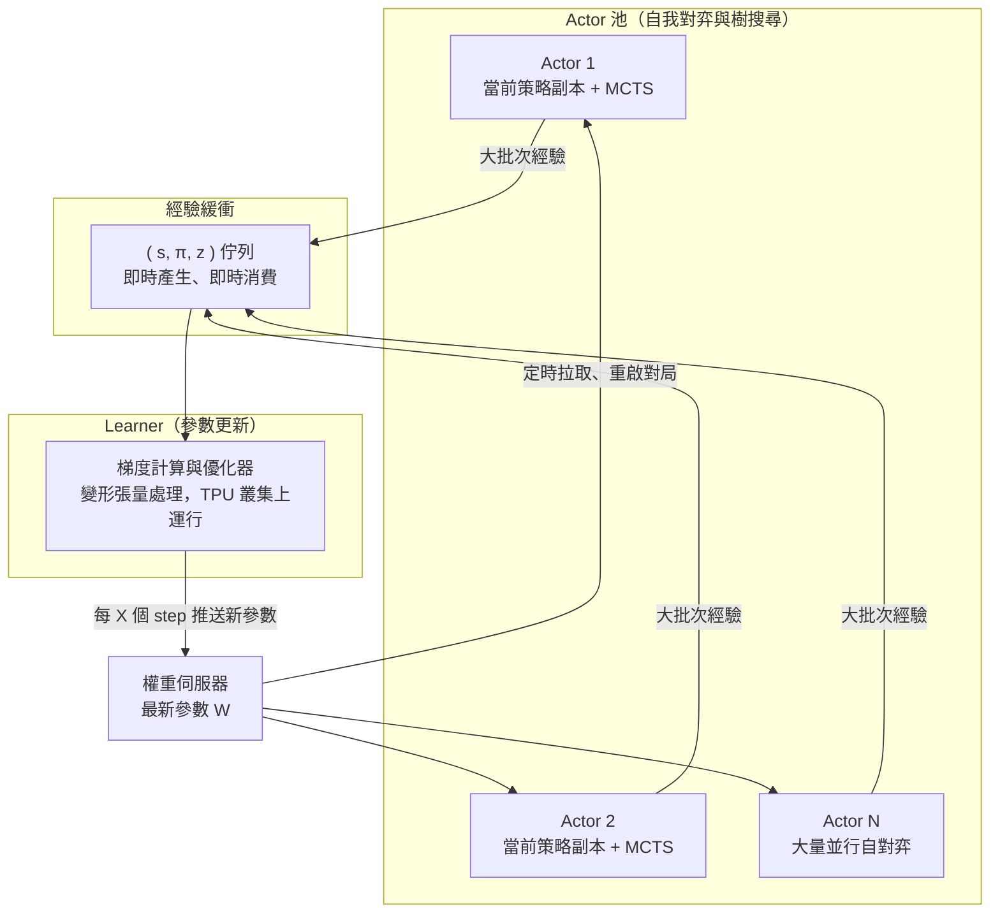
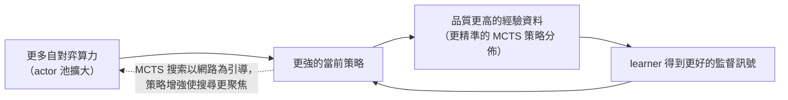

# 10.2 訓練大規模強化學習模型的硬體架構挑戰（2017-2019）

## 從推論到訓練：問題的難度換了一個量級

上一節把鏡頭停在 2016 年的比賽推論上，但如果只看推論，就看不到 AlphaZero 的真正野心。比賽時的 AlphaGo 只需要「用一個已經訓練好的網路快速思考」；而 2017 年的 AlphaGo Zero ——以及稍後的 AlphaZero——要的是「從隨機初始化出發，在幾天內自主地把一個網路訓練成超級棋手」。這兩件事對硬體的要求不是同一個數量級：訓練意味著反向傳播、梯度累加、參數同步，以及最重要的——一條源源不絕的新鮮訓練資料流。推論可以是短跑，訓練是馬拉松。

DeepMind 團隊在 2017 年的論文中描述了支撐這種訓練的分散式架構。它的骨幹思想叫 **actor-learner**：把「產生經驗」與「更新參數」兩件事拆成兩種角色，分別用不同的硬體資源去餵飽。這個拆分本身，就是強化學習系統設計的核心經濟學，值得花一節的篇幅細看。

## Actor-Learner：資料的生產線與加工廠

在這套架構中，一個鮮為人注意但至關重要的工程問題是**參數的保鮮度**。actor 手上的策略副本與 learner 手上的最新參數之間，永遠存在落後：網路每更新一次，所有 actor 都要設法取得新版本，否則它們仍在用舊腦袋下棋。刷新太頻繁，架構會把一切時間花在值傳輸上；刷新太緩慢，訓練訊號便帶有過大的系統性偏誤。AlphaZero 團隊把這個取捨做成了顯式參數：learner 攢夠一小批梯度才推送一次權重，actor 在每一局開始時拉取當前版本並在整局內固定使用——這正是整套系統在新舊資訊之間取得的折衷。

在這套架構中，**actor** 的職責是自我對弈。每個 actor 持有一份當前策略網路的副本，在棋盤上與自己（或其他 actor 的版本）對弈，同時在每一步執行一次 MCTS 搜尋。它的產出不是棋局勝負本身，而是豐富的訓練訊號：每一步棋局狀態、MCTS 搜索後的策略分佈（作為政策目標）、以及終局結果（作為價值目標）。這些三元組 $( s, \pi, z ) 一批批地被送進佇列，等待被消費。

**learner** 則是加工廠。它持續從佇列拉取這些經驗，計算損失、做梯度下降，把更新過的參數廣播回去。actor 拿到新參數後重啟自我對弈，於是下一批經驗就由一個稍強的策略產生。整個系統的循環如下圖所示：

注意關鍵的一個約束：**訓練資料必須由當前策略即時產生，不能離線重放**。這與監督學習的世界觀截然不同。监督學習有一個固定的資料集，訓練十個 epoch 是反覆咀嚼同一批樣本，資料可以在磁碟上冷凍、快取、隨意取用。但強化學習的資料答案取決於「產生它的那個策略」——用十天前還很弱的策略產生的棋譜，喂給今天已經變強的網路，引導訊號就是錯位的。所以 actor 必須不停地跑，資料像牛奶一樣只有幾小時的保鮮期。

## 規模的事實：多少晶片，多少天

現在把規模講清楚，並且要說得保守。根據 AlphaZero 團隊在 2017-2018 年論文中的訓練曲線與硬體描述，訓練規模大致是這樣的：西洋棋與將棋的完整訓練**只需要幾個小時**，圍棋需要**約數天**。這個速度遠非單機能達成，背後是 **TPU 叢集上數百到數千顆晶片量級的並行**——actor 端大量並行自對弈產生經驗，learner 端把更新做在 TPU pod 上。值得注意的是，論文中對具體晶片數量的表述在不同版本與媒體轉述之間並不完全一致，我們能夠穩妥陳述的是量級而非精確數字；讀者應把它理解成「千顆量級的加速器協同工作數小時到數天」，而不是某個精確的組態。

| 遊戲 | 訓練時長（AlphaZero, 2017-2018 論文） | 訓練量描述 |
|---|---|---|
| 西洋棋 | 約 4 小時 | 數百萬盤自對弈 |
| 將棋 | 約 2 小時 | 數百萬盤自對弈 |
| 圍棋 | 約 3 天 | 更深的搜尋與更長的對局 |

若把這個表翻譯成硬體的語言：西洋棋用約 $`4`$ 小時達到超越 Stockfish 的棋力，等於在幾小時內完成「數百萬盤完整對局 + 每步一次 MCTS + 全程梯度更新」的總工作量。這個總量如果不拆到上千顆加速器上，用單機去跑，時間會膨脹到以年計——這不是效率調優能解決的問題，而是數量級的差距。表格中的三個遊戲時長差異也有啟發：圍棋更慢，不是因為演算法不通用了，而是因為圍棋對局更長（每盤手數多一倍以上）且搜尋樹更寬，導致每單位棋力的經驗成本更高。

## 為什麼強化學習特別吃硬體

把監督學習與強化學習的硬體負載並排放，能看到三個本質差異。第一，**資料不能快取**。監督學習的監督學習的資料集是固定的，可以快取在記憶體與磁碟之間分層；RL 的資料生產線必須在線上持續運轉，這意味著 GPU 的算力不僅要花在訓練上，還要花在「生產訓練資料的自我對弈」上。第二，**探索必須在線**。策略要有足夠的多樣性，經驗才有足夠的覆蓋面；已經收斂的策略繼續自弈，得到的只會是同質化的重複樣本。第三，**存在序列依賴**。一盤棋要下到終局才知道勝負，價值目標 $`z`$ 要等整局結束才完整，這使得經驗的產生不能被隨意截斷與隨機打亂：actor 的並行性只能來自「同時跑很多盤棋」，而不能來自「把一盤棋拆開算」。

這三條共同推出一個結論：RL 訓練的算力需求，是「經驗生產」與「學習更新」兩部分的**和**，而且第一部分通常比第二部分更大。前者在舊的框架下甚至不被算進「機器學習的成本」，但在 AlphaZero 的世界裡，它才是主體。

## 經驗產生成本與學習成本的設計空間

一旦把訓練成本拆成兩項，一個設計參數就浮出水面：**actor 與 learner 的算力比例，是演算法的一部分**，而不只是工程師的資源配置決定。這個比例，可以用下面的量綱來思考：

$$
\text{總訓練吞吐} \approx \min \left( P_\text{actor} \times \frac{1}{c_\text{自對弈}} , \; P_\text{learner} \times \frac{1}{c_\text{梯度更新}} \right)
$$

其中 $`P_\text{actor}`$ 與 $`P_\text{learner}`$ 是兩側各自投入的加速器數量， $`c_\text{自對弈}`$ 與 $`c_\text{梯度更新}`$ 是各自的單位成本。任何一側若相對不足，另一側就會閒置等待——如果 learner 太快，佇列經常空掉，TPU 大半處於等待狀態；如果 actor 太慢，learner 只好放慢腳步，或者（更糟）拿舊資料亂訓練。AlphaZero 團隊選擇把兩側都放在同一個 TPU pod 的尺度上協同擴展，正是因為這個比例本身就有明顯的理論最佳值：滑向任何一邊都是在浪費某種算力。

這也解釋了為什麽 MCTS 搜尋深度的選擇不只是「棋力設定」，而是**硬體設定**。給每步分配更多 MCTS 模擬次數，經驗的品質更高、訓練所需的總對局數更少；但每次自對弈變慢，單位時間產生的經驗總量下降。什麼才是好的取捨，最終依賴於 actor 與 learner 之間的相對速度——演算法的品質旋鈕，特別在意底层硬體的形狀。

## Scaling 效應與正回饋

強化學習訓練有一個監督學習中不太明顯的性質：**不是簡單地「加大資料集、增大模型」這種靜態 scaling**，而是策略品質本身隨訓練迭代成長，進而反哺資料品質的動態迴圈。這個迴圈可以寫成下面這種形式：

每轉一圈，系統的棋力都上一個台階；而每一圈的成本，舊版本的資料不能重複利用，因為策略已經變強了。這個結構意謂著，**適用於 RL 的擴展規律，本質上是「算力 → 資料品質 → 策略品質 → 更好資料」的螺旋**，而不是監督學習裡那種「模型大小與資料量按次方成長」的直線關係。也因為是螺旋，硬體投入的回報是非線性的：在迴圈啟動之前，再多的晶片也看不到棋力；一旦迴圈轉起來，投入變成了指數成長的槓桿。

## 誠實的代價與侷限

這一節的重點是樹立一種工程視角，但那不應該變成對 AlphaZero 路徑的盲目崇拜，所以我們必須誠實地列出它的硬體代價。首先是**雲端資源成本**：以 Google Cloud 在 2018 年前後公布的 TPU pod 定價來粗估，AlphaZero 的一次訓練少說要花掉以數十萬美元計的運算費用，而且這還是 DeepMind 內部以實際成本更低的內部價格來計算的估計——外界復現這個規模，只能按零售價買單。第二是**可重現性**：整個訓練是一個大規模非線性系統，許多細節（種子、超參數、佇列排程）都可能影響結果，外界研究者在沒有同等基礎設施的情況下，幾乎不可能嚴格重現原論文的曲線。第三是**單機不可行**：這不僅是速度問題，更是記憶體與互連的物理極限；把上千顆加速器的經驗流塞進一台機器的匯流排，不符合任何合理的硬體形狀。

 最後值得留下來的一個判斷是：AlphaZero 把「硬體需求」從一條難以控制的隱性成本，變成了演算法設計裡顯式優化的一部分——actor 與 learner 的配比、MCTS 深度與經驗成本的交換、參數刷新頻率與佇列健康度，這些都是可在訓練中觀測與調整的旋鈕。後來整個產業在處理大型強化學習系統、乃至大型語言模型的 RLHF 訓練時，沿用的仍是同一份工程藍本：**把經驗生產與學習更新分離，讓兩者可以在異構的硬體資源上獨立擴展**。這份藍本誕生於一個用三千億種局面換來的教訓：當策略本身在訓練中途持續演化，訓練資料的供應鏈，就是訓練本身。
