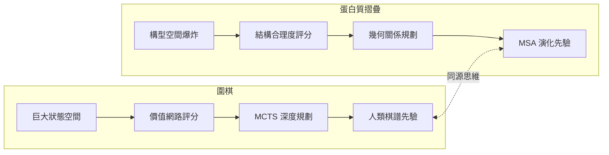
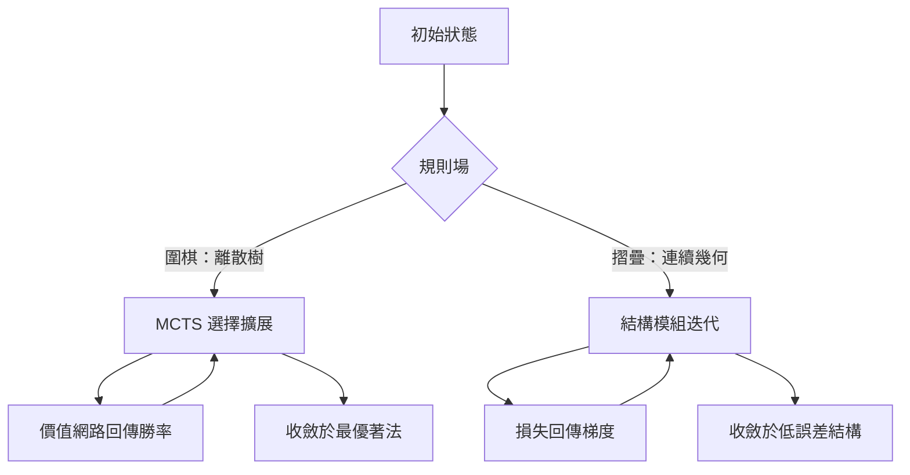

# 11.1 棋盤狀態與生物分子結構的共通點（2020-2024）

在本書前十章裡，我們反覆看到同一齣戲碼：西洋棋、圍棋這些看似人類直覺專屬的領域，最終都被「巨大但有限的狀態空間、可學習的評估函數、有引導的深度規劃」這三件武器攻破。2020 年，同一個團隊（DeepMind）把這套武器搬進了生物學，問了一個乍看毫不相干的問題：給定一條胺基酸序列，蛋白質會摺成什麼三維形狀？這一年 AlphaFold 2 在 CASP14 競賽取得中位數全域距離都在一個原子寬度內的預測精度，2021 年 Nature 刊出論文，同年 DeepMind 與歐洲分子生物學實驗室（EMBL-EBI）合作公開了人體幾乎全部蛋白質的結構預測資料庫。2024 年，本書所屬系列第五本《AlphaFold 蛋白質摺疊》詳述的主角——Hassabis 與 Jumper——也因此與研究蛋白質設計的 Baker 分享了諾貝爾化學獎。

這不是巧合的跨領域炫耀，而是同源思想在不同疆域上的勝利。本章將正面比較棋盤與分子這兩個世界，看清哪些結構可以遷移、哪些關鍵差異逼出了新方法。讀完本章，第 11.2 節將把搜尋與決策的完整框架再推向更廣的科學難題。

## 圍棋與摺疊：同一個問題的四張面孔

第一個共性是狀態空間的規模。十九路圍棋的合法局面數量級約為 $ 10^{170}$ ，博弈樹更大到 $ 10^{360}$ ；這個數字在第 3 章已經讓古典搜尋徹底失效。一條一百個胺基酸的蛋白質，若把主鏈上可旋轉的二面角全部攤開，理論構型數量級在 $ 10^{99}$ 以上；三百殘基的數字更不必算。早期直觀估算指出，隨機採樣摺出一條蛋白所需時間會嚴重違反宇宙年齡，這就是著名的 Levinthal 悖論。大自然用「能量地形上的漏斗」化解悖論：摺疊並非無方向的隨機遊走，而是一路往能量低處的局部下降。我們在前幾章看到 AI 對巨大搜尋空間的回應：不要窮舉，要學習一個能在巨大空間中指示方向的映射。兩個領域得到的，正是同一種回應。

第二個共性是「局勢好壞」的價值判斷。圍棋需要判斷某個局面下黑棋的勝率，這件事由價值網路完成；蛋白質摺疊需要判斷某個三維構型的好壞，傳統做法用經驗能量函數把氫鍵、疏水交互作用、鍵長鍵角合理性加總成一個分數，但這種求和式近似往往無法表現真實情況中多重作用力的耦合項。兩者本質相同：給定一個高維結構（棋盤或座標集），輸出一個評分。這種評分最難的部分——原子間作用力的微妙平衡或棋子之間的全局呼應——恰恰是人類手寫規則最力不從心的地方，因此也最適合交給神經網路從資料中學。

第三個共性是深度規劃。棋手推演十幾手，看落子引發的連鎖效應；摺疊研究也要問：序列最初形成的局部片段（所謂二級結構）如何一步步約束後續整體形狀。兩者都需要沿著時間或生成順序向前建模，而不是只看靜態快照。AlphaFold 2 的結構模組處理殘基之間的相對位置與鍵角，正是這種「先生成局部關係、再收束成全局形狀」的規劃式思維。

第四個共性是先驗的來源。AlphaGo 最初用了約三十萬盤人類高手棋譜做監督學習；AlphaFold 2 則大量倚賴 MSA（多序列比對）——從演化資料庫中找出目標蛋白質的數千條遠近親緣序列，以「共同演化信號」暗示哪些殘基在空間中彼此靠近。如果一對殘基在所有物種的變異裡都相應改變，這一訊號暗示它們物理上接觸。正如人類千年的下棋歷史凝結在棋譜裡，生命三十多億年的演化史也把結構訊息寫進了序列之中。**兩個領域都在說同一件事：龐大的歷史紀錄本身就是可用先驗。**

下面這張表彙整三項內容與先驗來源的對照：

| 要素 | 圍棋 | 蛋白質摺疊 |
|---|---|---|
| 狀態空間 | 合法局面，量級約 $ 10^{170}$ | 構型自由度組合，呈指數爆炸的連續空間 |
| 價值判斷 | 盤面勝率（價值網路） | 摺疊構型的合理度評分（能量函數） |
| 深度規劃 | 往後推演落子序列 | 由片段約束逐步收束成整體結構 |
| 先驗來源 | 人類棋譜（AlphaGo） | MSA 演化信號與實驗結構 |

這組對應也可畫成對照圖：

## 關鍵差異：終局的有無決定了方法

然而共性說完，差異才是推動方法分化的力量。圍棋有明確的規則、確定的終局與二元的勝負：一盤棋下完，不是勝就是負，價值網路的訓練目標乾淨俐落。蛋白質摺疊沒有這個奢侈品——分子沒有「打敗誰」，只有一個或多個低能量的穩定構型，而且不少蛋白質天然具備多個狀態，需要與其他分子結合才有固定形狀。換言之，摺疊問題缺少 AlphaZero 式自我對弈迴圈所必需的「分出勝負」信號。

因此 AlphaFold 2 的骨幹不是 MCTS，而是一個以注意力為核心的結構模組，反覆迭代精煉：先從粗略的三維座標（或無結構狀態）出發，每一輪以新的幾何約束更新殘基之間的相對位置與相對旋轉，同時以遮蔽式預測與等變變換打通序列資訊與空間資訊，最終收斂到高置信度的結構。表面上這是與 AlphaZero 完全不同的架構，深層邏輯卻一脈相承：**網路做局部更新、全局目標引導方向**。AlphaZero 每次落子是在棋局節點上做局部改進並剪去不可行分支，結構模組每輪迭代是在約束條件上做局部修正並向低誤差處收斂——兩者都是「可微分的推演」，只是前者在離散棋樹上、後者在連續座標場上。

一張示意圖可以看清這個「同構異形」：

## 表徵的另一個對照：符號棋盤與連續座標

還有一層更細的共性值得剝開：兩個領域都不約而同地選擇了「關係式表徵」。AlphaZero 的殘差網路把棋盤轉成多層特徵平面，特徵平面數十個，卻足以表現氣、眼、死活等高階概念；AlphaFold 2 的網路在序對表示（pair representation）中儲存「殘基 i 與殘基 j 的關係」，力量全在兩兩關係的矩陣裡，而不直接堆疊原子的絕對座標。這個選擇對兩個問題都成立，原因也相同：**絕對位置的意義很小，相對關係才承載知識**。棋子之間的生死依賴相對呼應，殘基之間的接觸也依賴相對距離。因此兩張網路都在內部學出了一種「以關係為原子單位的語言」，而這種語言與物理空間的等變性、與棋盤平移不變性的設計哲學，完全相通。

問題的歷史脈絡也頗對稱。在 AlphaGo 之前，電腦圍棋的主流是動用手工特徵的評估函數加 MCTS，精度始終難以突破業餘高段；在 AlphaFold 2 之前，摺疊預測的主流是共演化接觸圖加上梯度下降式的能量優化，CASP13 時最佳系統的誤差仍比實驗解析高一個量級。兩者的突破都發生了同一件事：**把「人類設計的特徵」全部換成「資料裡端到端學到的表徵」**。回頭看第 4 章與第 6 章的敘事，這正是從塞繆爾到 AlphaZero 一路貫穿的主旋律：領域知識從「寫進程式的規則」逐步轉移為「埋在權重裡的習得直覺」。CASP14 之後，競賽組織者 John Moult 評論說這是從「不可能的問題邁向已解決的問題」，其表述之強烈，與 2016 年李世乭賽後棋界的震撼如出一轍。

此外值得一提的是「環境可複製性」的差異，因為它牽動整個訓練迴路的設計。棋盤是一個可完全複製的微世界：規則確定、轉移即時、輸出二值勝負，因此自我對弈可以在上萬個模擬器實例平行展開，TPU 當年正是為此而生（第 10 章）。分子世界沒有免費的模擬器：分子力場模擬太慢，量子計算不可及，實驗解析以週月計。AlphaFold 2 因此選擇了「監督式為主、少量自蒸餾為輔」的路線——用結構資料庫的真值監督訓練，再以自身的預測作為弱標籤微調，迴路簡短、風險可控。這與 AlphaGo（含監督與強化）到 AlphaGo Zero（純自我對弈）的演進方向恰好相反：一個從「資料監督」走向「自生成」，另一個從「能量優化」走向「資料監督」。兩條路方向相反，卻在同一個母題上會合。

## 摺疊漏斗與棋局分界：極值的性質不一樣

在本節收尾前，還要澄清一個容易混淆的點：兩個領域都在「最佳化」，但極值的性質不同。圍棋的目標函數是勝率，極值是「下一步怎麼走才贏」，是對策性質，需要預料對手的反應，因此需要樹狀極小化極大的骨架；摺疊的目標函數近似能量或物理合理度，是單機問題，不需要互為敵手的對手。這個區別造成的影響是方向性的：在對策問題中，搜尋必須模擬雙方交替，價值估計會因對手策略改變而漂移；在單機問題中，收斂性可以用損失梯度直接衡量，避開了不確定性對手的困擾。AlphaFold 2 沒有對手，所以沒有 MCTS；而 AlphaZero 之所以必須有 MCTS，是因為對手的存在本身就規定了搜尋的形狀。

此外，能量地形與棋局樹也有不同的孔隙：棋局樹上有可勝與不可勝的清晰分界（第 1 章的老主題），而能量地形上的低窪可能不止一個，甚至可能都不是生物學真正採用的構型。AlphaFold 2 因此在輸出端附帶置信度指標（預測的單殘基誤差與局部距離等變差），告訴使用者「哪些區域可信」。這一台階在棋盤世界也可以找到對照：AlphaGo 的勝率輸出本身就是一個帶標準差的估計，盤面上職業棋士常據此判斷「AI 自己也不確定」。**兩個領域都學會了輸出「我不確定」**，這也是同一種誠實品質的傳遞。

## 方法論互借與共同的母題

看清兩者同源之後，反向的借鑑就順理成章。第一條互借是「精煉迴圈」：AlphaFold 的結構模組用三到四輪迭代把一個粗略構型磨成可用結構，這與 AlphaZero 用有限的搜尋步數把粗略策略磨成強手是同構的——多一輪迭代通常多一分精度，正如樹上多搜一層通常多一分棋力。第二條互借是 scaling 的直覺：AlphaZero 靠近乎無限的自我對弈資料擺脫人類棋譜，AlphaFold 則靠 MSA 的深度——比對序列的數量與多樣性——取得演化訊息，兩者同樣預測「資料越多，先驗越足，誤差越低」。後續研究確實觀察到：當 MSA 太淺或演化冗餘不足時，摺疊預測精度顯著下降；這正如沒有自我對弈資料流的 AlphaZero 只是一個監督學習式的模仿器。

但母題之外要誠實標記差異：兩個領域的資料來源性質不同。棋盤的資料來自人類的對弈歷史，規則是我們自己設定、完全已知的；摺疊的規則是物理定律，資料來自演化紀錄與實驗測定，我們只能用近似能量項加梯度來逼近。因此 AlphaGo 可以走向「拋棄人類棋譜、以自我對弈自生自長」的 AlphaGo Zero，蛋白質摺疊卻無法關掉演化資料這個輸入——它沒有一個可以直接用來掙扎求存的環境可反覆模擬。這正是為什麼摺疊問題的突破取徑是更好的先驗讀取（MSA）與更強的表徵（注意力結構），而不是純粹的搜尋。下表總結：

| 面向 | AlphaGo / AlphaZero | AlphaFold 2 |
|---|---|---|
| 終局與勝負 | 明確規則、二元勝負 | 無終局，只有能量地形上的吸引子 |
| 搜尋機制 | MCTS 在離散樹上規劃 | 結構模組在連續座標上迭代精煉 |
| 資料來源 | 人類棋譜，後改自我對弈 | 演化序列（MSA）與實驗結構資料庫 |
| 可自我生成資料 | 可以，且近乎無限 | 不可，需仰賴外在演化與實驗供給 |

在方法互借之外，還有一個更實用的註腳：資料品質的作用同樣相似。AlphaGo 的早期版本一度被自我對弈的觀察偏差拉低棋力（本書第 4 章提及），後來靠對手多樣化與訓練流程的修正而恢復；AlphaFold 2 的訓練也對資料中的低解析度結構、複合物殘片做了篩選與加權。兩邊的教訓一致：跑在「被污染的歷史紀錄」上，學到的直覺就會帶著污染的形狀。歷史資料不是金子，只是礦石，提煉流程決定成色。

本書定位為人工智慧系列第六本，該系列第五本正是《AlphaFold 蛋白質摺疊》，其中詳細拆解了 MSA、注意力結構模組與三角更新等機制。那本書從分子生物學的一端講述，本章從博弈 AI 的一端回望，兩者相遇的交點正是這個母題：**把難以手寫的啟發式交給資料**。棋盤把「形勢好壞」交給了從勝負中學習的價值網路，生物學把「哪些殘基相鄰」交給了從三十億年共同演化中學習的注意力網路。AlphaGo 用人類棋譜、AlphaFold 用演化紀錄，說到底都是在回答同一個問題：當啟發式的成本高到人寫不出來時，歷史資料能否替我們把它學出來。

最後簡短記一筆時間軸上的規模比例，因為這正是下一節的伏筆。AlphaGo 到 AlphaZero 的訓練周期以天計，AlphaFold 2 的訓練以週計，兩者投入的 TPU 規模都遠超當年深藍的專用晶片，但都不及後來大語言模型的十分之一。換句話說，這批突破發生在「中等規模運算、精確定義問題」的甜蜜區：問題界得夠清，資料就夠純；資料夠純，中等算力就足以推動。這個甜蜜區的存在本身，是從棋盤到科學遷移之所以在 2020-2024 年集中爆發的條件之一——比它更早，算力不夠；比它更晚，人們開始問「規則本來就不清楚的問題」。第 11.2 節接下來要談的，正是後者那種更渾沌、也更接近真實科學的挑戰。
