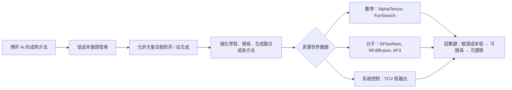

# 11.2 搜尋與決策思維在真實世界難題中的應用（2020-2026）

第 11.1 節比較了棋盤與分子兩個世界的同構與分化；本節把視野拉得更寬，看「狀態、動作、獎勵、規劃」這組源自博弈的抽象，如何在 2020 到 2026 年之間滲透進數學、演算法設計、材料科學、蛋白質工程與核融合控制。我們先逐個掃過代表案例，再提煉它們的共同結構，最後誠實評估這條遷移之路的疆界。

## 幾個代表的科學應用案例

第一個是 AlphaTensor（2022）。矩陣乘法是現代計算的心臟，把 $`n \times n`$ 矩陣乘到三階以上所需的演算法幾個世紀罕有突破；Strassen 在 1969 年憑人工巧思做到 $`n^3`$ 以下，此後群論式手工設計停滯不前。AlphaTensor 把「找更快的張量分解」改寫成單人遊戲：狀態是目前張量剩餘的目標，動作是選一個低秩的秩一二元組，獎勵是分解步數的負值。因此有一個能精確模擬的環境、能自我對弈的樹搜尋、能壓縮歷史的殘差網路，AlphaZero 的整套骨架就搬進來了。它據此找到了新的矩陣乘法演算法，在模 2 算術下突破 Strassen 的紀錄，這被視為機器首次在「演算法發現」這件事上邁出一小步。

第二個是 FunSearch（2023）。它把搜尋的主角從神經網路換成大型語言模型：LLM 提出候選程式（例如生成極度稠密集合的構造函數），一個可執行的驗證器（evaluator）立即測試該程式的表現，好的程式被保留，其片段再餵回模型引導下一輪生成。這是演化式搜尋與「低成本驗證」的合流：驗證對象是可執行的命題而非一段模糊文字，錯誤解自動出局，正確解的特徵則被放大。FunSearch 據公開報導給出了 cap set 問題的新下界，這被視為 LLM 第一次在純數學上產生被同行認可的新結果。值得細看的是它的迴路設計：模型做的是「提出點子」，驗證器做的是「無偏評分」，而演化式搜尋負責在兩代之間保留好的片段並催生變異。這三者原是三個不同的技術源流——工具性 LLM、程式驗證與基因式演算法——卻在這個系統裡被構成一個增益迴路，缺一不可。

第三個案例與生成式方法有關。材料與分子設計在 2020 年代有兩條進路：一是 GFlowNets 這類「以生成機率正比於目標函數」的取樣框架，它能以複雜但非退化的方式生成多樣的高分候選分子，避免了純 MCMC 過於單調的缺點；二是 RFdiffusion（2023），把擴散模型的去噪過程套在蛋白質骨架的座標上，逆向生成從零開始的新蛋白質骨架，再交由設計軟體補上序列。在前一本系列書裡詳述的擴散式生成邏輯被推到極致：與此同時，AlphaFold 3（2024）不僅預測單一蛋白質，更以擴散方式生成蛋白質與其他分子（核酸、金屬離子、小分子配體）複合物的結構，把摺疊預測變成一個「逐步去噪抵達能量低處」的生成任務。

第四個案例必須謹慎：核融合控制。2022 年 DeepMind 與洛桑聯邦理工學院（EPFL）在 TCV 托卡馬克上發表了一項用強化學習控制電漿形狀的實驗——訓練一個神經網路控制磁線圈電流，使電漿維持特定截面形貌。據公開報導，該系統成功在實驗裝置上完成了包括新型磁形狀的保持。但讀者務必區分兩件事：這是模擬器內訓練、真機上只驗證了有限工況，而不是「成功實現了商業核融合」，更不是解決了電漿物理的難題；後續的工程化至今仍在早期階段，2025-2026 年的整合進展也以初步探索為主。它是「方法可行」的演示，而非「問題已解」的宣告。

| 案例 | 年份 | 狀態 | 動作 | 獎勵 / 可驗證目標 |
|---|---|---|---|---|
| AlphaTensor | 2022 | 張量剩餘目標 | 選秩一二元組 | 分解步數負值 |
| FunSearch | 2023 | 候選程式 | LLM 產生程式片段 | 驗證器給出的目標值 |
| RFdiffusion | 2023 | 噪聲化蛋白骨架 | 去噪步 | 骨架合理性 |
| AlphaFold 3 | 2024 | 噪聲化複合物座標 | 去噪步 | 幾何與物理約束相符 |
| TCV 核融合控制 | 2022 | 電漿形狀狀態 | 磁線圈電流 | 形狀誤差負值 |

這批案例排成年表並非流水帳式的整理；它們之間有一條明顯的接力：AlphaTensor 證明了「規則精確的數學遊戲」可以被 AlphaZero 式搜尋改寫，FunSearch 把嚴格驗證器接進生成迴圈，生成式分子與摺疊擴散把取樣空間從離散組合推到連續幾何，最後核融合控制把整條鏈送到高風險系統的門口。每一步都以「犧牲部分領域資訊」為代價，換來「可驗證、可遷移」的收穫。

## 邏輯證明：決策樹在數學裡的延伸

緊接著 2024 年，同一個研究群把樹搜尋加到形式數學上。AlphaGeometry 把幾何證明拆成「符號推理引擎」與「語言模型提出輔助構造」的雙系統搜尋；同年 AlphaProof 在國際數學奧林匹亞程度的題目上，以強化學習訓練證明步驟的價值估計，達到了獎牌水準的成績。這兩個系統與本書前面各章一脈相承：證明步驟即動作，已證命題集即狀態，定理結論即勝負。值得一提的差別是，它們把「勝負」換成了「形式核對器是否接受」，也就是把昂貴的人工驗證外包給了自動檢查器。換言之，策略完全相同，關鍵工程量在於把一個領域的「裁判」變得快而準。這份工程量正好呼應前面 FunSearch 的驗證器：**搜尋方法早就在那裡，缺的是便宜可靠的裁判**。

## 共同結構與最難的三件事

把上述案例排開，會看到同一幕的各種變形：**一個可被評分的狀態空間、一組可採取的動作或生成步、一個看得見的獎勵或有執行結果的驗證器，以及一個引導探索的搜尋或規劃機制**。

但真實世界與棋盤最大的差別，凝結成三件事：**模擬器不準確、獎勵延遲、探索成本高**。棋的規則是精確的，一手內就有回饋，下一步近乎零成本；真實科學的模擬器是現實的粗略影子，材料與生物實驗以週、月計，而每一次探測都要花掉真實的金錢。在逐一拆解之前，我們先看一個總括性的表格：

| 難事 | 在棋盤的表現 | 在真實世界的表現 | 常見緩解手段 |
|---|---|---|---|
| 模擬器不準確 | 規則完全已知、零誤差 | 模擬結果與現實有質的差距 | 域隨機化、真機小樣驗證 |
| 獎勵延遲 | 落子即回饋、局終即結算 | 現代研發以週月甚至年計 | 價值折現、代理指標、Reanalyze |
| 探索成本高 | 自我對弈近乎免費 | 每次燒結、放電、試驗都消耗資源 | 生成式先驗、非簡併取樣 |

接著往下拆這三件難事，因為它們決定哪些科學題目真正適合遷移。

模擬器不準確的後果，並不是「解稍微差一點」，而是解的根本性質可能不同。在材料與化學裡，近似能量曲面上找到的極小點，在真實物理下可能不復存在；在核融合裡，模擬器沒捕捉到的湍流模式會讓策略在真機上失效。緩解這一點的常用工具，正是表格中提到的域隨機化（在多個略有不同的模擬器上同時訓練，要求政策對誤差穩健）與人在迴路中的小規模真機驗證。TCV 實驗正是走了這條路：先在高精度模擬中訓練，再用少數放電檢查是否如預期。流程的成本不在模擬而在放電，於是「驗證便宜」這個棋盤前提自動失效。

獎勵延遲的處理回到本書第 8 章已經描述過的技術：價值函數對未來打折扣、Reanalyze 類的方法把稀疏終局訊號重新分配到早期決策。但在真實科學裡，「一局棋」可能就是幾年的研發週期，幾乎不可能每年自我對弈上百萬局。因此真實應用多半把獎勵緊縮成代理指標（如模擬器的某個物理量），可這又回到第一步的問題：代理指標本身就可能失真。這兩個困難互相增強，構成了遷移的真實門檻。

探索成本高的問題，則被「生成式先驗」部分緩解。與其在連續空間盲目投石，不如用語言模型或擴散模型猜出更可能命中的鄰域，再在鄰域內有限搜尋；這就是 FunSearch 與 RFdiffusion 共享的直覺——把「隨機採樣」換成「學過的採樣」。但這條路的前提是先驗本身不會把探索鎖死在局部最優的地方，也就是生成模型可能在同一批似曾相識的候選上反覆打轉。多樣性維持機制（如 GFlowNets 的非簡併取樣）因此不只是技術細節，而是這類方法能否產生科學價值的關鍵。

## MuZero 的「對決策有用的模型」為何是關鍵

面對這三件事，本書第 8 章介紹的 MuZero 就顯得格外關鍵。MuZero 不被要求知道真實環境的規則，它自己學一個動態模型，且這個模型的唯一標準是「在用它做規劃時是否帶來更低的價值估計誤差」。這個看似妥協的設計，恰恰是往真實世界遷移的鑰匙：真實世界的模擬器既然不可能精確，那就不該追求「完美的世界模型」，而應該追求「對當下決策足夠好的模型」。

換句話說，MuZero 把「模型精度」這個科學問題，降維成「決策效用」這個工程問題。在電漿控制的場景，就算模型無法捕捉所有微觀擾動，只要它在策略層面可以把形狀誤差預估得夠準，就成了；在分子生成的場景，就算能量近似粗糙，只要排序高下的能力可靠，搜尋的方向就沒錯。這是從 AlphaGo 到 AlphaTensor 一貫精神的抽象遞增：不問世界是什麼，只問怎麼動作才對。同時要補一句，MuZero 在棋、Atari、與串流影片上的成功並不保證它在醫學或天文上同樣稱職；它的成功有一個前提——存在某種可以用計算換經驗的環境。凡是違反此一前提的領域，它就無法接力。

## 誠實的評估：這條路的疆界

教科書不該只唱讚歌。截至 2024 年甚至延伸到 2025-2026 年，這些科學應用大多仍在「演示可行」而非「規模化解決」的階段。FunSearch 的新結果集中在特定組合數學與演算法設計題，距離推翻數學家的日常典範還很遠；RFdiffusion 成功生成的蛋白質在生物活性的表現上仍需逐一實驗驗證；核融合的 RL 控制尚未進入大型實驗堆的常規流程；AlphaTensor 的方法至今也還在等待向更大規模與更實用問題的擴張。更深一層，並非所有問題都能被轉成 MDP：需要跨學科知識重組、需要證明級別嚴謹性的數學定理，就不是一個有明確驗證器的單機遊戲；藥物的臨床效能在電腦裡也沒有足夠忠實的模擬器。此外，這些方法的算力與資料成本限制了它們在資源稀缺領域的擴張。

## 統一語法：把問題轉成「棋」

回頭看，這幾個案例之所以都能接上棋盤的武器，是因為研究者先替它們各自完成了一次「翻譯」：把領域知識改寫成合法動作集，把好壞標準改寫成獎勵或驗證器，把演化步驟改寫成可規劃的序列。翻譯得好不好，通常比搜尋本體更能決定成敗。AlphaTensor 的作者在論文裡把這一步描述為把張量分解問題「再創作成遊戲」，FunSearch 的關鍵同樣是「找一個能嚴格評分的函數」。這正是本書一路強調的訓練：從第 1 章的評估函數到第 6 章的雙頭網路，我們學的不是某個遊戲的技巧，而是**如何把一個領域知識素材轉寫成棋盤式表述**。掌握這個語法之後，西洋棋、圍棋、Atari、張量、蛋白質、電漿，在不同程度上都可以用同一套語言交談。

把這些方法的時間軸排開也可以看出一個幅度上的規律：2020 年前後最亮眼的科學應用是以「巨大的監督資料」為底的預測（摺疊），2022 到 2023 年轉向以「搜尋加上生成模組」為底的發現（張量、數學猜想），2024 年之後進一步進到以「擴散與樹搜尋混合」為底的創造（複合物結構、幾何證明）。每往上一階，「人類標準答案」的參與就少一分，「自我生產資料的迴路」就多一分。換句話說，從 AlphaGo 到現在，這條線的內部也在走本書第 6 章描述的同一個方向：從模仿人類棋士，走向白板自主的學習者，最後再走向可以對科學世界提出新問題與新答案的操作媒介。

言及未來，不把話說滿。據公開報導，2025 到 2026 年間，這條遷移路徑的幾個端點都有持續活動：以大型語言模型為核心的數學發現系統持續改良，蛋白質設計在生成式模型的基礎上擴展到更複雜的複合物，核融合研究群也在更強的托卡馬克上探索強化學習控制的邊界；同時，多家研究機構與生成式業者把「AI 科學家」當成一個明確的研究綱領來推動。但公開資料同時顯示，這些活動的公開基準與可比較數據仍然稀少，許多宣稱停留在會議演講階段。把這些訊號放在一起，比較穩妥的判斷是：方向正在因博弈 AI 奠定的方法論而繼續擴張，但成為教科書級的定論，還需要幾年時間。

但疆界不等於絕路。本章的敘事把因果鏈攤開在讀者面前：**低成本驗證 → 允許大量自我對弈與自生成 → 造出新的學習方法 → 遷移到真實世界**。棋盤之所以是最好的起點，是因為它是一個便宜又自足的實驗場；科學問題之所以難，是因為驗證成本高、模擬器失真。因此未來的進度條，取決於我們能否為更多領域造出更便宜、更可信的驗證器——無論是更快的材料模擬器、更嚴謹的形式化驗證系統，還是實驗自動化的機器人平台。從西洋跳棋的塞繆爾到 TCV 的電漿，這條線牽了七十年，而它的續章，正由這一代的研究者與讀者一起書寫。
