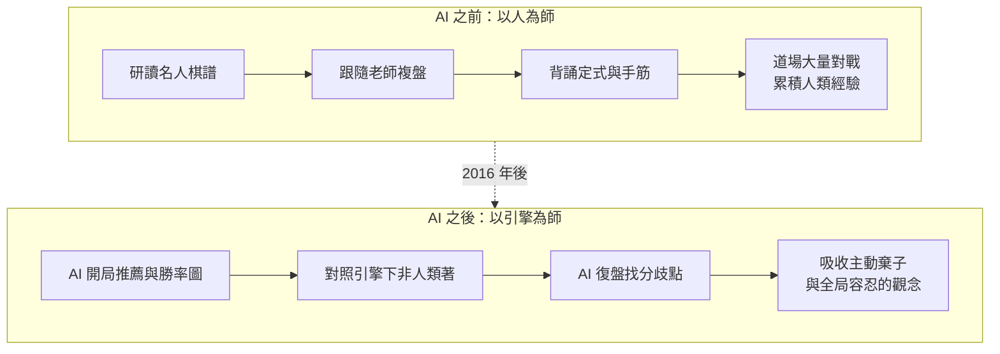

# 12.1 AI 教會了人類什麼？——重新定義傳統棋路的審美（2016-2019）

## 從對手變成老師

2016 年 3 月之前，圍棋界的主流態度是：AI 只是研究者的玩具。李世乭私下評估 AlphaGo 時，認為它頂多達到職業初段的程度。四局過後，全世界職業棋手的態度經歷了兩次翻轉：先是震撼，接著是如飢似渴的學習。到了 2017 年，幾乎每一個認真訓練的職業棋手，桌上都有一台跑著 AlphaGo 或其開源後繼者的電腦，做為每日復盤的工具。歷史上第一次，一項技藝的最頂尖職業棋手群體，同時承認自己身上最重要的能力——判斷——已經被一臺沒有人類經驗的系統追上，並且決定向它學習。

這場轉變的深度，遠超過「換了新工具」。過去數百年裡，圍棋的訓練是以人為師：跟隨某位老師的棋風、研讀歷代名人的棋譜、背誦定式的變化。老師的角色是知識的守門人，學生複製的是人類累積下來的偏好。AI 介入之後，這個生態被倒轉了：老師的權威讓位給引擎的勝率圖，定式的來源從「名人的手」變成「網路的搜尋」，而訓練的核心任務從「模仿高手」變成「理解機器對某一手棋給出的勝率差異」。

## AI 給出人類沒想過的答案

最早被衝擊的是定式。AlphaGo 在 2016 年的對局中，反覆使用一些被職業界視為「不成立」的下法：在小目定式中角上倉促的挖、大飛掛角後直接斷的處理、第三線上看似俗手的碰。職業棋手的第一反應是「這裡面一定有錯誤」，因為按傳統棋理推演，這些手順在局部總是吃虧。而引擎的勝率圖顯示，這些下法在多數盤面中損失極小，甚至可以轉為主動。不到一年，這些手順就在世界大賽中出現，並被正式列入更新的定式辭典。這種吸收的速度是新奇的：一個手順從引擎的推薦，走到世界大賽的實戰，中間的權威環節幾乎被跳過了。

這個翻轉的關鍵在於引擎給出的答案是可以驗證的。職業棋手可以不服氣，但沒有人能反駁勝率圖：把 AlphaGo 極端手順之後的局面拿去讓雙方以最高水準續弈幾百局，統計結果就擺在那裡。過去人類判斷定式成立與否靠的是棋理的內部一致性——某手棋「違背棋理」所以不好；現在，棋理本身變成了可以被統計檢驗的假說。一批被過去職業界奉為圭臬的舊定式就此退休，一批從未被任何名人下過的手順就此入典。定式辭典在 2017 年之後的幾次改版，是圍棋出版史上第一次由機器修訂的經典。

更深的衝擊是整體策略。人類的棋理告訴我們要避免孤棋、要保持局面的平衡、要珍惜每一塊棋的效率。但 AlphaGo 展示了兩種人類從未系統掌握的區域：一是極早階段的深打入，先讓對手在角上獲利，換取整體的主導權；二是對「不明確」的全局容忍，主動接受幾處損失難以衡量的交換，換取整體勝率上更優的期望。這兩種下法在傳統審美裡都被叫做「不優雅」，但在勝率上卻是對的。

## 訓練流程的位移

把這些改變整理起來，可以畫成一張訓練流程的前後對照圖。

圖中兩條鏈的差異不在技術難度，而在**知識的方向**。舊流程的箭頭從人指向人——棋譜、老師、定式全部是人類經驗的再生產。新流程的第一步就來自一個非人類的來源：開局的推薦由政策網路計算，好壞的判定由價值網路給出，而這個價值是一個學出來的函數，形式上只是把局面映射到 $ v (s) \in [ -1, 1 ] $ 的實數。人類開始從一個自己無法完全看懂內部的系統那裡，獲得關於「什麼是好棋」的第二意見。

這個過程裡有一段經常被忽略的插曲：開源社群的參與。DeepMind 只公開了寥寥數篇論文與部分 Anniversary 對局棋譜，並沒有釋出模型與程式碼。接棒的工作由社群自發完成：一批開發者與業餘棋手推動了 Leela Zero 等專案，透過全球志願者貢獻的算力重新跑出類似 AlphaGo Zero 的自學流程，再以開源授權釋出。正是因為有這些免費、可離線執行的引擎，AI 復盤才從少數頂尖棋手的專利，變成全世界業餘棋手的日常。教科書敘事常把 2016 年後的棋藝進步全部歸給 DeepMind，但把它變成人人可用的教具的，是開源社群。

## 西洋棋：另一種相同的故事

不要以為這只是圍棋的特例。2017 年 12 月 AlphaZero 上線之後，西洋棋界經歷了幾乎相同但更劇烈的震盪。西洋棋引擎在 1997 年之後早已遠超人類，但它們的棋風建立在人工設計的評估函數上：把局面拆成特徵向量 $ \phi (s) $ ，例如子力、機動性、王的安全這樣的手工特徵，再加權總合成一個分數。這套設計把西洋棋教成了「換子要算清楚、王要安全、弱點要少」的保守美學。

AlphaZero 不看任何手寫特徵，只從自我對弈的結果中學出價值網路 $ v_\theta (s) $ 。它的棋風截然不同：主動的兵力棄損、長期的結構性佈局、對動態補償的信心遠超當下計算能完全證明的範圍。西洋棋頂級引擎 Stockfish 在 2018 年之後吸收了這個方向，把神經網路評估引進自己的架構，用網路的輸出取代或融合傳統的手寫權重。這在引擎發展史上是一次方向的轉折：**不是 AlphaZero 的演算法贏了，而是它學出的偏好被人類工程沿用了**。

西洋棋界對此的反應與圍棋不同，但殊途同歸。1997 年深藍獲勝之後，卡斯帕羅夫就推動過所謂「先進西洋棋」的賽制：由人類棋手再加上普通引擎組成的人機團隊互相對抗，當時的結論是「人機合作的組合勝過引擎單獨出擊」，因為人類的直覺可以修剪引擎的搜尋方向。AlphaZero 之後這個結論被翻了過來：純引擎的棋力已經高過任何人機組合，人類的介入從合作變成拖累。西洋棋於是走向了與圍棋完全不同的角色分工——棋手不再試圖參與決策，而是把引擎當作訓練時期的備戰教練，賽場上完全放手。

其中一個技術細節值得記住。AlphaZero 加入 MCTS 的探索項是：

$$ U (s, a) = c_{\mathrm{puct}} \, P (s, a) \, \frac { \sqrt { \sum_b N (s, b) } } { 1 + N (s, a) } $$

這裡的 $ P (s, a) $ 是政策網路給出的先驗機率， $ N (s, a) $ 是該動作的累積造訪次數， $ c_{\mathrm{puct}} $ 是一個調節探索強度的常數。此項的存在使搜尋在早期不會被純粹價值最高的那一條路徑鎖死，而保留一絲「值得一試」的成分。人類的審美不需要接觸這個公式，但人類看到的每一手「AI 名手」，追到最底都是這個機制在數千萬次模擬後累積出來的統計結論。這件事在本書第 9 章已經講過：所謂的神來之筆，是 PUCT 在價值與先驗之間的平衡，而非任何意義上的靈感。

## 審美的重新定義

把人類棋藝數百年的美學主張濃縮起來，會得到一條核心原則：**好棋是消除錯誤**。日本古譜的美學把棋分成「厚」與「薄」，推崇無斷點的厚勢而貶低有毛病的薄棋；西洋棋的美學推崇小的、精確的優勢勝利，而不是依賴對手犯錯的隨機勝利；中國傳統的「手筋」觀念，本質上也追求以最小的代價取得最大的確定收益。這是一種「去除—逼近」的美學：人類棋力的成長，被理解為不斷移除自己下法中的錯誤。

AI 引入了一個不同的向度：棋力不再只是消除錯誤，還包括**犧牲與容忍**。AlphaGo 的幾個標誌性區域可以這樣描述：主動棄子，用局部的讓步換取全局的主導；深打入，用角上的得失換取整體的先手節奏；以及最弔詭的一種——容忍好幾處「說不清好壞」的交換，只要全局勝率的期望更高。人類花數百年打磨出來的「局部最佳」直覺，被 AI 的勝率曲線重新校準成了「全局最佳」的直覺。這不是棋藝變好了，而是棋藝的定義被改寫了。

## 人類吸收了非人類的選擇

最直接的證據是新一代棋手的棋風。2016 年之後入段的年輕職業棋手，幾乎都是在引擎勝率圖的陪伴下長大的，他們的棋像極了 AlphaGo：開局階段大量使用過去會被老師打回重下的手順，中盤階段敢於在任何位置主動棄子，收官階段對「官子價值」的估算精確到目數。批評者說他們的棋「缺乏主體性」，像是引擎的復讀機；支持者說這才是這個時代最好的棋。爭論本身無所謂對錯，但雙方都承認一件事：這批棋手的着法分布，與 2015 年之前的歷代棋手已經統計上可區分。用本書的語言說，人類的政策分布 $\pi$ 被引擎的政策分布拉了過去。

更有意思的是，這種吸收在老一輩同樣發生，只是形式不同。資深棋手不再強求自己「下得像 AI」，而是把引擎當成一位永不疲倦的復盤搭檔；複盤時先由人類憑經驗指出候選點，再由引擎給勝率排序，兩者不一致的地方就是最值得討論的地方。這種工作方式產生了一個新術語：「勝率勝」與「目數勝」的分離——引擎認定更優的下法，未必是人類直覺上舒服的下法。職業棋手必須同時說兩種語言：一種是給觀眾聽的棋理，一種是自己真正落子時用的勝率計算。

## 誠實的底線：AI 沒有品味，只有價值函數

有一件事必須寫得清楚：AlphaGo 沒有任何層次的品味。它的每一個下法，都是對勝率函數 $ v (s) $ 的最佳化，而那個函數是人類在訓練迴圈裡設定的，形式上只是一個把局面映射到勝率的估計器。它不會覺得某一手棋下得漂亮，也不會在兩個勝率相同的下法之間選擇更優雅的那一個——它選擇的那一個，只是搜尋統計上最先累積出優勢的那一個。

因此，過去幾年圍棋界所謂「AI 帶來新的美學」，嚴格來說是人類把 AI 的**偏好**翻譯成美學的一次集體創作。棄子、深打入、容忍不明確，這些在訓練過程裡只是勝率函數在全局最佳化中的副產品。把這些副產品稱為藝術、根據它們重新編寫教學體系、讓下一代的職業棋手從小學習——這個翻譯的全部工作是人做的。本節標題問「AI 教會了人類什麼」，嚴格的答案是：AI 提供了一個非人類的參照，而人類把這個參照看成了新的教科書。

## 對職業的影響：加速與衰退

審美的改變帶來了兩個方向相反的效應，都真實地發生了。

第一個是業餘提升的加速。2016 年之前，一個業餘棋手要進步，需要找老師、買書、泡道場；2019 年之後，免費的開源引擎加上無限制的自我對弈復盤，可以讓一個有天分的業餘棋手在兩三年內達到過去需要十年才能達到的水準。世界各地的業餘段位測試都在 2017 年之後經歷了相應的調整。這是 AI 對棋藝最正面的影響：它把過去依附於師徒制的稀缺資源，變成人人可得的技術服務。

第二個是職業生態的衰退。李世乭在 2019 年退役時說，即使自己成為第一名，也不過是「在 AI 的影子之下」。這句話指向一個結構性的問題：當引擎可以在任何局面下以壓倒性的勝率戰勝頂級職業，比賽的看點就從「誰是最強者」變成「誰更接近 AI」。加上網路轉播中勝率圖即時顯示哪一方犯錯，解說的張力被數據取代，職業比賽的觀賞性與贊助意願在部分地區明顯下滑。也就是說，AI 同時提升了玩家的水平與解構了表演的張力——這兩件事竟然可以是同一件事的兩面，是棋界以外很少人預料到的。同時，棋手在正式對局中偷偷使用 AI 輔助作弊的事件在幾個職業賽事中被揭露，各主要賽會不得不在 2020 年前後建立電子設備檢查等防弊規範。

把兩面放在一起，就可以看到 2016 年之後棋界的全貌：技術的提升是真實的，生態的衝擊也是真實的。人類獲得了一個極佳的老師，同時發現自己過去依附於棋盤的身份認同——「下棋的人類是最聰明的」——被連根拔起了。偶爾仍有棋手在特定賽制下可以接近引擎的判斷，但沒有人再宣稱能「戰勝」它；圍棋世界大賽的層級結構維持住了，只是它的頂點不再是人而是一個演算法。這個複雜的處境，正是下一節要面對的問題。

收束成一句話：本節描述的不是人類被機器打敗，而是人類被機器**改寫**。審美這個最主觀的領域，在 2016 到 2019 之間被一個沒有主觀的系統重塑了；重塑的理由無關藝術，只關勝率；重塑的執行者不是機器，而是願意承認自己一直看錯的人類。棋盤上的神經元至此不只是卓越的對弈者，它還變成一臺對「人類品味」的校正儀。

| 面向 | AI 之前的訓練 | AI 介入後（2016-2019） |
|---|---|---|
| 知識來源 | 名人棋譜、老師、定式辭典 | 引擎勝率圖、政策分布、自我對弈 |
| 定式的地位 | 必須背誦的公認規範 | 可被 AI 挑戰、由勝率數據更新的參考 |
| 好棋的定義 | 消除錯誤、局部效率、棋理一致 | 全局最佳化、容忍不明確、主動棄子 |
| 業餘學習 | 依附師徒制與道場 | 開源引擎加上免費復盤 |
| 職業比賽 | 以人類對抗為核心看點 | 看點轉為「與 AI 的接近程度」，觀賞性下滑 |
| 防弊規範 | 幾乎不需要 | 電子設備檢查、賽場監控 |
