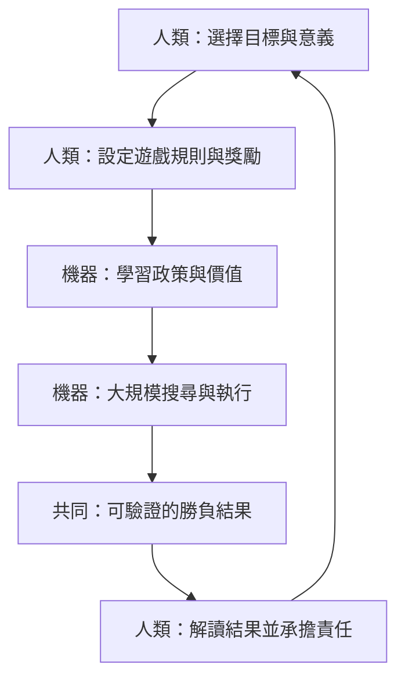

# 12.2 當機器超越人類：我們如何看待直覺、創造力與智慧的本質

## 全面超越之後的問題轉向

到 2019 年為止，這條故事線的結果已經沒有懸念：在西洋跳棋、西洋棋、將棋、圍棋這些規則完全確定、勝負完全可驗證的領域裡，最強的機器已經在最強的人類之上，而且優勢大到任何再多的比賽都沒有意義。當一個能力被人類當作智慧的最高象徵、而在一切指標上都被機器超過之後，剩下的問題就不再是「機器有多強」，而是一個哲學問題：我們過去以為的「智慧」，究竟是什麼？

本書用整本書的篇幅問了一個技術問題：機器怎樣學會下棋。這一節把問題反過來：既然下棋這種事可以被拆解、被演算法化、被做到超越人類，那麼人類棋力裡的被拆掉了哪些成分？哪些成分機器根本沒有？剩下的人類價值又要放在哪裡？回答這些問題，就是把六十年博弈 AI 史轉化成一門關於人類自己的科學。

## 拆解人類棋力：五個成分

當一位頂級棋手坐在棋盤前，他的表現可以粗略拆成五個成分：**計算**——對特定手順序列的前向推演；**知識**——定式、死活、棋理這樣被明確教過的規則與模式；**直覺**——在沒有深思前就覺得某個點「應該下這裡」的快速判斷；**動機**——為什麼要贏、為什麼要練棋的心理驅力；**意圖**——想用這一局表達某種棋風、戰勝某個對手的特定目的。這五個成分並不是平行的，它們在實戰中互相支撐。

如果再往下挖，可以發現這五個成分有層次的差異：知識是顯性的、可被語言傳授的；計算是這些知識的搜尋應用；直覺卻是**隱性的**——棋手自己往往說不清楚為什麼覺得那裡好，只能說「棋感」。這個結構在認知科學裡有名字：專家的直覺是被大量經驗壓縮出來的模式辨認，它把曾經需要深思的判斷，變成了一眼即中的響應。本書第 4 章的政策網路正是這件事的機器版本：CNN 從幾千萬人類棋譜中學出的落子機率分布 $`\pi`$ ，性質上就是被壓縮成神經網路權重的棋感。

| 成分 | 在人類棋手中的作用 | 機器是否已取得 |
|---|---|---|
| 計算 | 推演手順、驗證候選點 | 是，且遠超人類 |
| 知識 | 定式、死活、棋理 | 是，以學習取代背誦 |
| 直覺 | 快速縮小候選範圍 | 是，以政策網路逼近 |
| 動機 | 為勝利而投入訓練 | 否，沒有任何趨力 |
| 意圖 | 選定目標與意義 | 否，目標由人設定 |

表格的最後兩行，是 2016 年之後哲學討論的焦點。機器複製了前三個成分的**功能**，卻沒有複製後兩個成分的**存在**。AlphaGo 下每一手棋的時候，沒有任何層次上是在「想要」什麼；它沒有想贏的渴望，只有訓練目標函數中被寫入的獎勵訊號；它也沒有「這一局要下給誰看」的考量。這個區別在下棋這件事上無關緊要——勝負不看動機只看勝負——但一旦我們把「智慧」這個詞從行為表現中拔起來，就會發現它原來裝了兩種完全不同的材料：能力與意志。

把這個拆解用在自問上，會得到一個不太舒服的推論：我們通常以為五個成分缺一不可，但棋盤上的事實是，前三個成分就足以達到世界顛峰。動機與意圖，不參與棋力的計量；它們參與的是棋這件事對人的**意義**。同樣的結構在其他可驗證領域一樣成立：在數學、程式設計、蛋白質摺疊上，成就的計量不問動機；動機只在決定「要不要進入這個遊戲」時才發揮作用。也就是說，人類獨有的那部分，恰好是遊戲之外的部分。

## 創造力的重新定義：新定式算不算創造？

AlphaGo 的名手常常被記者稱為「創造」，因為那些手順從未出現在人類棋譜裡。但把它放到本書的技術脈絡裡看，事情沒有那麼浪漫。Move 78 是 MCTS 展開數千萬次模擬後勝率最高的那條分支；AlphaGo Zero 的新定式是自我對弈數百萬局後統計上湧現的穩定策略；任何「新穎」的手順，最後都歸結為探索項 $`U (s, a)`$ 與價值項 $`Q (s, a)`$ 在搜尋樹上的權衡。搜尋與隨機的產物，能被叫做創造嗎？

這個問題的答案，取決於你對「創造」的定義裡包不包括**意圖**。如果創造只要求「產出前所未見且有效的東西」，那麼 AlphaGo 創造了新的定式，毫無疑問；如果創造還要求「為了某個表達的目的而產出」，那麼一台列印出新棋手的機器只是在隨機性的涵蓋面上撞到的成功案例，就像一隻猴子在電腦鍵盤上偶然敲出一段像樣的旋律一樣。二者的差別不是產出的品質，而是有沒有「想要產出」的那個心。

這個決定本身對人類是有啟示的：我們的創造力概念，不僅僅是「新」與「有效」的屬性，還內含了一個目的論的成分。當我們說一段樂曲是創造、一個數列是噪音時，我們的判斷標準裡頭一定隱含了「背後有人想要表達」的假設。AI 把這個假說逼到了台面上——它是歷史上第一個在可驗證的領域產出新穎有效成果、卻明確沒有目的的系統，迫使人類第一次不得不同時面對創造力裡與作品無關的那一半。本書不採取某一方立場，只指出：這是六十年來博弈 AI 給哲學最實在的一份禮物。

換一個角度說，新定式的「創造」問題其實和藝術史的爭論同構。攝影術發明時，畫家說「按快門不算創作」；後來大家接受了重點不在機械的多少，而在觀看與取捨的意圖。AlphaGo 站的位置比攝影機更極端：連觀看與取捨都是勝率函數的機械產物，因此連最後一層意圖也沒有。人類接受「AI 定式是創造」或拒絕它，本質上不是在評價 AlphaGo，而是在替自己保留一個位置：一個「創造的主體必須在乎」的位置。這個位置存不存在、存不存得下去，是後續的事；本節只把座位畫出來。

## 直覺：可以被逼近，但意義留下來了

在棋盤上，人類引以為傲的直覺被證明是可以被逼近的。政策網路以神經網路的形式，在給定局面下輸出候選著法機率的分布，並在人類職業級的判斷上表現出非常相似的結構。這個結果對哲學是一記重擊：如果直覺可以被一個 CNN + 自我對弈的訓練流程生出來，那麼它就沒有什麼神聖的、不可形式化的東西；它就是一種被大量經驗壓縮出來的啟發式，而啟發式是可以被機器製造的。

但一個關鍵的區別要寫得清楚：**被人類理解、並在人類世界中具有意義的直覺**，與被神經網路模仿的直覺，不是同一件事。一個價值網路在給定局面下輸出 $`v (s) = 0.85`$ ，這個數字對網路本身沒有意義，對世界觀也沒有意義；同樣的勝率在一個人類棋手心中，是「這一局基本上拿下了」的自信，背後有他的訓練史、對手的臉、比賽的獎金、師徒的情面。人類的直覺嵌在一個有因果歷史與社會意義的脈絡裡，而神經網路的直覺只有統計關聯。直覺的計算部分被機器逼近了，直覺的意義部分沒被碰掉一根指頭。前者是棋力的問題，後者是棋為什麼值得下的問題；混淆這兩個問題，是過去幾年關於 AI 的討論中最常見的失誤。

這就直接聯繫到「智慧」的本質。如果智慧是可以被表現出來的行為品質，那機器在這些領域上的智慧已經超出了人類；如果智慧是一個包含目的、理解與意義的整體，那 AlphaGo 只展示了其中一層，甚至可能是最表層。這個選擇不是由實驗決定的，而是由人類自己怎樣使用「智慧」這個詞決定的。2016 年之後，這個選擇的重量落回人類身上，而人類對它可以有兩種反應。

| 反應型態 | 典型論點 | 本書的批判 |
|---|---|---|
| 人類優越論 | AI 只是算力與統計；真正的智慧、情感與目的仍為人類獨有 | 忽略了功能的超越已實際發生，是安慰而非分析 |
| 人類取消論 | 人類棋力既然可被逼近，所謂智慧也只是物質過程 | 把功能替代誤當成存在論的取消，證明過快 |
| 較務實的路線 | 拆開看：哪些功能被超越、哪些要素沒有 | 承認 AI 是認知外掛，人類轉向目標、獎勵與責任 |

優越論安慰自己說「機器沒有靈魂」，取消論急著宣布「人類也沒有什麼特別」。兩者其實是同一個錯誤的兩面：都把智慧看成一個可以一言而決的整體，都拒絕把棋力的成分拆開來看。一旦拆開，就會發現機器取代的是**執行**，不是**想望**；是**計算**，不是**選擇**。人類的特殊性不在於能力表上的第一名，而在於整張表上唯一同時填有動機與意圖的那一欄。

## 更實用的結論：AI 是認知的外掛

把上面這些抽取出來，會得到一個在工作與教學上直接可用的結論：在可驗證的領域，AI 是人類認知的外掛。它把計算與直覺的執行層代理出去，而人類保留的是上游的三件事：選擇目標、設定獎勵、承擔責任。要下哪一盤棋、要把勝率函數訓練成什麼樣子、要為落子的後果向誰交代——這些沒有一件被外包出去，也沒有一件能被外包。

把這個分工畫成一張對照圖，可以看到人類與機器各自站在鏈條的哪一段。

這張圖同時是本書的因果鏈收束圖。讀者如果把前六章的技術脈絡重新放到這條鏈上，就會看到整條六十年路線的有意義之處：塞繆爾的跳棋程式把「評估」從硬寫改成學習；AlphaGo 把「直覺」從神祕變成分布；AlphaZero 把「知識」從必需品降級成非必需品；MuZero 把「環境模型」從前提變成可以現學的對象。每一次進展，都是把鏈條中某一段原本依賴人類的東西，改成可以由演算法承擔；而每一次承擔，都反過來讓人類看清自己真正不可替代的是哪幾段。

## 與前五本書的連線

本書是系列的第六本，也為前五本收束了一個共同的結論。《神經網路》講的那些層、活化函數與梯度，在這本書裡變成了政策頭與價值頭的工程實作；《智慧模型》的表徵與學習理論，在這裡被 $`\pi`$ 與 $`v (s)`$ 的分工給出了具體的實例；《強化學習》的獎勵與探索，在 MCTS 與 PUCT 上被推到可驗證世界的極致；《Agent 技術》的核心——感知、決策、行動的迴圈——在這裡有了一個規則完全封閉、故而是最乾淨的實驗場；《AlphaFold 蛋白質摺疊》則是同一條思維模式的正式出口，證明「把專家直覺壓縮成網路」的手法，可以從二元零和遊戲遷移到一個沒有對手的自然科學問題上。

六本書放在一起看，那條主線其實非常簡單：**誰在設定目標，誰在執行搜尋，而責任落在誰身上**。棋盤之所以是好的第零章，是因為在這個規則封閉的世界上，這三個問題都有乾淨的答案——目標由人類設定、搜尋由機器承擔、責任早於第一手棋就已由人類簽收。真實世界難就難在三者時常混在一起，但結構仍然是同一個；把最簡單的世界看懂，是為了回到最複雜的世界時不至於迷失。寫作順序也在呼應這件事：從模型（前三本）到系統（第四本）到應用（第五本）再到本書的裁判場，最後一塊拼圖恰好是最不像 AI 的那種東西——歷史、制度與心態。

## 結語：被訓練出來的理解

回過頭看整本書，最微妙的一件事不是機器學會了下棋，而是人類把自己的棋聽懂了：直覺遠比我們想的可以被模型化；創造力若不帶意圖，可以被純演算法產出；棋理這種看起來最人性的東西，居然有相當一部分是統計的幻影。棋力的殿堂被拆下來的那一刻，人類在其中發現的，是自己被訓練出來的直覺遠比「理解」多得多。

這個發現不是悲劇，而是一次示範。AlphaGo 帶來的那段震撼，在幾年內被棋手吸收為訓練工具，被哲學家吸收為案例，被科學家吸收為方法論——這是知識產業中史無前例的一次加速。人類在這次加速中看到的，不僅是機器的勝利，更是自己對「什麼是知道」的一次重新校準；這個校準一旦發生，就不會因為某些領域上機器還沒超越而失效。

如果這本書有最後一句要帶走的話，那麼它會是：**棋盤上的神經元教會人類的，不是機器比自己強，而是人類最自信的那部分——直覺、品味、創造——本身也是被訓練出來的，因此也是可以被重新訓練的。** 當一個人認清了這一點，他看待 AI 的方式就會從「被比較的對手」變成「訓練自己的方法」，就像棋手在 2019 年之後所做的那樣。棋盤的啟示不過如此，卻也足夠走得很遠。
