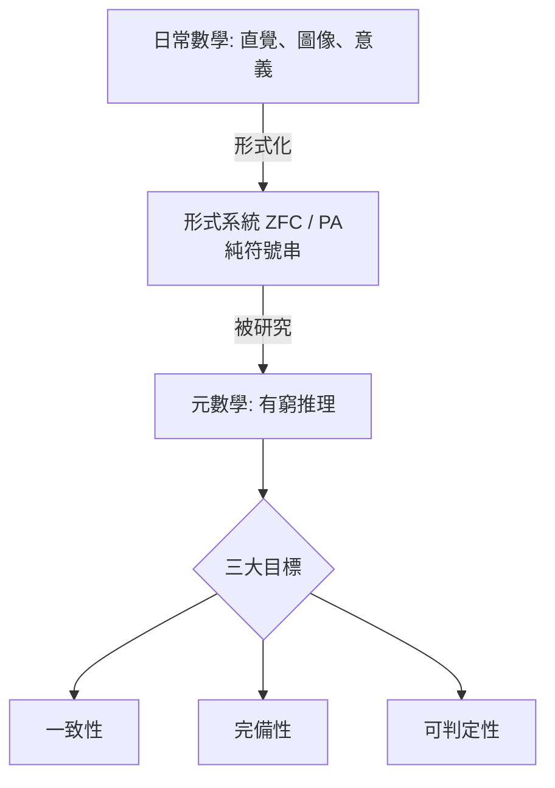

# 1.2 Hilbert 計畫：用公理與證明為數學築基

## 本節目標

- 認識 Hilbert 1900 年巴黎演講的 23 個問題如何設定二十世紀數學議程。
- 掌握 Hilbert 形式主義綱領的三大目標：一致性、完備性、可判定性，以及「元數學」概念。
- 了解 Hilbert 與 Brouwer 直覺主義的論戰及其歷史意義。
- 理解 Hilbert 計畫為何「失敗得如此有價值」——它的失敗催生了 Gödel 與 Turing。

## 1900 巴黎：為一個世紀開出問題清單

1900 年 8 月 8 日，第二屆國際數學家大會（ICM）在巴黎召開，38 歲的 David Hilbert 發表演講，提出 23 個數學問題。這份清單的影響力無與倫比：整個二十世紀的數學研究，很大程度是在回答 Hilbert 的問題。

| 問題 | 內容 | 結局 |
|------|------|------|
| 第 1 題 | 連續統假設 | Gödel 1940 / Cohen 1963：獨立於 ZFC |
| 第 2 題 | 算術公理的一致性 | Gödel 1931：不可能在系統內證明 |
| 第 10 題 | Diophantine 方程的可解性判定 | 1970 年 Matiyasevich（用 Turing 機的理論！）證明不可判定 |
| 第 17 題 | 正定函數為平方和 | Artin 1927，實代數幾何誕生 |
| 其餘 | 幾何、數論、分析、數學物理 | 多數已解，帶動整片領域 |

注意第 2 題與第 10 題：它們表面是數學問題，實質是**數學的自我設問**——數學能不能證明自己沒有矛盾？數學問題能不能機械地判定有無解答？這兩題把「數學」本身變成研究對象，直接通往本書的主題。

## 形式主義綱領：三大目標

Hilbert 與其學派（Bernays、Ackermann、von Neumann）在 1920 年代系統化了「Hilbert 計畫」：把數學全部形式化為符號系統，然後在系統之外用有限的、構造性的方法研究這些系統本身。三大目標：

### 一致性（Consistency）

系統內不存在矛盾，即不存在公式 $`\varphi`$ 使系統同時證明 $`\varphi`$ 與 $`\neg\varphi`$ ：

$$
\mathrm{Con}(T) \;:\Longleftrightarrow\; \neg\,\mathrm{Prov}_T(\ulcorner 0 = 1\urcorner)
$$

Hilbert 要求用**有窮方法（finitary methods）**證明一致性：只使用具體的符號操作、不加無窮假設——因為若證明一致性時用了有疑慮的無窮推理，就是循環論證。

### 完備性（Completeness）

每個在系統語言中可表達的命題，其真假都可被系統決定：

$$
\vdash \varphi \quad \text{或} \quad \vdash \neg\varphi, \quad \text{對每個句子 } \varphi
$$

若達成，則「不可證明的數學猜想」這個概念將消失——任何猜想終將被判明或否證。

### 可判定性（Decidability / Entscheidungsproblem）

存在一個**機械程序**，對任意命題 $`\varphi`$ 在有限步驟內判定 $`\vdash \varphi`$ 是否成立。這是 Hilbert 1928 年在 Bologna 大會上明確提出的問題，答案將由 Church 與 Turing 在 1936 年給出（1.4 節）。

## 元數學：把數學當對象研究

Hilbert 計畫的哲學創新是區分兩個層次：

| 層次 | 名稱 | 內容 | 允許的方法 |
|------|------|------|------------|
| 對象層 | 形式系統 $`T`$ | 無意義的符號串與機械推理規則 | （無，它只是對象） |
| 元層 | 元數學（metamathematics） | 關於 $`T`$ 的證明： $`T`$ 一致嗎？完備嗎？ | 有窮的、直觀可靠的 |

形式化後，「證明」本身成為**有限符號串的有限序列**，可以像多項式一樣被逐項檢查。這個想法在當時驚世駭俗，卻是今日證明助理（Lean、Coq）的直接先祖：Lean 的 kernel 就是一個「逐行檢查證明符號串」的元數學機器。

## 論戰：Hilbert 對 Brouwer

形式主義並非當時唯一的聲音。L.E.J. Brouwer 的**直覺主義（intuitionism）**主張：數學是心智的構造活動，排中律 $`P \vee \neg P`$ 對無窮集合不必然有效；一個「反證法式的存在證明」不算證明了存在——必須**構造出**對象。

| 立場 | 數學是什麼 | 排中律 | 存在證明的標準 |
|------|-----------|--------|----------------|
| 邏輯主義（Frege/Russell） | 邏輯的延伸 | 接受 | 古典即可 |
| 直覺主義（Brouwer） | 心智構造 | 拒絕 | 必須構造性 |
| 形式主義（Hilbert） | 符號遊戲＋元數學 | 於對象系統保留 | 於元層要求有窮 |

Hilbert 視直覺主義為自斷手足：放棄排中律等於廢棄大半數學。1926 年前後（其聯合 Bernays 的兩卷巨著《數學基礎》*Grundlagen der Mathematik* 於 1934/1939 出版，論文綱領文獻則在 1920 年代陸續發表），Hilbert 發起猛烈反擊，名言包括「禁止數學家使用排中律，就像禁止拳擊手使用拳頭」。Brouwer 則被 Hilbert 從 Göttingen 教職人員中除名（1928），兩派決裂。

諷刺的是，這場論戰的技術遺產雙豐收：

- 直覺主義邏輯日後成為**構造性證明**的語言，與 Curry–Howard 對應、證明助理（Lean 的建構自然演繹核心）血脈相連（見 1.4 節與第 3 章）。
- Hilbert 的有窮元數學方法成為證明論（proof theory）的起點，其學生 Gentzen 的相繼式演算正是其直接產物。

## Wir müssen wissen, wir werden wissen

1930 年，Hilbert 在故鄉 Königsberg 接受「榮譽市民」稱號，演講以格言作結：

> **Wir müssen wissen. Wir werden wissen.**
> （我們必須知道，我們必將知道。）

他堅信沒有不可知的問題——「在數學中沒有 ignorabimus（我們將永遠不知道）」。數日後，同一城市舉行的科學會議上，年輕的 Gödel 以一句話宣布了第一不完備定理。歷史在此刻交叉。

Hilbert 於 1943 年去世，墓碑上刻的正是這句格言。計畫以字面意義失敗了，但正如我們將在 1.3 節看到的，**失敗的方式比成功更有生產力**。

## 小結與練習

### 重點回顧

- Hilbert 23 問題設定二十世紀數學議程；第 2 題與第 10 題把數學本身變成研究對象。
- 形式主義綱領三目標：一致性（有窮方法證明）、完備性（每題可判真假）、可判定性（機械程序判定可證性）。
- 元數學把「證明」變成可檢查的有限符號串，是現代證明助理的思想雛形。
- Hilbert–Brouwer 論戰雖兩敗俱傷，直覺主義邏輯與證明論卻成為日後構造數學與證明助理的理論基石。

### 練習

1. 說明為何「用 ZFC 證明 ZFC 一致」是循環論證，以及 Hilbert 為何堅持有窮方法。
2. 寫出一個使用排中律的非構造性存在證明（例如：存在無理數 $`a, b`$ 使 $`a^b`$ 為有理數），並思考直覺主義者會如何質疑。
3. 對照 1.1 節，解釋為什麼 Zermelo 公理化（1908）尚不足以完成 Hilbert 的第 2 題。
4. 查閱《Grundlagen der Mathematik》兩卷（1934/1939）的目錄，指出哪些章節屬於「對象系統」、哪些屬於「元數學」。
5. 預習思考：若你設計一個軟體來「檢查數學證明」，你需要先對哪些概念形式化？（答案的輪廓在 1.4 節。）
