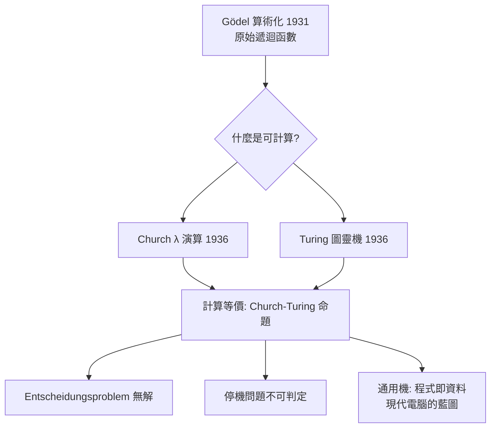
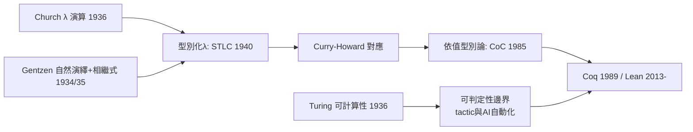

# 1.4 圖靈機、λ 演算與自然演繹：證明助理的三塊積木

## 本節目標

- 掌握 1936 年 Turing 論文與停機問題、Church λ 演算與 Entscheidungsproblem 的否定解答，以及 Church–Turing 命題。
- 認識 Gentzen 1934/1935 的自然演繹與相繼式演算，及其與直覺主義論戰的關係。
- 理解這三組 1930 年代的工具如何成為日後 Coq、Lean 等證明助理的理論積木。

## 1936：可計算性的雙子星

Gödel 證明了「可證明性」可被算術化，但「什麼是機械程序」仍無精確定義——Entscheidungsproblem（判定問題）因此懸而未決。1936 年，兩條獨立路線同時給出定義與否定解答。

### Church：λ 演算

Alonzo Church 的 **λ 演算（λ-calculus）** 以極簡的規則定義計算：一切都是函數，唯有三條變換規則：

| 規則 | 形式 | 意義 |
|------|------|------|
| $`\alpha`$ -變換 | $`\lambda x. M \equiv \lambda y. M[x:=y]`$ | 綁定變數改名 |
| $`\beta`$ -化約 | $`(\lambda x. M)\, N \to M[x:=N]`$ | 把實參代入函數體：**計算的本體** |
| $`\eta`$ -變換 | $`\lambda x. f\,x \equiv f`$ | 外延相等 |

例如： $`(\lambda x.\, x^2 + 1)\, 3 \to 10`$ 。Church 用 λ 可定義性刻畫「可計算」，並證明：

**Entscheidungsproblem 無解**——不存在 λ 可定義的函數判定任意一階邏輯公式的可滿足性。Hilbert 可判定性目標陣亡。

### Turing：圖靈機與停機問題

Alan Turing 的論文〈論可計算數及其在判定問題上的應用〉（*On Computable Numbers, with an Application to the Entscheidungsproblem*，1936）從另一端出發：不是代數式的函數，而是**模仿人類計算者的機械裝置**——紙帶、讀寫頭、有限狀態、逐步動作。

**通用圖靈機（universal Turing machine）** 是更深的洞察：存在單一機器 $`U`$ ，讀入「另一台機器 $`M`$ 的編碼 $`\ulcorner M\urcorner`$ 與輸入 $`w`$ 」，就能模擬 $`M(w)`$ ：

$$
U(\ulcorner M\urcorner, w) = M(w)
$$

**程式可以當資料**——這是儲存式電腦的理論藍圖，也是現代軟體概念的源頭。

**停機問題（halting problem）**：不存在機器 $`H`$ ，對任意 $`(\ulcorner M\urcorner, w)`$ 判定 $`M(w)`$ 是否停機。證明是對角化的最後一次登場：假設 $`H`$ 存在，構造

$$
K(\ulcorner M\urcorner) = \begin{cases} \text{不停機} & \text{若 } M(\ulcorner M\urcorner) \text{ 停機} \\ \text{停機} & \text{若 } M(\ulcorner M\urcorner) \text{ 不停機} \end{cases}
$$

則 $`K(\ulcorner K\urcorner)`$ 停機當且僅當 $`K(\ulcorner K\urcorner)`$ 不停機——矛盾。結論：可判定性目標正式蓋棺，且**定理證明的一般自動化有其內在極限**（呼應 1.3 節「找證明難、查證明易」）。

### Church–Turing 命題

Turing 論文中證明了圖靈機與 λ 演算計算等價。兩個毫不相干的定義給出**完全相同的函數類**，使人們相信它們捕捉了「機械可計算」的直覺本質：

> **Church–Turing 命題（論題）**：凡「可被有效程序計算」的函數，恰為圖靈機（等價地，λ 演算）可計算的函數。

注意這是**命題而非定理**——它連接形式定義與非形式直覺，無法被數學證明，只能被累積的證據支持（此後所有合理的計算模型——遞迴函數、Ramsey 式系統、現代程式語言——都被證明等價於圖靈機）。

## Gentzen：邏輯本身的計算結構

計算有了精確定義，邏輯推論也需要。Gerhard Gentzen 在 1934/1935 年的《調查自然邏輯演算》（*Untersuchungen über das logische Schließen*）中發明了兩套證明系統，回應的正是 1.2 節 Hilbert–Brouwer 論戰。

### 自然演繹（Natural Deduction）

Hilbert 式系統只有少數公理模式加 modus ponens，離真實數學推理極遠。Gentzen 的自然演繹讓**每個邏輯連詞有自己的引入與消去規則**，推理形狀貼近數學家的實際做法：

$$
\frac{P \quad Q}{P \wedge Q}\,(\wedge I) \qquad \frac{P \wedge Q}{P}\,(\wedge E) \qquad \frac{\begin{array}{c}\ [P]\\ \vdots \\ Q \end{array}}{P \to Q}\,(\to I)
$$

$`(\to I)`$ 規則最關鍵：**暫時假設 $`P`$ ，推出 $`Q`$ ，則解除假設得 $`P \to Q`$ **——這正是數學中「設 $`x`$ 滿足……，則……」的寫法，也是 Lean 中 `intro`、`exact` 等戰術的語義原型。

### 相繼式演算（Sequent Calculus）

為了證明系統的後設性質（一致性、切刪消除），Gentzen 把推理改寫為**相繼式（sequent）**之間的變換：

$$
\Gamma \vdash \Delta \quad \text{（假設集 } \Gamma \text{ 蘊含結論集 } \Delta\text{）}
$$

並證明 **切刪消除定理（Hauptsatz / cut-elimination）**：任何使用「引理」（cut 規則）的證明，都可機械地改寫為不使用引理的證明。切刪消除是證明論的靈魂：

- 它直接給出 **PA 的一致性證明**（1936），以良序 $`\varepsilon_0`$ 上的歸納為代價——Hilbert 計畫的「折衷救回」。
- 證明的正規化性質是現代型別理論與證明助理賴以為生的性質。

## 積木如何組成證明助理

三組 1930 年代工具，各自在 Lean 中轉世：

| 1930 年代理論 | 轉世化身 | 在 Lean 中的角色 |
|---------------|----------|------------------|
| 相繼式演算／自然演繹 | Curry–Howard 對應（命題即型別、證明即程式）、依值型別 | 證明的**語言**：`theorem`、`have`、`intro`、`apply` |
| λ 演算 | 型別化 λ 演算（Church 1940 → Coquand–Huet CoC 1985 → Lean 的歸納型別論） | 證明項的**語法與化約**：`fun x => e`、β 化約、kernel 歸約 |
| 圖靈機／可計算性 | decidability、可判定片段、 tactic 語言、元程式設計 | **自動化的邊界與工具**：`decide` 只用於可判定命題；「找證明」交給 tactic 與 AI |

關鍵對應（Curry–Howard，將在第 3 章展開）：

$$
\text{證明} \;=\; \text{程式}, \qquad \text{命題} \;=\; \text{型別}, \qquad \text{證明檢查} \;=\; \text{型別檢查}
$$

於是 1.3 節的不對稱有了工程實現：**kernel 是一個型別檢查器**（語法來自 λ 演算、規則來自自然演繹），機械、微小、可信；而 tactic 系統與 AI 是「找證明」的高階策略，其產物最終化約為 kernel 可檢查的項。Gentzen 的正規化保證這條化約路會終止；Church–Turing 命題界定了自動化永遠無法包辦一切；Gödel 則保證數學家不會失業。

## 小結與練習

### 重點回顧

- 1936 年 Church（λ 演算）與 Turing（圖靈機）分別定義可計算性並否定 Entscheidungsproblem；Church–Turing 命題宣稱兩者捕捉同一個「機械可計算」概念。
- 停機問題是對角化模板的第四次登場，並確立「程式即資料」的通用機思想。
- Gentzen 的自然演繹貼近數學推理（每個連詞有引入/消去規則），相繼式演算的切刪消除證明 PA 一致並開啟證明論。
- 三塊積木在 Lean 中分工：λ 演算是語法、自然演繹是推理規則、可計算性理論劃定自動化邊界——kernel 查證明，tactic 與 AI 找證明。

### 練習

1. 用 λ 演算定義布林的 `NOT`： $`\lambda b.\, b\;(\lambda x.\,\text{false})\;\text{true}`$ （Church 布林 $`\text{true} = \lambda a.\lambda b.\,a`$ ），並以 β 化約驗證 $`\text{NOT true} \to \text{false}`$ 。
2. 證明停機問題時的 $`K`$ 為何必須以自身編碼 $`\ulcorner K\urcorner`$ 為輸入？若只餵任意輸入，論證哪裡失效？（與 1.1 節 Russell 集合 $`R`$ 的自指結構對照。）
3. 寫出 $`(\to I)`$ 自然演繹規則，並說明它與 Lean 中 `intro` 戰術的對應。
4. 說明 Church–Turing 命題為何不是定理，以及「所有合理計算模型皆等價」這類證據如何支持它。
5. 實作預習：安裝 Lean 4 與 Mathlib，執行一個用 `intro` 與 `exact` 完成的 $`P \to P`$ 證明，辨認每個戰術背後的自然演繹規則。
