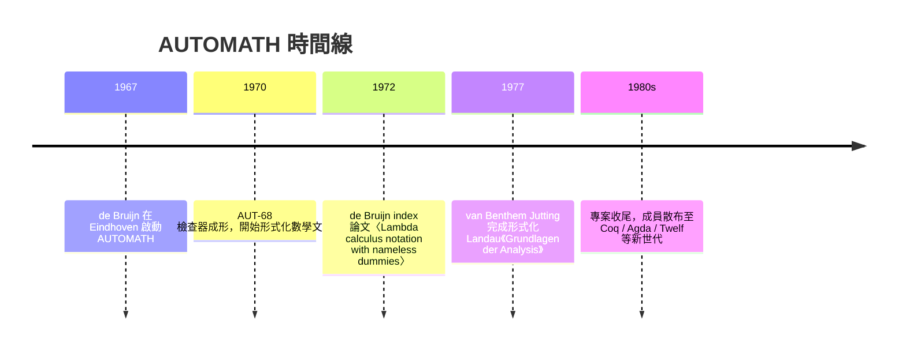

# 2.1 AUTOMATH 與 de Bruijn：依值型別的第一次實作

## 本節目標

- 認識 1967 年起 Nicolaas de Bruijn 在荷蘭 Eindhoven 啟動的 AUTOMATH 專案，這是史上第一個「依值型別」的電腦實作。
- 理解 de Bruijn 的兩大發明：**依值型別（dependent type）** 與 **de Bruijn index**（變數的無名表示法），以及它們如何成為今日 Coq、Agda、Lean 的理論基石。
- 回顧 1977 年 van Benthem Jutting 完整形式化 Landau《Grundlagen der Analysis》的壯舉——史上第一本「整本被機器檢查」的數學教科書。
- 建立「前因後果」的視野：AUTOMATH 雖然在商業上失敗，卻直接塑造了四十年後的定理證明生態。

## 歷史背景：證明檢查的黎明

1950–60 年代，電腦才剛走出實驗室，「讓機器檢查數學證明」被多數數學家視為科幻。當時主流的嘗試有兩條路：

1. **自動定理證明（Automated Theorem Proving）**：希望程式自己「想出」證明（如 1950 年代的 Logic Theorist、後來的 resolution 方法）。這條路在組合爆炸面前屢屢受挫。
2. **證明檢查（Proof Checking）**：只要求程式**檢查**人類寫好的證明。問題小得多，卻也更貼近數學家的實際工作方式。

荷蘭邏輯學家 **Nicolaas Govert de Bruijn**（1918–2012，以組合數學的 de Bruijn sequence、de Bruijn graph 聞名）選了第二條路。他在 1967 年於 Eindhoven 技術大學（後來的 TU Eindhoven）啟動 **AUTOMATH** 專案，口號極為樸實：

> 「寫一個小程式，檢查數學論文的每一行推導是否正確。」

de Bruijn 的核心信念是：**檢查器必須小到一個人能在幾週內讀完全部程式碼**。這個「小核心」的哲學，後來在 LCF（見 2.2 節）以「可信核心」的形式重生，並一路傳到今天的 Lean。

## AUTOMATH 的理論創新一：依值型別

AUTOMATH 語言家族（PAL、ISMIR、AUT-68、AUT-QE 等）有一個當時革命性的設計：**型別可以依賴項（term）**。

普通簡單型別 lambda 演算中，型別是固定的原子，如 $`\mathbb{N}`$ 、 $`\text{Bool}`$ 。但考慮數學敘述「對所有 $`n : \mathbb{N}`$ ， $`P(n)`$ 成立」——謂詞 $`P`$ 的型別是 $`\mathbb{N} \to \text{Prop}`$ ，即「吃一個自然數、吐出一個命題」的函數。**命題本身成了型別系統裡的一等公民**，而型別可以帶著參數 $`n`$ 變化。

在 AUT-QE 的語法裡，一條「引進變數」的敘述長這樣（現代化改寫）：

```text
n  : nat                -- 引進一個自然數 n
P  : nat -> prop        -- 引進一個謂詞 P
h  : P(n)               -- 引進「P 對 n 成立」這個假設 h
```

第三行的型別 $`P(n)`$ 是一個**項**——它依賴前面引進的 $`n`$ 。這就是依值型別的濫觴。今日 Lean 中的：

```lean
def P (n : ℕ) : Prop := n + 0 = n
variable (h : P 5)   -- 型別是 P 5，一個依賴 5 的命題
```

語意上與 1967 年的 AUT-QE 一脈相承。

### Curry–Howard 的先聲

AUTOMATH 把「命題即型別、證明即項」發揮到實作層面（比 Curry–Howard 對應被命名為定理還早）。一個證明就是一個型別為某命題的項；證明檢查就是**型別檢查**。這個等式後來成為所有依值型別證明助手的心臟。

## 理論創新二：de Bruijn index

形式化變數時有個臭名昭著的難題：**名稱捕獲（name capture）**。做 $`\alpha`$ -等價、替換時， $`\lambda x. \lambda y. x\,y`$ 這種項的「哪個 $`x`$ 指哪個綁定」全靠名稱比對，實作極易出錯。

de Bruijn 的解法乾脆俐落：**根本不用名稱**。變數用一個整數表示——「向上數第 $`k`$ 層 $`\lambda`$ 綁定」：

$$
\lambda x.\ \lambda y.\ x\ y \quad\Longrightarrow\quad \lambda.\ \lambda.\ 1\ 0
$$

- $`0`$ 指最內層的綁定， $`1`$ 指次內層，依此類推。
- $`\alpha`$ -等價變成「結構相同」，不需任何改名。
- 替換只需一個機械化的 shift 遞迴，正確性極易證明。

```text
λx. x        →  λ. 0
λx. λy. x    →  λ. λ. 1
λx. λy. y    →  λ. λ. 0
(λx. x) y    →  (λ. 0) y
```

de Bruijn index 如今是每一次型別檢查器實作的**標配**。Lean 4 的核心（以及 Rust、Haskell 編譯器內部的 binder 表示）都可追溯到這個 1972 年的技巧。它的精神是：**把易錯的語法層問題，化約成不易錯的算術層問題**——這也是整個形式化的精神寫照。

## 專案執行：1970–1977 的黃金年代

AUTOMATH 團隊在 1970 年代完成了幾件驚人的事：



其中最輝煌的成果屬 **L. S. van Benthem Jutting**。他選定 Edmund Landau 1930 年的《Grundlagen der Analysis》——一本從 Peano 公理開始、一磚一瓦蓋出實數與分析基礎的教科書——**整本逐行**形式化進 AUT-QE。

這本書難度極高：Landau 的風格是徹底的公理化，連「 $`1+1=2`$ 」都要從 Peano 公理推。van Benthem Jutting 用了數年時間（博士論文 1977 年完成，兩大冊打字稿），輸入逾萬行的證明文本，機器全部檢查通過。這是史上第一次：

- 一本正規出版的數學教科書，**被電腦完整驗證**。
- 形式化過程還順便發現了原書幾處**筆誤與跳步**——機器不放過任何人類的馬虎。

這個實驗證明了一件事：**人類規模的數學文本，機器檢查是可行的**。代價是驚人的人力：以當時的技術，一頁數學 ≈ 數天甚至數週的輸入工作。

## AUTOMATH 的局限與收場

到了 1980 年前後，AUTOMATH 逐漸停擺，原因兼具技術與時代：

1. **表達力受限**：AUT-QE 沒有真正的歸納型別（inductive types）與歸納原理，定義自然數要靠公理式補丁；也缺乏 universe 與impredicativity 的細膩控制。
2. **工具性差**：沒有 tactic、沒有搜尋、沒有現代編輯整合，一切靠手打全文。
3. **缺乏社群動能**：de Bruijn 團隊小、學術地理偏遠，未形成開放生態。

但它的**理論遺產**完整地被下一代繼承：

| AUTOMATH 概念 | 現代繼承者 |
|---|---|
| 依值型別（型別依賴項） | Coq 的 CIC、Agda、Lean 4 的型別系統 |
| 命題即型別、證明即項 | Coq / Lean 的證明即程式架構 |
| de Bruijn index | 幾乎所有型別檢查器核心 |
| 小型可信檢查器哲學 | LCF 式核心、Lean 4 kernel（約數千行） |
| 逐行檢查數學文本 | Mathlib 這種「書即程式庫」的實踐 |

de Bruijn 1994 年回顧專案時自嘲 AUTOMATH 是「一個被時代浪費的先驅」。但從今天的後見之明看：**Coq、Agda、Lean 的每一行核心程式碼裡，都有 AUTOMATH 的 DNA**。

## 小結與練習

本節看到形式化驗證的第一次完整嘗試：de Bruijn 以「小而可信的檢查器 + 依值型別 + 無名變數」三件套，在 1967–1977 年證明了機器檢查人類數學的可行性。AUTOMATH 沒有活到商業成功，但它的理論成為 Coq 與 Lean 的直系祖先；van Benthem Jutting 形式化 Landau 一書，則是所有後繼「把整本書搬進電腦」計畫（如 Flyspeck，見 2.4 節）的原型。

**練習**

1. 手工將 $`\lambda x.\ \lambda y.\ \lambda z.\ x\ (y\ z)`$ 轉成 de Bruijn 表示，並說明為何 $`\alpha`$ -等價在此表示下是「直接比較結構」。
2. AUTOMATH 的 $`\text{nat} \to \text{prop}`$ 型別意味著什麼？寫出 Lean 中等價的型別宣告。
3. 查閱 de Bruijn 1994 年的回顧文章〈A plea for weaker frameworks〉，摘要他對「框架應該多小」的立場，並與 2.2 節 LCF 的「可信核心」比較異同。
4. 為什麼「檢查證明」比「自動找證明」在 1960 年代是更務實的目標？請從搜尋空間的組合爆炸角度討論。
