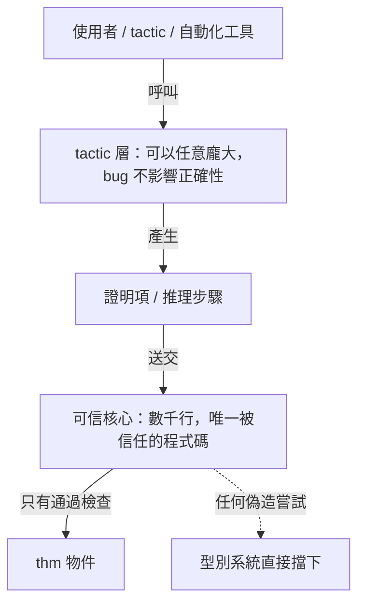
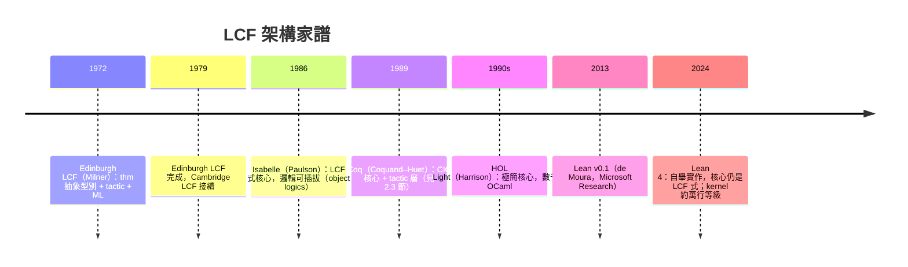

# 2.2 LCF 方案：可信核心與 tactic 的誕生

## 本節目標

- 理解 1972 年 Robin Milner 在 Edinburgh 啟動的 LCF（Logic for Computable Functions）專案，以及它發明的**可信核心（trusted kernel）架構**。
- 掌握「定理是抽象型別、只能由少數 primitive 函數產生」這個軟體工程奇蹟——它讓證明系統的**正確性訴諸型別系統本身**。
- 認識 tactic 的起源：以「策略」產生證明項，而非手寫證明；以及為了寫 tactic 而誕生的程式語言 **ML**。
- 追蹤這個架構的後裔：Isabelle、Coq、Lean——直到 2024 年的 Lean 4，本質上仍是 LCF 式架構。

## 歷史背景：Scott 的域理論需要一個證明助手

1969–70 年代，Dana Scott 提出 **域理論（domain theory）**，為程式語言的語意學提供數學基礎。Scott 到牛津訪問時與 Milner 討論：這套理論的證明繁瑣而機械，應該交給電腦。Milner 於 1972 年在 Edinburgh 大學啟動 **LCF 專案**，目標是打造一個互動式系統，讓使用者以可計算函數的邏輯（PPλ，一階邏輯 + 不動點歸納）證明程式性質。

「LCF」這個名字即「Logic for Computable Functions」。專案歷經數代實作（Stanford LCF → Edinburgh LCF → Cambridge LCF），最大的產物卻意外地是兩個超越原目標的發明：**可信核心架構**與 **ML 語言**。

## 核心設計一：定理是抽象型別

Milner 面對的工程難題是：檢查器再小，使用者還是可以繞過它——只要程式裡有一個函數能「偽造」定理物件，整個系統的可信度就歸零。

他的解法是軟體工程史上的神來一筆：**把定理做成抽象型別（abstract type）**，其建構子不對外開放。在 ML 中（以現代語法示意）：

```sml
abstype thm  -- 定理型別，建構子封裝在核心模組內
with
  val ASSUME : term -> thm              -- 假設 x 得 x
  val EQ_MP  : thm -> thm -> thm        -- 肯定前件（modus ponens）
  val GEN    : term -> thm -> thm       -- 全稱概括
  val SYM    : thm -> thm              -- 對稱律
  val TRANS  : thm -> thm -> thm        -- 遞移律
  ...
end
```

規則殘酷而簡單：

- 型別 `thm` 的值**只能**由這幾個 primitive 推理規則產生。
- 任何使用者程式碼——不論多複雜——都無法在 ML 型別系統允許下「憑空」造出一個 `thm`。
- 因此：**一個型別為 `thm` 的值，就是一個被核心規則真正推導出來的定理**。正確性由宿主語言的型別系統保證。

這就是 **可信核心（trusted kernel / small trusted core）** 概念的誕生。用現代密碼學的比喻：核心是 trust root，所有下游工具（tactic、自動化、決策程序）再大再複雜，最終都必須經過核心這道窄門產出定理。



請注意一個重要的責任轉移：**tactic 寫錯了，最多產出「無效的證明企圖」，絕不可能產出假的定理**——因為最終拍板的是核心。這個性質稱為「de Bruijn criterion」的實作版：信任面積縮小到一個人力可審計的核心。

## 核心設計二：tactic——以策略產生證明

早期 LCF 使用者必須手工逐步呼叫推理規則，一次證明只推一步，繁瑣至極。Milner 與團隊（Gordon、Weyhrauch、Newey 等）發明了 **tactic**：

> 一個 tactic 是一個函數：輸入「待證目標」，輸出「若干子目標 + 一個把子目標證明拼回原目標證明的方法」。

型別上（簡化）：

$$
\text{tactic} : \text{goal} \to (\text{validation} \times \text{goal list})
$$

- `goal list`：分解出的子目標（如用歸納法後得到的基底與歸納步）。
- `validation`：等子目標都證完後，把各個小證明**黏合**成原目標證明的函數。

使用體驗是「倒推式」的：先喊 `INDUCTION`，目標分成兩個；再喊 `SIMPLIFY`，剩餘目標縮小；最後 `REWRITE` 收尾。**使用者管理的是策略，機器負責在背後組裝真正的證明項**——組裝過程仍受核心把關。

這個「目標—子目標—黏合」的模型，就是今日 Coq 的 `intros / induction / simpl`、Lean 的 `intro / apply / rw`、以及 `apply?` 這類自動化的直接祖先。你在第 3 章之後寫的每一行 Lean tactic，都是 1972 年 Edinburgh 那間辦公室的迴聲。

## 意外產物：ML 語言的誕生

tactic 需要一個程式語言來寫。Milner 團隊為此設計的元語言（Meta Language）就是 **ML**。設計動機極為特定：

1. 需要高階函數：tactic 是函數，組合 tactic（`THEN`、`ORELSE`）是函數組合。
2. 需要多型與代數資料型別：表示 term、formula、goal。
3. **需要抽象型別與強型別**：`thm` 的封裝正是依賴 ML 的型別系統才有意義。

換言之，**ML 的型別系統就是為了「讓偽造定理型別錯誤」而設計的**。ML 後來演進為 SML、OCaml、以及間接影響了 Haskell——而 OCaml 正是 Coq 的實作語言；Lean 4 則把實作語言換成了自己（自舉），但核心架構血統不變。

有個精妙的自指值得咀嚼：ML 用型別系統保證 LCF 正確，而 LCF 證明的對象之一是程式語言的語意——**系統用型別證明語意，語意又反過來證明型別的可靠性**。型別理論與程式語言理論在這裡合流。

## 架構的繼承者們

LCF 的「核心 + tactic」架構成為互動式定理證明（ITP）的主流範式：



各家的差異主要在**核心裝的是什麼邏輯**：

| 系統 | 核心邏輯 | 證明項的命運 |
|---|---|---|
| HOL 系（Isabelle/HOL、HOL Light） | 簡單型別 HOL | tactic 執行後證明項常被丟棄，只留定理 |
| Coq / Agda / Lean（依值型別系） | CIC / MLTT | 證明本身是型別檢查的項，可被反解與程式化使用 |

HOL 系將在 2.3 節與 Coq 對比；此處只需記住：**不論核心裝哪種邏輯，「產出定理的門只有一道」是 LCF 給全體 ITP 的遺產**。

Lean 4 值得一提的演化是「把核心縮到更小、用 Lean 自己寫核心」：kernel 只實作型別規則與歸納原理的消除，其餘（ elaboration、tactic、巨集）全是外圍可替換的 library——這是 Milner 哲學在五十年後的極致版本。

## 小結與練習

LCF 的兩大發明改變了證明系統的工程學：其一，**定理 = 抽象型別**，使「偽造證明」成為型別錯誤，正確性訴諸宿主語言；其二，**tactic = 產生證明的策略函數**，使使用者得以在較高抽象層次工作。為了承載這兩個發明而生的 ML 語言，則成為現代函數式程式設計的源頭之一。Isabelle、Coq、HOL Light、Lean 全都是這個架構的後裔——2024 年的 Lean 4 骨幹裡，依然站著 1972 年那個 `abstype thm`。

**練習**

1. 用自己熟悉的語言（TypeScript / Rust / OCaml 任一）模擬 LCF 架構：設計 `Thm` 型別與 3 個推理規則，使外部無法偽造 `Thm`。Rust 中可用 private enum + `pub fn`，說明你如何封裝。
2. 解釋「tactic 有 bug 不會導致假定理」的確切理由。若核心本身有 bug 呢？系統的信任假設是什麼？
3. 比較 LCF 的 validation 與 Lean tactic 的「策略→證明項」關係：Lean 的 tactic framework 中，`apply h` 之後誰負責最終組裝證明？
4. 為什麼說 ML 的抽象型別是 LCF 可信度的「載體」？若 LCF 改用無型別的 Lisp 實作（歷史上確實有 Lisp 版 LCF），會失去什麼？
