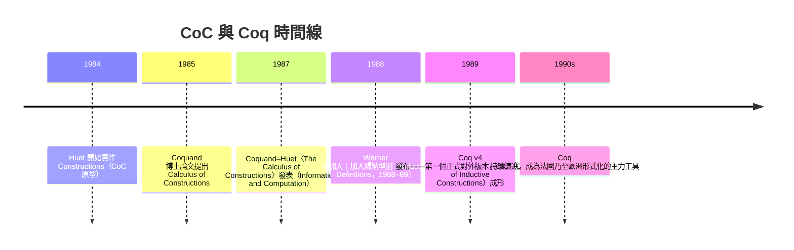

# 2.3 Coq 與 Curry–Howard 對應

## 本節目標

- 理解 1984–1989 年 Coquand 與 Huet 的 **Calculus of Constructions（CoC）** 理論，以及 Coq 系統的誕生時間線。
- 完整掌握 **Curry–Howard 對應**：命題↔型別、證明↔項、蘊含↔函數型別、歸納↔歸納型別——這是貫穿本書的理論主軸。
- 認識依值乘積 $\Pi$ 與依值和 $\Sigma$ 如何把全稱與存在量化納入型別系統。
- 對比同年代的兩大陣營：依值型別系（Coq）與簡單型別 HOL（Isabelle），理解「自動化 vs 表達力」的路線之爭。

## 歷史背景：從 AUTOMATH 到 CoC 的二十年的醞釀

1970 年代 AUTOMATH 證明了依值型別可行（見 2.1 節），但理論上仍嫌粗糙。1980 年前後，幾條線索匯流：

- **Per Martin-Löf** 的直覺式型別理論（MLTT，1972/1979/1984 幾版），把 Curry–Howard 提升為哲學綱領：「命題即集合，證明即元素」。
- **Jean-Yves Girard** 的 System F（1972）與強正規化證明，提供了高階 polymorphism 的理論工具。
- Huet 的 **Constructions** 實作（1984–85，法國 INRIA Rocquencourt），由學生 **Thierry Coquand** 的博士工作（1985）奠定理論。

Coquand 的 **Calculus of Constructions** 是一個優雅的合體：取 Girard System F 的 polymorphism、AUTOMATH 的依值型別、MLTT 的歸納思想，統一在一個純粹的 lambda 演算裡。**命題、型別、項不再分屬三個世界，全部是同一個語言裡的項**。

## Curry–Howard 對應：邏輯與計算是同一件事

Curry 在 1934 年、Howard 在 1969/1980 年觀察到一個驚人的同構：**構造性邏輯的證明與程式是同一個數學物件**。完整對照表：

| 邏輯 | 型別理論 / 程式 | 例子 |
|---|---|---|
| 命題 $P$ | 型別 $P$ | `p : P` |
| 證明 $p$ of $P$ | 項 `p : P` | 一個程式其型別是該命題 |
| 蘊含 $P \to Q$ | 函數型別 `P → Q` | 接受證明回傳證明的函數 |
| 合取 $P \wedge Q$ | 乘積型別 `P × Q` | 配對 `(p, q)` |
| 析取 $P \vee Q$ | 和型別 `P ⊕ Q` | 標註哪一邊的 injection |
| 真 $\top$ | 單元型別 `Unit` | 唯一元素 |
| 假 $\bot$ | 空型別 `Empty` | 無元素 |
| 否定 $\neg P$ | `P → Empty` | 「由 $P$ 得矛盾」的函數 |
| 全稱 $\forall x{:}A, P(x)$ | 依值乘積 `(x : A) → P x` | 見下 |
| 存在 $\exists x{:}A, P(x)$ | 依值和 `Σ x : A, P x` | 見下 |
| 歸納定義 | 歸納型別（如 `Nat`） | 見下 |
| 消去歸納（case/induction） | 遞迴子 / 消除子（`Nat.rec`） | fold 即歸納 |
| 規約（β 化） | 程式執行 | `plus_zero` 展開 |

三個對應特別值得展開：

### 蘊含即函數

「若 $P$ 則 $Q$」的證明，**就是**一個把 $P$ 的證明轉成 $Q$ 的證明的函數：

```lean
-- 肯定前件：給 p : P 與 f : P → Q，得 q : Q
def modus_ponens (P Q : Prop) (f : P → Q) (p : P) : Q := f p
```

證明項 `fun p => f p` 既是數學證明，也是可執行程式——因為 **β 規約就是求值**。

### 全稱量化即依值乘積

「對所有 $x : A$，$P(x)$」的證明是一個函數：吃掉任意 $x$，吐出 $P\ x$ 的證明。它的型別 $(x : A) \to P\ x$ 與普通函數型別的唯一差別是：**回傳型別依賴輸入值**。這正是 2.1 節 AUTOMATH 的 $\text{nat} \to \text{prop}$ 的嚴格化。

```lean
-- 對所有 n，n + 0 = n
theorem add_zero (n : ℕ) : n + 0 = n := rfl
-- add_zero 的型別 (n : ℕ) → n + 0 = n 就是一個依值乘積
```

### 歸納即歸納型別

數學歸納法不是系統的「內建公理」，而是**型別的性質**：定義 `Nat` 為歸納型別後，「歸納原理」`Nat.rec` 自動隨型別生成——它是這個型別的消除規則：

```lean
inductive Nat where
  | zero : Nat
  | succ : Nat → Nat

-- 歸納原理：給定 P : Nat → Prop，
--   P zero 成立 且 對所有 n，P n → P (n+1)，則對所有 n，P n 成立
-- 這正是 Nat.rec 的型別
```

對這個表格，請把它當成**雙語字典**：之後每一章讀到 Lean 程式碼，都應能譯回邏輯句子，反之亦然。

## Coq 的誕生時間線



名稱趣聞：Coq 取自 Coquand 的姓氏縮寫，也順便致敬法國數學傳統（Bourbaki 精神）與法語雙關「coq」（公雞）。1989 年的 **Coq v4** 是關鍵節點：它加入了**歸納型別與歸納原理的自動生成**，補上了 CoC 原始理論的缺口，形成今日所稱的 **CIC（Calculus of Inductive Constructions）**——也就是 Lean 型別系統的直系理論。

Coq 的架構本身則是 LCF 式（見 2.2 節）：OCaml 寫的核心檢查器把守 `thm`（在 Coq 中是 `Prop` 的證明項），外圍是 tactic 層（`intros`、`apply`、`induction`、`omega`…）。

## 路線對比：CIC 陣營 vs HOL 陣營

1980 年代末期，ITP 世界分裂成兩個陣營：

| | Coq（1989，CIC） | Isabelle（1986，HOL 實例 1989 前後） |
|---|---|---|
| 核心邏輯 | 依值型別（CIC），命題即型別 | 簡單型別 HOL，命題與型別分離 |
| 證明表示 | 證明項一等公民，可被程式操作 | tactic 執行完常丟棄證明，只留定理 |
| 表達力 | 可陳述「對所有程式 $p$，$p$ 滿足 $\phi$」這種高階依值語句 | 陳述需借助集合論式編碼，較迂迴 |
| 自動化 | 當時較弱，需人工引導 | 繼承 LCF 的 tactic 傳統 + 強 rewrite 自動化 |
| 源頭 | AUTOMATH + Girard + MLTT | Edinburgh LCF + HOL |
| 標誌成果 | 四色定理（2005）、C 编譯器 CompCert | Flyspeck 的部分參與、seL4 微核心驗證 |

路線差異的哲學根源：HOL 陣營相信「**邏輯基礎夠用就好，把工程力氣花在自動化**」；CIC 陣營相信「**型別即邏輯的極簡統一，表達力優先，自動化可以慢慢補**」。四十年後的 Lean 4 + Mathlib 是一次有趣的合流：以 CIC 為核心（表達力），同時發展出 ITP 界最強的 tactic 生態之一（自動化）——魚與熊掌兼得，這也是 Lean 能後來居上的結構性原因之一。

## 小結與練習

本節建立了本書的理論地基：Curry–Howard 對應讓「證明」與「程式」成為同一物件的兩個名字；依值乘積與依值和把全稱與存在量化變成型別；歸納法變成歸納型別的消除規則。Coq（1984–1989）把這套理論變成可用的系統，並與 Isabelle/HOL 形成兩大陣營對峙。理解了這個地基，第 3 章之後的每一行 Lean 程式碼都將是這個字典的活用。

**練習**

1. 把以下邏輯敘述寫成 Lean 型別（並嘗試證明其一）：(a) $P \to (Q \to P)$；(b) $(P \to Q) \to (Q \to R) \to P \to R$。
2. Curry–Howard 對應下，$\neg\neg P$ 的型別 `¬¬P = P → Empty → Empty` 是什麼形狀的函數？為何從這個函數構造 `P` 的證明在構造性邏輯中做不到（雙重否定消去失效）？
3. 解釋為什麼 `Nat.rec` 的型別恰好就是數學歸納法。寫出 `P : ℕ → Prop` 時 `Nat.rec` 需要哪些參數。
4. 比較 Coq 的 `Prop` 依值乘積與 Isabelle/HOL 中以集合論表示「$\forall$」的差異，說明依值型別在陳述複雜數學（如「所有 $C^\infty$ 流形上的向量叢」）時的優勢。
