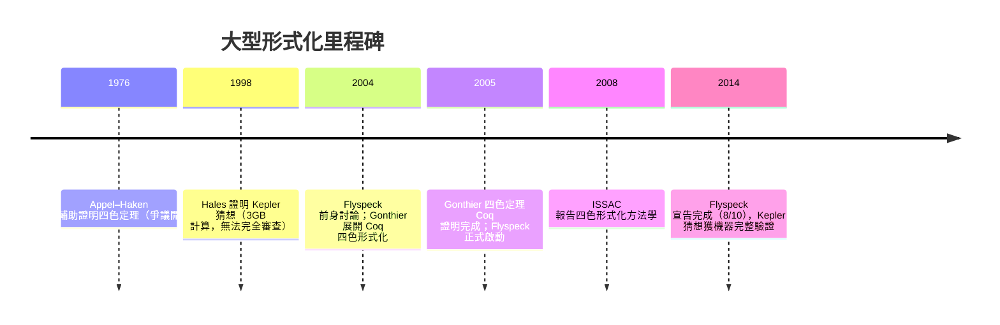

# 2.4 四色定理與大型形式化里程碑

## 本節目標

- 回顧 1976 年 Appel–Haken 的四色定理電腦輔助證明，及其引發的「電腦說了算嗎」哲學爭議。
- 詳述 2004–2005 年 Georges Gonthier 以 Coq 完成四色定理完整形式化的經過（含 2008 年 ISSAC 論文的總結）。
- 認識 2005 年啟動的 Flyspeck 計畫：Hales 對自己 1998 年 Kepler 猜想證明的「自我形式化」，2014 年完成。
- 收束主線：這些里程碑證明了機器檢查的證明可行，但也暴露了 Coq/Isabelle 時代的使用門檻——為 Lean 的誕生鋪路。

## 前因：1976 年的爭議證明

四色定理（1852 年 Guthrie 提出）：任何平面地圖只需四種顏色，即可使相鄰區域不同色。它是四色理論纏鬥一百二十四年後才被解決的難題，而解答的方式掀起了一場持續至今的方法論地震。

**Kempe 1879** 的「證明」風光了十一年後被 Heawood 拆穿——四色問題由此染上「簡潔優雅證明不存在」的疑雲。1976 年，伊利諾大學的 **Kenneth Appel 與 Wolfgang Haken**給出答案：他們把問題化約為檢查 **1,936 個「不可避免組態」**，每個組態的「可約性」需大量電腦計算驗證，總計約 1,200 小時的機器時間、超過 400 頁的微縮膠片輸出。

證明發表了（《Illinois Journal of Mathematics》1977），卻伴隨史無前例的不安：

1. **無法人工複查**：沒有人——包括作者——讀過完整證明。數學共同體千年來的「我讀懂了，所以我相信」模式首次失效。
2. **程式正確性存疑**：檢查程式有無 bug？1980 年代後續研究發現原證明有若干瑕疵（Appel–Haken 自己也承認），雖經修補不影響結論，但加深了疑慮。
3. **哲學衝擊**：哲學家 Tymoczko 1979 年撰文宣稱四色定理是「第一個依賴實驗的數學定理」，數學的認識論基礎被動搖。

Appel 本人的無奈是經典註腳：他說自己因此獲得了「除了這個證明，其他證明都不可信」的名聲。數學界普遍接受定理為真，但「這算不算一個證明」的問題懸而未決——**答案要等到機器能檢查一切的那一天**。

## 轉折：Gonthier 的 Coq 形式化（2004–2005）

微軟研究院的 **Georges Gonthier** 決定正面回應爭議：不用「再跑一次電腦檢查」，而是**把證明本身——包括那 1,936 個組態的可約性——全部形式化成 Coq 的證明項**，讓 Coq 的可信核心（見 2.2 節）逐項型別檢查。

計畫的技術亮點：

1. **從頭重構**：Gonthier 與 Werner 基於 Robertson–Sanders–Seymour–Thomas 1996 年的簡化版證明（633 個組態），而非重跑 Appel–Haken。
2. **數學結構優先**：大量使用 Coq 的模組與泛型（functor），把「有限圖」「平面嵌入」等抽象結構做成可重用元件——這些元件後來成為 Coq 數學函式庫的重要基礎。
3. **反射式計算**：可約性檢查不是「呼叫外部程式後相信結果」，而是**在 Coq 內部以證明程式（reflection）執行**：寫一個 OCaml 風格的演算法、並在 Coq 中證明該演算法的正確性，再由 Coq 的計算引擎跑出結果。電腦計算因此**被證明包裹**，而非被信任包裹。
4. **規模**：約 6 萬行 Coq 程式碼、數千個引理。2005 年 9 月，Coq 核心檢查完畢：**整個證明收斂為一個型別檢查通過的項**。總結性論文〈A Computer-Checked Proof of the Four Colour Theorem〉2005 年發布，方法學總結於 **2008 年 ISSAC** 的〈Computer-checked proofs of formal objects in geometry and combinatorics〉及相關報告。

意義是雙重的：

- **對數學**：四色定理第一次擁有了「可被完全機器複查」的證明。1976 年的認識論懸案正式有了答案——電腦可以說了算，**只要它的計算被一個可信核心檢查過**。
- **對 ITP**：這是 Coq 的成人禮。一個「大到沒人讀得完」的證明，第一次以證明項的形式完整存在。

## Flyspeck：Hales 的自我救贖（2005–2014）

幾乎同時，另一場更大的風暴在醞釀。1998 年，**Thomas Hales**（Pittsburgh 大學）宣稱證明了 **Kepler 猜想**（1611 年提出）：三維空間中最密堆積是面心立方堆積，密度

$$
\pi / \sqrt{18} \approx 0.74048
$$

Hales 的證明（與 Ferguson 合作）比四色更極端：數百頁數學 + 約 **3 GB 的電腦計算資料**。Annals of Mathematics 的審稿人「99% 確定」正確，卻明說無法完全驗證——編輯部罕見地接受了這個附帶保留意見的證明（2005 年刊出）。

Hales 的反應成為科學史佳話：他不等別人來質疑，**自己發起形式化計畫**——**Flyspeck**（名字雙關：F**ly** + **SPECK**，即「消滅 proof 的 speck/瑕疵」）。2005 年啟動，目標：

- 以 Isabelle/HOL 與 HOL Light 為主力（HOL 陣營），部分元件用 Coq 與 Glucoq。
- 把證明的**每一部分**——組合引理、線性規劃界限、非線性不等式——全部形式化。
- 採用**開源協作**模式：全球數十位貢獻者分頭認領引理（這個「把定理拆包發包」的模式，正是日後 Mathlib 社群協作的雛形）。

2014 年 8 月，Flyspeck 團隊宣布完成（正式論文 2017 年刊出）：Kepler 猜想成為當時**被形式化的最複雜數學定理**。Hales 的結論發人深省：形式化過程沒有推翻原證明，但揭露了**大量原稿中的跳步、記號歧義與隱含假設**——人類審稿制度與機器檢查的差距，比想像中大得多。

## 後果：可行性已證明，門檻成為瓶頸

到 2014 年前後，「機器檢查的證明」已完成三級跳的驗證：

1. **1977**（van Benthem Jutting）：一本教科書可行。
2. **2005**（Gonthier）：一個超級定理可行。
3. **2014**（Flyspeck）：一個大型多作者分散式專案可行。

但代價同樣明顯——**使用門檻**：

- Gonthier 的四色形式化是頂尖專家數年之功；Coq 的 tactic 系統、模組系統、證明管理（`Section`、`Module`、coercion、notation）學習曲線陡峭，文件碎片化。
- Flyspeck 拆成 HOL Light 與 Isabelle 兩個系統並行，元件間互通艱難；「缺乏統一的、不斷成長的數學函式庫」是公認痛點。
- 數學主力社群與 ITP 社群幾乎不重疊：多數數學家既不會 OCaml/ML 式思考，也沒有動機投入數月學習。

於是歷史的下一幕已呼之欲出：**需要一個學習曲線平緩、函式庫統一龐大、架構仍是 LCF 式可信核心、同時具備強自動化與現代工程能力（如原生編譯、與程式設計無縫整合）的系統**。2013 年，Leo de Moura 在 Microsoft Research 啟動 Lean，第一版就繼承了 CIC 核心（Coq 路線）與 LCF 架構（Edinburgh 路線）；2017 年社群的 mathlib 統一函式庫、2023 年 Lean 4 自舉與工具鏈成熟、以及 2020 年代 AI 與 Lean 的結合，正是對 2.4 這節所有未竟問題的回答——這些是第 3 章的主角。

## 小結與練習

四色定理與 Kepler 猜想的爭議，把「證明的可信度」問題從哲學辯論變成工程問題；Gonthier（Coq）與 Flyspeck（Isabelle/HOL）用兩種路線證明了機器檢查大型證明完全可行，同時暴露了 Coq/Isabelle 時代的可用性瓶頸。可行性已定、門檻待破——這正是 Lean 誕生的歷史縫隙。前因（AUTOMATH → LCF → CoC/Coq）與後果（Lean → Mathlib → AI 數學），在本節完成了交接。

**練習**

1. 「reflection」策略如何讓電腦計算被證明包裹？用一句話比較「呼叫外部數值程式」與「在核心內計算」的可信度差異。
2. Appel–Haken（1976）與 Gonthier（2005）的證明都依賴電腦，為何後者被視為「無爭議」？列出關鍵的技術與社會性差異。
3. Flyspeck 為何選 HOL 陣營而非 Coq？從 Hales 團隊的背景與「證明項是否需要保存」兩個角度討論（對照 2.3 節的陣營對比表）。
4. 依本節的「門檻問題」清單，設計你心目中理想 ITP 的五個特性，並在讀完第 3 章後回來檢查 Lean 各中了幾項。
