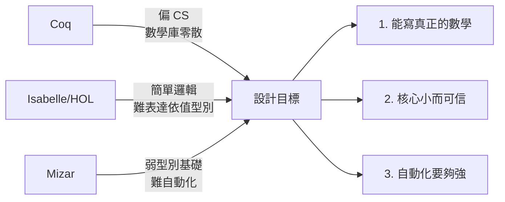
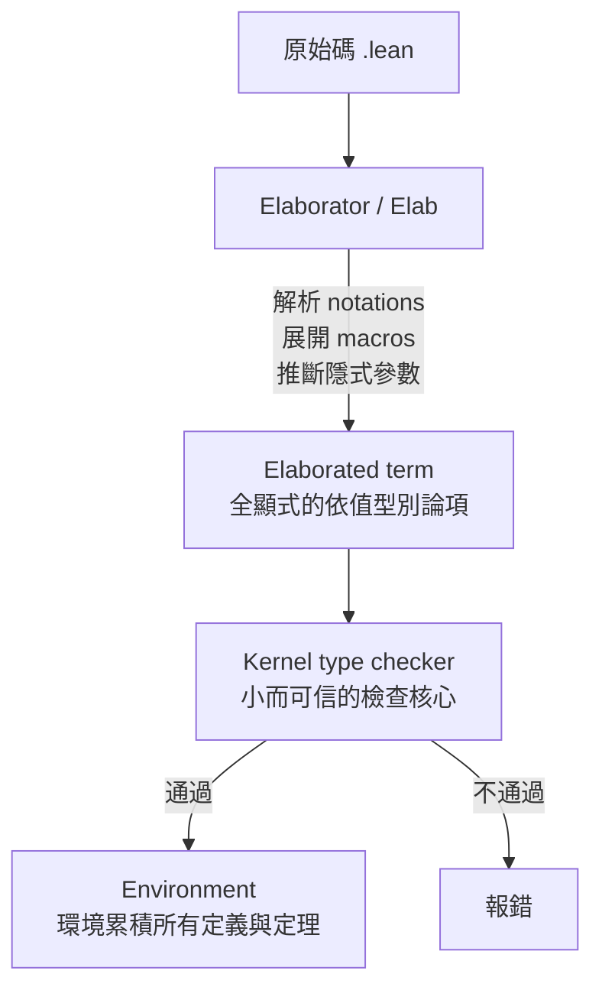

# 3.1 Leonardo de Moura 與 Lean 的誕生

## 本節目標

- 認識 Leonardo de Moura 的技術履歷：從 Z3 SMT 求解器到 Lean 的設計脈絡
- 理解 2013 年 Lean 專案在微軟 Redmond 啟動時的設計目標
- 掌握 elaborator（Elab）在 Lean 架構中的核心角色
- 梳理 Lean 從微軟研究院到 AWS/CMU 的遷移史，以及 Sebastian Ullrich 的維護者角色

## 一位「求解器的人」決定自己寫一個證明助手

要在理解 Lean 之前先理解它的作者。**Leonardo Mendonça de Moura** 是巴西裔計算機科學家，在自動化推理（automated reasoning）領域浸淫了二十多年。他最著名的成就是與 Nikolaj Bjørner 共同開發的 **Z3**——當今世界上最重要的 SMT（Satisfiability Modulo Theories）求解器。

de Moura 的職業軌跡大致如下：

| 時期 | 單位 | 關鍵工作 |
|------|------|----------|
| 2001 年博士 | 巴西 UFRJ / 法國 INRIA | 高階邏輯與自動化推理 |
| 2000 年代 | 微軟研究院 Redmond | Z3 SMT 求解器 |
| 2013 年 | 微軟研究院 Redmond | 開始 Lean 專案 |
| 2017 年前後 | 微軟 → Amazon | Amazon Alexa / 自動化驗證 |
| 2020 年之後 | AWS / 卡內基美隆大學（CMU） | Lean 4 與正式化數學 |

Z3 的設計哲學深刻影響了 Lean。Z3 的核心信念是：**強大的預設策略（他律，heuristic）配上高效率的 C++ 實作，才能讓自動化推理真正被工程界使用**。Z3 被用在 Windows 驅動程式驗證、程式語言研究、密碼學協議分析等無數場合，也在 2015 年成為開源軟體獎（ACM SIGPLAN）的得主工具。

但 SMT 求解器處理的是一階邏輯的可滿足性問題——它**找到答案，但不「證明」答案**。de Moura 在多年與 Coq、Isabelle 使用者的合作中意識到一個缺口：互動式定理證明器（interactive theorem prover, ITP）的世界裡，缺少一個「既有真正的數學能力、又像 SMT 求解器一樣快」的系統。

## 為什麼不是 Coq？設計目標的三個決斷

Lean 在 2013 年於微軟 Redmond 啟動時，de Moura 對既有的證明助手做了一番診斷：



三個決斷值得逐一展開：

**決斷一：擁抱依值型別論（而不是 HOL）。** Isabelle/HOL 建立在簡單型別論上，表達「對所有群 $`G`$ ，存在恆等元素」這類量化「型別」的命題時要繞道集合論。Coq 與 Lean 都選了依值型別論（dependent type theory），讓命題與資料共用同一套語言。這是第 3.2 節的主題。

**決斷二：數學優先於程式驗證。** Coq 的使用者社群以程式語言理論與形式驗證為主（CompCert 編譯器、Fiat Crypto 都是 Coq 的傑作），對「把實分析、代數幾何搬進電腦」這件事熱情有限。Lean 從設計第一天就以**正經數學（serious mathematics）**為第一目標——de Moura 說過，他想要一個能夠形式化同倫型別論、乃至菲爾茲獎級工作的系統。

**決斷三：效能與自動化是公民權利，不是附加品。** Coq 的核心以 OCaml 寫成， tactic 引擎效率有限；Isabelle 的自動化（Sledgehammer）靠外部求解器。Lean 則把高效能當成核心需求：核心用 C++ 寫、elaborator 支援重寫策略、決策程序可以嵌入型別檢查器。這一點讓 Lean 後來成為 AI 訓練資料的寵兒。

## Elaborator：Lean 架構的心臟

Lean 的架構分三層，理解這三層是理解後續所有章節的前提：



Elaborator 不是單純的語法糖展開器。它要做的事情包括：

- **符號與記法**：使用者可以自訂 infix、prefix 記法，elaborator 要在解析階段處理
- **隱式參數推斷**：`List α` 中的 `α` 通常不用寫，elaborator 用 unification 推出來
- **type class 解析**：`Add a`、`BEq a` 這些 instance 是在 elaboration 時搜尋到的
- **tactic 執行**：`by` 區塊裡的 tactic 就是一段 Lean 程式，在 elaboration 期執行、產生 proof term

一個簡單的例子：

```lean
theorem add_comm_alt (n m : Nat) : n + m = m + n := by
  induction n with
  | zero => simp [Nat.zero_add, Nat.add_zero]
  | succ n ih => simp [Nat.succ_add, Nat.add_succ, ih]
```

這段程式碼在 `by` 之後的部分是** tactics**，它們被 elaborator 當作程式執行，最終產生一個純項（pure term）交給 kernel 檢查。這個「tactic 是 elaborator 裡跑的程式」的設計，是 Lean 4 元程式設計能力的基礎（見 3.4 節）。

## 從微軟到 AWS 與 CMU：一個系統的遷移史

Lean 的治理結構經歷了三次轉移，這在開源基礎軟體裡相當少見：

1. **2013–2016（微軟研究院）**：Lean 1 與 Lean 2 開發期。Lean 2 支援 Homotopy Type Theory（HoTT），但為了簡化核心，Lean 3 捨棄了內建 HoTT。
2. **2017（Lean 3 釋出）**：與德國亚琛 /后来的 Karlsruhe 的 Sebastian Ullrich 合作，重寫了 elaborator。此時 Lean 仍主要由微軟資助，但社群（mathlib）已經開始獨立成長。
3. **2017–2020（微軟 → Amazon）**：de Moura 離開微軟研究院加入 Amazon（先 Alexa、後 AWS），Lean 的開發轉由 de Moura 與 Ullrich 主導，成為真正的社群專案。Lean 4 幾乎全部的開發都在這段期間完成。
4. **2020 之後（AWS / CMU）**：de Moura 在 AWS 持續以部分工時投入 Lean 開發（AWS 對形式化驗證有興趣），同時加入 CMU 擔任兼職教授。Lean 與 mathlib 的主要開發動能轉向開源社群。

**Sebastian Ullrich** 的角色在此必須特別強調。他是 Lean 3 與 Lean 4 elaborator 的共同設計者，Lean 4 的 `macro` / `Elab` 框架很大程度是他與 de Moura 共同的產物；他長期擔任主分支維護者，並在 Karlsruhe 理工學院（KIT）以 Lean 為博士論文主題。如果說 de Moura 是 Lean 的「靈魂」，Ullrich 就是把這個靈魂變成可維護軟體的人。Lean 4 的論文（2021 年出版的 *Counting Immutable Beans*）就是 Ullrich 寫的——講的正是 Lean 4 的記憶體管理如何靠引用計數達到接近手寫 C++ 的效能。

## 為什麼這段歷史重要

理解 Lean 的誕生，能解釋它的幾個「氣質」：

- **快**：因為 Z3 的基因，Lean 對效能有近乎偏執的要求，kernel 檢查一個 proof term 是毫秒級的
- **元程式設計友善**：因為 elaborator 就是 Lean 程式，使用者可以「客製化自己的證明語言」
- **社群驅動**：因為離開了微軟的羽翼，mathlib 變成一個獨立的、由數百位貢獻者推動的專案
- **AI 友善**：因為輕量、快、輸出是純文字的 proof term，Lean 成為 DeepMind 等團隊的首選（見 3.4 節結尾）

## 小結與練習

**本節重點**：

1. Leonardo de Moura 是 Z3 SMT 求解器的主要作者，2013 年在微軟 Redmond 開始 Lean 專案
2. Lean 的三個設計目標：能寫真正的數學、核心小而可信、自動化夠強
3. Elaborator 是 Lean 的心臟：負責記法、隱式參數、type class、tactic 執行
4. Lean 的治理經歷微軟 → Amazon → AWS/CMU 的遷移，Sebastian Ullrich 是長期主分支維護者

**練習**：

1. 查閱 Z3 的 GitHub 頁面，比較它與 Lean kernel 的程式碼規模（提示：Z3 大約 30 萬行 C++，Lean 4 kernel 只有數千行）
2. 安裝 Lean 4（`elan`），寫下你的第一個 `#eval "hello, lean"`，確認開發環境可用
3. 閱讀 de Moura 與 Ullrich 的論文 *The Lean Theorem Prover*（2015）的前兩節，標出與本節對應的設計目標
4. 思考題：如果 Lean 當初留在微軟內部、沒有獨立治理，你認為 mathlib 的發展會有何不同？
