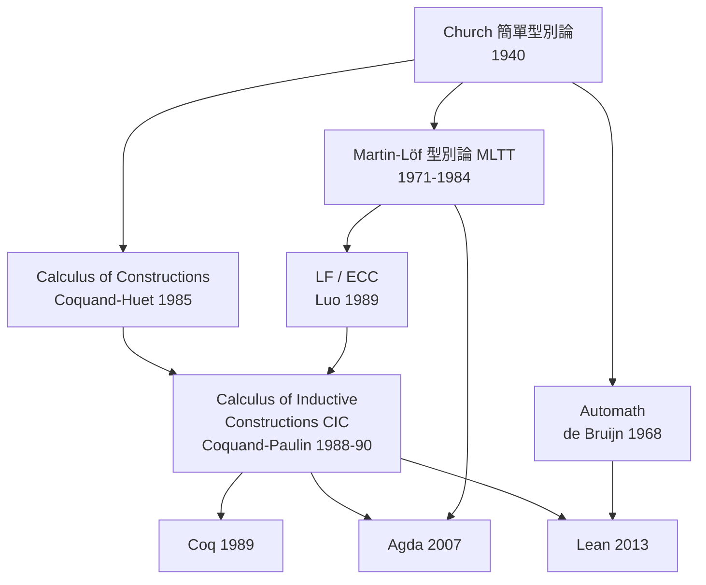
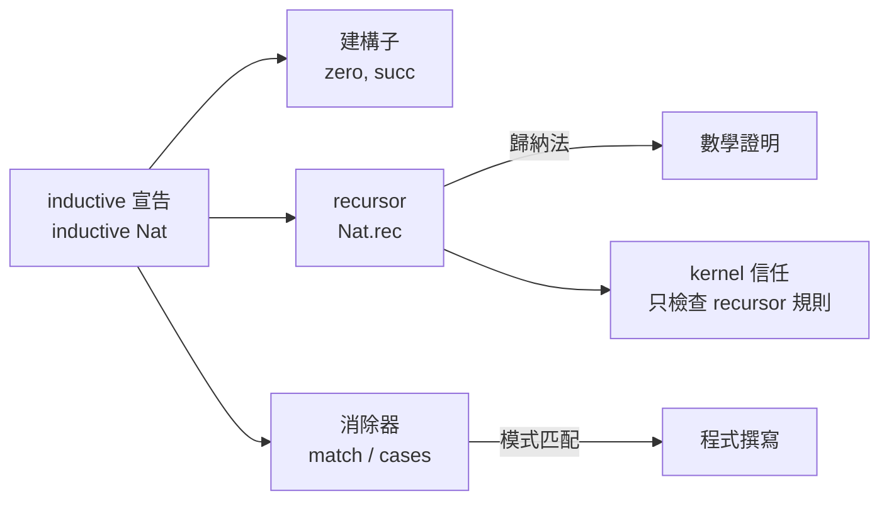

# 3.2 依值型別論與 CIC：Lean 的邏輯地基

## 本節目標

- 梳理型別論從簡單型別論到 Martin-Löf 型別論、再到 CIC 的演進史
- 理解 Lean 的 universe 層級：`Type u` 與 impredicative 的 `Prop`
- 掌握 $`\Pi`$ 型別（依值函數）與 $`\Sigma`$ 型別（依值配對）的語意
- 理解 Lean 的歸納型別宣告與 recursor 機制

## 型別論的百年脈絡

型別論不是 Lean 的發明，甚至不是 Coq 的發明。它的根源可以追溯到 Russell 為解決羅素悖論而提出的型別理論（1908），而現代意義上的型別論則從 Church 的 $`\lambda`$ 演算（1940）開始。我們只需要抓住三個里程碑：

**里程碑一：簡單型別論（simple type theory，1940）。** Church 的 $`\lambda`$ 演算配上簡單型別：每個項都有一個型別，函數 $`\mathbb{N} \to \mathbb{N}`$ 吃自然數吐自然數。這套系統「邏輯與數學分離」——命題不是型別，證明也不是項。Isabelle/HOL 與 HOL Light 至今仍立足於此。

**里程碑二：依值型別論（dependent type theory，1971–1984）。** Per Martin-Löf 在 1971 年提出了第一版直覺主義型別論，此後反覆修正（1972、1979、1984）。關鍵創新是**依值**：型別可以依賴項。函數的回傳型別可以由輸入值決定——「對所有長度 $`n`$ 的向量，回傳一個長度 $`n`$ 的向量」這種規格終於可以寫進型別。

**里程碑三：CIC（1989–今天）。** Zhaohui Luo 在 1989 年提出 LF（Logical Framework）與 ECC（Extended Calculus of Constructions）；Coquand 與 Huet 的 Calculus of Constructions（CoC，1985）加上 Coquand 與 Paulin-Mohring 的歸納型別擴充，成為 **Calculus of Inductive Constructions（CIC）**——Coq 的基礎，也是 Lean 的基礎。



值得注意的是，Coquand-Huet 的 CoC 與 Martin-Löf 的 MLTT 是兩條平行發展的線：CoC 源自 Curry–Howard 對應與 Girard 的 System F（1971），MLTT 源自直覺主義數學哲學。CIC 把兩者合流，Lean 繼承的正是這個合流後的傳統。

## $`\Pi`$ 型別：依值函數

依值型別論的第一個核心構造是 ** $`\Pi`$ 型別**（dependent function type）。在 Lean 中，它的語法就是 `(x : α) → β x`：

```lean
-- 非依值函數：β 不依賴 x
def double (n : Nat) : Nat := n + n
-- 型別：Nat → Nat

-- 依值函數：回傳型別依賴 x 的值
def vecType (n : Nat) : Type := List Nat  -- 簡化示例
-- 型別：(n : Nat) → Type
-- 這個函數「吃一個數 n，吐一個型別」——型別成了運算的結果
```

`Type` 本身可以當成值傳遞，這就是**型別層級**存在的理由。如果允許 `Type : Type`，Girard 悖論（1969）會讓系統不一致——可以推出 `False`。Lean 的解法是 **universe 層級**：

```lean
-- Lean 的 universe 層級（簡化）
-- Sort 0 = Prop, Sort 1 = Type 0 (即 Type), Sort 2 = Type 1, ...
-- 規則：Sort u 中所有型別的型別是 Sort (u+1)

def Nat : Type := ...        -- Type 0
def List (α : Type) : Type   -- Type 0（因為 α 是 Type 0）
-- Type : Type 1
```

Lean 實際上支援 universe polymorphism（`Type u` 中 `u` 是層級變數），這讓定義可以跨層重用：

```lean
-- identity 對所有層級的型別都可用
def id' {α : Sort u} (x : α) : α := x

#check @id'           -- id' : {α : Sort u} → α → α
#check @id' Nat       -- 層級 u 被實例化為 1
#check @id' Type      -- 層級 u 被實例化為 2
```

## $`\Sigma`$ 型別：依值配對

與 $`\Pi`$ 對偶的是 ** $`\Sigma`$ 型別**（dependent pair type）：第二個成分的型別依賴第一個成分的值。

```lean
-- 存在一個自然數 n，使得 P n 成立 —— 作為「資料」來理解
-- Sigma 是依值配對：第二個成分的型別由第一個成分決定

structure Point (α : Type) where
  x : α
  y : α

-- 但真正的 Sigma 是：
-- { n : Nat // n < 5 }  -- subtype，第二成分是證明
-- (n : Nat) ×' (List Nat) 的依值版本：
-- Σ n : Nat, Vec α n -- 「某長度 n 的向量」，n 與向量綁在一起
```

$`\Pi`$ 與 $`\Sigma`$ 的對偶，正是邏輯中全稱量詞與存在量詞的對偶（下一節的 Curry–Howard 會讓這件事精確化）：

| 型別論構造 | 邏輯解讀 | 資料解讀 |
|-----------|---------|---------|
| $`\Pi_{x:A} B(x)`$ | 對所有 $`x`$ ， $`B(x)`$ 成立 | 依值函數 |
| $`\Sigma_{x:A} B(x)`$ | 存在 $`x`$ ， $`B(x)`$ 成立 | 依值配對 |
| `A + B` | $`A \lor B`$ | 和型別 |
| `A × B` | $`A \land B`$ | 積型別 |
| `Empty` | `False` | 空型別 |
| `Unit` | `True` | 單位型別 |

## Prop：impredicative 的命題宇宙

Lean 在 universe 層級上做了一個與 Coq 略為不同的選擇：**`Prop`（即 `Sort 0`）是 impredicative 的**。

「impredicative」的意思是：定義一個命題時，可以量化**整個 Prop 宇宙**，包括還沒定義好的命題自己。例如：

```lean
-- impredicative 的例子：對所有命題 P 的量化
def And_def : Prop := ∀ (P Q : Prop), P → Q → P ∧ Q  --（示意）

-- 更經典的例子：
def True' : Prop := ∀ (P : Prop), P → P
def False' : Prop := ∀ (P : Prop), P   -- 對所有 P，P 都成立 —— 這就是 False！
```

`False'` 的定義裡量化了所有的 `P : Prop`——**包含 `False'` 自己**。這種「自我指涉的量化」在 `Type` 層級會導致 Girard 悖論，但在 `Prop` 層級是安全的，因為 `Prop` 有兩個特殊性質：

1. **proof irrelevance**：任何兩個同型別的證明都相等（見 3.3 節）
2. **elimination 限制**：`Prop` 中的資料不能直接「取出」到 `Type` 層級（除非是 subsingleton elimination）

Coq 也有 impredicative 的 `Prop`，但 Lean 的 `Type` 層級預設是不累積的（non-cumulative，後來版本加了彈性），而 Coq 的 `Type` 是累積的。這個差異在實務上影響的是 unification 與 elaborator 的行為，對使用者來說最重要的記憶點是：**在 Lean 裡，命題與資料是兩個宇宙，命題宇宙允許 impredicative 量化**。

## 歸納型別與 recursor：CIC 的「I」

CIC 的 "I" 是 Inductive——歸納型別。Lean 中所有具體資料型別（除了少數 kernel 內建的）都是用 `inductive` 宣告的：

```lean
inductive Nat where
  | zero : Nat
  | succ : Nat → Nat

inductive List (α : Type u) where
  | nil  : List α
  | cons : α → List α → List α
```

這個宣告做了三件事：

1. **定義型別** `Nat` 及其建構子 `zero`、`succ`
2. **自動生成 recursor**：`Nat.rec`，這是「歸納原理」的型別論形式
3. **自動生成消除器**：模式匹配 `match`、迭代器等都是 recursor 的語法糖

`Nat.rec` 的型別（稍微簡化）是：

```lean
#check @Nat.rec
-- Nat.rec : {motive : Nat → Sort u}
--   → motive zero
--   → ((n : Nat) → motive n → motive n.succ)
--   → (t : Nat) → motive t
```

用白話讀：要對**任意自然數 $`n`$ ** 證明/構造 `motive n`，只要提供

- `n = 0` 的情況（基礎步）
- 「若 $`n`$ 成立則 $`n+1`$ 成立」的函數（歸納步）

就能得到「對所有 $`n`$ ，`motive n` 成立」。這就是**數學歸納法的型別論化身**——它不是一條「公理」，而是由歸納型別的 recursor **自動生成**的。這是 CIC 的深刻之處：邏輯規則（歸納原理）變成了資料結構（歸納型別）的**伴隨產物**。



## 為什麼 Lean 選 CIC 而不是 MLTT？

Martin-Löf 型別論純正、哲學上優雅，但**沒有內建的 impredicative 命題宇宙**，表達「存在一個證明，使得……」這類高階邏輯命題時很笨拙。CIC 加上了 impredicative `Prop` 與歸納型別，讓：

- 數學中大量的量化命題（如「存在無窮多質數」）可以用一個小的證明項表達
- 證明可以與資料分開管理（proof irrelevance 讓 kernel 不必關心證明的具體形狀）
- 歸納型別與遞迴函數有一套統一的、kernel 可檢查的機制

代價是邏輯變得「不純正」：impredicative `Prop` 配上選擇公理，就超出純直覺主義的範圍。但 Lean 的態度是務實的——**目標是正經數學，數學家本來就用選擇公理**（見 3.3 節的三大公理）。

## 小結與練習

**本節重點**：

1. 型別論演進：Church 簡單型別論 → Martin-Löf MLTT → CoC → CIC，Lean 繼承 CIC 傳統
2. $`\Pi`$ 型別是依值函數， $`\Sigma`$ 型別是依值配對，對應全稱與存在量詞
3. Lean 的 universe 層級 `Sort u`：`Prop = Sort 0`，`Type = Sort 1`，避免 Girard 悖論
4. `Prop` 是 impredicative 的，可以量化整個命題宇宙
5. 歸納型別宣告自動生成 recursor，數學歸納法由此而來，不需要額外公理

**練習**：

1. 在 Lean 中宣告 `inductive Bool`，用 `#check @Bool.rec` 觀察 recursor 型別，寫出它的白話解讀
2. 寫一個依值函數 `def decideEven : (n : Nat) → Bool`（或用 `Nat.beven`），說明它為什麼不是依值的；再構造一個真正依值的例子
3. 用 `#check` 檢查 `@Exists`，確認它的型別是依值的：`(α : Sort u) → (α → Prop) → Prop`，並解釋這個型別為什麼**必須**在 `Prop` 層級
4. 思考題：如果 `Type : Type` 是允許的，構造 Girard 悖論需要哪些步驟？為什麼 impredicative `Prop` 不會有同樣的問題？
