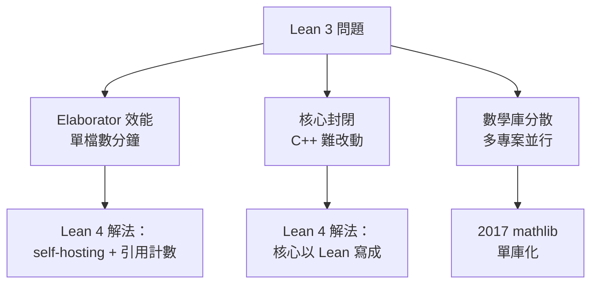

# 3.4 Lean 3 到 Lean 4 的重生

## 本節目標

- 理解 Lean 3 的架構性問題：elaborator 效能、C++ 核心的封閉性、數學庫分散
- 梳理 2017 年 mathlib 單庫化的來龍去脈
- 掌握 Lean 4 的核心變革：self-hosting、`macro`/`Elab` 元程式設計、效能提升
- 理解 2023 年 Lean 4.0 正式釋出與 mathlib 遷移的意義，以及為何 AI 計畫選擇 Lean

## Lean 3：成功的甜，與架構的痛

2017 年釋出的 Lean 3 是一個重要的里程碑：它有了穩定的 elaborator（Ullrich 重寫的）、有了第一個真正可用的數學庫，也吸引了一批認真的數學家。但隨著 mathlib 成長，三個架構性問題浮上檯面：

**問題一：Elaborator 效能瓶頸。** Lean 3 的 elaborator 用 C++ 寫，內部狀態管理複雜，且大量使用 OCaml/C++ 混合的資料結構。隨著 mathlib 變大，**單檔案的 elaboration 時間以分鐘計**，CI 循環長到開發者難以忍受。更糟的是 elaborator 的記憶體行為（大量小物件、頻繁配置）讓 C++ 的垃圾回收策略力不從心。

**問題二：核心難以改動。** Lean 3 的 kernel 與 elaborator 緊耦合在 C++ 程式碼庫裡，任何改動都要動 C++，而社群中真正能安全改 kernel 的人只有一兩個。使用者想要的新功能（自訂 tactic 框架、新的 elaboration 行為）只能等待核心團隊，或繞道受限的 API。

**問題三：數學庫分散。** Lean 3 時代存在多個並行的數學庫：`mathlib` 之前有 `ho_tt`、`algebra`、`analysis` 等多個專案，版本互相依賴、命名衝突頻傳。這是社群層面的教訓，不是語言的問題——但解決方式（2017 年合併成單一 `mathlib`）深刻影響了 Lean 的未來。



## 2017：mathlib 單庫化

2017 年，社群做了一個影響深遠的決定：**把所有數學相關程式碼合併到單一 `mathlib` 專案**，統一命名空間（全部掛在根命名空間下）、統一風格指南、統一 CI。這個決定仿效 Haskell 的 Stackage 與 Rust 的 `crates.io`，但走得更極端——**一個版本、一個倉庫**。

好處立現：

- **相依性地獄消失**：沒有版本衝突，因為只有一個版本
- **重構敢做**：改名、重新分類都可以全域進行
- **品質門檻統一**：所有 PR 走同一套審核流程

代價是 mathlib 變成一個龐大單體（如今超過一百五十萬行 Lean），CI 需要特殊的快取與二進位Artifact 機制。但歷史證明這個選擇是對的——mathlib 成為當今最大的單一正式化數學庫，也是 Lean 生態的護城河。

## Lean 4：以 Lean 寫 Lean

Lean 4 的開發（2017–2023，de Moura 與 Ullrich 主導）圍繞一個核心理念：**系統本身用系統自己的語言寫**（self-hosting）。Lean 4 的 elaborator、tactic 框架、甚至大部分的標準庫，都是 Lean 程式碼。

這帶來幾個革命性後果：

**後果一：kernel 仍然小而可信（C/C++），但其他一切可擴充。** Lean 4 的信任核心（kernel type checker）維持在數千行 C 與 C++，這是必須由專家維護的「根基」。但 elaborator、tactic、notation 全部搬到 Lean 層——**使用者第一次可以用 Lean 的語言改變 Lean 的行為**。

**後果二：`macro` 與 `Elab` 元程式設計。** Lean 4 把「寫新的語法與新的 tactic」變成普通程式設計：

```lean
-- 定義新記法
syntax "trivial" : tactic

-- 實作這個 tactic（一段在 elaboration 期執行的 Lean 程式）
macro_rules
  | `(tactic| trivial) => `(tactic| assumption)

-- 更進一步，Elab 指令可以直接操作語法樹
elab "my_nat" : tactic =>
  Lean.Elab.Tactic.liftMetaFinishingCtx fun g => do
    -- 這裡寫的是純 Lean 程式，操作目標（goal）
    g.applyConst `Nat.zero_le
```

傳統的證明助手把 tactic 引擎視為「核心程式的一部分」，Lean 4 把它變成**函式庫**。這是 Lean 4 最深遠的改變：使用者可以為自己的領域（密碼學、機率論、程式驗證）量身打造證明語言，而不需要動核心。

**後果三：效能。** Lean 4 用引用計數（reference counting）管理記憶體，配合精心設計的不可變資料結構。Ullrich 的論文 *Counting Immutable Beans* 詳細記錄了這套設計。結果是：

| 專案 | Lean 3 | Lean 4 |
|------|--------|--------|
| elaboration 速度 | 慢（分鐘級） | 快 10 倍以上 |
| 執行速度（Lean 寫的程式） | 不實用 | 接近手寫 C++ |
| 記憶體用量 | 高 | 顯著降低 |

Lean 4 的直譯器快到可以**真的當通用程式語言用**——mathlib 本身就是最大的受益者：編譯整個庫的時間從 Lean 3 的數小時縮短到可互動開發的節奏。

## 2023：Lean 4.0 正式釋出與 mathlib 遷移

Lean 4 經過多年的 alpha/beta（版本號一路到 4.0.0-m 系列），在 **2023 年 9 月正式釋出 Lean 4.0.0**。同年 mathlib 完成了從 Lean 3 到 Lean 4 的全面遷移——這是一場涉及一百多萬行程式碼、數百位貢獻者、將近一年的集體工程。

遷移的完成點有重要意義：

1. **生態定於一尊**：Lean 3 停止維護，所有新開發都在 Lean 4 上
2. **工具鏈成熟**：Language Server Protocol 支援、VS Code 外掛、`elan`/`lake` 建置系統（Rust 的 `rustup`/`cargo` 模式）
3. **與 Rust 的相似性**：Lean 4 的 `lake` 之於 Lean，就像 `cargo` 之於 Rust——同一種「工具鏈即生態」的哲學

未來方向上，Lean 核心團隊持續朝「更 Rust 化」演進：更精細的所有權與借用分析、更少的隱式拷貝、更好的 FFI。Lean 4 的記憶體模型本來就借鑑 Rust（不可變為預設、明確的所有權轉移），兩者的設計哲學有明顯的親緣關係。

## 為什麼 AI 計畫選擇 Lean

2020 年代 AI 數學推理的浪潮中，Lean 成為首選的證明語言：

- **DeepMind 的 AlphaProof**（2024）以 Lean 為介面，在 IMO 層級題目上達到銀牌水準
- **Harmonic AI、Math Inc.、OpenAI 的內部實驗**等團隊，多以 Lean 作為驗證後端
- 社群工具如 **LeanDojo**、**Peano**、**Pantograph** 提供了程式化操作 Lean 的介面

Lean 勝出的技術理由：

1. **輕量與快**：kernel 檢查毫秒級，整個系統可以嵌入 AI agent 的回饋循環。一個錯誤的 tactic 在幾百毫秒內回報，RL 訓練的吞吐量取決於這個延遲
2. **單一數學庫**：mathlib 的單庫化讓 AI 模型面對的是**一個**一致的前置知識庫，而不是 Coq 生態的多版本碎片
3. **資料友好**：Lean 的證明是純文字的 proof term + tactic 腳本，易於 token 化、易於訓練、易於驗證（`#print axioms` 的血統檢驗在資料清洗時直接可用）
4. **kernel 即裁判**：AI 生成的證明**由 kernel 機械驗證**，不存在「看起來對但邏輯有洞」的灰色地帶。這是 RLHF 無法提供的絕對回饋訊號

一句話總結：**Lean 把「數學真理」變成了一個可以程式化呼叫的 API，而這正是 AI 訓練迴圈最需要的介面。**

## 小結與練習

**本節重點**：

1. Lean 3 的三大問題：elaborator 效能、C++ 核心封閉、數學庫分散
2. 2017 年 mathlib 單庫化，用「一個倉庫一個版本」解決相依性問題
3. Lean 4 的核心變革：kernel 小而可信、其餘以 Lean 自身寫成（self-hosting）、`macro`/`Elab` 元程式設計
4. 2023 年 Lean 4.0 正式釋出，mathlib 遷移完成，生態定於一尊
5. AI 計畫選 Lean：快、單庫、資料友好、kernel 即絕對裁判

**練習**：

1. 用 `lake new myproject` 建立一個 Lean 4 專案，觀察 `lakefile.lean` 與 `lean-toolchain`，對比 Rust 的 `Cargo.toml` 與 `rust-toolchain`
2. 寫一個自訂 syntax + macro_rules，讓 `by trivial` 能解決你的特定模式（提示：先 `open Lean.Elab.Tactic`）
3. 在 GitHub 上找 mathlib 的 `CONTRIBUTING.md`，列出它的審核流程與本節提到的「統一門檻」如何對應
4. 思考題：如果 mathlib 當初沒有單庫化、而是走向 NPM 式的分散生態，AI 訓練資料的建構會遇到哪些額外問題？
