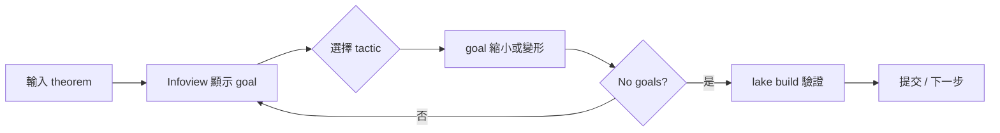

# 4.1 Lean 4 環境建置與第一個定理

## 本節目標

- 安裝 Lean 4 工具鏈（`elan`、`lake`）
- 建立 mathlib 專案，理解專案結構與 `lakefile`
- 設定 VS Code + lean4 擴充套件，學會閱讀 Infoview（goal state）
- 寫下第一個定理 `example : 1 + 1 = 2 := rfl`
- 學會 `#check`、`#eval`，以及如何閱讀錯誤訊息

## 工具鏈：elan、lake、mathlib

Lean 生態的工具鏈設計與 Rust 高度相似：

| Lean 4 | Rust 對應 | 說明 |
|--------|-----------|------|
| `elan` | `rustup` | 版本管理器，管理多個 Lean 版本 |
| `lean` | `rustc` | 編譯器 / 核心檢查器 |
| `lake` | `cargo` | 建構工具 + 套件管理 |
| `mathlib` | `crates.io` | 標準數學函式庫（社群維護） |

```bash
# 安裝 elan（Lean 的版本管理器，相當於 rustup）
curl https://elan.lean-lang.org/elan-init.sh -sSf | sh

# 檢查安裝
elan --version
lake --version
```

`elan` 會依照專案內 `lean-toolchain` 檔案自動切換 Lean 版本 —— 就像 `rust-toolchain.toml` 之於 Cargo。

## 建立專案

```bash
# 建立一個使用 mathlib 的專案（第一次會下載並編譯，可能要數十分鐘）
lake new myproj
cd myproj

# 取得 mathlib 依賴
lake exe cache get   # 下載預編譯快取（強烈建議，可省去自行編譯 mathlib）
lake build
```

> 若不是用 mathlib，可先用 `lake init myproj` 建立純 Lean 專案，本書一律使用 mathlib。

## 專案結構

```text
myproj/
├── lakefile.toml        # 建構設定（相當於 Cargo.toml）
├── lean-toolchain       # 指定 Lean 版本，如 leanprover/lean4:v4.15.0
├── manifest.json        # 依賴鎖定（相當於 Cargo.lock）
├── .github/             # CI 設定
└── Myproj/
    └── Basic.lean       # 原始碼根模組
```

`lakefile.toml` 的內容大致如下：

```toml
name = "myproj"
version = "0.1.0"
defaultTargets = ["Myproj"]

[[require]]
name = "mathlib"
scope = "leanprover-community"

[[lean_lib]]
name = "Myproj"
```

常用 lake 命令：

```bash
lake build              # 編譯（相當於 cargo build）
lake env lean Myproj/Basic.lean   # 單檔檢查（快速迭代）
lake run myproj         # 執行自訂腳本 target
```

## VS Code 與 Infoview

1. 安裝 VS Code 擴充套件：搜尋並安裝 **lean4**（leanprover.lean4）。
2. 用 VS Code 開啟專案資料夾（`code .`）。
3. 打開任一 `.lean` 檔案，右下角出現「Lean: ...」後按 **Restart Server**（若需）。
4. 游標停在證明中的任一行，右側 **Infoview** 會顯示當下的 **goal state**（目標狀態）。

Infoview 是 Lean 開發的核心體驗：它即時顯示「此刻必須證明什麼」與「目前有哪些假設」。像除錯器一樣，你可以把游標移到 tactic 之間，逐步觀察 goal state 的演變。

## 第一個定理

在 `Myproj/Basic.lean` 輸入：

```lean
import Mathlib.Tactic

-- `example` 是匿名的定理：型別為 `1 + 1 = 2` 的項
example : 1 + 1 = 2 := rfl
```

`rfl`（reflexivity）表示「由定義即相等」。`1 + 1` 與 `2` 在 Peano 數的定義下確實是同一個項，所以核心檢查器不假思索地接受。

### `theorem`、`#check`、`#eval`

```lean
-- 具名定理，之後可以被引用
theorem onePlusOne : 1 + 1 = 2 := rfl

-- #check 顯示項的型別（像 Rust 中看 signature）
#check onePlusOne      -- onePlusOne : 1 + 1 = 2
#check Nat.add_comm    -- Nat.add_comm (n k : ℕ) : n + k = k + n
#check fun (n : ℕ) => n + 1   -- fun n => n + 1 : ℕ → ℕ

-- #eval 執行純運算（相當於 Rust 的 println! 除錯）
#eval 2 ^ 10           -- 1024
#eval "hello".length   -- 5
```

注意三者的差別：

- `example` / `theorem`：**證明**，產出的項型別是 `Prop`（命題）。
- `#check`：查詢型別，只影響編譯器輸出，不產生程式碼。
- `#eval`：**執行程式碼**，適用於可計算的資料，不能用於證明。

`theorem` 與 `example` 的差別只在是否給名字；給了名字才能在別處引用。

```lean
-- 引用已證明的定理
theorem alsoTwo : 2 = 1 + 1 := onePlusOne.symm
```

### 帶前提的定理

```lean
-- ∀ 表示全稱量化：對所有自然數 n
theorem addZero (n : ℕ) : n + 0 = n := Nat.add_zero n

-- 函數型別的自然數加法交換律（mathlib 已有，此為示意）
theorem addComm (n m : ℕ) : n + m = m + n := Nat.add_comm n m
```

`(n : ℕ)` 這種寫法中，n 既是定理的「參數」，也可視為證明中的「假設資源」—— 在 tactic 證明裡會以 `n : ℕ` 出現在 context 中。

## 閱讀錯誤訊息

```lean
example : 1 + 1 = 3 := rfl
```

錯誤：

```text
type mismatch
  rfl
has type
  1 + 1 = 1 : Prop
but is expected to have type
  1 + 1 = 3 : Prop
```

解讀方式：

1. **type mismatch** —— 提供的項與目標型別不符（證明就是型別，見 4.2 節的 Curry–Howard）。
2. 中段給出你實際提供的型別，尾段給出期望的型別 —— 逐字比較兩者的差異。
3. 錯誤發生的行號與字元位置會在編輯器中以下劃線標出。

常見錯誤類型速查：

| 訊息 | 常見原因 |
|------|---------|
| `unknown identifier` | 名字打錯、缺少 `import`、未打開命名空間 |
| `type mismatch` | 證明的項與目標不符 |
| `unsolved goals` | 證明沒寫完（這是提醒，不是失敗）|
| `failed to synthesize ...` | 型別類實例缺失（稍後章節討論）|

## 一個漸進的例子：使用 Infoview 觀察 tactic

```lean
example (n : ℕ) (h : n = 3) : n + 1 = 4 := by
  rw [h]        -- 把 n 重寫成 3；目標變成 3 + 1 = 4
  rfl           -- 由定義得證
```

把游標移到 `rw [h]` 之後，Infoview 顯示：

```text
Goals
⊢ 3 + 1 = 4
```

移到 `rfl` 之後，顯示 `No goals` —— 證明完成。這種「逐步觀察目標被消化」的循環，就是 Lean 互動式證明的日常。

### 證明與程式的同構（預告）

`rfl : 1 + 1 = 2` 這件事在本質上是：

- 命題 `1 + 1 = 2` 就是一個**型別**；
- `rfl` 是這個型別的一個**項**（居住者）；
- 「證明命題」=「構造該型別的項」。

這就是 **Curry–Howard 對應**，下一節我們會用它來統一解釋邏輯連接詞與 tactic。

## 開發工作流



實務建議：把游標放在證明最後一行，先看 `No goals` 出現，再 `lake build` 確認整個專案通過。

## 小結與練習

本節建立完整的 Lean 4 開發環境：`elan` 管理版本、`lake` 管理建構、VS Code Infoview 提供互動式證明體驗。核心心法是：**證明即型別， tactic 即構造**。

練習：

1. 建立一個 mathlib 專案 `logics`，成功執行 `lake build`。
2. 寫出 `example : 2 + 2 = 4 := rfl` 並在 Infoview 中確認無錯誤。
3. 用 `#check` 查詢 `Nat.add_assoc` 與 `Nat.mul_comm` 的型別，並用人類語言描述其內容。
4. 故意寫出 `example : 3 = 3 := rfl` 之外的錯誤證明（例如 `:= Nat.zero_le 0`），練習閱讀 type mismatch 訊息。
5. 執行 `#eval (1 : Nat) + (2 : Nat) * 3`，解釋為什麼是 `7` 而不是 `9`。
