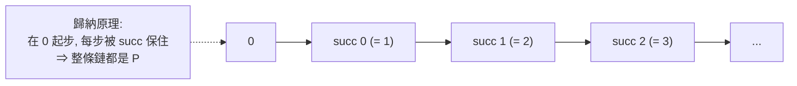
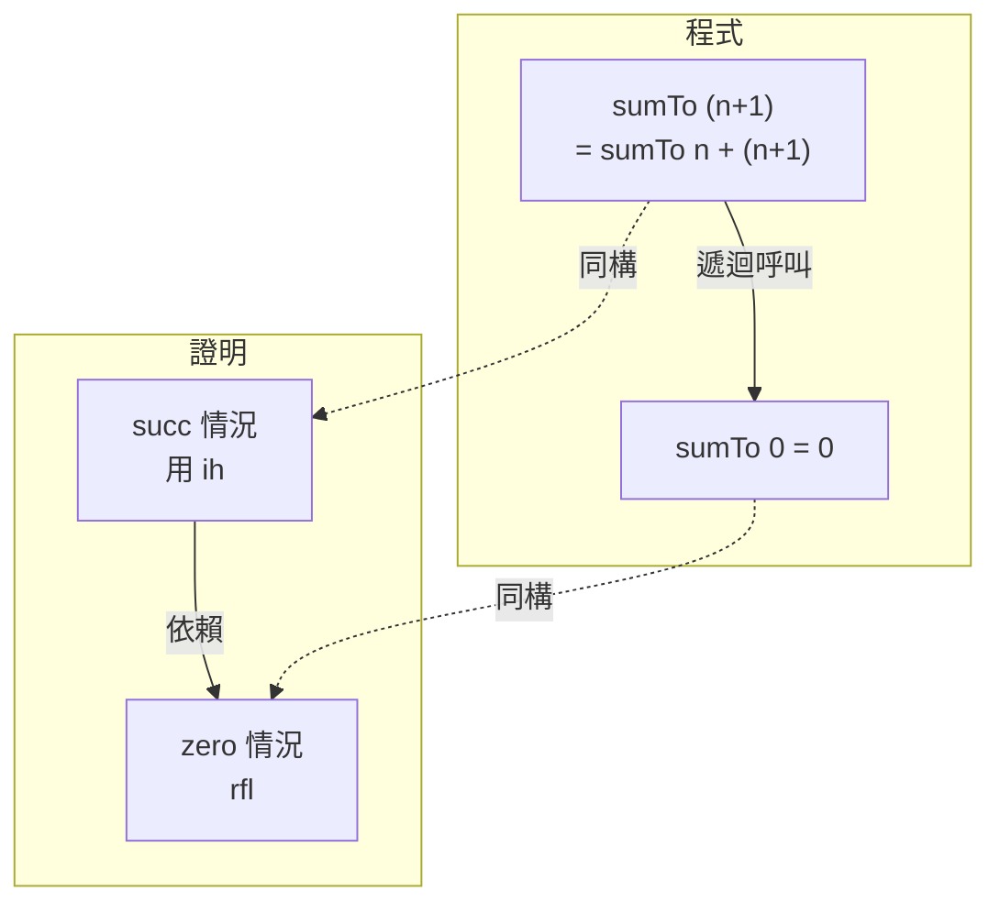

# 4.3 自然數與歸納法

## 本節目標

- 理解 Peano 公理與 Lean 中 `Nat` 的歸納型別定義
- 認識 recursor 與 `induction` tactic 的關係
- 用數學歸納法證明 $\sum_{i=1}^{n} i = \frac{n(n+1)}{2}$
- 使用 `omega` 與 `decide` 處理線性算術與可判定命題
- 對照 Lean 歸納與程式遞迴

## Peano 公理

Giuseppe Peano 於 1889 年形式化自然數：

1. $0$ 是自然數。
2. 每個自然數 $n$ 有後繼 $\mathrm{succ}(n)$。
3. $0$ 不是任何數的後繼。
4. $\mathrm{succ}$ 是單射。
5. **歸納原理**：若 $P(0)$ 且 $P(n) \Rightarrow P(\mathrm{succ}(n))$，則對所有 $n$，$P(n)$。



## Nat 作為歸納型別

在 Lean 中，`Nat` 幾乎逐字就是 Peano 公理：

```lean
-- Lean 中 Nat 的定義（簡化示意）
inductive Nat where
  | zero : Nat
  | succ (n : Nat) : Nat
```

`inductive` 宣告同時生成了：

- 兩個**建構子**：`Nat.zero`、`Nat.succ`（公理 1、2）
- 自動證明的**單射性**與**不相交性**（公理 3、4，如 `Nat.succ.injEq`、`Nat.succ_ne_zero`）
- 一個 **recursor**：`Nat.rec`（公理 5）

## recursor：歸納原理的機械形式

```lean
#check @Nat.rec
-- Nat.rec {motive : Nat → Sort u}
--   (zero : motive Nat.zero)
--   (succ : (n : Nat) → motive n → motive n.succ)
--   (t : Nat) : motive t
```

`Nat.rec` 說：要對任意 `t : Nat` 證明 `motive t`，只需提供

- `zero` 的情況：`motive Nat.zero`
- `succ` 的情況：給定 `motive n`，能構造 `motive (n + 1)`

這正是歸納法：**基底 + 歸納步驟**。`induction` tactic 只是 recursor 的語法糖。

## 歸納法證明：$\sum_{i=1}^{n} i = \frac{n(n+1)}{2}$

先寫成可計算的函數（像寫遞迴程式）：

```lean
import Mathlib.Tactic

def sumTo (n : ℕ) : ℕ :=
  match n with
  | 0 => 0
  | n + 1 => sumTo n + (n + 1)

#eval sumTo 100   -- 5050
```

定理陳述（避開除法，用乘法形式：$2\sum = n(n+1)$）：

```lean
theorem sumTo_correct (n : ℕ) : sumTo n * 2 = n * (n + 1) := by
  induction n with
  | zero => rfl                          -- 基底：0 * 2 = 0 * 1，由定義成立
  | succ k ih =>                          -- 歸納步驟
    rw [sumTo, ih]                       -- 展開定義，代入歸納假設
    ring                                 -- 多項式恆等式交給 ring
```

注意三個要素：

1. `induction n with` 產生兩個子目標（zero、succ），Infoview 會分別顯示。
2. `ih`（induction hypothesis）是自動引入的歸納假設：`sumTo k * 2 = k * (k + 1)`。
3. `ring` 是 mathlib 的交換環自動化 tactic，專門處理 `+`、`*` 的多項式恆等式。

### 歸納的推廣形式

有時歸納假設需要加強。例如 $\sum_{i=1}^{n} i > \frac{n^2}{2}$ 這類不等式，弱假設不夠用時，先證一個**更強**的陳述（稱為 strengthening the induction hypothesis）：

```lean
-- 練習前示範：證明 sumTo n ≥ n，逐步歸納
theorem sumTo_ge (n : ℕ) : sumTo n ≥ n := by
  induction n with
  | zero => rfl
  | succ k ih =>
    rw [sumTo]
    calc sumTo k + (k + 1) ≥ k + (k + 1) := Nat.add_le_add_right ih _
      _ = k + k + 1 := Nat.add_assoc k k 1
      _ ≥ k := by omega
```

## omega：線性算術自動證明

`omega` 專門處理線性整數 / 自然數算術（Presburger 算術的子集）：

```lean
example (n : ℕ) : n + 3 = 3 + n := by omega

example (a b c : ℤ) (h1 : a + 2*b = c) (h2 : a = b) : 3*b = c := by
  omega

example (n : ℕ) (h : n > 0) : n ≥ 1 := by omega
```

`omega` 能消化 context 中的線性假設，瞬間產出證明。**經驗法則：凡線性不等式與等式，先丟給 omega**；`ring` 負責非線性恆等式。

## decide：可判定命題

若命題的型別類有 `Decidable` 實例，`decide` 直接計算答案：

```lean
example : 2 ^ 10 = 1024 := by decide

example (n : ℕ) (h : n < 5) : sumTo n ≤ 10 := by
  decide   -- 失敗！n 是變數，無法枚舉 —— decide 只對封閉的具體命題有效

example : sumTo 4 ≤ 10 := by decide   -- OK：sumTo 4 = 10 可計算
```

`decide` 的本質：把「證明」化為「執行程式」。這是 Curry–Howard 的純粹展現 —— 檢查證明就是跑演算法。

## 歸納與遞迴的對照

Lean 的定義遞迴與證明歸納是同一枚硬幣的兩面：

| 程式世界 | 證明世界 |
|---------|---------|
| `def` 的遞迴定義 | `induction` 的歸納結構 |
| 基底情況 return 值 | 基底情況的證明 |
| 遞迴呼叫自己 | 使用歸納假設 ih |
| 終止性檢查 | 歸納的良基性（well-foundedness）|



呼叫 `sumTo (n+1)` 展開成 `sumTo n + (n+1)`，與 tactic `rw [sumTo]` 做的事完全一樣 —— `rw` 就是「函數展開」。

## 強歸納（strong induction）與其他形式

有時需要「假設所有小於 n 的情況都成立」，即強歸納：

```lean
-- 強歸納由良基遞迴支援；mathlib 提供 induction … using 及相關引理
-- 例如：每個 n ≥ 1 都有前驅（示範結構）
theorem exists_pred (n : ℕ) (h : n > 0) : ∃ m, n = m + 1 := by
  cases n with
  | zero => omega
  | succ k => exact ⟨k, rfl⟩
```

`cases` 是歸納的退化形式：只拆建構子、不引入 ih。遇到「要對前一個情況做假設」的問題，先想清楚 ih 應該長什麼樣，再決定 `induction` 的陳述方式。

## 小結與練習

- `Nat` 是歸納型別，Peano 公理由 `inductive` 宣告自動獲得。
- `Nat.rec` 是歸納原理的機械形式，`induction` tactic 是其語法糖。
- `omega` 管線性算術、`ring` 管多項式恆等式、`decide` 管可計算的封閉命題。

練習：

1. 定義 `def fact : ℕ → ℕ`（0 → 1，n+1 → fact n * (n+1)），並證明 `fact 5 = 120`（用 `decide` 或 `rfl`）。
2. 證明：`sumTo (n + 1) = sumTo n + n + 1`（其實就是定義展開）。
3. 用歸納法證明 $\sum_{i=1}^{n} i^2 = \frac{n(n+1)(2n+1)}{6}$（提示：定義 `sumSq`，用乘法形式 $6\sum = n(n+1)(2n+1)$，靠 `ring` 收尾）。
4. 證明：對所有 `n : ℕ`，`n < n + 1`（可用 `Nat.lt_succ_self` 或 omega）。
5. 解釋為什麼 `example (n : ℕ) : n + n = 2 * n := by decide` 會失敗，但 `by omega` 會成功。
