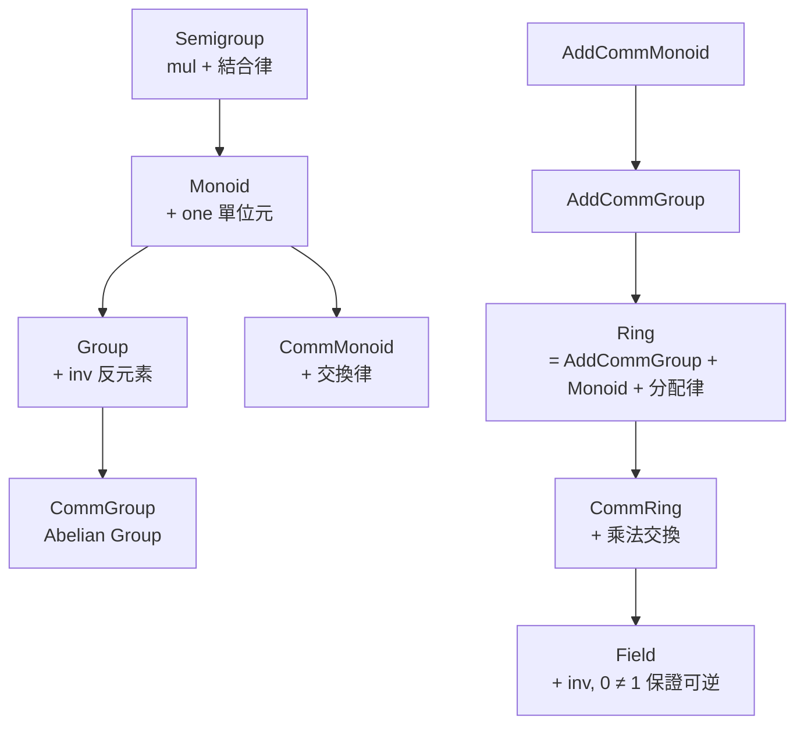

# 5.2 代數結構層級與 typeclass

## 本節目標

- 理解 Lean 的 typeclass 機制與 instance resolution 的運作原理
- 以 `class Group (G : Type)` 為例，學會定義與使用代數結構
- 掌握 Semigroup → Monoid → Group → Ring → Field 的繼承層級
- 認識 diamond 問題，以及 Mathlib 用 `FunLike` / `Hom` 類別給出的解法
- 體會為什麼這套架構讓「泛型數學」成為可能：一個定理，所有 field 適用

## Typeclass：以推理而非繼承取得性質

Lean 的 typeclass 機制源自 Haskell，但在依值型別語言中被推到極致。核心思想：

- `class` 是一種特殊的 structure，用來描述「某型別具備某種結構」
- `instance` 是具體的證據（evidence），宣告某型別滿足某 class
- 使用 `simp`、`ring` 等 tactic，或泛型函式時，Lean 透過 **instance resolution**（實例推理）自動搜尋所需的證據

與物件導向的繼承不同，typeclass 是**編譯期自動證明搜尋**：編譯器替你找出「ℤ 是一個 CommRing」這件事的證據。

## 第一個範例：`class Group`

```lean
-- 群：一個型別配上一個二元運算，滿足結合律、單位元、反元素
class Group (G : Type) where
  mul : G → G → G
  mul_assoc : ∀ a b c : G, mul (mul a b) c = mul a (mul b c)
  one : G
  one_mul : ∀ a : G, mul one a = a
  mul_one : ∀ a : G, mul a one = a
  inv : G → G
  inv_mul_cancel_left : ∀ a : G, mul (inv a) a = one
```

關鍵細節：運算與公理**都放在同一個 class 裡**——一個 `Group G` 的 instance 同時給出資料（`mul`、`one`、`inv`）與性質（`mul_assoc` 等證明）。在依值型別的世界裡，「證明也是資料」，這樣打包非常自然。寫一個泛型定理：

```lean
theorem inv_inv {G : Type} [Group G] (a : G) :
    Group.inv (Group.inv a) = a := by
  rw [← Group.one_mul (Group.inv (Group.inv a)),
    ← Group.mul_inv_cancel_right a, Group.inv_mul_cancel_left]
  exact (Group.mul_one _).symm
```

注意簽名中的 `[Group G]`：方括號是 **typeclass 約束**，意思是「任何具備 Group 結構的型別 G」。這個證明寫一次，ℤ 的加法群、置换群、矩陣群——全部自動適用。

## 代數結構的層級

Mathlib 的代數部分本質上是一張巨大的繼承圖。核心骨幹如下：



Lean 用 `extends` 表達這種繼承：

```lean
class Semigroup (G : Type) extends Mul G where
  mul_assoc : ∀ a b c : G, a * b * c = a * (b * c)

class Monoid (G : Type) extends Semigroup G where
  one : G
  one_mul : ∀ a : G, one * a = a
  mul_one : ∀ a : G, a * one = a

class Ring (R : Type) extends AddCommGroup R, Monoid R where
  left_distrib : ∀ a b c : R, a * (b + c) = a * b + a * c
  right_distrib : ∀ a b c : R, (a + b) * c = a * c + b * c
```

有了層級，泛型定理的適用範圍自動最大化：```lean
-- 對所有 commutative ring 成立，ℤ、ℚ、ℝ、多項式環全部適用
theorem sq_add_sq {R : Type} [CommRing R] (a b : R) :
    (a + b) * (a + b) = a * a + 2 * a * b + b * b := by
  ring
```

`ring` tactic 能自動完成證明，正是因為它在背後透過 instance resolution 找到所需的代數公理。

## Diamond 問題

多重繼承的代價是 **diamond 問題**：同一個事實經由兩條繼承路徑（如 `Ring` 同時繼承 `AddCommGroup` 與 `Monoid`）取得，得到兩個「不同」的 instance，導致證明對不上。

在 Lean 裡 diamond 有輕重之分：

- **可合併的 diamond**：兩條路徑給出的欄位**定義上相同**（definitional equal），Lean 的 defeq 檢查可以直接打通。大多數數學繼承屬於此類
- **真正的 diamond**：兩條路徑給出的結果**命題上相同但證明不同**，或資料真的不同，必須顯式補一條 `instance` 合併引理

Mathlib 為此發展出嚴格的設計守則：每個 class 盡量只包一個概念的核心資料，性質多靠額外 lemma class（如 `MulZeroClass`）分層提供。

## FunLike 與 Hom 類：把「映射保持結構」變成 class

數學中充滿「結構保持映射」：群同態、環同態、線性映射。如果每種都各自定義一個 structure，很快就會重複勞動。Mathlib 的解法是**泛型函式應用類**：

```lean
-- 泛型：凡是可以「像函式一樣套用」的東西都屬於 FunLike
class FunLike (F : Type) (α : outParam Type) (β : outParam Type) where
  coe : F → α → β

-- 群同態：具備 FunLike 行為的 F，且映射保持乘法
structure MulHom (G H : Type) [Mul G] [Mul H] where
  toFun : G → H
  map_mul' : ∀ a b : G, toFun (a * b) = toFun a * toFun b

instance : FunLike (MulHom G H) G H where
  coe f := f.toFun
```

這樣 `f x` 這個書寫形式對同態、同構、線性映射全部通用，而型別系統仍記得 `f` 保持什麼結構。`Hom` 家族（`MulHom`、`RingHom`、`LinearMap`……）共用 `FunLike` 的統一介面，是 Mathlib 泛化能力的重要支柱。

## `to_additive`：一寫兩得

數學中「乘法結構」與「加法結構」總是成對出現：群與加法群、乘法 monoid 與加法 monoid。重複寫兩遍違反 DRY。Mathlib 的 `to_additive` attribute 讓你**只寫乘法版本，自動生成加法版本**：

```lean
@[to_additive "指數律的加法版本：n • a + n • b = n • (a + b)"]
theorem mul_pow_of_mul_of_pow {M : Type} [CommMonoid M] (a b : M) (n : ℕ) :
    (a * b) ^ n = a ^ n * b ^ n := by
  induction n with
  | zero => simp
  | succ k ih => rw [pow_succ, pow_succ, ih, mul_assoc, mul_comm b (a ^ k), ← mul_assoc]
```

這個 attribute 會掃描證明本體、把 `mul` 換成 `add`、`one` 換成 `zero`、`^` 換成 `•`，生成命名與文檔齊全的加法版定理。這是 Mathlib 用自動化對抗重複的代表性武器。

## 為什麼這個架構讓泛型數學可行

回到本節的標題問題：為什麼 Lean + Mathlib 能做到「一個定理，所有 field 適用」？

1. **結構即型別證據**：`[Field F]` 不是註解，而是編譯器可檢查的前提
2. **instance resolution 自動供給**：使用者寫 `ℝ` 的版本時，不需要手動搬運「ℝ 是 field」的證明，編譯器自己找到
3. **層級最大化適用範圍**：定理寫在最弱足夠的結構上（能寫 `CommRing` 就不寫 `Field`），適用面自動擴大
4. **單態化思維**：與 Rust 泛型如出一轍，每個實例都是獨立檢查過的具體命題

一位物理學家可以在實數上工作，一位密碼學家在有限體上工作，兩人用的是**同一條定理**。這就是 Mathlib 單庫策略 + typeclass 架構合起來的威力。

## 小結與練習

本節學會了 typeclass 的三個核心機制：class 定義結構、instance 提供證據、resolution 自動搜尋；Semigroup 到 Field 的層級如何用 `extends` 建構、diamond 問題如何被設計守則與 `FunLike` 緩解，以及 `to_additive` 如何消除乘法/加法的重複。

**練習：**

1. 定義一個 `class Loop`（具有單位元、每個元素有左反元素與右反元素的非結合結構），並為 `ℤ` 的加法寫一個 instance。
2. 寫一個對任意 `[Monoid M]` 成立的定理：`a ^ (m + n) = a ^ m * a ^ n`，用 `induction` 完成。
3. 在 Mathlib 中搜尋 `to_additive` 的實際用法，找一個例子，閱讀其乘法版本與自動生成的加法版本，比對兩者的命名。
